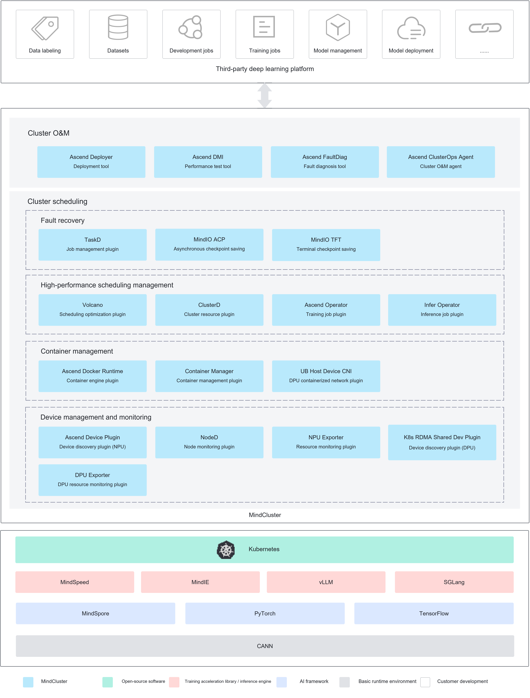

# MindCluster

 

 [![Zread](https://img.shields.io/badge/Zread-Ask_AI-_.svg?style=flat&color=0052D9&labelColor=000000&logo=data%3Aimage%2Fsvg%2Bxml%3Bbase64%2CPHN2ZyB3aWR0aD0iMTYiIGhlaWdodD0iMTYiIHZpZXdCb3g9IjAgMCAxNiAxNiIgZmlsbD0ibm9uZSIgeG1sbnM9Imh0dHA6Ly93d3cudzMub3JnLzIwMDAvc3ZnIj4KPHBhdGggZD0iTTQuOTYxNTYgMS42MDAxSDIuMjQxNTZDMS44ODgxIDEuNjAwMSAxLjYwMTU2IDEuODg2NjQgMS42MDE1NiAyLjI0MDFWNC45NjAxQzEuNjAxNTYgNS4zMTM1NiAxLjg4ODEgNS42MDAxIDIuMjQxNTYgNS42MDAxSDQuOTYxNTZDNS4zMTUwMiA1LjYwMDEgNS42MDE1NiA1LjMxMzU2IDUuNjAxNTYgNC45NjAxVjIuMjQwMUM1LjYwMTU2IDEuODg2NjQgNS4zMTUwMiAxLjYwMDEgNC45NjE1NiAxLjYwMDFaIiBmaWxsPSIjZmZmIi8%2BCjxwYXRoIGQ9Ik00Ljk2MTU2IDEwLjM5OTlIMi4yNDE1NkMxLjg4ODEgMTAuMzk5OSAxLjYwMTU2IDEwLjY4NjQgMS42MDE1NiAxMS4wMzk5VjEzLjc1OTlDMS42MDE1NiAxNC4xMTM0IDEuODg4MSAxNC4zOTk5IDIuMjQxNTYgMTQuMzk5OUg0Ljk2MTU2QzUuMzE1MDIgMTQuMzk5OSA1LjYwMTU2IDE0LjExMzQgNS42MDE1NiAxMy43NTk5VjExLjAzOTlDNS42MDE1NiAxMC42ODY0IDUuMzE1MDIgMTAuMzk5OSA0Ljk2MTU2IDEwLjM5OTlaIiBmaWxsPSIjZmZmIi8%2BCjxwYXRoIGQ9Ik0xMy43NTg0IDEuNjAwMUgxMS4wMzg0QzEwLjY4NSAxLjYwMDEgMTAuMzk4NCAxLjg4NjY0IDEwLjM5ODQgMi4yNDAxVjQuOTYwMUMxMC4zOTg0IDUuMzEzNTYgMTAuNjg1IDUuNjAwMSAxMS4wMzg0IDUuNjAwMUgxMy43NTg0QzE0LjExMTkgNS42MDAxIDE0LjM5ODQgNS4zMTM1NiAxNC4zOTg0IDQuOTYwMVYyLjI0MDFDMTQuMzk4NCAxLjg4NjY0IDE0LjExMTkgMS42MDAxIDEzLjc1ODQgMS42MDAxWiIgZmlsbD0iI2ZmZiIvPgo8cGF0aCBkPSJNNCAxMkwxMiA0TDQgMTJaIiBmaWxsPSIjZmZmIi8%2BCjxwYXRoIGQ9Ik00IDEyTDEyIDQiIHN0cm9rZT0iI2ZmZiIgc3Ryb2tlLXdpZHRoPSIxLjUiIHN0cm9rZS1saW5lY2FwPSJyb3VuZCIvPgo8L3N2Zz4K&logoColor=ffffff)](https://zread.ai/Ascend/mind-cluster)&nbsp;&nbsp;&nbsp;&nbsp;
 [![DeepWiki](https://img.shields.io/badge/DeepWiki-Ask_AI-_.svg?style=flat&color=0052D9&labelColor=000000&logo=)](https://deepwiki.com/Ascend/mind-cluster)

- [News](#news)
- [Introduction](#introduction)
- [Release Notes](#release-notes)
- [Compatibility Information](#compatibility-information)
- [User Guide](#user-guide)
- [Compilation Guide](#compilation-guide)
- [Feature Introduction](#feature-introduction)
- [FAQs](#faqs)
- [Security Statement](#security-statement)
- [Branch Maintenance Policy](#branch-maintenance-policy)
- [Version Maintenance Policy](#version-maintenance-policy)
- [Disclaimer](#disclaimer)
- [License](#license)
- [Contribution Guide](#contribution-guide)
- [Suggestions and Feedback](#suggestions-and-feedback)

# News

- [2026.04.15]: 🚀 Support for fault post-processing policy configuration
- [2026.04.15]: 🚀 Support for soft partitioning of A2\A3 devices
- [2026.04.15]: 🚀 Support for switch affinity during inference
- [2026.04.15]: 🚀 Enhancement of RoCE network fault isolation and recovery
- [2026.04.15]: 🚀 Improved accuracy of manual chip isolation
- [2026.04.15]: 🚀 Support for affinity scheduling within Tiangong networking
- [2026.04.15]: 🚀 Support for automatic de-isolation of isolated chips
- [2026.04.15]: 🚀 Support for statistics on causes of abnormal job scheduling
- [2026.04.15]: 🚀 Support for hard partitioning of A2/A3 devices
- [2026.04.15]: 🚀 NPU Exporter supports custom metrics reporting based on files

# Introduction

MindCluster (AI cluster system software) is a set of deep learning components that support NPU (Ascend AI Processor) training and inference, enabling the construction of full-process cluster operations and providing functions such as NPU cluster job scheduling, O&M monitoring, and fault recovery. By leveraging MindCluster, deep learning platform developers can minimize development efforts related to underlying resource scheduling and rapidly build their platforms.

# Release Notes

For details about MindCluster version compatibility, see [Version Compatibility Details](/docs/en/release_notes.md)

# Compatibility Information

Frameworks supporting basic scheduling and resumable training features of MindCluster: Pytorch, MindSpore.

# User Guide

## MindCluster Cluster Scheduling

Using a single Atlas 800T A2 training server (acting as both the management node and the compute node) as an example, MindCluster guides developers to quickly complete the installation of the NodeD, Ascend Device Plugin, Ascend Docker Runtime, Volcano, ClusterD, and Ascend Operator components, and to quickly launch training jobs using the full-NPUd scheduling feature. For detailed operations, see [Cluster Scheduling User Guide](./docs/en/scheduling/menu_scheduling_user_guide.md).

## MindCluster Ascend FaultDiag

- Ascend FaultDiag

  Ascend FaultDiag (ascend-fd) is a log diagnosis tool designed for Ascend AI clusters, providing two core functions: log parsing and fault diagnosis.

  When a training or inference job exits abnormally or its performance degrades, ascend-fd can automatically extract key information from cluster logs, analyze the root-cause node and fault events, and help users quickly locate the problem. For detailed operations, see [Ascend FaultDiag User Guide](./docs/en/faultdiag/ascend-faultdiag/menu_ascend_faultdiag_user_guide.md).

- Ascend FaultDiag Toolkit

  Ascend FaultDiag Toolkit (ascend-fd-tk) is a link fault diagnosis tool for Ascend AI clusters.

  The tool provides both interactive and non-interactive operation modes, and supports two data processing capabilities: online automatic data collection and offline log parsing. It can collect cluster device information, conduct automated inspection diagnosis, and locate link faults in a cluster through information of servers, L1/L2 UnifiedBus switches, RoCE switches, and BMC. For detailed operations, see [Ascend FaultDiag Toolkit User Guide](./docs/en/faultdiag/ascend-faultdiag-toolkit/menu_ascend-faultdiag-toolkit.md).

# Compilation Guide

For details about component compilation, see [Compilation Guide](build/README.md).

# Feature Introduction

This part describes the specific features of MindCluster.

## MindCluster Cluster Scheduling

| Feature        | Introduction                                                                                                            | Released |
|------------|---------------------------------------------------------------------------------------------------------------|----------|
| Containerization    | [Containerization](./docs/en/scheduling/04_usage/00_containerization/00_before_you_start.md) | ✅ |
| Resource Monitoring     | [Resource Monitoring](./docs/en/scheduling/04_usage/01_resource_monitoring/00_before_you_start.md)                                                                                                 | ✅ |
| Virtual Instance    | [Virtual Instance](./docs/en/scheduling/04_usage/02_virtual_instance/00_virtual_instance_with_hdk/01_description.md)                                                                                                  | ✅ |
| Basic Scheduling     | [Basic Scheduling](./docs/en/scheduling/04_usage/03_basic_scheduling/00_feature_description.md)                                                                                                    | ✅ |
| Resumable Training     |[Resumable Training](./docs/en/scheduling/04_usage/04_resumable_training/00_feature_description.md)                                                                                                  | ✅ |
| Appliance     |[Appliance](./docs/en/scheduling/04_usage/05_appliance/01_npu_hardware_fault_detection_and_rectification.md)                                                                                                  | ✅ |
| Best Practices of MindIE Motor Inference Jobs |[Best Practices of MindIE Motor Inference Jobs](./docs/en/scheduling/04_usage/06_mindie_motor_best_practice/00_before_you_start.md)   | ✅ |
| Best Practices of SGLang Inference Jobs |[Best Practices of SGLang Inference Jobs](./docs/en/scheduling/04_usage/07_sglang_best_practice/00_before_you_start.md)   | ✅ |
| Best Practices of vLLM Inference Jobs |[Best Practices of vLLM Inference Jobs](./docs/en/scheduling/04_usage/08_vllm_best_practice/00_before_you_start.md)   | ✅ |
| Best Practices of Infer Operator Inference Jobs |[Best Practices of Infer Operator Inference Jobs](./docs/en/scheduling/04_usage/09_infer_operator_best_practice/00_before_you_start.md)   | ✅ |
| Best Practices of Tidal Scheduling |[Best Practices of Tidal Scheduling](./docs/en/scheduling/04_usage/10_tidal_scheduling/00_before_you_start.md)   | ✅ |

## MindCluster Ascend FaultDiag

- Ascend FaultDiag

  | Feature                  | Introduction                                                                                                           | Released |
  |---------------------------|----------------------------------------------------------------------------------------------------------------|----------|
  | Log Parsing                  | [Log Parsing](./docs/en/faultdiag/ascend-faultdiag/05_usage/03_log_parsing.md)                                    | ✅        |
  | Fault Diagnosis                  | [Fault Diagnosis](./docs/en/faultdiag/ascend-faultdiag/05_usage/04_fault_diagnosis.md)                                | ✅        |
  | Single-Server Fault Diagnosis              | [Single-Server Fault Diagnosis](./docs/en/faultdiag/ascend-faultdiag/05_usage/05_single_server_diagnosis.md)                    | ✅        |
  | SuperPoD Fault Diagnosis            | [SuperPoD Fault Diagnosis](./docs/en/faultdiag/ascend-faultdiag/05_usage/06_superpod_diagnosis.md)                       | ✅        |
  | Custom Fault Entities            | [Custom Fault Entities](./docs/en/faultdiag/ascend-faultdiag/05_usage/07_custom_fault_entities.md)                    | ✅        |
  | Fault Log Masking              | [Fault Log Masking](./docs/en/faultdiag/ascend-faultdiag/05_usage/08_fault_log_masking.md)                          | ✅        |
  | Custom Configuration File            | [Custom Configuration File](./docs/en/faultdiag/ascend-faultdiag/05_usage/09_custom_configuration.md)                     | ✅        |
  | Service Log Parsing (SDK)       | [Service Log Parsing (SDK)](./docs/en/faultdiag/ascend-faultdiag/05_usage/10_service_flow_parsing.md)                | ✅        |
  | Root Cause Node Parsing and Diagnosis (SDK) | [Root Cause Node Parsing and Diagnosis (SDK)](./docs/en/faultdiag/ascend-faultdiag/05_usage/11_root_cause_parsing_diagnosis.md)  | ✅        |
  | Fault Event Parsing and Diagnosis (SDK) | [Fault Event Parsing and Diagnosis (SDK)](./docs/en/faultdiag/ascend-faultdiag/05_usage/12_fault_event_parsing_diagnosis.md) | ✅        |

- Ascend FaultDiag Toolkit

  | Feature            | Introduction                                                                                                     | Released |
  |---------------------|----------------------------------------------------------------------------------------------------------|----------|
  | Log Collection            | [Log Collection](./docs/en/faultdiag/ascend-faultdiag-toolkit/05_usage/02_log_collection.md)                   | ✅        |
  | Log Parsing            | [Log Parsing](./docs/en/faultdiag/ascend-faultdiag-toolkit/05_usage/03_log_parse.md)                        | ✅        |
  | Fault Diagnosis            | [Fault Diagnosis](./docs/en/faultdiag/ascend-faultdiag-toolkit/05_usage/04_fault_diagnosis.md)                  | ✅        |
  | Fault Inspection            | [Fault Inspection](./docs/en/faultdiag/ascend-faultdiag-toolkit/05_usage/05_fault_inspection.md)                 | ✅        |
  | Diagnostic/Inspection Report Description | [Diagnostic/Inspection Report Description](./docs/en/faultdiag/ascend-faultdiag-toolkit/05_usage/06_fault_analysis_report.md) | ✅        |
  | Online Diagnosis            | [Online Diagnosis](./docs/en/faultdiag/ascend-faultdiag-toolkit/05_usage/07_online_diagnosis.md)                 | ✅        |
  | Offline Diagnosis            | [Offline Diagnosis](./docs/en/faultdiag/ascend-faultdiag-toolkit/05_usage/08_offline_diagnosis.md)                | ✅        |
  | Batch Diagnosis            | [Batch Diagnosis](./docs/en/faultdiag/ascend-faultdiag-toolkit/05_usage/09_batch_diagnosis.md)                  | ✅        |
  | Customized Inspection      | [Customized Inspection](./docs/en/faultdiag/ascend-faultdiag-toolkit/05_usage/10_customized_inspection.md)      | ✅        |

# FAQs

For MindCluster cluster scheduling-related FAQs, see [FAQs](./docs/en/scheduling/07_references/03_faq.md).

For FAQs related to MindCluster Ascend FaultDiag, see [FAQs](./docs/en/faultdiag/ascend-faultdiag/07_references/02_faq.md).

For FAQs related to MindCluster Ascend FaultDiag Toolkit, see [FAQs](./docs/en/faultdiag/ascend-faultdiag-toolkit/07_references/01_faq.md).

# Security Statement

## MindCluster Cluster Scheduling

- Currently, components are deployed in a containerized manner. ServiceAccount is used as an authentication and authorization method, where the ServiceAccount token is displayed in plain text. You are advised to perform your own security hardening measures.
- Currently, components are deployed in a privileged container mode, which poses certain risks. You are advised to perform your own security hardening measures.
- For other security statements, see [Security Statement](./docs/en/scheduling/07_references/04_security_hardening.md)
- For the communication matrix, see [Communication Matrix](https://gitcode.com/Ascend/mind-cluster/wiki/Home.md)
- For public URLs, see [Public URLs](./docs/en/resource/MindCluster%20Cluster%20Scheduling%20Public%20Network%20Addresses.xlsx)

## MindCluster Ascend FaultDiag

- For the security statement, see [Security Statement](./docs/en/faultdiag/ascend-faultdiag/07_references/03_security.md)
- For details about the Public URL, see: [Public URLs](./docs/en/resource/MindCluster%20Ascend%20FaultDiag%20Public%20Network%20Addresses.xlsx)

# Branch Maintenance Policy

The maintenance phases for version branches are as follows:

| Status                  | Duration     | Description                                                                                       |
|-------------------------|--------------|---------------------------------------------------------------------------------------------------|
| Planned                 | 1-3 months   | Feature planning                                                                                  |
| Developing              | 3 months     | Develop new features and fix issues, with regular new version releases                            |
| Maintained              | 3-12 months  | Regular branches are maintained for 3 months, and long-term support branches for 12 months. Critical bugs are fixed, no new features are merged, and patch versions are released based on bug impact. |
| End of Life (EOL)       | N/A          | The branch no longer accepts any modifications.                                                    |

# Version Maintenance Policy

| Version       | Maintenance Policy | Current Status | Release Date       | Future Status               | EOL Date      |
|----------|------|------|------------|--------------------|------------|
| master   | Long-term support | Development   | In-development branch, not released   |         | -          |
| v26.0.0   | Regular branch | Maintenance   | 2026-04-15   |         | 2026-07-15          |
| v7.3.0   | Long-term support | Maintenance   | 2026-01-13   |         | 2026-12-30        |
| v7.2.RC1 | Regular branch | Maintenance   | 2025-10-25 | Expected to enter `unmaintained` status from 2026-01-25 | 2025-10-27 |
| v7.1.RC1 | Regular branch | EOL   | 2025-07-24 |           | 2025-10-24 |
| v7.0.RC1 | Regular branch | EOL   | 2025-04-27 |           | 2025-07-27 |
| v6.0.0   | Long-term support | Maintenance   | 2024-12-31 | Expected to enter `unmaintained` status from 2025-12-31         |            |
| v6.0.RC3 | Regular branch | EOL   | 2024-11-20 |           | 2025-02-20 |
| v6.0.RC2 | Regular branch | EOL   | 2024-11-20 |           | 2025-02-20 |
| v6.0.RC1 | Regular branch | EOL   | 2024-11-20 |          | 2025-02-20 |
| v5.0.0   | Long-term support | EOL  | 2023-11-20 |           | 2024-11-20 |

# Disclaimer

- This repository contains multiple development branches, which may include unfinished, experimental, or untested features. Before official release, these branches should not be used in any production environment or projects that rely on business-critical operations. Please be sure to use our official release versions to ensure code stability and security.
  This project and its contributors shall not be held responsible for any issues, losses, or data corruption resulting from the use of development branches.
- For official versions, please refer to the release versions at <https://gitcode.com/ascend/mind-cluster/releases>.

# License

MindCluster is licensed under the [Apache 2.0](https://gitcode.com/Ascend/mind-cluster/blob/master/LICENSE) license.

The documentation under the `docs` directory is licensed under [CC-BY 4.0](./docs/LICENSE).

# Contribution Guide

- Before contributing, please sign the [Open Project Contributor License Agreement (CLA)](https://clasign.osinfra.cn/sign/gitee_ascend-1611222220829317930).
- If you encounter a bug, please submit an [issue](https://gitcode.com/Ascend/mind-cluster/issues).
- If you plan to contribute bug-fixes, please submit a [PR](https://gitcode.com/Ascend/mind-cluster/blob/branch_v26.1.0/contributing.md#PullRequest).
- If you plan to contribute new features or functions, please create an issue to discuss with us first. In your issue, please describe the background/purpose of the requirement, the design approach, and the impact on existing APIs, etc. Submitting a PR without prior discussion may result in rejection, as the project's evolution direction may differ from your ideas.
- For a more detailed contribution process, please refer to the [Contribution Guide](https://gitcode.com/Ascend/mind-cluster/blob/branch_v26.1.0/contributing.md).

# Suggestions and Feedback

Welcome to contribute to the community. If you have any questions or suggestions, please submit an [issue](https://gitcode.com/Ascend/mind-cluster/issues), and we will respond as soon as possible. Thank you for your support.
