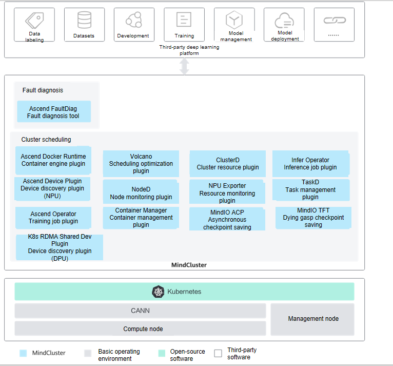

<h1 align="center">MindCluster</h1>

 

 
 
 [![Zread](https://img.shields.io/badge/Zread-Ask_AI-_.svg?style=flat&color=0052D9&labelColor=000000&logo=data%3Aimage%2Fsvg%2Bxml%3Bbase64%2CPHN2ZyB3aWR0aD0iMTYiIGhlaWdodD0iMTYiIHZpZXdCb3g9IjAgMCAxNiAxNiIgZmlsbD0ibm9uZSIgeG1sbnM9Imh0dHA6Ly93d3cudzMub3JnLzIwMDAvc3ZnIj4KPHBhdGggZD0iTTQuOTYxNTYgMS42MDAxSDIuMjQxNTZDMS44ODgxIDEuNjAwMSAxLjYwMTU2IDEuODg2NjQgMS42MDE1NiAyLjI0MDFWNC45NjAxQzEuNjAxNTYgNS4zMTM1NiAxLjg4ODEgNS42MDAxIDIuMjQxNTYgNS42MDAxSDQuOTYxNTZDNS4zMTUwMiA1LjYwMDEgNS42MDE1NiA1LjMxMzU2IDUuNjAxNTYgNC45NjAxVjIuMjQwMUM1LjYwMTU2IDEuODg2NjQgNS4zMTUwMiAxLjYwMDEgNC45NjE1NiAxLjYwMDFaIiBmaWxsPSIjZmZmIi8%2BCjxwYXRoIGQ9Ik00Ljk2MTU2IDEwLjM5OTlIMi4yNDE1NkMxLjg4ODEgMTAuMzk5OSAxLjYwMTU2IDEwLjY4NjQgMS42MDE1NiAxMS4wMzk5VjEzLjc1OTlDMS42MDE1NiAxNC4xMTM0IDEuODg4MSAxNC4zOTk5IDIuMjQxNTYgMTQuMzk5OUg0Ljk2MTU2QzUuMzE1MDIgMTQuMzk5OSA1LjYwMTU2IDE0LjExMzQgNS42MDE1NiAxMy43NTk5VjExLjAzOTlDNS42MDE1NiAxMC42ODY0IDUuMzE1MDIgMTAuMzk5OSA0Ljk2MTU2IDEwLjM5OTlaIiBmaWxsPSIjZmZmIi8%2BCjxwYXRoIGQ9Ik0xMy43NTg0IDEuNjAwMUgxMS4wMzg0QzEwLjY4NSAxLjYwMDEgMTAuMzk4NCAxLjg4NjY0IDEwLjM5ODQgMi4yNDAxVjQuOTYwMUMxMC4zOTg0IDUuMzEzNTYgMTAuNjg1IDUuNjAwMSAxMS4wMzg0IDUuNjAwMUgxMy43NTg0QzE0LjExMTkgNS42MDAxIDE0LjM5ODQgNS4zMTM1NiAxNC4zOTg0IDQuOTYwMVYyLjI0MDFDMTQuMzk4NCAxLjg4NjY0IDE0LjExMTkgMS42MDAxIDEzLjc1ODQgMS42MDAxWiIgZmlsbD0iI2ZmZiIvPgo8cGF0aCBkPSJNNCAxMkwxMiA0TDQgMTJaIiBmaWxsPSIjZmZmIi8%2BCjxwYXRoIGQ9Ik00IDEyTDEyIDQiIHN0cm9rZT0iI2ZmZiIgc3Ryb2tlLXdpZHRoPSIxLjUiIHN0cm9rZS1saW5lY2FwPSJyb3VuZCIvPgo8L3N2Zz4K&logoColor=ffffff)](https://zread.ai/Ascend/mind-cluster)&nbsp;&nbsp;&nbsp;&nbsp;
 [![DeepWiki](https://img.shields.io/badge/DeepWiki-Ask_AI-_.svg?style=flat&color=0052D9&labelColor=000000&logo=)](https://deepwiki.com/Ascend/mind-cluster)

## ✨ Latest News

- [2026.08.01]: 🚀 Improved MindCluster usability
- [2026.08.01]: 🚀 Improved compatibility with the open-source Volcano community
- [2026.08.01]: 🚀 Improved monitoring usability and reliability
- [2026.08.01]: 🚀 Support for DPU device discovery and fault reporting
- [2026.08.01]: 🚀 Support for A5 soft partitioning and A2/A3 dynamic hard partitioning
- [2026.08.01]: 🚀 Support for pluggable DP fault handling
- [2026.08.01]: 🚀 A5 hardware adaptation
- [2026.08.01]: 🚀 Support for elastic scaling of custom resources in inference scenarios
- [2026.08.01]: 🚀 Support for container snapshots to accelerate fault recovery of services

## ℹ️ Introduction

MindCluster (AI cluster system software) is a set of deep learning components that supports NPU (Ascend AI Processor) training and inference hardware, enabling the construction of full-process cluster operations and providing functions such as job scheduling within an NPU cluster, O&M monitoring, and fault recovery. This helps deep learning platform vendors reduce the software development workload related to underlying resource scheduling and quickly enable partners to develop deep learning platforms based on MindCluster. In addition, it provides fault diagnosis tools (also called Ascend FaultDiag), including a log diagnostic tool (abbreviated as ascend-fd) and a link diagnostic tool (abbreviated as ascend-fd-tk), which can provide diagnosis results for problems such as cluster job failures and link faults.

## ⚙️ Feature Description

**Cluster Scheduling**

| Feature Name                       | Introduction                                                         | Released |
| ------------------------------ | ------------------------------------------------------------ | -------- |
| Containerization                 | [Containerization](./docs/en/scheduling/04_usage/00_containerization/00_before_you_start.md) | ✅        |
| Resource Monitoring                   | [Resource Monitoring](./docs/en/scheduling/04_usage/01_resource_monitoring/menu_resource_monitoring.md) | ✅        |
| Virtualization Instance                   | [Virtualization Instance](./docs/en/scheduling/04_usage/02_virtual_instance/00_virtual_instance_with_hdk/01_description.md) | ✅        |
| Basic Scheduling                   | [Basic Scheduling](./docs/en/scheduling/04_usage/03_basic_scheduling/00_feature_description.md) | ✅        |
| Fault Detection                   | [Fault Detection](./docs/en/scheduling/04_usage/04_fault_detection_and_diagnosis/00_feature_description.md) | ✅        |
| Resumable Training                   | [Resumable Training](./docs/en/scheduling/04_usage/05_fault_recovery/01_resumable_training/00_feature_description.md) | ✅        |
| Appliance                     | [Appliance](./docs/en/scheduling/04_usage/06_appliance/01_npu_hardware_fault_detection_and_rectification.md) | ✅        |
| Best Practices of MindIE CMotor Inference Jobs   | [Best Practices of MindIE CMotor Inference Jobs](./docs/en/scheduling/04_usage/07_mindie_motor_best_practice/00_before_you_start.md) | ✅        |
| Best Practices of SGLang Inference Jobs         | [Best Practices of SGLang Inference Jobs](./docs/en/scheduling/04_usage/08_sglang_best_practice/00_before_you_start.md) | ✅        |
| Best Practices of vLLM Inference Jobs           | [Best Practices of vLLM Inference Jobs](./docs/en/scheduling/04_usage/09_vllm_best_practice/00_before_you_start.md) | ✅        |
| Best Practices of Infer Operator Inference Jobs | [Best Practices of Infer Operator Inference Jobs](./docs/en/scheduling/04_usage/10_infer_operator_best_practice/00_before_you_start.md) | ✅        |
| Best Practices of Tidal Scheduling              | [Best Practices of Tidal Scheduling](./docs/en/scheduling/04_usage/11_tidal_scheduling/00_before_you_start.md) | ✅        |
| Best Practices of verl Reinforcement Learning Jobs                | [Best Practices of verl Reinforcement Learning Jobs](./docs/en/scheduling/04_usage/12_verl_best_practice/menu_verl_best_practice.md) | ✅        |

**Fault Diagnosis**

- Log Diagnostic Tool

| Feature Name                  | Introduction                                                         | Released |
| ------------------------- | ------------------------------------------------------------ | -------- |
| Log Parsing                  | [Log Parsing](./docs/en/faultdiag/ascend-faultdiag/05_usage/03_log_parsing.md) | ✅        |
| Fault Diagnosis                  | [Fault Diagnosis](./docs/en/faultdiag/ascend-faultdiag/05_usage/04_fault_diagnosis.md) | ✅        |
| Single-Server Fault Diagnosis              | [Single-Server Fault Diagnosis](./docs/en/faultdiag/ascend-faultdiag/05_usage/05_single_server_diagnosis.md) | ✅        |
| SuperPoD Fault Diagnosis            | [SuperPoD Fault Diagnosis](./docs/en/faultdiag/ascend-faultdiag/05_usage/06_superpod_diagnosis.md) | ✅        |
| Custom Fault Entities            | [Custom Fault Entities](./docs/en/faultdiag/ascend-faultdiag/05_usage/07_custom_fault_entities.md) | ✅        |
| Fault Log Masking              | [Fault Log Masking](./docs/en/faultdiag/ascend-faultdiag/05_usage/08_fault_log_masking.md) | ✅        |
| Custom Configuration Files            | [Custom Configuration Files](./docs/en/faultdiag/ascend-faultdiag/05_usage/09_custom_configuration.md) | ✅        |
| Service Log Cleaning (SDK)       | [Service Log Cleaning (SDK)](./docs/en/faultdiag/ascend-faultdiag/05_usage/10_service_flow_parsing.md) | ✅        |
| Root Cause Node Cleaning and Diagnosis (SDK) | [Root Cause Node Cleaning and Diagnosis (SDK)](./docs/en/faultdiag/ascend-faultdiag/05_usage/11_root_cause_parsing_diagnosis.md) | ✅        |
| Fault Event Cleaning and Diagnosis (SDK) | [Fault Event Cleaning and Diagnosis (SDK)](./docs/en/faultdiag/ascend-faultdiag/05_usage/12_fault_event_parsing_diagnosis.md) | ✅        |

- Link Diagnostic Tool

| Feature Name            | Introduction                                                         | Released |
| ------------------- | ------------------------------------------------------------ | -------- |
| Log Collection            | [Log Collection](./docs/en/faultdiag/ascend-faultdiag-toolkit/05_usage/02_log_collection.md) | ✅        |
| Log Parsing            | [Log Parsing](./docs/en/faultdiag/ascend-faultdiag-toolkit/05_usage/03_log_parse.md) | ✅        |
| Fault Diagnosis            | [Fault Diagnosis](./docs/en/faultdiag/ascend-faultdiag-toolkit/05_usage/04_fault_diagnosis.md) | ✅        |
| Fault Inspection            | [Fault Inspection](./docs/en/faultdiag/ascend-faultdiag-toolkit/05_usage/05_fault_inspection.md) | ✅        |
| Diagnosis/Inspection Report Description | [Diagnosis/Inspection Report Description](./docs/en/faultdiag/ascend-faultdiag-toolkit/05_usage/06_fault_analysis_report.md) | ✅        |
| Online Diagnosis            | [Online Diagnosis](./docs/en/faultdiag/ascend-faultdiag-toolkit/05_usage/07_online_diagnosis.md) | ✅        |
| Offline Diagnosis            | [Offline Diagnosis](./docs/en/faultdiag/ascend-faultdiag-toolkit/05_usage/08_offline_diagnosis.md) | ✅        |
| Batch Diagnosis            | [Batch Diagnosis](./docs/en/faultdiag/ascend-faultdiag-toolkit/05_usage/09_batch_diagnosis.md) | ✅        |
| Customized Inspection      | [Customized Inspection](./docs/en/faultdiag/ascend-faultdiag-toolkit/05_usage/10_customized_inspection.md) | ✅        |

## 🚀 Getting Started

**Cluster Scheduling**

MindCluster provides two quick start paths:

- **10-minute quick start**: Deploy only Ascend Device Plugin and Ascend Docker Runtime, use the native Kubernetes scheduler to schedule common Pods, and quickly verify NPU resource scheduling capabilities.
- **Training job quick start**: Deploy the complete set of cluster scheduling components (NodeD, Ascend Device Plugin, Ascend Docker Runtime, Volcano, ClusterD, and Ascend Operator), and use a PyTorch training job as an example to experience the end-to-end training process.

For details, see [Quick Start](./docs/en/scheduling/02_quick_start/quick_start.md).

**Fault Diagnosis**

- The log diagnostic tool provides a simple example for you to quickly experience its capabilities. For details, see [Quick Start](./docs/en/faultdiag/ascend-faultdiag/03_quick_start/quick_start.md).
- The link diagnostic tool provides a simple example for you to quickly experience its capabilities. For details, see [Quick Start](./docs/en/faultdiag/ascend-faultdiag-toolkit/03_quick_start/quick_start.md).

## 📦 Installation Guide

**Cluster Scheduling**

Multiple installation methods are supported:

- **Install using Helm (recommended)**: Deploy the cluster scheduling components with one click using a Helm chart.
- **Manual installation**: Install each component step by step, which is suitable for custom configuration scenarios.
- **Install using tools**: Quickly complete installation and deployment using automation tools.

Before installation, read [Before You Start](./docs/en/scheduling/03_installation_guide/00_before_you_start.md) and [Environment Dependencies](./docs/en/scheduling/03_installation_guide/01_environment_dependencies.md). For details, see [Installation Guide](./docs/en/scheduling/03_installation_guide/menu_installation_guide.md).

**Fault Diagnosis**

- The log diagnostic tool supports installation from source code and installation from a Whl package. For details, see [Installation and Deployment](./docs/en/faultdiag/ascend-faultdiag/04_installation_guide/01_installation.md).
- The link diagnostic tool supports installation from source code and installation from a Whl package. For details, see [Installation and Deployment](./docs/en/faultdiag/ascend-faultdiag-toolkit/04_installation_guide/01_installation.md).

## 📘 Usage Guide

**Cluster Scheduling**

MindCluster provides guides for environment installation and deployment (supporting multiple installation methods such as Helm, manual, and tool-based installation), containerization, resource monitoring, virtualization instances (vNPU), scheduling features (full-NPU scheduling, affinity scheduling, and multi-level scheduling), resumable training, and tidal scheduling, as well as best practices for various inference frameworks such as MindIE CMotor, SGLang, vLLM, and Infer Operator. For details, see [Cluster Scheduling User Guide](./docs/en/scheduling/menu_scheduling_user_guide.md).

**Fault Diagnosis**

- The log diagnostic tool provides two core functions: log cleaning and fault diagnosis. When a training or inference task exits abnormally or suffers performance degradation, ascend-fd can automatically extract key information from cluster logs, analyze the root cause node and fault events, and help users quickly locate issues. For details, see [Ascend FaultDiag User Guide](./docs/en/faultdiag/ascend-faultdiag/menu_ascend_faultdiag_user_guide.md).
- The link diagnostic tool provides both interactive and non-interactive operation modes, with two data processing capabilities: automatic online data collection and offline log cleaning. It can complete cluster device information collection and automated inspection and diagnosis, and locate link faults in a cluster through information from servers, L1/L2 UnifiedBus switches, RoCE switches, and BMC. For details, see [Ascend FaultDiag Toolkit User Guide](./docs/en/faultdiag/ascend-faultdiag-toolkit/menu_ascend-faultdiag-toolkit.md).

## 🗺️ Roadmap

[Roadmap (2026Q2)](https://gitcode.com/Ascend/mind-cluster/issues/471)

## 🔀 Version Maintenance Policy

The maintenance phases of version branches are as follows:

| Status                | Duration    | Description                                                         |
| ------------------- | ------- | ------------------------------------------------------------ |
| Planned                | 1-3 months | Planned features                                                     |
| Development                | 3 months   | Develop new features and fix issues, releasing new versions periodically                         |
| Maintenance                | 6 months   | Regular branches are maintained for 6 months. Major bugs are fixed, no new features are merged, and patch versions are released depending on the impact of the bugs |
| End of Life (EOL) | N/A   | The branch no longer accepts any modifications                                          |

The current version maintenance policy is as follows:

| Version     | Maintenance Policy | Current Status | Release Date         | Subsequent Status                       | EOL Date    |
| -------- | -------- | -------- | ---------------- | ------------------------------ | ---------- |
| master   | Long-Term Support | Development     | In-development branch, not released |                                | -          |
| v26.1.0  | Regular Branch | Maintenance     | 2026-08-03       |                                | 2027-02-03 |
| v26.0.0  | Regular Branch | Maintenance     | 2026-04-15       |                                | 2026-10-15 |
| v7.3.0   | Long-Term Support | Maintenance     | 2026-01-13       |                                | 2026-12-30 |
| v7.2.RC1 | Regular Branch | Maintenance     | 2025-10-25       | Expected to enter unmaintained status from 2026-01-25  | 2026-01-25 |
| v7.1.RC1 | Regular Branch | EOL      | 2025-07-24       |                                | 2025-10-24 |
| v7.0.RC1 | Regular Branch | EOL      | 2025-04-27       |                                | 2025-07-27 |
| v6.0.0   | Long-Term Support | Maintenance     | 2024-12-31       | Expected to enter unmaintained status from 2025-12-31 |            |
| v6.0.RC3 | Regular Branch | EOL      | 2024-11-20       |                                | 2025-02-20 |
| v6.0.RC2 | Regular Branch | EOL      | 2024-11-20       |                                | 2025-02-20 |
| v6.0.RC1 | Regular Branch | EOL      | 2024-11-20       |                                | 2025-02-20 |
| v5.0.0   | Long-Term Support | EOL      | 2023-11-20       |                                | 2024-11-20 |

## 🛠️ Contribution Guide

- For the detailed contribution process, see the [Contribution Guide](CONTRIBUTING.md).

## ⚖️ Related Notes

🔹 [*Release Notes*](./docs/en/release_notes.md) 
🔹 [*License Statement*](LICENSE) 
🔹 [*Document License Statement*](./docs/LICENSE) 
🔹 [*Third-Party Open-Source Software Notice*](Third_Party_Open_Source_Software_Notice.md)

## 🤝 Suggestions and Communication

Everyone is welcome to contribute to the community. If you have any questions or suggestions, please submit an [issue](https://gitcode.com/Ascend/mind-cluster/issues), and we will respond as soon as possible. Thank you for your support.
