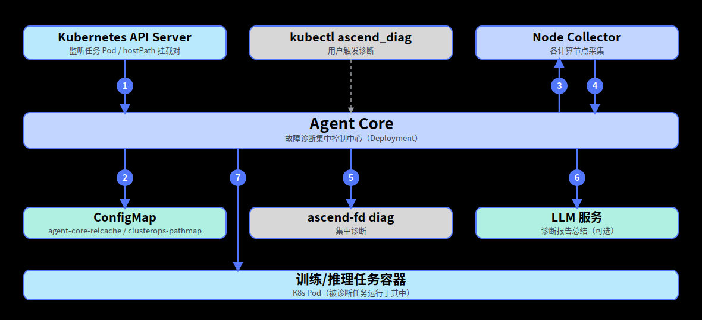

# Ascend ClusterOps Agent

## 目录

- [简介](#简介)
- [软件架构](#软件架构)
  - [上下游依赖](#上下游依赖)
- [编译指南](#编译指南)
- [单元测试](#单元测试)
- [安装部署](#安装部署)
- [使用指南](#使用指南)
- [说明](#说明)

## 简介

Ascend ClusterOps Agent（集群运维Agent）把 ascend-faultdiag（离线日志清洗+诊断）包装成集群诊断Agent：用户只需指定任务名，即可自动完成**采集→清洗→诊断→出报告**的全流程；同时以统一工具契约提供故障、隔离、资源与任务状态的只读查询。

组件包含三个模块：

- **agent-core**：诊断与查询主控，部署在管理节点。维护任务Pod中心关系缓存与挂载关系表，并发向各节点下发采集指令，聚合清洗产物后调用`ascend-fd diag`生成诊断报告；对外提供`/diag`诊断接口和`/tools`工具接口。
- **node-collector**：节点采集端，部署在计算节点。按采集契约从宿主机与静态挂载的共享盘采集任务日志，本地执行`ascend-fd parse`进行清洗。
- **kubectl插件**（`kubectl-ascend_diag`/`kubectl-clusterops`）：面向用户的入口。`ascend_diag`经port-forward调用agent-core；`clusterops`提供能力发现、四类查询、故障诊断和LLM配置管理。

接口与使用说明统一维护在用户文档中，本README只保留组件级信息：

- 接口参考：[Agent Core、Node Collector与Kubectl Plugin](../../docs/zh/scheduling/06_api/20_clusterops_agent.md)、[查询工具接口](../../docs/zh/scheduling/06_api/21_clusterops_agent_tools.md)
- 特性指南：[集群运维Agent](../../docs/zh/scheduling/04_usage/14_clusterops_agent/00_before_you_start.md)

## 软件架构

### 上下游依赖



1. Agent Core从K8s API Server获取任务请求与节点、Pod、ConfigMap数据。
2. Agent Core从ConfigMap中获取任务缓存信息、训练/推理任务的挂载对和env信息。
3. Agent Core从训练/推理任务容器中获取挂载信息、env信息和元数据。
4. Agent Core发送采集指令给Node Collector。
5. Node Collector将清洗结果回传给Agent Core。

## 编译指南

1. 通过git拉取源码，获得ascend-clusterops-agent。

   示例：源码放在/home/mind-cluster/component/ascend-clusterops-agent目录下。

2. 进入构建目录执行构建脚本，在`output`目录下生成组件whl、部署清单、Dockerfile、采集契约与kubectl插件。

    ```shell
    cd /home/mind-cluster/component/ascend-clusterops-agent/build/
    chmod +x build.sh
    ./build.sh
    ```

3. 查看**output**目录生成的软件列表。

    ```shell
    ll /home/mind-cluster/component/ascend-clusterops-agent/output
    ```

    ```text
    agent_core-<version>-py3-none-any.whl
    node_collector-<version>-py3-none-any.whl
    agent-core.yaml
    node-collector.yaml
    Dockerfile
    collect_manifest.yaml
    kubectl-plugin/
    ├── install.sh
    ├── kubectl-ascend_diag
    ├── kubectl-clusterops
    └── clusterops_query_client.py
    ```

    > **说明：**
    > - `<version>`表示当前代码仓分支中的数字版本号。
    > - 组件whl为纯Python包（py3-none-any），运行时依赖由镜像内pip install按目标架构拉取，镜像构建需联网。
    > - 交付zip包（`Ascend-mindxdl-ascend-clusterops-agent_<version>_linux.zip`）由流水线统一打包，build.sh仅生成output/交付物目录。
    > - build.sh只构建与组装交付物，不执行校验；单元测试从`tests/run_dt.sh`进入，见[单元测试](#单元测试)。

## 单元测试

组件用例从`tests/run_dt.sh`进入。单元测试通过mock/fake隔离Kubernetes、LLM和外部命令，无需真实集群与真实LLM：

```bash
bash tests/run_dt.sh              # 全部单元测试（pytest tests/）
bash tests/run_dt.sh -k query     # 透传 pytest 参数
```

真实集群采集、部署注入与压力测试属于独立验收活动，不在仓库单测范围内。

## 安装部署

当前Ascend ClusterOps Agent组件的安装部署为手动安装方式：

1. Agent Core（Deployment，含SA/RBAC/Service/ConfigMap），请参见[Agent Core](../../docs/zh/scheduling/05_developer_guide/00_installation_deployment/00_manual_installation/15_agent_core.md)。
2. Node Collector（DaemonSet，每个NPU节点一份），请参见[Node Collector](../../docs/zh/scheduling/05_developer_guide/00_installation_deployment/00_manual_installation/16_node_collector.md)。
3. Kubectl Plugin（安装在用户机），请参见[Kubectl Plugin](../../docs/zh/scheduling/05_developer_guide/00_installation_deployment/00_manual_installation/14_kubectl_plugin.md)。

## 使用指南

诊断（`kubectl ascend_diag` 保留旧诊断入口；通用入口也可调用 diagnose 工具）：

```shell
kubectl ascend_diag --job train-a -n default
kubectl clusterops tool diagnose --param job=train-a
```

有模型时自动总结诊断报告；未配置模型时输出确定性诊断报告文本。

更新采集清单（以下两个命令效果相同，任选其一）：

```shell
kubectl ascend_diag --collect-manifest ./collect_manifest.yaml
kubectl clusterops tool diagnose --param collect_manifest=./collect_manifest.yaml
```

该操作使用本地 kubeconfig 更新采集 ConfigMap 后直接退出，不要求 `job`，不调用 Agent Core，
也不触发诊断。后续采集读取更新后的清单，无需重启。`collect_manifest` 必须提供本地文件路径。

四类只读查询与通用工具入口：

```shell
kubectl clusterops tools
kubectl clusterops tool faulty_device --param node=worker-a
kubectl clusterops tool isolated_device
kubectl clusterops tool cluster_resource
kubectl clusterops tool task_status --param job=train-a --param namespace=default
```

参数写法、返回体字段、错误码、退出码与行为边界见[查询工具接口](../../docs/zh/scheduling/06_api/21_clusterops_agent_tools.md)；查询操作步骤见[查询集群与任务状态](../../docs/zh/scheduling/04_usage/14_clusterops_agent/05_querying_cluster_status.md)；诊断全流程（配置任务类型、配置日志采集、使用故障诊断、配置和清除LLM）见[集群运维Agent特性指南](../../docs/zh/scheduling/04_usage/14_clusterops_agent/00_before_you_start.md)。

## 说明

- 当前容器方式部署本组件，本组件的认证鉴权方式为ServiceAccount，该认证鉴权方式为ServiceAccount的token明文显示，建议用户自行进行安全加强。
