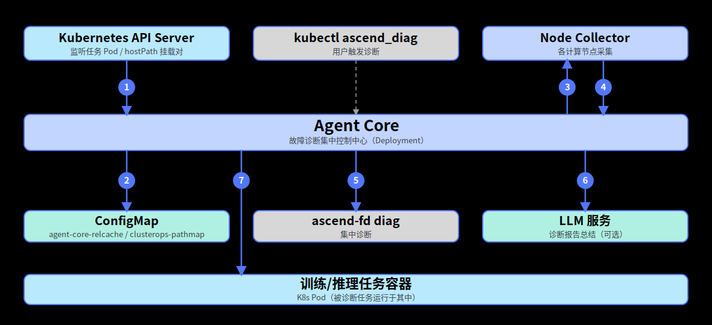

# Ascend ClusterOps Agent

## 目录

- [简介](#简介)
- [软件架构](#软件架构)
  - [上下游依赖](#上下游依赖)
- [编译指南](#编译指南)
- [安装部署](#安装部署)
- [使用指南](#使用指南)
- [说明](#说明)

## 简介

- Ascend ClusterOps Agent（集群运维Agent）是把ascend-faultdiag（离线日志清洗+诊断）包装成集群诊断Agent的组件。用户只需指定异常任务名，即可自动完成**采集→清洗→诊断→出报告**的全流程。
- 组件包含三个模块：
   - **agent-core**：诊断主控，部署在管理节点。维护任务Pod中心关系缓存与挂载关系表，并发向各节点下发采集指令，聚合清洗产物后调用`ascend-fd diag`生成诊断报告，并按需落缓存。
   - **node-collector**：节点采集端，部署在计算节点。按采集契约从宿主机与静态挂载的共享盘采集任务日志，本地执行`ascend-fd parse`进行清洗。
   - **kubectl插件**（`kubectl-ascend_diag`/`kubectl-clusterops`）：面向用户的入口。`ascend_diag`经port-forward调用agent-core；`clusterops`管理LLM配置。
- 主要功能：
   - 按任务维度一键触发诊断，自动完成节点日志采集调度、本地清洗与集中诊断。
   - 可选对接LLM服务，对诊断报告进行智能总结。

## 软件架构

### 上下游依赖



1. Agent Core从K8s API Server获取任务请求。
2. Agent Core从ConfigMap中获取任务缓存信息、训练/推理任务的挂载对和env信息。
3. Agent Core从训练/推理任务容器中获取挂载信息、env信息和元数据。
4. Agent Core发送采集指令给Node Collector。
5. Node Collector将清洗结果回传给Agent Core。

## 编译指南

1. 通过git拉取源码，获得ascend-clusterops-agent。

   示例：源码放在/home/mind-cluster/component/ascend-clusterops-agent目录下。

2. 执行以下命令，进入构建目录，执行构建脚本，在"output"目录下生成组件whl、部署清单、Dockerfile、采集契约与kubectl插件。

    ```shell
    cd /home/mind-cluster/component/ascend-clusterops-agent/build/
    chmod +x build.sh
    ./build.sh
    ```

3. 执行以下命令，查看**output**目录生成的软件列表。

    ```shell
    ll /home/mind-cluster/component/ascend-clusterops-agent/output
    ```

    ```text
    agent_core-<version>-py3-none-any.whl
    node_collector-<version>-py3-none-any.whl
    agent-core.yaml
    node-collector.yaml
    Dockerfile
    collect_manifest.yaml
    kubectl-plugin/
    ├── install.sh
    ├── kubectl-ascend_diag
    └── kubectl-clusterops
    ```

    > **说明：**
    > - 上述回显中的`<version>`表示当前代码仓分支中的数字版本号。
    > - 交付zip包（`Ascend-mindxdl-ascend-clusterops-agent_<version>_linux.zip`）由流水线统一打包，build.sh仅生成output/交付物目录。
    > - 组件whl为纯Python包（py3-none-any），不依赖架构；运行时依赖（grpcio、fastapi等）由镜像内pip install按目标架构自动拉取，镜像构建需联网。

## 安装部署

当前Ascend ClusterOps Agent组件的安装部署为手动安装方式：

1. Agent Core（Deployment，含SA/RBAC/Service/ConfigMap），请参见[MindCluster 集群调度组件开发指南 - 手动安装 - Agent Core](../../docs/zh/scheduling/05_developer_guide/00_installation_deployment/00_manual_installation/15_agent_core.md)。
2. Node Collector（DaemonSet，每个NPU节点一份），请参见[MindCluster 集群调度组件开发指南 - 手动安装 - Node Collector](../../docs/zh/scheduling/05_developer_guide/00_installation_deployment/00_manual_installation/16_node_collector.md)。
3. Kubectl Plugin（安装在用户机），请参见[MindCluster 集群调度组件开发指南 - 手动安装 - Kubectl Plugin](../../docs/zh/scheduling/05_developer_guide/00_installation_deployment/00_manual_installation/14_kubectl_plugin.md)。

## 使用指南

集群运维Agent特性的完整使用流程（特性说明、配置任务类型、配置日志采集、使用故障诊断、配置和清除LLM），请参见[MindCluster 集群调度组件用户指南 - 特性指南 - 集群运维Agent](../../docs/zh/scheduling/04_usage/14_clusterops_agent/00_before_you_start.md)。

## 说明

- 当前容器方式部署本组件，本组件的认证鉴权方式为ServiceAccount，该认证鉴权方式为ServiceAccount的token明文显示，建议用户自行进行安全加强。
