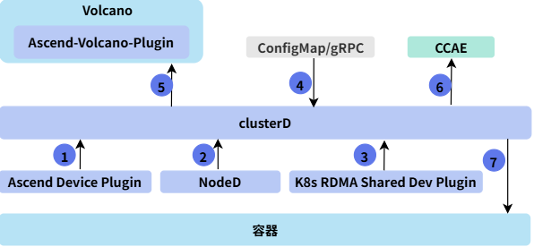
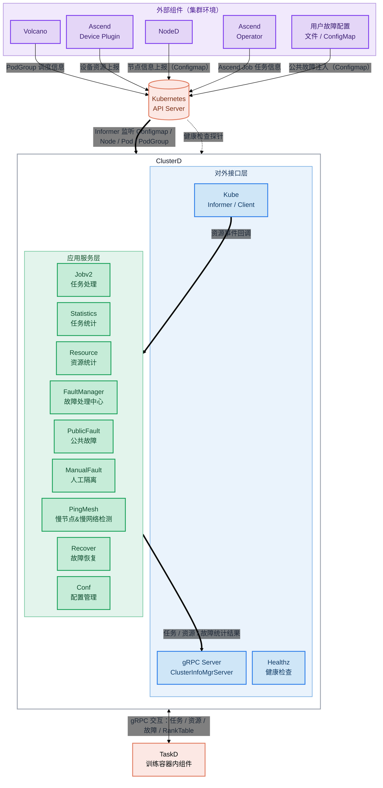

# ClusterD

## 目录

- [简介](#简介)
- [软件架构](#软件架构)
    - [上下游依赖](#上下游依赖)
    - [组件架构](#组件架构)
- [编译指南](#编译指南)
- [安装部署](#安装部署)
- [使用指南](#使用指南)
- [说明](#说明)

## 简介

- ClusterD 是一种提供集群级别信息收集服务的组件，收集集群任务信息、资源信息和故障信息及影响范围，从任务、芯片和故障维度进行统计分析。
- ClusterD 通过 gRPC 服务向训练容器内组件提供任务、资源、故障和 Rank Table 等信息，支撑断点续训、弹性训练、故障恢复等特性。
- 主要功能：
    - 收集集群训练任务信息，进行任务级统计分析。
    - 收集集群资源信息，包括节点、芯片、超节点、交换机等，提供集群可用资源统计。
    - 收集集群故障信息，分析故障影响范围，联动断点续训与故障重调度流程。
    - 支持公共故障通过ConfigMap和gRPC接口接入，支持人工隔离芯片的检测与自动解除隔离。
    - 支持慢节点&慢网络故障检测（PingMesh）。

## 软件架构

### 上下游依赖



1. 从各个计算节点的Ascend Device Plugin中获取芯片的信息。
2. 从各个计算节点的NodeD中获取计算节点的CPU、内存、硬盘的健康状态，以及节点共享存储故障、灵衢慢网络故障信息。
3. 从各个计算节点的K8s RDMA Shared Dev Plugin中获取RDMA设备的故障信息。
4. 从ConfigMap或gRPC获取公共故障信息。
5. 汇总整个集群的资源信息，上报给Volcano。
6. 将集群的任务状态、资源使用情况等信息上报给CCAE等运维系统。
7. 与容器内的训练推理业务交互，协调高阶恢复过程。

### 组件架构

ClusterD组件在Kubenetes集群以容器方式部署在管理节点上，模块层级如下：



## 编译指南

1. 通过git拉源码，获得ClusterD源码。

   示例：源码放在home/mind-cluster/component/clusterd目录下。

2. 执行以下命令，进入构建目录，执行构建脚本，在"output"目录下生成二进制clusterd、yaml文和Dockerfile。

    ```shell
    cd /home/mind-cluster/component/clusterd/build/
    chmod +x build.sh
    ./build.sh
   ```

3. 执行以下命令，查看  **output** 目录生成的软件列表。

    ```shell
    ll /home/mind-cluster/component/clusterd/output
    ```

    ```text
    -r-x------ 1 root root 46732536 Sep  2 15:33 clusterd
    -rw-r--r-- 1 root root 14029188 Sep  2 15:35 Ascend-mindxdl-clusterd_linux.zip
    -r-------- 1 root root     5310 Sep  2 15:33 clusterd-v<version>.yaml
    -r-------- 1 root root     1159 Sep  2 15:33 Dockerfile
    -r-------- 1 root root     1297 Sep  2 15:33 Dockerfile.openeuler
    -r-------- 1 root root      220 Sep  2 15:33 faultDuration.json
    -r-------- 1 root root      209 Sep  2 15:33 fdConfig.yaml
    -r-------- 1 root root      630 Sep  2 15:33 publicFaultConfiguration.json
    -r-------- 1 root root      657 Sep  2 15:33 relationFaultCustomization.json
    ```

   > [!NOTE]
   >
   > 上述回显中的`<version>`表示当前代码仓分支中的数字版本号。

## 安装部署

当前ClusterD组件的安装部署支持两种方式：

1. Helm安装，请参考[使用Helm安装](../../docs/zh/scheduling/03_installation_guide/02_installation/00_helm_installation.md)。
2. 手动安装与部署（包含安装前置条件、镜像准备、yaml部署及安装验证等），请参见[手动安装](../../docs/zh/scheduling/05_developer_guide/00_installation_deployment/00_manual_installation/06_clusterd.md)。

## 使用指南

ClusterD组件的故障感知与公共故障上报等开发指南，请参见[公共故障上报](../../docs/zh/scheduling/05_developer_guide/03_clusterd_fault_awareness.md)。

ClusterD组件相关的使用指南（包含故障检测与诊断、慢节点&慢网络故障检测等完整使用流程），请参见[故障检测与诊断](../../docs/zh/scheduling/04_usage/04_fault_detection_and_diagnosis/01_working_principle.md)。

ClusterD组件的集群资源与gRPC接口说明，请参见[ClusterD](../../docs/zh/scheduling/06_api/04_clusterd/menu_clusterd.md)。

## 说明

当前容器方式部署本组件，本组件的认证鉴权方式为ServiceAccount， 该认证鉴权方式为ServiceAccount的token明文显示，建议用户自行进行安全加固。
