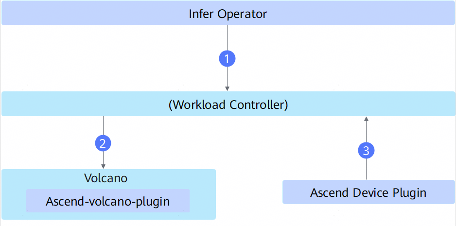
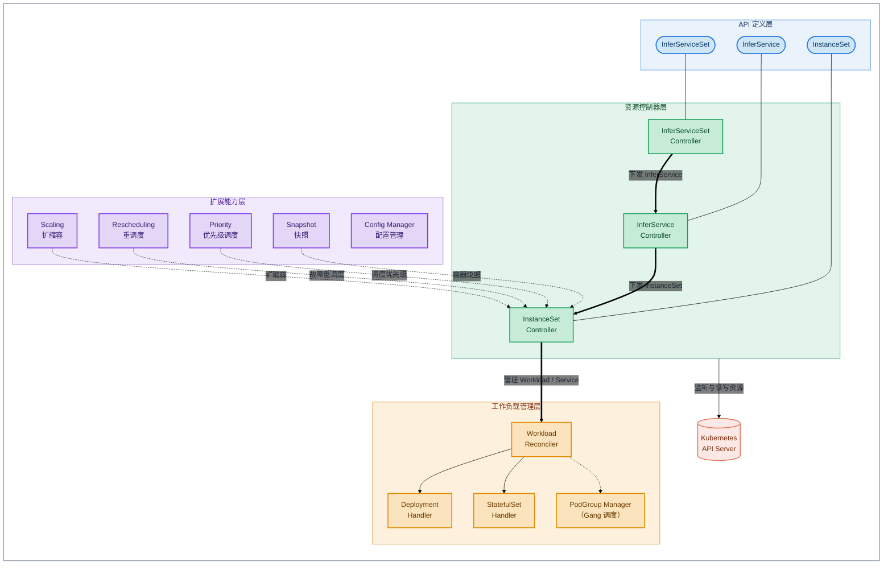

# Infer Operator

## 目录

- [简介](#简介)
- [软件架构](#软件架构)
  - [上下游依赖](#上下游依赖)
  - [组件架构](#组件架构)
- [编译指南](#编译指南)
- [安装部署](#安装部署)
- [使用指南](#使用指南)
- [说明](#说明)

## 简介

- Infer Operator 一种基于 Kubernetes 自定义资源（CRD）和控制器机制的集群调度组件，用于部署和管理多角色合作的推理任务。
- Infer Operator 定义了 InferServiceSet、InferService 和 InstanceSet 三种 CRD，并实现了三种资源的控制器，用于调谐三种资源实例的状态。
- 主要功能：
   - 根据推理服务的实例配置，创建推理实例 Workload 与 Service。
   - 支持推理实例的扩缩容。

## 软件架构

### 上下游依赖



- Infer Operator 基于用户配置的任务 YAML 创建推理实例 Workload（Deployment 或 StatefulSet）。
- Workload Controller 创建 Pod 后，由调度器进行调度和资源选定，例如 Volcano 调度器。
- 若 Workload 申请占用 NPU 卡，由 Ascend Device Plugin 获取 NPU 信息，完成设备的挂载。

### 组件架构

Infer Operator 组件在 Kubernetes 集群中以容器方式部署在管理节点上，模块层级如下：



## 编译指南

1. 通过 git 拉取源码，获得 infer-operator。

   示例：源码放在 /home/mind-cluster/component/infer-operator 目录下。

2. 执行以下命令，进入构建目录，执行构建脚本，在"output"目录下生成二进制 infer-operator、yaml 文件和 Dockerfile。

    ```shell
    cd /home/mind-cluster/component/infer-operator/build/
    chmod +x build.sh
    ./build.sh
    ```

3. 执行以下命令，查看 **output** 目录生成的软件列表。

    ```shell
    ll /home/mind-cluster/component/infer-operator/output
    ```

    ```text
    drwxr-xr-x 2 root root     4096 Jan 29 19:12 ./
    drwxr-xr-x 9 root root     4096 Jan 29 19:09 ../
    -r-x------ 1 root root 43524664 Jan 29 19:09 infer-operator
    -r-------- 1 root root   372080 Jan 29 19:09 infer-operator-v<version>.yaml
    -r-------- 1 root root      482 Jan 29 19:12 Dockerfile
    ```

    > **说明：** 上述回显中的 `<version>` 表示当前代码仓分支中的数字版本号。

## 安装部署

当前Infer Operator 组件的安装部署支持两种方式：

1. Helm安装，请参考[MindCluster 安装部署 - 使用Helm安装](../../docs/zh/scheduling/03_installation_guide/02_installation/00_helm_installation.md)
2. 手动安装与部署（包含安装前置检查、镜像准备、yaml 部署及安装验证等），请参见[MindCluster 集群调度组件开发指南 - 手动安装 - Infer Operator](../../docs/zh/scheduling/05_developer_guide/00_installation_deployment/00_manual_installation/07_infer_operator.md)。

## 使用指南

Infer Operator 组件的最佳实践（包含推理任务使用前的准备工作、任务 YAML 的配置示例，以及多角色推理服务的部署与扩缩容等完整使用流程），请参见[MindCluster 集群调度组件用户指南 - 特性指南 - Infer Operator 推理任务最佳实践](../../docs/zh/scheduling/04_usage/10_infer_operator_best_practice/00_before_you_start.md)。

## 说明

- 当前容器方式部署本组件，本组件的认证鉴权方式为ServiceAccount，该认证鉴权方式为ServiceAccount的token明文显示，建议用户自行进行安全加强。
