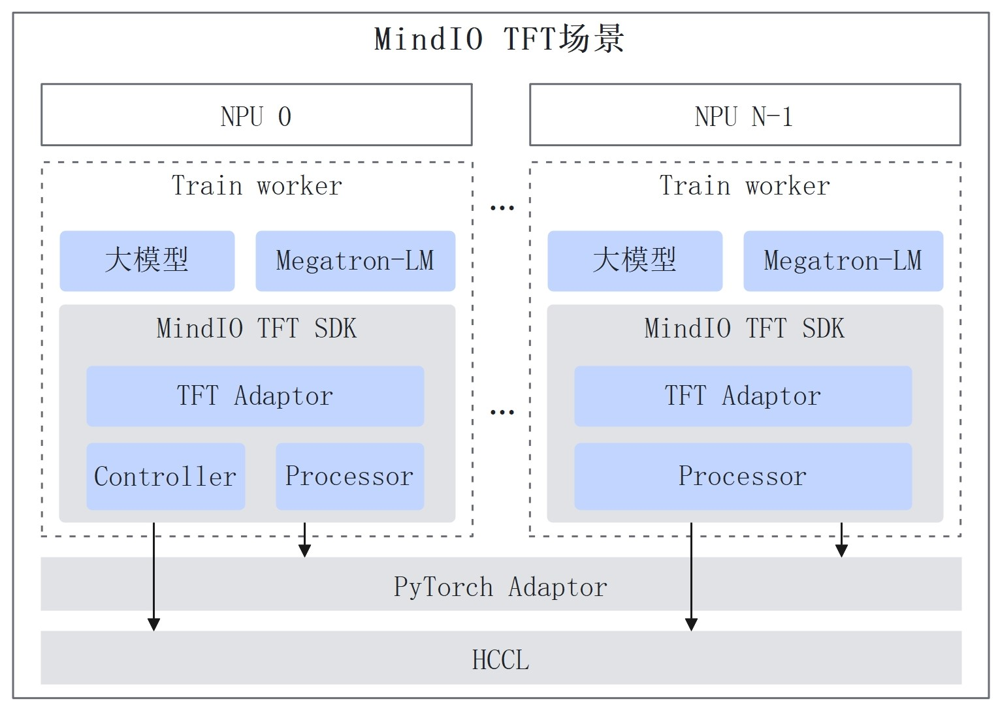

# MindIO TFT

## 目录

- [简介](#简介)
- [软件架构](#软件架构)
  - [上下游依赖](#上下游依赖)
  - [组件架构](#组件架构)
- [编译指南](#编译指南)
- [安装部署](#安装部署)
- [使用指南](#使用指南)
- [说明](#说明)

## 简介

MindCluster MindIO Training Fault Tolerance（MindIO TFT）面向大模型分布式训练，提供临终 Checkpoint 保存、进程级在线恢复和进程级重调度能力，减少故障导致的训练迭代损失。各项能力集成在 `mindio_ttp` Python wheel 包中，通过训练框架适配层接入。

主要功能如下：

| 功能 | 作用 |
| --- | --- |
| MindIO TTP（Try To Persist） | 故障发生后，校验优化器等中间状态数据的完整性和一致性，生成临终 Checkpoint，供重新启动训练时恢复。 |
| MindIO UCE（Uncorrectable Memory Error） | 针对片上内存 UCE、网络故障执行进程级在线修复，修复失败后进入 TTP 流程。 |
| MindIO ARF（Air Refuelling） | 针对异常故障，通过节点重启、替换或故障进程原地重启，恢复模型参数和优化器状态后继续训练。 |

配合 MindCluster，还可使用亚健康故障热切换、在线压测/借轨回切等能力。功能介绍参见[产品描述](../../../docs/zh/scheduling/07_references/00_fault_recovery_acceleration/01_product_description.md)。

## 软件架构

### 上下游依赖

| 对接对象 | 与 MindIO TFT 的关系 |
| --- | --- |
| 训练框架及适配层 | MindSpeed-LLM 等框架通过适配层初始化 TFT、上报训练状态和优化器更新状态，并注册保存、修复、回滚等回调，执行 TFT 下发的动作。其他框架需要自行完成适配。 |
| NPU 驱动、固件和 CANN | 提供训练所需的设备运行环境，配合训练框架完成故障检测和恢复。运行前需按配套版本安装并加载 CANN 环境变量。 |
| OpenSSL | 默认启用的 TLS 通信依赖 OpenSSL 动态库；库路径、证书及 GLIBC 配套要求参见安全管理与加固文档。 |
| MindCluster 集群调度组件 | 集群部署时协同故障处理、进程或节点重调度；TFT SDK 也支持在裸机训练环境使用，无需构建其他 MindCluster 组件。 |
| 持久化存储 | 由训练框架的 Checkpoint 回调写入和读取模型、优化器等状态；临终 Checkpoint 必须在训练进程退出前完成持久化。 |

框架对接和集群部署关系参见[使用指导](../../../docs/zh/scheduling/07_references/00_fault_recovery_acceleration/03_usage_guidance.md)。

### 组件架构



- **Controller**：收集各训练进程状态，维护故障恢复状态机，根据异常类型生成动作并下发给 Processor。一个训练集群中存在一个 Active Controller，可自动启动最多两个 Backup Controller。
- **Processor**：每个训练进程启动一个 Processor，向 Controller 汇报状态，并调用训练框架注册的回调执行对应动作。
- **Adaptor**：位于训练框架侧，负责 TFT 与模型、优化器、通信组及 Checkpoint 的适配。现有 MindSpeed-LLM 适配代码位于其 [high_availability 目录](https://gitcode.com/Ascend/MindSpeed-LLM/tree/master/mindspeed_llm/core/high_availability)，使用时应选择与 TFT 发布版本配套的框架分支。

TFT 以 SDK 形式随训练任务启动和退出，无需单独部署常驻服务。初始化和回调接口参见[API 接口参考](./doc/api/API接口参考.md)。

## 编译指南

### 编译准备

TFT 使用 CMake 和 Make 进行本地源码构建，不需要先构建其他 MindCluster 组件。当前构建脚本没有容器基础镜像或 openEuler 镜像选择参数。

构建环境需准备：

- Linux 环境，目标架构为 `x86_64` 或 `aarch64`。
- Git、支持 C++17 的 C/C++ 编译器、CMake（顶层声明最低版本为 3.12.0）、Make，以及构建配置使用的 GNU gold 链接器。
- Python 3 解释器及开发头文件、SWIG、pip、setuptools 和 wheel。构建时应确保 `python3`、`pip3` 和 CMake 找到的 Python 对应预期环境。
- 能够访问构建脚本中的第三方源码仓库。脚本会在相应源码目录缺失时下载 `libboundscheck v1.1.16` 和 `spdlog v1.12.0`；未安装 wheel 时还会通过 pip 安装。

运行环境的软件、硬件配套请参见[安装部署中的环境要求](../../../docs/zh/scheduling/07_references/00_fault_recovery_acceleration/02_installation_and_deployment.md#环境要求)。构建产物包含本地共享库，应在与目标运行环境兼容的系统和 Python 环境中构建。

### 编译步骤

1. 获取源码并进入 TFT 目录。

   ```bash
   git clone https://gitcode.com/Ascend/mind-cluster.git
   cd mind-cluster/component/mindio/tft
   ```

2. 执行构建。默认类型为 `release`。

   ```bash
   bash build/build.sh -t release
   ```

   常用参数如下，完整帮助可通过 `bash build/build.sh --help` 查看。

   | 参数 | 说明 |
   | --- | --- |
   | `-t` / `--type` | 接受 `debug`、`release`、`asan`、`tsan`，默认 `release`。 |
   | `-b` / `--builddir` | 指定已存在的构建目录，默认按构建类型使用 `Build/Release`、`Build/Debug`、`Build/ASAN` 或 `Build/TSAN`。 |
   | `-f` / `--flags` | 传递自定义 CMake 参数，必须放在其他参数之后。 |

   **注意：构建脚本会清空指定构建目录中的非隐藏内容。必须使用专用构建目录，不要指定源码目录或存放其他文件的目录。**

   自定义构建目录示例：

   ```bash
   mkdir -p Build/custom-release
   bash build/build.sh -t release -b ./Build/custom-release
   ```

   `asan`、`tsan` 的实际插桩配置需核对 CMake：当前脚本传入 `TTP_ASAN_BUILD`、`TTP_TSAN_BUILD`，顶层 CMake 检查的是 `OCKIO_ASAN_BUILD`、`OCKIO_TSAN_BUILD`，仅指定构建类型不能作为已开启插桩的依据。

3. 查看产物。

   ```bash
   ls -l output/mindio_ttp-*.whl
   ls -l output/lib/
   ```

   wheel 包格式为 `mindio_ttp-{version}-py3-none-linux_{arch}.whl`，其中 `version` 来自构建版本配置，`arch` 为 `x86_64` 或 `aarch64`，以实际生成的文件名为准。原生库位于 `output/lib/`，包括 `libttp_framework.so`、`libttp_c_api.so` 和 `_ttp_c2python_api.so`。

### 单元测试

当前测试入口为：

```bash
bash test/run_gtest_dt.sh
```

该脚本构建主程序和 Google Test 测试，并生成覆盖率报告；需额外准备 `dos2unix`、`lcov` 和 `genhtml`，首次运行还会下载 Google Test 和 mockcpp。测试结果位于 `test/build/report/report.xml`，覆盖率报告位于 `test/build/gcover_report/index.html`。脚本对用例失败仅打印告警，验收时需检查测试输出及 XML 报告，不能仅依据脚本退出码判断通过。

## 安装部署

详细步骤参见[昇腾社区：安装 MindIO TFT SDK](https://www.hiascend.com/document/detail/zh/mindcluster/730/clustersched/dlug/mindiotft011.html)和[仓内安装部署文档](../../../docs/zh/scheduling/07_references/00_fault_recovery_acceleration/02_installation_and_deployment.md)。官网链接对应 MindCluster 7.3.0，使用其他版本时应切换到对应版本资料。

1. 按配套说明安装 NPU 驱动、固件、CANN 和训练框架，加载实际 CANN 安装目录中的 `set_env.sh`。
2. 在各计算节点训练使用的 Python 环境中安装匹配架构的 wheel。以下包名中的版本及架构需替换为实际值。

   ```bash
   python3 -m pip install ./mindio_ttp-{version}-py3-none-linux_{arch}.whl --force-reinstall --no-index
   python3 -m pip show mindio_ttp
   ```

3. 按[安全管理与加固](../../../docs/zh/scheduling/07_references/00_fault_recovery_acceleration/04_security_management_and_hardening.md)配置安装目录权限、通信及 TLS 证书。

安装后的主要目录如下，包名为 `mindio_ttp`：

```text
site-packages/
└── mindio_ttp/
    ├── VERSION
    ├── __init__.py
    ├── controller_ttp/
    ├── framework_ttp/
    ├── mindspore_api/
    └── utils/
```

部署注意事项：

- SDK 支持裸机和容器环境。非共享 Python 环境需在每个训练节点安装，可预先集成到训练镜像中。
- Controller 与 Processor 需要通过业务面网络通信。容器部署时，应根据实际地址、端口及网络策略配置连通性；仅在 Pod 中声明端口不能替代网络策略放通。
- 安装 wheel 只完成 SDK 部署，还需训练框架适配和功能配置。`pip show` 仅用于确认安装信息，不能作为故障恢复功能已生效的依据。

## 使用指南

完整训练示例、参数说明和其他框架适配点参见[使用指导](../../../docs/zh/scheduling/07_references/00_fault_recovery_acceleration/03_usage_guidance.md)。

### 对接 MindSpeed-LLM

1. 根据所用 TFT 版本选择配套的 MindSpeed-LLM、Megatron-LM 和运行环境，先确认训练任务可正常运行。
2. 配置训练网络和 TFT 地址，例如 `GLOO_SOCKET_IFNAME`、`TTP_ADDR`；使用 MindCluster 时按使用指导配置 `CONTROLLER_ADDR`、`PROCESSOR_ADDR`。
3. 在训练脚本中按需配置功能参数：

   | 参数 | 作用 |
   | --- | --- |
   | `--enable-high-availability` | TFT 总开关，开启临终 Checkpoint 保存。 |
   | `--enable-hbmfault-repair` | 在总开关开启时，启用片上内存和网络故障在线修复。 |
   | `--enable-worker-reboot` | 在总开关开启时，启用进程级重调度恢复。 |
   | `--distributed-optimizer-no-replica` | 不增加分布式优化器副本，UCE/ARF 使用周期 Checkpoint 在线恢复，会损失最近一次 Checkpoint 之后的训练迭代。 |

4. 配置可访问的 Checkpoint 保存和加载路径，按指导启动训练，结合 TFT 日志检查 Controller、Processor 初始化及状态上报，再在验证环境中测试所需故障恢复流程。

在 MindCluster 管理的 PyTorch 训练中，由 MindCluster 控制进程退出，应跳过使用指导中修改 `torchrun` 的可选步骤。不要直接套用其他版本的训练脚本。

### 对接其他训练框架

需通过现有 SDK 接口完成 Controller/Processor 初始化与启动、优化器状态更新事务上报、异常处理及相应功能回调。临终保存、在线恢复、重调度等特性所需适配点不同，请按[非 MindSpeed-LLM 框架对接指导](../../../docs/zh/scheduling/07_references/00_fault_recovery_acceleration/03_usage_guidance.md#对接非mindspeed-llm框架)逐项实现，并参考[API 接口参考](./doc/api/API接口参考.md)及[环境变量说明](./doc/环境变量.md)。

## 说明

- 当前配套说明面向类 Megatron 训练框架的 ZeRO-1 场景，不应据此推断其他优化器分片方式或任意训练特性已兼容。完整要求见[约束限制](../../../docs/zh/scheduling/07_references/00_fault_recovery_acceleration/02_installation_and_deployment.md#约束限制)。
- 使用副本从当前 Step 恢复时，DP Size 需满足偶数及副本整除约束；MoE 场景要求稠密层和稀疏层 DP Size 均大于 1。无副本、DP Size 为 1 等场景的 UCE/ARF 恢复需依赖周期 Checkpoint。
- 优化器副本会增加片上内存占用，启用前应评估容量。状态数据不完整或不同分片迭代不一致时，不能生成有效的临终 Checkpoint。
- MindIO ARF 要求至少两个节点，且存在 Controller 节点故障等限制；当前不支持级联故障。Atlas 800 训练服务器（型号：9000）仅支持 TTP，不支持 UCE/ARF。
- 当前 UCE 快速恢复支持模型参数和优化器参数内存空间中的 UCE 故障。
- UCE 功能依赖 NPU 内存复用机制，不应设置 `PYTORCH_NO_NPU_MEMORY_CACHING=1`。
- MindSpeed-LLM 配套使用指导声明 MindIO ACP 周期性 Checkpoint 加速与 TFT 不兼容；TTP 临终 Checkpoint 必须直接保存到持久化存储，不能使用异步 Checkpoint 保存。
- 默认开启 TLS，请按部署指导配置证书并保留安全通信。安全要求参见[安全声明](./doc/SECURITYNOTE.md)。
- 本组件使用 Apache License 2.0，详见[LICENSE](../../../LICENSE)。
