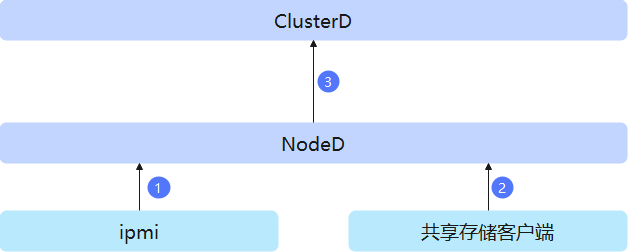
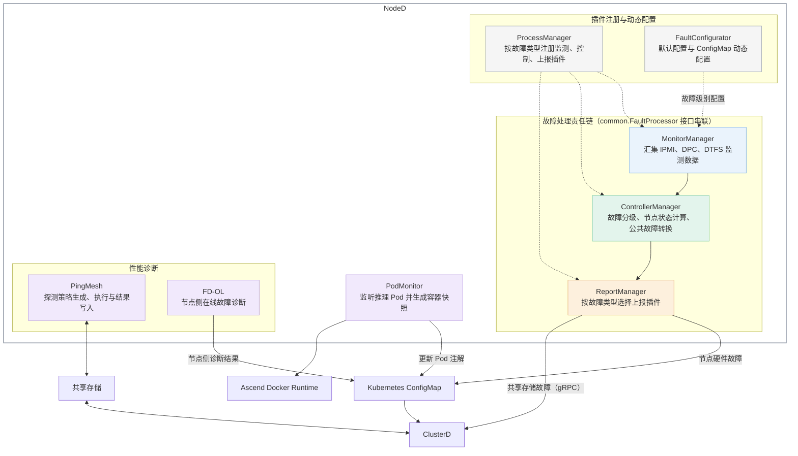

# NodeD

## 目录

- [简介](#简介)
- [软件架构](#软件架构)
  - [上下游依赖](#上下游依赖)
  - [组件架构](#组件架构)
- [编译指南](#编译指南)
- [安装部署](#安装部署)
- [使用指南](#使用指南)
- [说明](#说明)

## 简介

- NodeD 是 MindCluster 的计算节点侧组件，在 Kubernetes 集群上以 DaemonSet 方式部署，用于节点故障检测与上报。
- NodeD 从 IPMI 获取 CPU、内存、硬盘等硬件故障信息，从 DPC、DTFS 共享存储客户端获取存储异常信息，为 ClusterD 的故障处理提供节点侧数据。
- 主要功能：
  - 检测节点硬件故障，依据故障码配置确定故障级别和节点健康状态，支持动态调整故障级别。
  - 检测 DPC、DTFS 共享存储客户端异常，并向 ClusterD 上报公共故障事件。
  - 在支持的设备和驱动环境下执行 PingMesh 网络探测，并集成在线故障诊断框架，配合 ClusterD 完成慢节点、慢网络诊断。
  - 与 Infer Operator、Ascend Docker Runtime 协作，为推理任务生成容器快照，支持后续通过快照快速启动和恢复服务。

## 软件架构

### 上下游依赖

  

   NodeD 各功能涉及的上下游关系如下：

   | 功能 | 数据来源与依赖 | 输出与下游组件 |
   | --- | --- | --- |
   | OS硬件故障检测 | 通过宿主机 IPMI 驱动向 iBMC 查询硬件告警；通过 Kubernetes API 获取故障级别配置。 | 将故障信息和节点状态写入 `mindx-dl` 命名空间下的 `mindx-dl-nodeinfo-<nodename>` ConfigMap，供 ClusterD 获取和处理。 |
   | 共享存储故障检测 | 从宿主机 DPC、DTFS 客户端的状态文件读取异常信息。 | 通过 gRPC 向 ClusterD 的公共故障服务上报告警及恢复事件。 |
   | 慢网络诊断 | 依赖 Ascend 驱动和设备管理接口；PingMesh 读取探测配置、设备地址及探测范围。 | 与 ClusterD 通过共享存储交换探测范围、结果等数据，配合完成诊断。 |
   | 慢节点诊断 | 集成在线故障诊断框架，读取诊断任务配置及节点侧采集数据。 | 通过 ConfigMap 上报节点侧数据处理和诊断结果，配合 ClusterD 完成集群诊断。 |
   | 容器快照 | 监听 Infer Operator 管理的本节点推理 Pod，依赖 Ascend Docker Runtime 的快照工具和共享存储。 | 生成快照并更新 Pod 注解，由 Infer Operator、Ascend Docker Runtime 配合完成后续恢复流程。 |

   NodeD 通过 Kubernetes API 监听 ConfigMap、Pod，读写故障信息和节点元数据。节点故障处理的完整链路及其与调度、恢复组件的协作关系，请参见[故障检测与诊断工作原理](../../docs/zh/scheduling/04_usage/04_fault_detection_and_diagnosis/01_working_principle.md)。

### 组件架构

NodeD 在 `main.go` 中完成参数解析、客户端与设备管理器初始化，并启动故障处理、网络探测和容器快照等模块。节点故障处理采用“监测—处理—上报”的插件链路：



- `pkg/processmanager`：按处理类型注册监测、控制和上报插件。
- `pkg/monitoring`、`pkg/control`、`pkg/reporter`：分别负责故障采集、故障转换与分级、结果上报。其中 IPMI 故障通过 ConfigMap 上报，DPC、DTFS 故障通过 gRPC 上报。
- `pkg/pingmesh`：监听配置与探测范围变化，生成探测策略，调用设备接口执行探测并写入结果文件。节点侧在线诊断由 `main.go` 启动 `ascend-faultdiag-online` 框架。
- `pkg/containersnapshot`：监听本节点符合条件的推理 Pod，调用快照工具并回写执行结果。
- `pkg/kubeclient`、`pkg/device`、`pkg/common` 等：提供 Kubernetes 访问、设备管理、配置与故障缓存等公共能力。

## 编译指南

1. 通过 git 拉取完整源码，获得 noded。

   示例：源码放在 `/home/mind-cluster/component/noded` 目录下。编译时需保留同级的 `ascend-common` 和 `ascend-faultdiag-online` 目录，`go.mod` 通过本地 `replace` 引用这两个模块。

   在 Linux 环境中准备满足当前 `go.mod` 要求的 Go 工具链（当前为 Go 1.26），以及 Bash、GCC 和 C 标准库开发环境。构建脚本启用 `CGO_ENABLED=1`，使用外部链接器生成 PIE 可执行文件；需能够获取 Go 模块依赖。制作镜像时还需准备 Docker 和对应基础镜像。构建环境与运行镜像的 CPU 架构、glibc 等运行库需兼容。

2. 执行以下命令，进入构建目录，执行构建脚本，在 `output` 目录下生成二进制 noded、YAML、配置文件和 Dockerfile。

   ```shell
   cd /home/mind-cluster/component/noded/build/
   chmod +x build.sh
   ./build.sh
   ```

3. 执行以下命令，查看 `output` 目录生成的软件列表。

   ```shell
   ls -1 /home/mind-cluster/component/noded/output
   ```

   ```text
   Dockerfile
   Dockerfile-container-snapshot
   Dockerfile.openeuler
   NodeDConfiguration.json
   agreement.txt
   fdConfig.yaml
   noded
   noded-container-snapshot-v<version>.yaml
   noded-dpc-v<version>.yaml
   noded-v<version>.yaml
   pingmesh-config.yaml
   ```

   > **说明：** `<version>` 表示构建版本号，当前脚本默认使用 `26.2.0`；若组件根目录存在 `service_config.ini`，则从其首行读取版本。脚本会清理原有 `output` 目录，并更新 `build` 目录下部署 YAML 的镜像版本及 `agreement.txt` 的版本信息。

4. 根据部署场景选择 Dockerfile，制作 NodeD 镜像。

   `build.sh` 同时输出三种 Dockerfile，不通过脚本参数选择操作系统，也不执行镜像构建。进入 `output` 目录后，按需选择下列一种方式。

   ```shell
   cd /home/mind-cluster/component/noded/output
   # 按实际构建版本修改，与部署 YAML 的镜像版本保持一致
   NODED_VERSION=v26.2.0
   ```

   | 场景 | Dockerfile | 基础镜像 | 构建命令 |
   | --- | --- | --- | --- |
   | Ubuntu 镜像 | `Dockerfile` | `ubuntu:22.04` | `docker build -f Dockerfile -t noded:${NODED_VERSION} .` |
   | openEuler 镜像 | `Dockerfile.openeuler` | `openeuler/openeuler:24.03-lts` | `docker build -f Dockerfile.openeuler -t noded:${NODED_VERSION} .` |
   | 容器快照镜像 | `Dockerfile-container-snapshot` | `openeuler-24.03-lts-sp2:latest` | `docker build -f Dockerfile-container-snapshot -t noded:${NODED_VERSION} .` |

   使用容器快照时，需先准备 Dockerfile 中指定的基础镜像及快照运行环境，具体要求请参见[容器快照使用指南](../../docs/zh/scheduling/04_usage/10_infer_operator_best_practice/06_container_snapshot_usage.md)。

   在Atlas 850E 超节点、Atlas 650E 服务器、Atlas 950 SuperPoD 超节点场景下，`Dockerfile.openeuler` 支持通过 `UMDK_PKG` 构建参数安装软件包。需要将匹配环境的 RPM 压缩包放入 `output` 目录，再执行以下命令；软件包获取与适用范围请参见[容器基础镜像集成 UMDK 安装指导](../../docs/zh/scheduling/07_references/02_common_operations.md#ZH-CN_TOPIC_0000002516255288)。

   ```shell
   # 将占位名称替换为实际软件包文件名
   UMDK_PKG='<UMDK软件包文件名>.rpm.tar.gz'
   docker build -f Dockerfile.openeuler --build-arg UMDK_PKG="${UMDK_PKG}" -t noded:${NODED_VERSION} .
   ```

## 安装部署

当前NodeD 组件支持以下安装方式：

1. Helm 安装，请参见 [MindCluster 安装部署 - 使用 Helm 安装](../../docs/zh/scheduling/03_installation_guide/02_installation/00_helm_installation.md)。
2. 手动安装与部署（包含镜像准备、YAML 部署、启动参数及安装验证等），请参见 [MindCluster 集群调度组件开发指南 - 手动安装 - NodeD](https://www.hiascend.com/document/detail/zh/mindcluster/latest/clustersched/dlug/docs/zh/scheduling/05_developer_guide/00_installation_deployment/00_manual_installation/09_noded.md)。当前代码仓对应的说明见[仓内文档](../../docs/zh/scheduling/05_developer_guide/00_installation_deployment/00_manual_installation/09_noded.md)。

手动部署时，根据所需功能选择并调整 YAML：

| 部署文件 | 使用场景与注意事项 |
| --- | --- |
| `noded-v<version>.yaml` | 常规部署。 |
| `noded-dpc-v<version>.yaml` | 需要共享存储故障检测。按实际客户端保留 DPC 的 `/proc/odcs`、DTFS 的 `/proc/dtfs` 挂载；仅使用一种客户端时，删除另一种客户端对应的 `volumes` 和 `volumeMounts` 配置。 |
| `noded-container-snapshot-v<version>.yaml` | 需要容器快照。使用 `Dockerfile-container-snapshot` 制作的镜像，配置实际共享快照目录，并核对驱动、Ascend Docker Runtime 等宿主机路径。 |

以上 YAML 定义的是同名 `noded` DaemonSet。需要组合功能时，应在同一份部署配置中合并所需挂载及参数。默认通过 `workerselector: dls-worker-node` 选择计算节点；部署前请核对节点标签、命名空间、宿主机挂载目录以及主容器和初始化容器的镜像配置。默认主容器的 `imagePullPolicy` 为 `Never`，需提前在目标节点准备对应镜像。

## 使用指南

NodeD 部署后在节点侧运行，通常通过部署参数、ConfigMap 和业务任务配置使用各项能力。

- **节点硬件故障检测与分级：** 默认按 `NodeDConfiguration.json` 对故障分级；如需自定义，可在 `mindx-dl` 命名空间创建或更新 `mindx-dl-node-fault-config` ConfigMap。已有有效 ConfigMap 优先于镜像内的默认配置。配置方法请参见[配置节点故障](../../docs/zh/scheduling/04_usage/04_fault_detection_and_diagnosis/03_configuration/02_node_faults.md)，状态与字段定义请参见 [NodeD 接口说明](../../docs/zh/scheduling/06_api/03_noded.md)。
- **共享存储故障检测：** 使用共享存储部署配置，并确保相应客户端状态文件可读、ClusterD 的公共故障服务可达。NodeD 采集客户端状态变化后上报告警或恢复事件。支持范围和前提条件请参见[节点故障](../../docs/zh/scheduling/04_usage/04_fault_detection_and_diagnosis/02_fault_types/01_node_faults.md)。
- **慢节点、慢网络诊断：** 根据指南配置任务和共享存储，并调整 NodeD 的 CPU、内存资源。慢网络场景使用 `cluster-system` 命名空间中的 `pingmesh-config` ConfigMap；模板默认关闭探测，需按实际超节点配置 `activate`、`task_interval` 等参数。超节点专属配置优先于 `global`，NodeD 与 ClusterD 的共享存储根路径需一致。完整流程请参见[配置慢节点和慢网络诊断](../../docs/zh/scheduling/04_usage/04_fault_detection_and_diagnosis/03_configuration/06_performance_diagnosis.md#配置慢节点和慢网络诊断)。
- **推理容器快照：** 使用快照镜像和部署配置，按指南配置推理任务的快照标签及路径。NodeD 监听本节点符合快照条件的推理 Pod，在 Pod 就绪后调用快照工具并回写结果。任务配置、环境要求和恢复流程请参见[容器快照使用指南](../../docs/zh/scheduling/04_usage/10_infer_operator_best_practice/06_container_snapshot_usage.md)。

运行状态可通过 `kubectl get pods -n mindx-dl -l app=noded -o wide` 查看，默认运行日志路径为 `/var/log/mindx-dl/noded/noded.log`。硬件故障信息保存在 `mindx-dl-nodeinfo-<nodename>` ConfigMap 中；当前实现会在节点健康且无故障时删除该 ConfigMap，因此应结合组件日志判断检测是否正常。查询方法请参见[查询和验证故障](../../docs/zh/scheduling/04_usage/04_fault_detection_and_diagnosis/04_querying_and_verifying_faults.md)。

## 说明

- NodeD 使用 ServiceAccount 访问 Kubernetes API，请妥善保护挂载的 Token，并结合实际使用场景配置访问权限。
- 节点硬件故障、网络探测、共享存储检测和容器快照的可用范围受服务器型号、驱动、iBMC、存储客户端及运行环境约束，使用前请核对对应特性指南。部署及使用资料应与实际组件版本匹配。
