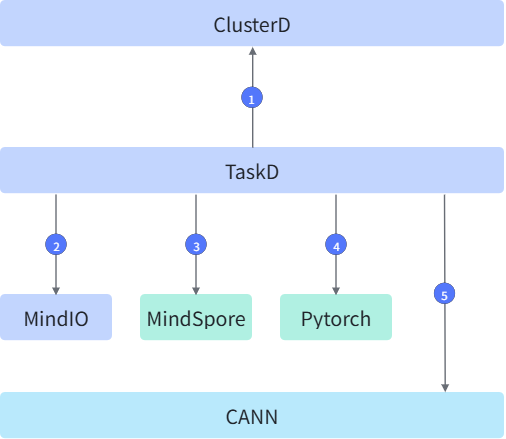
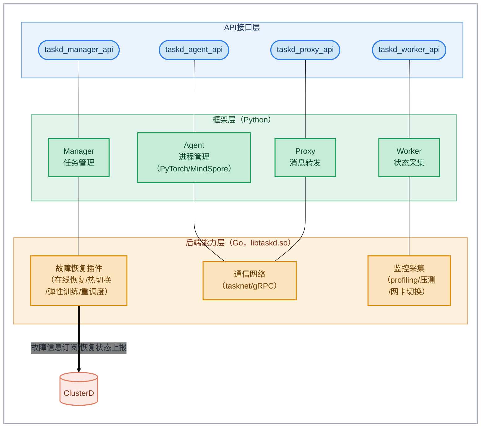

# TaskD

## 目录

- [简介](#简介)
- [软件架构](#软件架构)
  - [上下游依赖](#上下游依赖)
  - [组件架构](#组件架构)
- [编译指南](#编译指南)
- [安装部署](#安装部署)
- [使用指南](#使用指南)
- [说明](#说明)

## 简介

- TaskD是训练的管理组件，以Python Wheel包的形式发布，安装在业务容器中，为断点续训等特性提供任务状态管理与进程管理能力。
- TaskD采用Manager-Agent-Worker三层管理架构：Manager负责任务级的状态汇总与故障恢复决策；Agent运行在计算节点上，负责业务进程的生命周期管理；Worker内嵌于训练进程中，负责状态数据采集。
- 主要功能：
  - 进程管理：支持训练&推理业务进程的进程生命周期管理，包括进程的启动、停止、重启与优雅退出。
  - 状态采集：支持任务的状态数据采集，包括训练轻量级profiling采集等功能。
  - 故障恢复：支持进程级在线恢复、热切换、弹性训练、进程级重调度等多种故障处理策略，以插件化方式按需加载。

## 软件架构

### 上下游依赖



- **ClusterD**：TaskD依赖ClusterD提供的故障检测结果（故障事件、故障级别和资源状态）触发故障恢复。TaskD Manager作为gRPC客户端连接ClusterD的Recover、TrainingDataTrace服务，订阅进程管理、网卡切换、NPU压测、profiling开关等信号，并向ClusterD上报恢复策略、恢复进度、进程故障与OM操作结果。
- **MindIO**：TaskD通过mindio_ttp使用MindIO的Checkpoint管理与高可用恢复能力。TaskD在训练节点上初始化MindIO Controller，向其注册故障、停止完成、恢复策略、恢复结果等上报回调，并将ClusterD下发的恢复动作转换为对MindIO Controller的通知。在各类恢复场景下，TaskD与MindIO的交互如下：

  - **进程级在线恢复**：训练进程不重启，TaskD将ClusterD的故障决策与策略变更（change_strategy）通知MindIO Controller，由MindIO在进程内完成故障修复与训练状态恢复，执行结果经TaskD回调上报ClusterD，实现训练不中断恢复。
  - **进程级重调度**：TaskD收到ClusterD的save_and_exit信号后，通知MindIO保存Checkpoint并退出训练进程，随后在本Pod内原地重启训练进程（告知MindIO重启类型为worker），由MindIO加载Checkpoint恢复训练。
  - **Pod级重调度**：TaskD通知MindIO保存Checkpoint后退出训练进程（告知MindIO重启类型为pod），Pod重建完成后，由MindIO在新Pod内加载Checkpoint恢复训练。
  - **Job级重调度**：整个Job重建、全部Pod重新拉起，TaskD在新实例中重新初始化MindIO Controller，由MindIO加载最近保存的Checkpoint恢复训练。
- **MindSpore**：TaskD通过MSRunPlugin注册到MindSpore的msrun启动器，接管msrun训练进程的生命周期管理，并结合ClusterD注入的故障信息完成MindSpore场景的进程级重调度与优雅容错。
- **PyTorch**：TaskD运行于PyTorch训练进程中，通过对torchrun弹性Agent（torch.distributed.elastic）打补丁的方式接管训练进程的启动、退出与信号处理，在PyTorch场景提供进程管理与故障恢复能力。
- **CANN**：TaskD Worker在训练进程内通过dlopen动态加载CANN的MSPTI性能分析接口库（libmspti.so），基于其Activity订阅与缓冲回调机制实现训练轻量级profiling数据的采集、落盘与磁盘限额管理；MSPTI库缺失时自动降级，不影响训练与故障恢复主流程。

### 组件架构

TaskD组件以whl包形式安装在业务容器中，核心能力由Go实现并以动态库（libtaskd.so）方式被Python调用，模块层级如下：



## 编译指南

1. 通过git拉取taskd源码。

    示例：源码放在 /home/mind-cluster/component/taskd目录下。

2. 执行以下命令，进入构建目录，执行构建脚本，在“output”目录下生成taskd-{version}-py3-none-linux_{arch}.whl的二进制文件。

    ```shell
    cd /home/mind-cluster/component/taskd/build/
    chmod +x build.sh
    ./build.sh
    ```

3. 执行以下命令，查看 **output** 目录生成的软件列表。

    ```shell
    ll /home/mind-cluster/component/taskd/output
    ```

    ```text
    drwxr-xr-x  2 root root     4096 Jan 18 17:04 ./
    drwxr-xr-x 12 root root     4096 Jan 18 17:04 ../
    -r-x------  1 root root  1270175 Jan 18 17:04 taskd-<version>-py3-none-linux_aarch64.whl
    ```

## 安装部署

TaskD组件以whl包的形式安装在使用断点续训特性的业务容器（训练/推理镜像）中，不支持通过Helm安装。

执行以下命令，完成TaskD组件的安装：

```shell
pip install taskd-{version}-py3-none-linux_{arch}.whl
```

业务镜像准备与断点续训特性的完整部署配置流程，请参见[MindCluster集群调度组件用户指南 - 断点续训特性指南 - 配置](../../docs/zh/scheduling/04_usage/05_fault_recovery/01_resumable_training/02_configuration/menu_configuration.md)。

## 使用指南

TaskD组件的最佳实践（包含断点续训特性的故障处理策略配置、恢复加速配置，以及PyTorch和MindSpore场景的示例与验证等完整使用流程），请参见[MindCluster集群调度组件用户指南 - 断点续训特性指南](../../docs/zh/scheduling/04_usage/05_fault_recovery/01_resumable_training/menu_resumable_training.md)。

## 说明

- 本组件为Python软件库，whl包内包含与CPU架构相关的Go动态库（libtaskd.so），请根据业务环境的架构（x86_64/aarch64）选择对应的whl包手动安装到自己的Python环境中。
