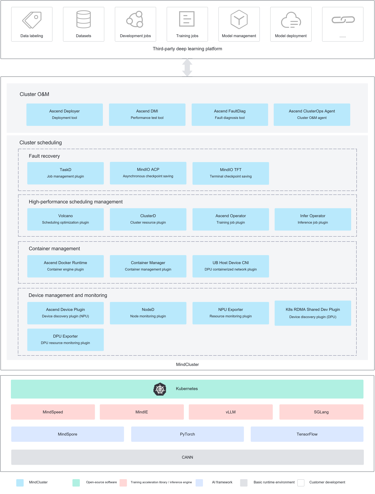

# What is MindCluster

MindCluster is a deep learning component for an AI cluster built to support NPUs (Ascend AI Processors), providing cluster-level solutions specifically for training and inference jobs. By leveraging MindCluster, deep learning platform developers can minimize development efforts related to underlying resource scheduling and rapidly build their platforms.

**Figure 1** MindCluster architecture

**MindCluster Feature Overview**

|Key Feature|Introduction|Reference|
|--|--|--|
|Installation and deployment|Provides online download, installation, and signature verification for Ascend software and its dependencies.|[Installation and Deployment](https://gitcode.com/Ascend/ascend-deployer/blob/release_v26.2.0/docs/en/01_introduction/01_introduction.md)|
|Performance testing|Provides functions such as Atlas hardware compatibility check, performance testing, and stress test.|[Performance Testing](https://www.hiascend.com/document/detail/en/mindcluster/2620/toolbox/toolboxug/toolboxug_0002.html)|
|Fault diagnosis|Provides log cleaning and fault diagnosis functions for training and inference jobs, and locates the root cause of failures.|[Fault Diagnosis](./faultdiag/ascend-faultdiag/01_introduction/01_overview.md)|
|Cluster scheduling|Provides functions such as NPU resource scheduling and management, configuration generation for distributed training collective communication, and resumable training.|[Cluster Scheduling](./scheduling/01_introduction/00_overview.md)|

**MindCluster Component Description**

**Table 1** Installation and deployment

|Component|Feature Overview|
|--|--|
|Ascend Deployer|Supports automatic download and one-click installation of Ascend software and its dependencies, and provides functions such as parameter plane network configuration.|

**Table 2** Performance testing

|Component|Feature Overview|
|--|--|
|Ascend DMI|Provides functions such as compatibility check, bandwidth test, computing power test, power consumption test, and diagnostic stress test for Atlas hardware products.|

**Table 3** Fault diagnosis

|Component|Feature Overview|
|--|--|
|Ascend FaultDiag| Provides log diagnosis and link diagnosis functions. The former locates the root cause node and event by cleaning the logs of training or inference cluster nodes; the latter locates cluster link faults by combining multi-dimensional information such as servers, switches, and BMC. |
|Ascend ClusterOps Agent| Provides a cluster O&M agent that triggers diagnosis for a job with one click, automatically completing the entire process of node log collection, log cleaning, and centralized diagnosis, helping users quickly locate the root cause of job faults.                 |

**Table 4** Cluster scheduling

|Component| Feature Overview|
|--|--|
|Ascend Docker Runtime| Provides containerization support for training and inference jobs, automatically mounting required files and device dependencies. |
|Ascend Device Plugin| Based on the Kubernetes device plugin mechanism, provides device discovery, allocation, and health status reporting for Ascend AI Processors, enabling Kubernetes to manage Ascend AI Processor resources. |
|NPU Exporter| Monitors Ascend AI Processor resource metrics in real time, obtaining information such as utilization, temperature, and voltage. |
|DPU Exporter| Monitors the running status and statistics of the DPU in real time, providing global metrics such as RoCE packet errors, packet loss, ECN, CNP, and abnormal PSN retransmission, as well as interface-level metrics such as the link status and send/receive traffic of each NIC port. |
|Volcano| Based on the open-source Volcano scheduling plugin mechanism, adds features such as affinity scheduling and fault rescheduling for Ascend AI Processors to maximize their computing performance. |
|ClusterD| Provides cluster-level available resource information. It collects cluster job information, resource information, fault information, and impact scope, and performs statistical analysis from job, chip, and fault dimensions. |
|Ascend Operator| Provides lifecycle management for training jobs, supplying environment variables for distributed training jobs of different AI frameworks and generating the collective communication configuration on which distributed training jobs depend. |
|NodeD| Reports node status and fault information such as node health status, CPU, and memory. |
|TaskD| Provides status monitoring and status control for training and inference jobs on Ascend devices. |
|MindIO ACP| In large model training, uses training server memory as a cache to accelerate checkpoint saving and loading. |
|MindIO TFT| Provides functions such as TTP, UCE, and ARF. |
|Container Manager| Provides service container recovery in non-K8s scenarios, mainly used for appliances. |
|Infer Operator| Manages the lifecycle of inference services based on their configuration, and supports instance-level scaling and job role extension. |
|K8s RDMA Shared Dev Plugin| Based on the functions of open-source components, provides discovery and fault detection of Huawei UB RDMA DPU devices in a shared manner. |
|UB Host Device CNI| Deployed on the host as a CNI plugin, mounts the UB RDMA network devices on the host to the Pod network namespace, so that containers can perform high-speed RDMA communication through UB devices. |
