# Component Introduction

## Ascend Docker Runtime

**Application Scenario**

To use Ascend AI Processors in containers, scripts and commands related to the Ascend driver must be mounted. These scripts and commands are distributed across different files and may change as chips iterate. To avoid lengthy file mounting during container creation, MindCluster provide Ascend Docker Runtime. By entering the number of the Ascend AI Processor to be mounted, you can complete the file mounting of the Ascend AI Processor and related drivers.

**Table 1** Example of files required in an Ascend container

| File Path                           | Function                      |
| ------------------------------ | ----------------------- |
| /dev/davinci*                  | NPU device                   |
| /dev/vdavinci*                 | vNPU device                  |
| /dev/davinci_manager           | Device resource scheduling                  |
| /dev/devmm_svm, /dev/hisi_hdc   | Memory and communication control                 |
| /usr/local/Ascend/driver/lib64 | Driver interaction interface                  |
| /usr/local/Ascend/driver/tools | Network and upgrade tools                 |
| /usr/local/sbin/npu-smi        | Driver interaction commands                  |
| ...                            | As chips iterate, there are other device-specific or file-specific items |

**Component Function**

- Provides minimal Docker, Containerd, and CRI-O containerization support for Ascend.
- Some hardware forms support inputting vNPU information to complete automatic creation and destruction of vNPUs.

**Component Upstream and Downstream Dependencies**

**Figure 1** Component upstream and downstream dependencies

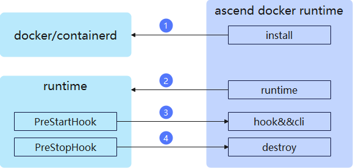

1. install module: During deployment, modifies the Docker/Containerd/CRI-O configuration file to change the container runtime to the Ascend container runtime.
2. runtime module: Modifies the container configuration file to enable the hook and destroy hook functions, and completes pre-mount preparations such as vNPU partitioning and chip device file parsing.
3. hook&&cli: Invoked before container creation, responsible for organizing chip device files, driver files, and user-defined files, and mounting them into the container.
4. destroy: Invoked before container destruction, responsible for destroying the created vNPU.

## NPU Exporter

**Application Scenario**

During job execution, it is necessary to closely monitor the network and computing power usage of the chips to provide data support for job tuning. MindCluster provides NPU Exporter to report the status of various chip metrics.

**Component Function**

- Obtains various data information about chips and networks from the driver, and supports reporting through both Prometheus and Telegraf.
- Plugin-based management, supporting the development of new metrics through plugins and the configuration of different collection periods for different types of metrics.

**Component Upstream and Downstream Dependencies**

**Figure 2** Component upstream and downstream dependencies

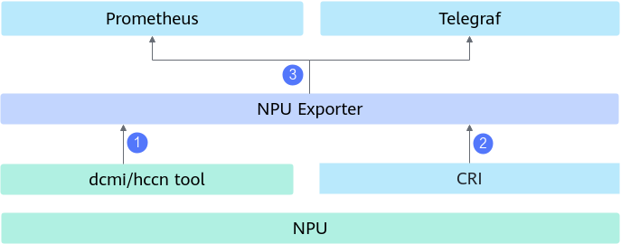

1. Obtain chip and network information from the driver and store it in the local cache.
2. Obtain container information from the Kubernetes (K8s) standardized interface CRI and store it in the local cache.
3. Implement the Prometheus or Telegraf interface for them to periodically retrieve the cached data information.

## Ascend Device Plugin

**Application Scenario**

Considering the complexity, K8s only has built-in device discovery capabilities for CPU and memory, while other resource types are maintained through the device plugin mechanism. MindCluster provides Ascend Device Plugin, which reports Ascend chip resources based on the K8s device plugin mechanism.

**Component Function**

- Reports the resource name of Ascend chips by implementing the `Register` interface of the device plugin.
- Implements the `ListAndWatch` API of the device plugin to report the quantity, IDs, and health status of Ascend chips and the NUMA node to which they belong.
- Implements the `Allocate` API of the device plugin and works with Ascend Docker Runtime to mount Ascend chips into containers.
- Supports proactive O&M. After detecting a chip fault, it changes the chip from the service state to the O&M state and resets the chip to repair it.

**Component Upstream and Downstream Dependencies**

**Figure 3** Component upstream and downstream dependencies

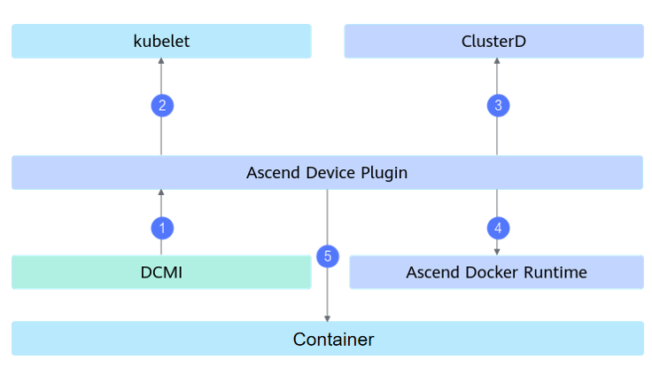

1. Obtain the chip type, quantity, and health status information and the NUMA node to which the chip belongs from DCMI, or deliver chip reset commands.
2. Report the chip type, quantity, and status and the NUMA node to which the chip belongs to kubelet.
3. Report the chip type, quantity, and specific fault information to ClusterD.
4. Notify Ascend Docker Runtime of the chip information selected by the scheduler in the form of environment variables.
5. Map the job configuration into the container to facilitate in-container service usage.

## Volcano

**Application Scenario**

During job execution, most of the time is spent on computation and communication. With the same number of chips, the computing power provided is identical, but due to inconsistencies in the communication network, the final job efficiency differs completely. MindCluster provides Volcano to deliver optimal scheduling solutions for different network topologies.

**Component Function**

- Perceives the available chip information in the cluster and selects the optimal resource scheduling based on both network and resource fragmentation considerations.
- After scheduling, if a chip fault occurs during job running, reselect a healthy chip to recover the job.

**Component Upstream and Downstream Dependencies**

**Figure 4** Component upstream and downstream dependencies

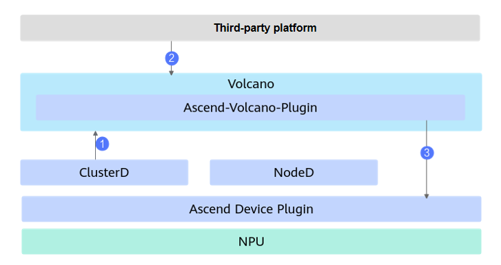

1. Obtain the total number of chips from the Node object in K8s, obtain the used chip information from the Pod object, and obtain the faulty chip information from ClusterD. The three are combined to obtain the available chip information of the cluster.
2. Receives the job configuration and selects the optimal resource scheduling based on cluster resource information.
3. Passes the specific resource selection information to Ascend Device Plugin or Ascend Docker Runtime to complete device mounting.

## ClusterD

**Application Scenario**

Multiple faults in a cluster are often correlated, and fault monitoring from a cluster perspective is required to more accurately identify the root cause of faults. MindCluster provides the ClusterD service to aggregate cluster resource information, delivering more accurate fault awareness and faster fault recovery capabilities.

**Component Function**

- Aggregates Ascend jobs and Ascend resource information across the cluster, and provides query interfaces for O&M systems.
- Based on the jobs and fault information in the cluster, determines whether to perform high-level recovery operations for training and inference jobs, and coordinates the recovery process as the cluster brain.

**Component Upstream and Downstream Dependencies**

**Figure 5** Component upstream and downstream dependencies

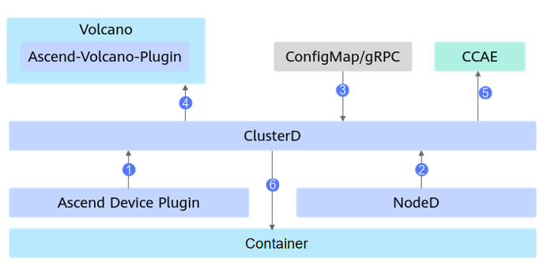

1. Obtains chip information from Ascend Device Plugin on each compute node.
2. Obtain the health status of the CPU, memory, and hard drive of each compute node from NodeD on that node, as well as information about shared storage faults and UnifiedBus slow network faults on the node.
3. Obtain RDMA device information from the K8s RDMA Shared Dev Plugin on each compute node.
4. Obtain public fault information from ConfigMap or gRPC.
5. Aggregate the resource information of the entire cluster and report it to Volcano.
6. Report information such as the job status and resource usage of the cluster to O&M systems such as CCAE.
7. Interact with in-container training and inference services to coordinate the advanced recovery process.

## Ascend Operator

**Application Scenario**

Distributed jobs require chips on multiple nodes to communicate with each other to complete, so certain parameters are needed to let chips know how to communicate with other chips. These parameters have inconsistent names in PyTorch and MindSpore, and cannot be maintained manually in large-scale job scenarios. MindCluster provides Ascend Operator to automatically fill in the required collective communication parameters based on the AI framework type.

| Parameter Description          | PyTorch          | MindSpore       |
| ------------- | ---------------- | --------------- |
| Master container IP address  | `MASTER_ADDR`      | `MS_SCHED_HOST`   |
| Master container port number   | `MASTER_PORT`      | `MS_SCHED_PORT`   |
| Total number of NPUs in the job       | `WORLD_SIZE`       | `MS_WORKER_NUM`   |
| Number of NPUs in this container      | `LOCAL_WORLD_SIZE` | `MS_LOCAL_WORKER` |
| Node rank of this container | `RANK`             | `MS_NODE_RANK`    |

**Component Function**

- Based on the K8s CRD mechanism, maintains the Ascend job resource type acjob and creates Pods according to the acjob configuration.
- Based on the job configuration, injects parameters into the container through environment variables or files.

**Component Upstream and Downstream Dependencies**

**Figure 6** Component upstream and downstream dependencies

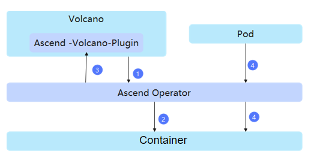

1. Use Volcano to sense whether the resources required by the current job are satisfied.
2. After the resources are satisfied, create the corresponding Pod for the job and inject the environment variables of the collective communication parameters.
3. After the Pod is created, Volcano performs the final selection of resources.
4. Mount the collective communication parameters by means of files (optional). Obtain the chip ID, IP, and RankId information used by each Pod from the Pod, aggregate them to generate a collective communication file, and mount it in-container.

## NodeD

**Application Scenario**

For a job to run stably on a node, in addition to ensuring the health of the NPU, the health of the node's CPU, memory, and hard disk must also be guaranteed. MindCluster provides NodeD for node anomaly detection and reporting.

**Component Function**

- Obtains node anomalies from IPMI and reports them to the upper-layer service.
- Obtains shared storage exceptions from DPC and DTFS, and reports them to the upper-layer service.

**Component Upstream and Downstream Dependencies**

**Figure 7**  Component upstream and downstream dependencies

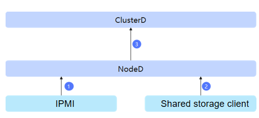

1. Obtains the CPU, memory, and drive fault information of the compute node from IPMI.
2. Obtain shared storage abnormal information from the shared storage client.
3. Report the abnormal information to ClusterD.

## Elastic Agent

>[!NOTE]
>This component has been deprecated, and its related content will be removed in the version released on December 30, 2026. The process-level recovery capabilities will be carried by TaskD.

**Application Scenario**

Because various software and hardware faults are prone to occur during large model training jobs, which affect the training jobs, MindCluster provides a binary package of Elastic Agent deployed on compute nodes to provide management functions for training jobs on Ascend devices.

**Component Function**

- Provides process management for the PyTorch framework adapted to Ascend devices, stopping or restarting training processes when software or hardware faults occur.
- Connects to the cluster control center in the K8s cluster and performs training management based on the cluster control center.

**Component Upstream and Downstream Dependencies**

**Figure 8** Component upstream and downstream dependencies

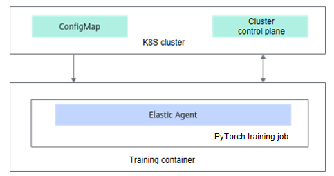

- The MindCluster cluster scheduling components write information such as device and training job status into a ConfigMap through K8s and maps it in the container. The ConfigMap name is [reset-config_job_name](../06_api/01_volcano.md#job-information).
- Elastic Agent obtains information such as the device status used by the current training container and the training job status through the ConfigMap.
- Elastic Agent connects to the K8s cluster control center and completes training management based on the cluster control center.

## TaskD

**Application Scenario**

Large model training and inference jobs may encounter faults, performance degradation, and other issues during service execution, which affect the jobs. TaskD provides status monitoring and status control capabilities for training and inference jobs on Ascend devices.

**Component Function**

- **Functions of each component in service flow 1**
  - The PyTorch and MindSpore frameworks provide process management adapted to Ascend devices, stopping and restarting training processes when software or hardware faults occur.

  - Responsible for interfacing with the K8s cluster control center, performing training management based on the cluster control center and managing the status of training jobs.

- **Functions of each component in service flow 2**
  - Provides lightweight profiling of training data, and completes profiling data collection under the control of the cluster control center.
  - Provides link failover and switchback, and online stress testing capabilities.

**Component Upstream and Downstream Dependencies**

- **Dependencies in service flow 1**

  - The MindCluster cluster scheduling components write information such as devices and training status into a ConfigMap through K8s and map it into the container. The ConfigMap is named [reset-config-<job_name\>](../06_api/01_volcano.md#job-information).
  - The MindCluster cluster scheduling components write the training status detection command into a ConfigMap through K8s and map it into the container.
  - TaskD Manager obtains information such as the device status used by the current training container and the training job status through the ConfigMap.
  - TaskD Manager connects to the K8s cluster control center and completes training management based on the cluster control center.

  **Figure 9** Component upstream and downstream dependencies in service flow 1

  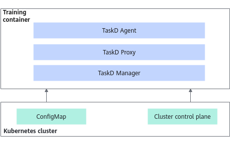

- **Dependencies in service flow 2**

  - TaskD Worker obtains the training detection function enable instruction of the current job through ConfigMap.
  - TaskD Manager obtains the training detection function enabling instruction for the current job through gRPC.

  **Figure 10** Component upstream and downstream dependencies in service flow 2

  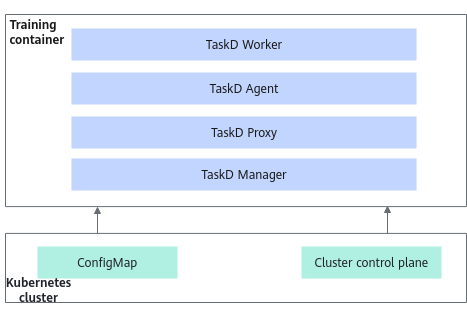

## MindIO ACP

**Application Scenario**

A checkpoint is a key point for resuming training after a model interruption. The density of checkpoints and the performance of saving and restoring them are critical, as they can improve the effective throughput of the training system. MindIO ACP provides a checkpoint acceleration solution that supports Ascend products in expanding market space in the LLM model domain.

**Component Function**

In large model training, the memory of a training server is used as a cache to accelerate the saving and loading of checkpoints.

**Component Upstream and Downstream Dependencies**

**Figure 11** MindIO ACP dependencies

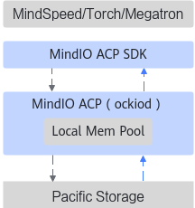

## MindIO TFT

**Application Scenario**

In LLM training, saving checkpoint data each time, loading data to re-iterate training, and saving and loading periodic Checkpoints all require a relatively long time. After a fault occurs, the MindIO TFT feature immediately generates a checkpoint, and recovery can also immediately restore to the state just before the fault, reducing iteration loss. MindIO UCE and MindIO ARF complete online repair or online repair at the level of restarting only the faulty node for different fault types, saving the time of stopping and restarting the cluster.

**Component Function**

MindIO TFT includes functions such as dying gasp checkpoint saving, process-level online recovery, and graceful fault tolerance, which correspond to:

- MindIO TTP mainly verifies the integrity and consistency of intermediate state data after a fault occurs during large model training, generates a dying gasp checkpoint, and restores training from this checkpoint to reduce the training iteration loss caused by the fault.
- MindIO UCE mainly detects UCE faults in on-chip memory during large model training and performs online repair to achieve step-level recomputation.
- MindIO ARF mainly restarts or replaces nodes as a unit instead of restarting the entire cluster after a training exception occurs, completing the repair and continuing training.

**Component Upstream and Downstream Dependencies**

**Figure 12** MindIO TFT dependencies

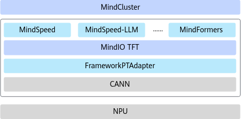

## Container Manager

**Application Scenario**

In scenarios without K8s, when an inference or training process becomes abnormal, Volcano and Ascend Device Plugin cannot be used to stop and reschedule service containers, isolate faulty nodes, or reset NPU chips. MindCluster provides Container Manager for container management and chip reset in scenarios without K8s.

**Component Function**

- Subscribes to chip fault information from the driver, and stores the chip status and specific fault information in the cache for subsequent container management and chip reset.
- If the faulty chip is currently in use by a container, the container occupying the faulty chip is stopped according to the user's startup configuration, and the container is restarted after the faulty chip is successfully reset.
- If the faulty chip is idle and can be recovered after a restart, a hot reset is performed on the chip.
- In a distributed job scenario, the leader node and common nodes work together: common nodes report distributed job container information to the leader node, and the leader node centrally coordinates the start and stop of job containers across nodes, ensuring consistent recovery of the entire distributed job.

**Component Upstream and Downstream Dependencies**

**Figure 13** Component upstream and downstream dependencies

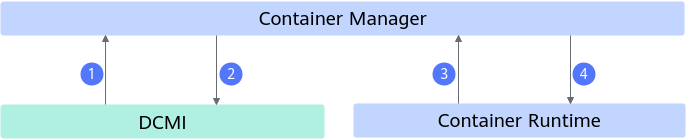

1. Obtains the chip type, quantity, and health status information from DCMI.
2. Delivers chip reset commands to DCMI.
3. Obtains the currently running containers and chip mount information from the container runtime Docker or Containerd.
4. Delivers container stop and start commands to the container runtime.

## Infer Operator

**Application Scenario**

MindCluster provides Infer Operator to batch start inference instances based on the instance configuration of the inference service.

**Component Function**

- A single request creates a job group that contains multiple inference services, each of which contains multiple instance workloads with different roles.
- Supports scaling of inference instances.
- Supports load-based elastic scaling.

**Component Upstream and Downstream Dependencies**

**Figure 14**  Component upstream and downstream dependencies

1. Create an inference instance Workload based on the job YAML configured by the user.
2. After Workload Controller creates the Pod, Volcano performs the final resource selection.
3. If the Workload requests NPUs, Ascend Device Plugin obtains the NPU information and completes device mounting.

## K8s RDMA Shared Dev Plugin

**Application Scenario**

Kubernetes needs to be aware of RDMA network device resource information to implement resource scheduling. To enable containers to use the RDMA network for high-speed data transmission, the RDMA device resources must be registered with Kubernetes through the device plugin mechanism. MindCluster provides K8s RDMA Shared Dev Plugin deployed on compute nodes to manage RDMA device resources.

> [!NOTE]
>
> When a service container uses a 1825 DPU device, in addition to component mounting, the following is also required:
>
> - Configure `hostNetwork: true`
> - Configure the user-mode driver. Choose either of the following two methods:
>   - Install the OFED driver for the 1825 DPU in the image.
>   - Mount the OFED driver for the 1825 DPU from the host after the container starts.

**Working Mode**

- **Shared mode (default)**: All pods in the cluster share all RDMA devices on the node, and no specific device needs to be allocated to a single pod. The component creates virtual devices based on the `rdmaHcaMax` parameter and reports them to kubelet. After a pod requests the resource, it can use any device.
- **Exclusive mode**: Each NPU corresponds to a specific DPU device in a one-to-one manner, and device allocation is completed through the NPU-NIC mapping relationship. Based on the NPU requested by the pod, the component finds the corresponding DPU device through the mapping file and mounts it to the container, implementing device-level isolation.
  - **How to enable**: Add the `--ub-excl-mode` parameter when starting the component to enable exclusive mode.
  - **Allocation logic**: When a pod is created, the component reads the NPU ID requested by the pod, finds the corresponding DPU device through the mapping relationship, and mounts it to the container.
  - **Device reporting**: In exclusive mode, the UB devices actually discovered on the node are reported, and the reported quantity is the same as the actual number of DPU devices on the node.

**Component Function**

- Discovers UB RDMA devices from the system.
- Supports selecting specific RDMA devices through configuration files, with configurable selectors such as `vendors`, `deviceIDs`, `drivers`, and `buses`, where the `buses` selector is used to specify the device bus type (such as the UB).
- Reports RDMA device resource information to kubelet for Kubernetes scheduling.
- Supports the shared and exclusive working modes.
- Supports hot-plugging and dynamic updates of RDMA devices.
- Log parameters such as the log level, number of log backups, and log retention days can be configured.
- The fault detection period can be configured. In each period, fault detection is performed on the filtered UB devices, and the results are written to the `dpuinfo-<nodename>` configMap.

**Component Upstream and Downstream Dependencies**

**Figure 15** Component upstream and downstream dependencies

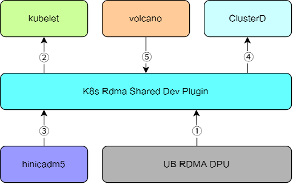

1. Reads device information from the device directory.
2. Reports the type, quantity, and status of RDMA devices to kubelet.
3. Performs fault detection on RDMA devices using the hinicadm5 tool.
4. Reports RDMA device faults and aggregate the faults through ClusterD.
5. In exclusive mode, obtains the NPU information written by Volcano from the service pod.

## UB Host Device CNI

**Application Scenario**

Kubernetes perceives and reports UB RDMA network device resources through device components (such as K8s RDMA Shared Dev Plugin), but the devices must be mounted into a pod before they can be used by the container. MindCluster provides the UB Host Device CNI component, which is deployed as a binary in `/opt/cni/bin` on each worker host, to mount the UB network device on the host into the network namespace of the pod, so that containers can perform high-speed RDMA communication through UB devices.

**Component Function**

- Adapts UB devices based on Host Device CNI, and moves the host UB NIC into the network namespace (`netns`) of the pod.
- Supports UB mode (`ubMode`). UB mode is enabled by setting `ubMode` in the NAD configuration to `true`.
- Supports allocating an IP address for the mounted NIC through an IPAM plug-in (such as calico-ipam), or inheriting the IP address and route of the host NIC through `inheritHostIP`.
- When a device is deleted (`DEL`), moves the UB NIC in the container back to the host network namespace.

**Component Upstream and Downstream Dependencies**

**Figure 16** Component upstream and downstream dependencies

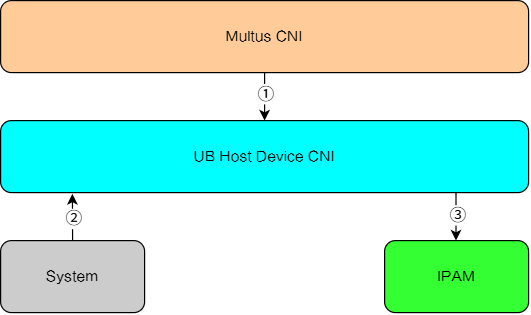

1. One of the device mounting sources: `runtimeConfig.deviceID` delivered by Multus CNI.
2. Queries the specific NIC device based on the obtained device ID.
3. Allocates an IP address for the mounted NIC through the IPAM plug-in.

## DPU Exporter

**Application Scenario**

During job running, the health status of the DPU directly affects job stability. MindCluster provides the DPU Exporter component to monitor the running status and statistics of the DPU. The currently provided metrics fall into two categories:

- **Global metrics**: Covers statistics such as RoCE packet errors, packet loss, received ECN, sent/received CNP, and abnormal PSN retransmission.
- **Interface-level metrics**: Covers metrics such as the link running status, send/receive traffic, and abnormal error status of each NIC port.

**Component Function**

- Obtains DPU global metrics and interface-level metrics from the NIC management tool and the file system interface respectively.
- Provides the Prometheus metrics API for monitoring the running status and statistics of the DPU.

**Component Upstream and Downstream Dependencies**

**Figure 17** Component upstream and downstream dependencies

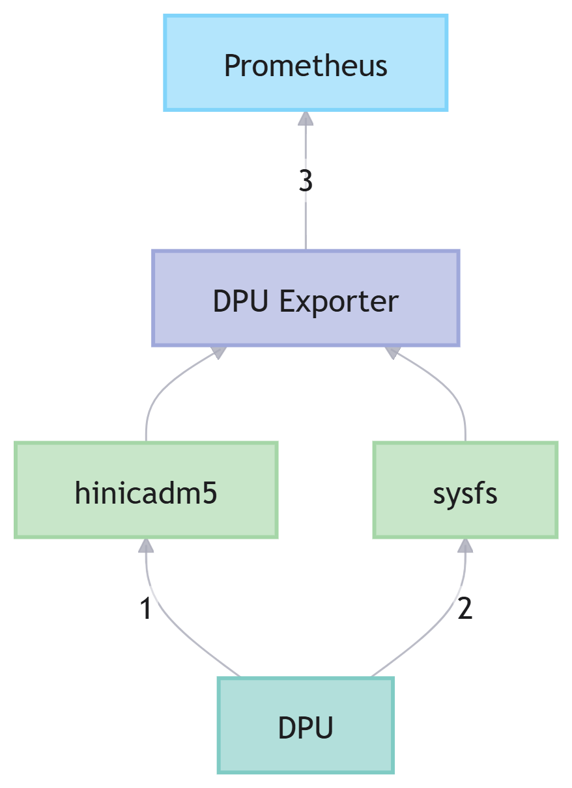

1. Obtains DPU global metrics from the NIC management tool hinicadm5 and stores them in the cache.
2. Obtains interface-level metrics from the file system sysfs and stores them in the cache.
3. Implements the Prometheus metrics API so that Prometheus can periodically obtain the data in the cache.

## Ascend Dynamic Resource Allocation

**Application Scenario**

Ascend Dynamic Resource Allocation is the Kubernetes Dynamic Resource Allocation (DRA) driver plugin for Ascend NPUs. The component automatically discovers Ascend NPU devices on the node and reports them to the cluster in the `ResourceSlice` format. After a service declares the required resources through `ResourceClaim`, the scheduler completes matching and allocation based on the reported device information, and injects the devices into service containers through the Container Device Interface (CDI) mechanism, implementing full-process automation from resource declaration to device usage.

**Component Function**

- Based on the K8s DRA mechanism, reports the device attribute information of Ascend chips to the cluster, supporting resource selection by chip attribute.
- By implementing the `PrepareResourceClaims` API of the DRA mechanism, receives the chip allocation result of the scheduler and completes the allocation of Ascend chips.
- By implementing the `UnprepareResourceClaims` API of the DRA mechanism, completes the release of Ascend chips after the job ends.
- Injects the allocated Ascend chip devices into service containers through the CDI mechanism.

**Component Upstream and Downstream Dependencies**

**Figure 18** Component upstream and downstream dependencies

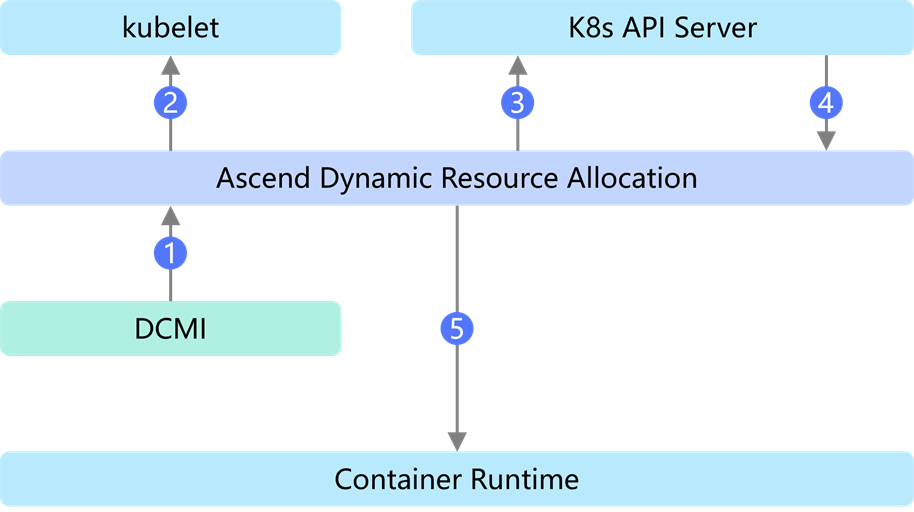

1. Obtains information such as the type, physical ID, and logical ID of Ascend chips from DCMI to complete device discovery.
2. Completes registration through the kubelet plugin mechanism.
3. Reports the device information of Ascend chips to K8s in the ResourceSlice format for the scheduler to perceive and select.
4. Reads the chip allocation result of the scheduler from ResourceClaim, and completes device allocation and release.
5. Transfers the device injection information to the container runtime through the CDI mechanism to complete device injection.

## Agent Core

**Application Scenario**

When a training or inference job encounters a fault during running, the root cause must be located quickly. Jobs are usually distributed across multiple nodes, and fault-related logs (system logs, device logs, and service logs) are scattered on the host of each node, making manual troubleshooting costly and inefficient. MindCluster provides the Agent Core component as the centralized control center for fault diagnosis, which automatically completes node collection scheduling, log parsing, and centralized diagnosis by job.

**Component Function**

- Maintains the central relationship cache (`relcache`) of job pods: fully watches pods and records the mapping between jobs and pods, nodes, pod UIDs, and ranks. Snapshots are synchronized to ConfigMaps (`agent-core-relcache`, `agent-core-relcache-1...N`) in shards by pod UID. The memory capacity is the same as the shard snapshot capacity, and the oldest entries are evicted first when the capacity is exceeded.
- Maintains the pod mount relationship table (`pathmap`): watches the `hostPath` mount pairs, literal env values, and pod IPs of job pods. Snapshots are synchronized to ConfigMaps (`clusterops-pathmap`, `clusterops-pathmap-1...N`) in shards, and the mount pairs/env/pod IPs are delivered with the pod list in the TriggerCollect collection instruction, so that Node Collector can resolve host paths as requested and filter and collect plog on the statically mounted shared storage by `MINDX_TASK_ID` and pod IP (collection is still possible after the job pod is deleted).
- Receives diagnosis requests, queries the central relationship table by job name and namespace, delivers collection instructions to the Node Collector on each compute node, and aggregates the collection results reported by each node.
- Assembles the logs collected and parsed by each node into a diagnosis input directory, and calls the ascend-fd diag command to perform centralized diagnosis and generate a diagnosis report.
- Supports diagnosis result caching: the diagnosis result is cached after each diagnosis, and repeated diagnosis requests directly return the cached result. You can run --refresh to forcibly refresh the result.
- Optionally connects to an LLM service to intelligently summarize the diagnosis report and output a root cause report.

**Component Upstream and Downstream Dependencies**

**Figure 19** Agent Core upstream and downstream dependencies

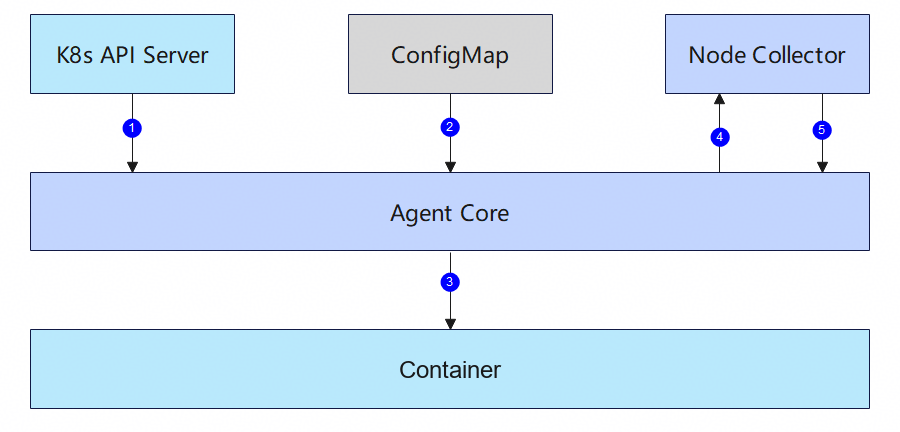

1. Obtains job requests from the K8s API Server.
2. Obtains the job cache information and the mount pairs and env information of training/inference jobs from ConfigMaps.
3. Obtains the mount information, env information, and metadata from the training/inference job containers.
4. Sends collection instructions to Node Collector.
5. Receives the collection results from Node Collector.

## Node Collector

**Application Scenario**

Job logs are scattered on the hosts of compute nodes in the cluster. During diagnosis, job logs must be collected from each node and parsed locally. MindCluster provides the Node Collector component, which is deployed on each compute node as a DaemonSet and is responsible for collecting job logs from the host according to the collection contract and completing local parsing.

**Component Function**

- Receives the collection instruction delivered by Agent Core (including the mount pairs, env, and pod IP of the job pods on the local node), immediately returns the acceptance result, and performs collection asynchronously in the background.
- Performs collection according to the collection contract (`collect_manifest.yaml`), and supports multiple entity types such as `env`, `paths`, `mount_keywords`, and `commands`:
  - `env`: Reads the env value (container path) of the job pod, and collects the log after resolving the host path through the mount pair.
  - `paths`: Matches the mount pairs of the job pod by the container path prefix, and collects the log after resolving the host path.
  - `mount_keywords`: Locates the log directory by matching mount pairs with keywords or scanning the host path subdirectories. If no match is found, the log directory of the pod is filtered out by pod IP and `MINDX_TASK_ID` on the statically mounted shared storage (`/mnt/shared-storage`, protocol not limited) before collection (collection is still possible after the job pod is deleted).
  - `commands`: Only collection commands in the trustlist (such as `dmesg`, `dmidecode`, and `msnpureport`) are allowed to be executed.
- Locally calls ascend-fd parse to parse the collected logs, packages the parsing result as tar.gz, and proactively reports it to Agent Core through the gRPC API.

**Component Upstream and Downstream Dependencies**

**Figure 20** Node Collector upstream and downstream dependencies

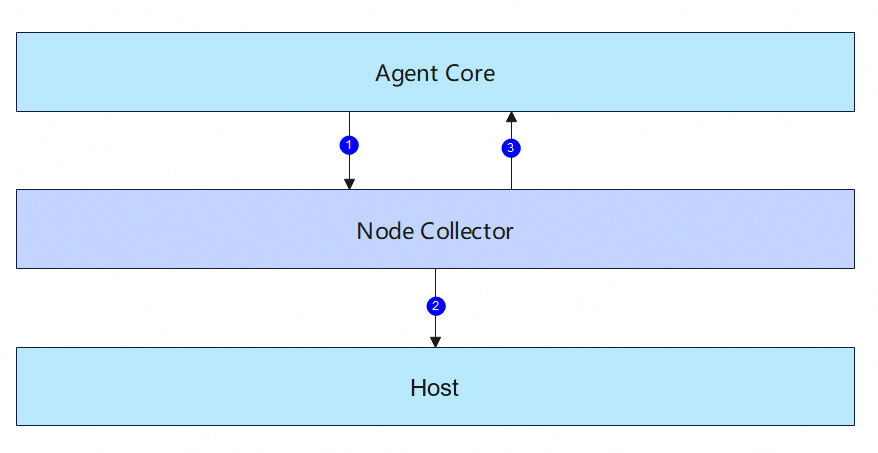

1. Receives collection and parsing instructions from Agent Core.
2. Performs related data collection on the host according to the collection contract.
3. Packages the parsed data and sends it to Agent Core.

## Kubectl Plugin

**Application Scenario**

Users need to quickly trigger the ClusterOps Agent by job, and the invocation method must be simple and secure. MindCluster provides Kubectl Plugin, which encapsulates the fault diagnosis capability into kubectl commands. Users can trigger diagnosis with one click by running the `kubectl ascend_diag` command without logging in to each node, and manage the LLM service configuration by running the `kubectl clusterops` command.

**Component Function**

- kubectl ascend_diag: Triggers the ClusterOps Agent by job name. The `--refresh` parameter is supported to forcibly refresh the diagnosis result, the `--json` parameter is supported to output a complete JSON response, and the `--collect-manifest` parameter is supported to update the cluster collection contract.
- kubectl clusterops: Supports creating and clearing the LLM service configuration (`--create-llm-config`/`--clear-llm-config`).
- Reuses the local kubeconfig for authentication and accesses the Agent Core service through kubectl port-forward, without exposing a separate entry or delivering keys.
- Implemented with standard libraries only. No pip installation is required, and it can be used after running the installation script.

**Component Upstream and Downstream Dependencies**

1. The user runs the `kubectl ascend_diag` command. The plugin reuses the local kubeconfig and forwards the diagnosis request to the `/diag` API of Agent Core through port-forward.
2. After Agent Core completes node collection scheduling, log parsing, and centralized diagnosis by job, it returns the diagnosis report, and the plugin displays the result on the terminal.
