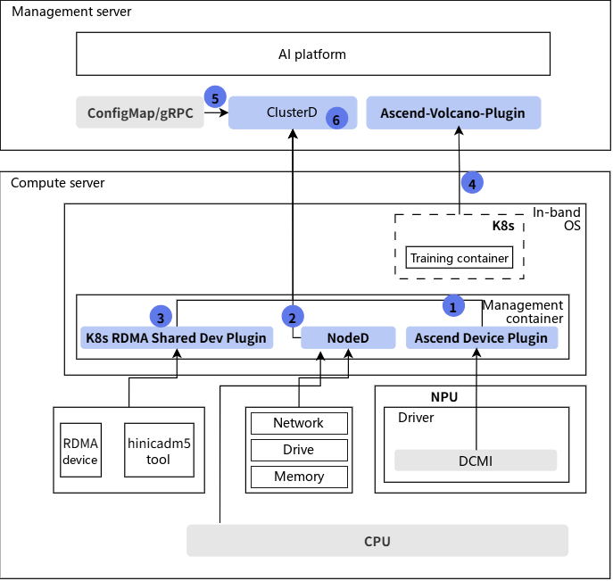
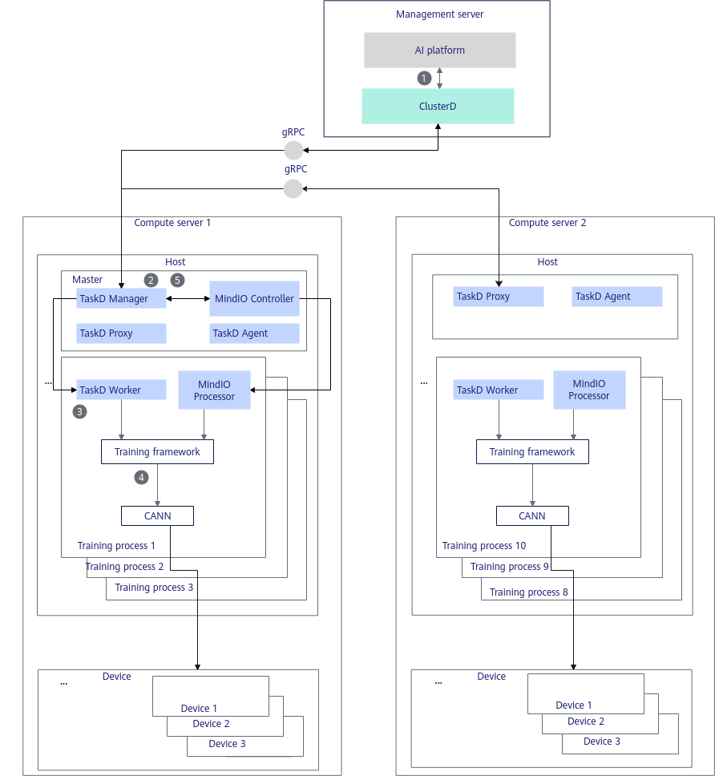

# Working Principle

## Overall Architecture of Fault Detection

Among MindCluster cluster scheduling components, Ascend Device Plugin detects NPU chip faults and NPU parameter plane network faults, NodeD detects server node faults, shared storage faults, and UnifiedBus slow network faults, ClusterD detects public faults, and Volcano detects service plane container exceptions. The overall fault detection architecture is shown in the following figure.

1. After Ascend Device Plugin on a compute server obtains NPU chip faults and parameter plane network faults through the driver, it reports the fault information to the management server.
2. After NodeD on a compute server obtains server node fault, shared storage fault, and UnifiedBus slow network fault information through the driver, it reports the fault information to the management server.
3. After K8s RDMA Shared Dev Plugin on a compute server obtains UB NIC fault information through the `hinicadm5` command, it reports the fault information to the management server.
4. K8s on a compute server monitors the status of training containers. After a training container becomes abnormal, the fault is reported to K8s, and Volcano on the management server obtains the fault information of the training container through K8s.
5. After ClusterD on the management server obtains public faults through the public fault interface, it summarizes the received information and writes it to `cluster-info-device-cm`.
6. (Optional) ClusterD on the management server summarizes the fault information reported by all Ascend Device Plugin and NodeD components in the cluster.

## ConfigMap Description

- Ascend Device Plugin on each compute node creates a ConfigMap file that records information about the NPUs and UnifiedBus devices on the node. The ConfigMap file is named `mindx-dl-deviceinfo-<nodename>`; (hereinafter referred to as `device-info-cm`), and fault information is reported through this ConfigMap. For details about the fields in the ConfigMap file, see the [ConfigMap Description](../../06_api/02_ascend_device_plugin.md#chip-resources) table.
- When a node fault exists on a node, NodeD on each compute node creates a ConfigMap file that records the device information of the node. The ConfigMap file is named `mindx-dl-nodeinfo-<nodename>`, (hereinafter referred to as `node-info-cm`), and node fault information is reported through this ConfigMap. For details about the fields in the ConfigMap file, see the [mindx-dl-nodeinfo-&lt;nodename&gt;](../../06_api/03_noded.md#node-resources) table.
- K8s RDMA Shared Dev Plugin on each compute node creates a ConfigMap file that records information about the UB NIC devices on the node. The ConfigMap file is named `dpuinfo-<nodename>`, and fault information is reported through this ConfigMap. For details about the fields in the ConfigMap file, see [ConfigMap Description](../../06_api/11_k8s_rdma_shared_dev_plugin.md#ZH-CN_TOPIC_configmap_k8s_rdma_shared_dev_plugin).
- ClusterD creates ConfigMap files that record the device information of the cluster. The ConfigMap files are named `cluster-info-<device/switch>-<[0-5]>` and `cluster-info-node-cm` (hereinafter referred to as `cluster-info-cm`). Node and chip fault information is reported through [cluster-info-cm](../../06_api/04_clusterd/00_cluster_resources.md).
- When each job is created, a ConfigMap file needs to be configured in the YAML. The ConfigMap file is named `reset-config-<job-name>`, (hereinafter referred to as `reset-info-cm`). This ConfigMap is mounted to the "/user/restore/reset/config" path of the container. Ascend Device Plugin automatically mounts the ConfigMap to the "/user/restore/reset/&lt;job-namespace&gt;.&lt;job-name&gt;" path of the node.

    Alternatively, the "/user/restore/reset/&lt;job-namespace&gt;.&lt;job-name&gt;" on the node can be mounted to the "/user/restore/reset/config" path of the container instead of the ConfigMap. For details about the fields in the ConfigMap file, see the [reset-config-&lt;job-name&gt;](../../06_api/02_ascend_device_plugin.md#job-information) table.

## Online Stress Testing

MindCluster supports the online stress testing feature, that is, during training, the online stress testing interface can be called to suspend a specified training job and perform a hardware P2P or AIC stress test on the nodes used by the job, so as to proactively determine whether the nodes are abnormal. If no fault exists, training is resumed. If a fault exists, the faulty node is isolated and resumable training is triggered.

### Constraints

- For the PyTorch training framework, MindSpeed-LLM 2.3.0 is required. For version matching, see [MindSpeed-LLM](https://gitcode.com/Ascend/MindSpeed-LLM/tree/2.3.0).
- For the MindSpore training framework, the master version of MindFormers is required. For version matching, see [MindSpore MindFormers](https://gitcode.com/mindspore/mindformers/tree/master).
- Deliver the online stress testing command only after normal training iteration.
- Ensure that features related to process-level recovery have been enabled.
- ClusterD cannot be restarted during stress testing. If ClusterD restarts abnormally, you need to restart training and deliver the stress testing job.
- During stress testing, the hot reset function must be disabled.
- For P2P stress testing, ensure that the free memory on the device side is greater than 10 GB.
- For the MindSpore training framework, set `export TASKD_PROCESS_ENABLE="on"` before starting TaskD Manager.
- This function depends on the MindIO component. Before using it, learn about the [constraints](../../07_references/00_fault_recovery_acceleration/02_installation_and_deployment.md#constraints) of MindIO.

### Supported Products and AI Frameworks

**Table 1** Products and frameworks supported by online stress testing

|Product Type|Hardware Form|Training Framework|
|--|--|--|
|Atlas A2 training products|Atlas 800T A2|<ul><li>MindSpore</li><li>PyTorch</li></ul>|
|Atlas A3 training products|Atlas 900 A3 SuperPoD|<ul><li>MindSpore</li><li>PyTorch</li></ul>|

### Online Stress Testing Principle

**Figure 1** Working principle

The steps in the preceding working principle diagram are described as follows.

1. The AI platform integrates ClusterD and calls the gRPC interface of ClusterD to deliver a stress testing operation and specify the nodes to be tested.
2. ClusterD notifies MindIO to suspend training.
3. TaskD Manager notifies the specified TaskD Worker to call the training framework interface to perform the stress testing operation.
4. The training framework calls the CANN interface on the specified NPU to perform the stress testing operation.
5. After ClusterD determines that the stress testing operation on the specified NPU is complete, TaskD notifies MindIO to continue the next Step of training after the stress testing is complete.

### Adaptation Function Points

In online stress testing, the framework first initializes the MindIO service. After the service is started, the corresponding status is reported to MindIO when the optimizer is updated. By proactively calling the graceful pause mechanism, the job on the current card is paused, and a hardware stress test is performed after the pause. After the test is complete, training continues. The cluster brain needs to provide an external interface to receive stress testing instructions and manage the stress testing process.

For users who do not use MindSpeed-LLM or the MindCluster platform, complete the function adaptation in [Table 2](#table19955141136103) on the framework side.

**Table 2** Function points to be adapted for online stress testing

<table><thead align="left"><tr id="row169591493619"><th class="cellrowborder" valign="top" width="18.98%" id="mcps1.2.5.1.1">
Function Point

</th>
<th class="cellrowborder" valign="top" width="39.26%" id="mcps1.2.5.1.2">
Function Brief

</th>
<th class="cellrowborder" valign="top" width="18.01%" id="mcps1.2.5.1.3">
Component

</th>
<th class="cellrowborder" valign="top" width="23.75%" id="mcps1.2.5.1.4">
Reference Link

</th>
</tr>
</thead>
<tbody><tr id="row893618158397"><td class="cellrowborder" valign="top" width="18.98%" headers="mcps1.2.5.1.1 ">
Initialization while startup

</td>
<td class="cellrowborder" valign="top" width="39.26%" headers="mcps1.2.5.1.2 ">
Start the MindIO service when the training framework is initialized.

</td>
<td class="cellrowborder" rowspan="3" valign="top" width="18.01%" headers="mcps1.2.5.1.3 ">
Distributed training framework

</td>
<td class="cellrowborder" rowspan="3" valign="top" width="23.75%" headers="mcps1.2.5.1.4 ">
<a href="../../07_references/00_fault_recovery_acceleration/03_usage_guidance.md#integrating-with-non-mindspeed-llm-frameworks">Integrating with Non-MindSpeed-LLM Frameworks</a>

</td>
</tr>
<tr id="row1793717157396"><td class="cellrowborder" valign="top" headers="mcps1.2.5.1.1 ">
Reporting the optimizer update status

</td>
<td class="cellrowborder" valign="top" headers="mcps1.2.5.1.2 ">
Report the start and end of the optimizer update before the optimizer update operation.

</td>
</tr>
<tr id="row193701523914"><td class="cellrowborder" valign="top" headers="mcps1.2.5.1.1 ">
Graceful pause

</td>
<td class="cellrowborder" valign="top" headers="mcps1.2.5.1.2 ">
Add a MindIO function call at the very end of the training iteration to implement the active pause function.

</td>
</tr>
<tr id="row46026594305"><td class="cellrowborder" valign="top" width="18.98%" headers="mcps1.2.5.1.1 ">
Online stress testing process management

</td>
<td class="cellrowborder" valign="top" width="39.26%" headers="mcps1.2.5.1.2 ">
Provides the capability of delivering online stress testing requests, and controls the pause and  resumption of training processes.

</td>
<td class="cellrowborder" valign="top" width="18.01%" headers="mcps1.2.5.1.3 ">
AI platform

</td>
<td class="cellrowborder" valign="top" width="23.75%" headers="mcps1.2.5.1.4 ">
<a href="https://gitcode.com/Ascend/mind-cluster/blob/release_v26.2.0/component/clusterd/pkg/application/recover/om_controller.go" target="_blank" rel="noopener noreferrer">Link</a>

</td>
</tr>
</tbody>
</table>
