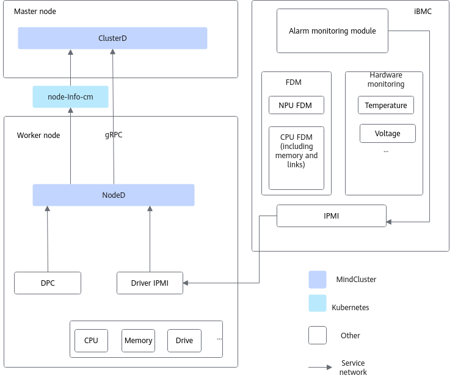

# Node Faults

Node faults are mainly detected through NodeD. Node faults include node health status, node hardware faults, and node shared storage faults. The details are as follows:

- Node health status

    After NodeD completes the node status diagnosis of the current node, it collects the fault information in the local node. When a node fault occurs, NodeD continuously sends the node status to Volcano through the node status reporting mechanism (currently only hardware fault information in the local node is collected).

- Node hardware faults

    For node hardware faults, NodeD sends a fault query request to the iBMC through the IPMI driver, and the iBMC responds to NodeD with the current hardware alarm information. After collecting the hardware alarm information, NodeD reports the node hardware status to Volcano.

- Node shared storage faults

    For nodes that use Scale-Out Storage DPC or DTFS products, you can start the NodeD service by using the `noded-dpc-{version}.yaml` in the NodeD installation package, to enable exception detection and reporting for shared storage.

    >[!NOTE]
    >When a node fault occurs, NodeD reports the node health status and node hardware faults. When no fault occurs, the node is healthy by default.

**Figure 1** Node fault reporting

- When a node fault occurs, NodeD updates the `node-info-cm` content of the local node within a minimum of 5 seconds (default). For details about the fields, see the [mindx-dl-nodeinfo-&lt;nodename&gt;](../../../06_api/03_noded.md#node-resources) table.
- NodeD queries fault information from the iBMC every 60 seconds (default). When the queried fault information differs from the previously queried information, or the interval from the last reporting exceeds 30 minutes, it is reported to `node-info-cm` within 1 second.

## Required Components

To ensure that the node fault detection function works properly, install Volcano, Ascend Operator, NodeD, and ClusterD.

## Usage Constraints

- The node hardware fault reporting capability of NodeD is supported only for the following product models: Atlas 800T A2, Atlas 900 A2 PoD, and Atlas 900 A3 SuperPoD.
- The node hardware fault reporting capability of NodeD is supported only when the iBMC is V2 3.15.0.1 or later or V2 3.10.02.55, and the IPMI driver is installed. When a lower iBMC version fails to obtain node fault information through IPMI, only the node health status is reported.
- To use the SuperPoD fault detection function, the iBMC must be V3 5.8.3.35 or later.
- To use the DPC fault detection function, Scale-Out Storage DPC 24.2.0 or later is required.

## Supported Fault Handling Types

Job-level rescheduling, Pod-level rescheduling, and process-level rescheduling

## (Optional) Configuring the Fault Detection Level

For the different fault codes of **node hardware faults**, the fault detection feature provides a default fault level and a fault handling policy for the corresponding level. If you need to change the fault handling policy, see [Node Hardware Faults](../03_configuration/02_node_faults.md#configuring-node-faults). Unless otherwise required, do not change it at will.

## Related Operations

- [Configuring Node Faults](../03_configuration/02_node_faults.md)
- [Querying and Verifying Faults](../04_querying_and_verifying_faults.md)
