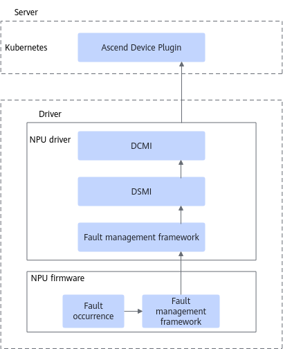
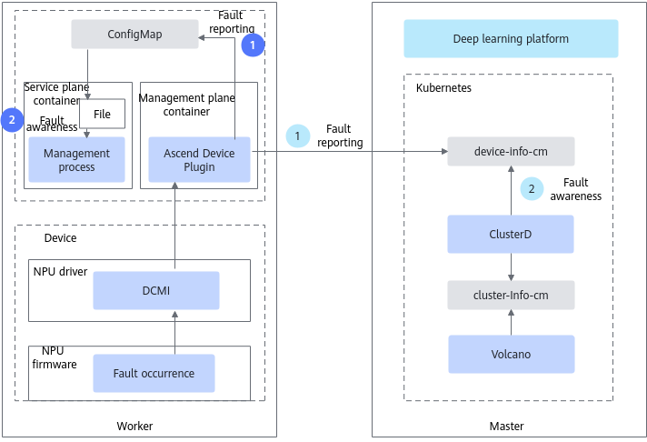

# Chip Faults

Chip faults refer to basic software faults and chip hardware faults that occur on an NPU. In the resumable training feature, the detection and reporting of chip faults are handled by the device management component Ascend Device Plugin.

## NPU Reporting Mechanism

When an NPU fault occurs, the fault management framework obtains the fault information and uploads it to the fault management framework of the NPU driver. After receiving the fault information, the fault management framework reports it to Ascend Device Plugin through the DCMI, as shown in [Figure 1](#fig3951191610267).

Ascend Device Plugin obtains the chip health status through the DCMI. The following two obtaining modes are currently provided:

- Fault subscription mode: When Ascend Device Plugin starts, it first calls the DCMI fault subscription interface to register for monitoring. When a fault occurs, the driver reports the fault event to Ascend Device Plugin through this interface. When the fault is recovered, the recovery event is reported to Ascend Device Plugin through this interface.
- Fault polling mode: At fixed intervals, the chip fault status is queried through the fault query interface. This mode is used when the device driver does not support the subscription capability.

**Figure 1** Chip fault reporting

## Ascend Device Plugin Reporting Mechanism

After obtaining the chip fault information, Ascend Device Plugin reports it to K8s in the form of a ConfigMap. The fault reporting mechanism of Ascend Device Plugin is as follows:

**Figure 2**  Reporting a fault to K8s

For different fault handling modes, the reporting path differs to some extent.

- Rescheduling mode: After Ascend Device Plugin obtains a chip fault, it writes the chip fault information to the device-info-cm of the node to which the chip belongs. For details about the fields, see the [DeviceInfoCfg](../../../06_api/02_ascend_device_plugin.md#chip-resources) table. ClusterD reads the `device-info-cm` of each node to detect chip faults and reports them to the scheduler.
- Graceful fault tolerance mode (deprecated): After Ascend Device Plugin obtains a recoverable chip fault, it writes the chip fault information to the `reset-info-cm` of the job to which the chip belongs. Service containers perceive the chip fault by mounting `reset-info-cm` as a file and reading the file.

    >[!NOTE]
    >If the graceful fault tolerance mode fails to handle the fault and falls back to the rescheduling mode, the fault is reported along the rescheduling mode path.

## Required Components

To ensure that the chip fault detection function works properly, install Volcano, Ascend Operator, Ascend Device Plugin, and ClusterD.

## (Optional) Configuring the Fault Detection Level

For **chip faults**, the fault detection feature provides a default fault frequency, duration, fault level, and a fault handling policy for the corresponding level. If you need to change the fault handling policy, see [Chip Faults](../03_configuration/03_chip_faults.md#ZH-CN_TOPIC_0000002511346521_0101). Unless otherwise required, do not change it at will.

## Supported Fault Handling Types

Job-level rescheduling, Pod-level rescheduling, process-level rescheduling, process-level online recovery, and graceful fault tolerance (deprecated)

>[!NOTE]
>Only uncorrectable errors that occur on the on-chip memory support process-level online recovery. Other types of chip faults do not support process-level online recovery.

## Related Operations

- [Configuring Chip Faults](../03_configuration/03_chip_faults.md)
- [Querying and Verifying Faults](../04_querying_and_verifying_faults.md)
