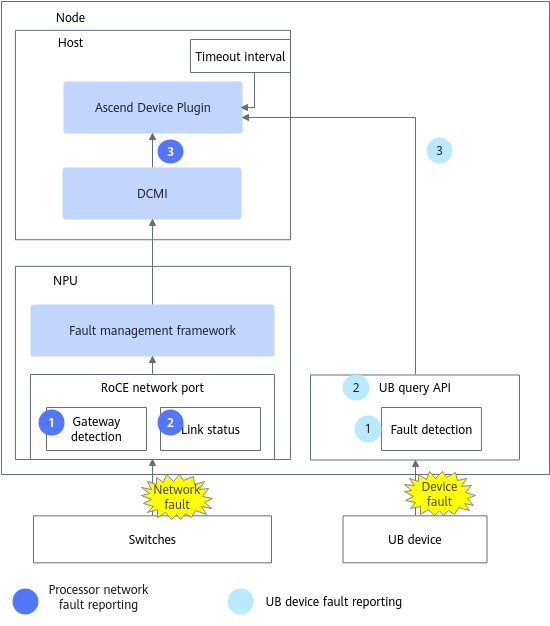
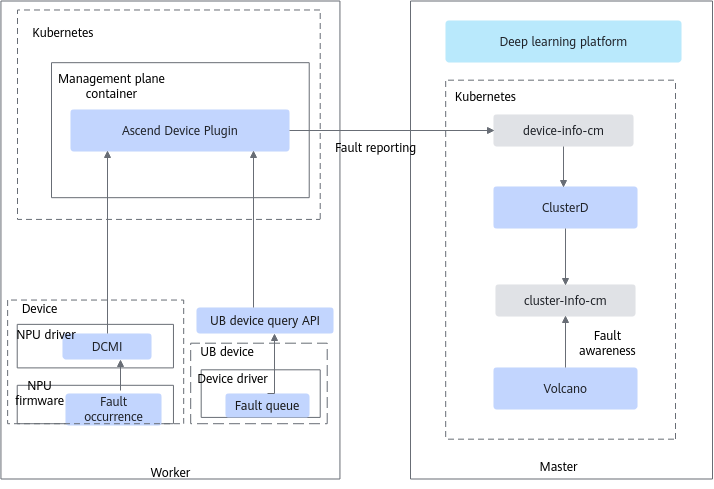

# Network Faults

## Parameter Plane Network Faults

NPU parameter plane network faults include chip network-related faults and UnifiedBus device faults.

When a parameter plane network fault occurs, the training job is interrupted or the training job performance is poor. After a UnifiedBus device fault occurs, the MindCluster cluster scheduling components perform corresponding rescheduling handling based on the fault level.

>[!NOTE]
>
>- A parameter plane network fault does not directly trigger job rescheduling. Job rescheduling is triggered only when a parameter plane fault causes the training job to be interrupted abnormally.
>- If you need to perform fault handling for parameter plane network faults, you must also enable the unconditional retry capability upon service plane faults.

Parameter plane network fault detection is performed by Ascend Device Plugin. The detailed principle is shown in [Figure 1](#fig68743107307).

**Figure 1** Fault detection

### Key Step Description

#### Chip Network Faults

1. The NPU periodically checks whether communication with the gateway address is normal and reports the result through the fault management framework.
2. The RoCE driver monitors the NPU NIC port Link status in real time and reports linkdown or linkup events through the fault management framework.
3. Ascend Device Plugin obtains information from the fault management framework through the DCMI, queries gateway detection results by polling, and subscribes to NIC port linkdown or linkup events in real time and reports them. Ascend Device Plugin collects statistics on the duration of abnormal gateway detection and the duration of linkdown. If the duration is less than or equal to the RoCE network timeout period (20 seconds by default), the fault is marked as an NPU network fault (not handled by default, which may cause a parameter plane network fault). If the duration is greater than 20 seconds, the fault is escalated to the configured fault level.

#### UnifiedBus Device Faults

1. The UnifiedBus device writes the faults that occur on the device to a local queue.
2. The UnifiedBus query interface queries the preceding queue, caches the faults to the query interface, and performs summary processing.
3. Ascend Device Plugin calls the interface through subscription or polling to obtain UnifiedBus device faults and writes them to `device-info-cm` for reporting.

### Fault Reporting Mechanism

- **When a network fault occurs on a chip**, after the NPU fault management framework obtains the fault information, it reports the information to the NPU driver. After receiving the fault information, the NPU driver reports it to Ascend Device Plugin through the DCMI. Ascend Device Plugin obtains the chip health status through the DCMI. Currently, the following two obtaining modes are provided:
    - Fault subscription mode: When Ascend Device Plugin is started, it first calls the DCMI fault subscription interface to register monitoring. When a fault occurs or is recovered, the driver reports the fault occurrence or recovery event to Ascend Device Plugin through this interface.
    - Fault polling mode: At a fixed interval, the chip fault status is queried through the fault query interface. This mode is switched to when the device driver does not support the subscription capability.

- **When a UnifiedBus device fault occurs**, Ascend Device Plugin obtains the fault information through the UnifiedBus query interface. Currently, the following two fault query modes are provided:
    - Fault subscription mode: During the startup of Ascend Device Plugin, a fault handling callback is registered with the UnifiedBus query interface. After a fault occurs, the callback is invoked to report the fault to Ascend Device Plugin, and when the fault is recovered, the recovery event is reported through this interface.
    - Fault polling mode: Ascend Device Plugin calls the full fault query interface every 5 minutes.

### Ascend Device Plugin Reporting Mechanism

After Ascend Device Plugin obtains a parameter plane network fault, it writes the fault information to device-info-cm and reports it to K8s in the form of a ConfigMap. For details about the fields in `device-info-cm`, see the [DeviceInfoCfg](../../../06_api/02_ascend_device_plugin.md#chip-resources) table.

The fault reporting mechanism of Ascend Device Plugin is shown in [Figure 2](#fig1587571063011).

**Figure 2**  Fault reporting

### Watchdog Fault Detection

An abnormal parameter plane network link (parameter plane network fault) may cause healthy NPUs in the job to fail to communicate with the faulty NPU, so that the collective communication of all NPUs enters a timeout waiting state, and the job exits only after a collective communication timeout exception occurs (30 minutes by default).

If the watchdog function is enabled (and the unconditional retry capability upon service plane faults is enabled), after an abnormal parameter plane network link occurs, the faulty NPU can be isolated and the job can be rescheduled to a healthy NPU, so that the job exits quickly within 6 minutes.

>[!NOTE]
>The watchdog function is supported only for the PyTorch and MindSpore frameworks.

### Required Components

To ensure normal use of the parameter plane network fault detection function, install Volcano, Ascend Operator, Ascend Device Plugin, and ClusterD.

### Supported Fault Handling Types

Job-level rescheduling, Pod-level rescheduling, process-level rescheduling

### (Optional) Configuring Fault Detection Levels

For **parameter plane faults**, the fault detection feature provides default fault levels and fault handling policies for the corresponding levels. If you need to modify a fault handling policy, see [Parameter Plane Network Faults](../03_configuration/04_network_faults.md#ZH-CN_TOPIC_0000002479226486). Do not modify it at will unless you have special requirements.

## pingmesh UnifiedBus Network Faults

UnifiedBus network faults are detected NPU network faults within the HCCS network inside a SuperPoD (including intra-node and inter-node).

### Reporting Mechanism

NodeD calls the DCMI to start a pingmesh task, periodically queries the pingmesh result, and writes the result to the "&lt;nodename&gt;.log" file. The directory where the file resides is a fixed path ("/user/mind-cluster/pingmesh") in the container, and the default directory on a physical machine is "/user/mind-cluster/pingmesh". The physical machine path can be modified as described below.

>[!NOTE]
>
>- "&lt;nodename&gt;" is not a fixed value. It is the node name queried in K8s.
>- The physical machine path of the "&lt;nodename&gt;.log" file can be configured by users based on actual conditions: modify the physical machine mount path whose mounted volume name is "pingmesh-result" in the NodeD startup YAML.

After obtaining the pingmesh result, ClusterD performs a preliminary analysis on the result and writes the fault information to the ConfigMap file named [pingmesh-fault-&lt;nodename&gt;](../04_querying_and_verifying_faults.md#zh-cn_topic_0000002193288232_table2371535113510). ClusterD listens to the ConfigMap information, summarizes the faults, and reports them to Volcano, which performs scheduling.

### Required Components

Install NodeD (mandatory), Ascend Device Plugin (optional), and ClusterD (optional) on the corresponding nodes.

### Constraints

This function is supported only by Atlas 900 A3 SuperPoD.

### Supported UnifiedBus Network Faults

|Fault Code|Fault Description|Fault Level|
|--|--|--|
|220001001|NPU HCCS network fault|
SeparateNPU

This fault level cannot be configured manually.
|

## Optical Link Member Port Faults

Include the port faults from NPU to unions and 5808 in Atlas 950 SuperPoD, and the port faults from NPU to 1825 and 5808 in Atlas 850E, Atlas 850, Atlas 650E, and Atlas 650.

### Detection Principle

The detection of parameter plane optical link member port faults is performed by Ascend Device Plugin, which performs a round of detection on each NPU at a fixed interval by default. The detection process is as follows:

1. Ascend Device Plugin obtains all fault code information of the NPU.
2. Based on different fault code information, determine whether the NPU has a parameter plane optical link member port fault and whether the fault scope breaks route convergence.
3. Write faults of different levels to the `device-info-cm` ConfigMap.

### Required Components

To ensure normal detection, install Ascend Device Plugin.

### Fault Types to Be Handled

UB PORT link status change (UP -> DOWN); UBOE PORT link status change (UP -> DOWN).

### Constraints

This function is supported only by Atlas 950 SuperPoD, Atlas 850E, Atlas 850, Atlas 650E, and Atlas 650.

|Fault Code|Fault Description|Fault Level|
|--|--|--|
|020001002|The hyper-plane route cannot converge.       |SeparateNPUCodes|
|020000002|The hyper-plane route can converge, but the device is in a sub-health state.|SubHealthFaultCodes|
|110001024|The parameter plane route cannot converge.       |PreSeparateNPUCodes: pre-isolate the NPU fault.|
|110000002|The parameter plane route can converge, but the device is in a sub-health state.|SubHealthFaultCodes|

## UB NIC Faults

UB NIC faults are faults that occur on UB NICs in Atlas 950 SuperPoD, Atlas 850E, Atlas 850, Atlas 650E, and Atlas 650.

### Detection Principle

UB NIC faults are detected by K8s RDMA Shared Dev Plugin, which performs a round of detection on each HCA device on the node at a fixed period. The detection process is as follows:

1. K8s RDMA Shared Dev Plugin reads the fault configuration file to obtain the fault items to be detected and the corresponding detection methods.
2. For each device, each fault item is detected in sequence by reading the sysfs device status and calling the `hinicadm5` tool to query host topology information.
3. Writes the detected faults by level to the `dpuinfo-<nodename>` ConfigMap for reporting.

### Fault Reporting Mechanism

K8s RDMA Shared Dev Plugin detects UB NIC faults in polling mode. After a fault is detected, the fault information is written to the `dpuinfo-<nodename>` ConfigMap and reported to K8s. For details about the fields in the ConfigMap, see [ConfigMap Description](../../../06_api/11_k8s_rdma_shared_dev_plugin.md#table_dpuconfigmap_k8s_rdma_shared_dev_plugin).

### Required Components

To ensure normal function, install K8s RDMA Shared Dev Plugin.

### Supported Fault Handling Types

Job-level rescheduling, Pod-level rescheduling

### Constraints

- This function is supported only by Atlas 950 SuperPoD, Atlas 850E, Atlas 850, Atlas 650E, and Atlas 650.
- To use the capability of triggering resumable training by a DPU fault, a distributed training job must request all NPU resources on the node and the DPU resource corresponding to each NPU resource.
- Only the host network is supported.

### Supported UB NIC Faults

|Fault Code|Fault Level|Fault Event Name|Fault Description|
|--|--|--|--|
|21000022|SubHealthFault|ub_port_down|The RoCE device is unavailable, and the NIC and IP address need to be switched.|
|21000023|SubHealthFault|ub_lane_down|UB lane degradation. The NIC or IP address does not need to be switched.|
|21000024|SeparateDPU|hca_port_down|HCA port fault. The IP address needs to be switched after the fault occurs.|
|22000025|SubHealthFault|bond_member_down|A single member is faulty in the Bond scenario. The service can continue with half the bandwidth.|
|22000026|SeparateDPU|dpu_card_drop|DPU loss fault.|

## Related Operations

- [Configuring Network Faults](../03_configuration/04_network_faults.md)
- [Querying and Verifying Faults](../04_querying_and_verifying_faults.md)
