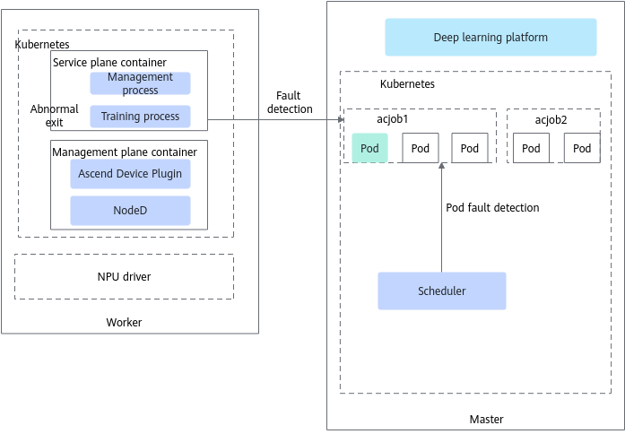

# Workload Faults and Task Hangs

## Service Plane Faults

The resumable training feature supports perceiving and handling job failures caused by service plane faults through the Volcano scheduler. A service plane fault is a fault in which all training processes in a container exit abnormally, causing the container to exit abnormally so that the status of the Pod becomes `Failed`. In scenarios where Ascend Operator is used, a service plane fault is supported only when some Pods of a job are faulty. If the status of all Pods of a job becomes `Failed` within a few seconds, the job is not rescheduled and is considered to be in a failed state.

The principle of service plane fault discovery is shown in [Figure 1](#fig1761563615337).

**Figure 1** Discovery principle

The scheduler continuously polls and queries the Pod status of each job, so as to perceive a service plane fault and report it. You can handle service plane faults based on specific service requirements. After the resumable training feature obtains a service plane fault, Volcano checks whether the unconditional retry function is enabled. If it is enabled, the job is rescheduled and the training job is executed again, and the retry count decreases by 1. When the retry count reaches 0 or the unconditional retry function is not enabled, the faulty service container is not handled.

>[!NOTE]
>
>- To use the unconditional retry function, configure the following three parameters in the job YAML: `fault-retry-times`, `restartPolicy`, and `policies`. For details about the parameters, see [YAML Configuration Description](../../../06_api/15_yaml_configuration.md#yaml_configuration) (`policies` is a native vcjob field).
>- In scenarios where Ascend Operator is used, if you want the job to be rescheduled after the status of all Pods of the job becomes `Failed`, see [Pod Status Becomes Failed and Unconditional Retry Cannot Be Triggered In a Job with Service Plane Faults when Volcano and Ascend Operator Are Used](https://gitcode.com/Ascend/mind-cluster/issues/362).
>- The job status can be connected to an external monitoring platform and monitored through the [ClusterD job interface](../../../06_api/04_clusterd/01_job_information.md). When a service plane Pod exits with a non-zero code and the status becomes Failed, or the job stays in the Pending status for a long time, the related information can be obtained through the job information interface.

### Watchdog Fault Detection

An abnormal Task execution on an NPU (service plane fault) may cause healthy NPUs in the job to fail to communicate with the faulty NPU, so that the collective communication of the healthy NPUs enters a timeout waiting state, and the job exits only after a collective communication timeout exception occurs (30 minutes by default). If the watchdog function is enabled (the unconditional retry capability upon service plane faults must be enabled at the same time), after the exception occurs, the faulty NPU can be isolated and the job can be rescheduled to a healthy NPU, so that the job exits quickly within 6 minutes.

>[!NOTE]
>Task execution exceptions on NPUs support the watchdog function only for the PyTorch framework of <term>Atlas A2 training products</term>.

### Required Components

To ensure normal use of the service plane fault detection function, install Volcano and Ascend Operator.

### Supported Fault Handling Types

Job-level rescheduling, Pod-level rescheduling, process-level rescheduling, and graceful fault tolerance (deprecated)

## Task Hang Faults

A task hang fault is an abnormal state in which a process is running on an NPU but the process has made no substantive progress for a long time. Multiple hang cases exist in actual scenarios:

- Computing hang: The process stays at a certain operator, with no output but low NPU utilization
- Memory hang: Memory allocation is abnormal, causing the process to be suspended
- Communication hang: The HCCL collective communication is deadlocked
- Other hang cases

The task hang detection function can detect and report task hang faults in a timely manner, preventing the job from running without progress and improving efficiency and resource utilization.

### Detection Principle

Hang fault detection is performed by Ascend Device Plugin, which performs a round of detection on each NPU every **60 seconds** by default. The detection process is as follows:

1. Ascend Device Plugin obtains the process information on the NPU. If no process is running, this round of detection is skipped.
2. Collect the key NPU running metrics of the current round, including:
   - AICore utilization: Obtain the AICore usage of the NPU through the driver interface.
   - On-chip memory usage: Obtain the on-chip memory usage of the NPU through the driver interface.
   - Network traffic:
     - For <term>Ascend 950PR&950DT products</term>, use the hccn_tool to collect the `tx_busi_flit_num` and `rx_busi_flit_num` statistics of UB.
     - For other scenarios, use the hccn_tool to collect the `roce_tx_all_pkt_num` and `roce_rx_all_pkt_num` statistics of RoCE.
   - Process CPU time: Obtain the `utime` and `stim`e of the process by reading the `/proc/{pid}/stat` file, and calculate the CPU time of all processes associated with the NPU.
3. Compare the metrics of the current round with those saved in the previous round and calculate the increment of each metric.
4. When **all** the following conditions are met, the job in this round is determined to be in a hang state:
   - A process is running on the NPU.
   - The current AICore utilization < the AICore utilization threshold (5% by default).
   - The current on-chip memory usage increment <= the on-chip memory threshold (0% by default).
   - The current network traffic increment < the traffic threshold (100 packets/minute by default).
   - The current process CPU time increment < the CPU time threshold (5 seconds by default).

>[!NOTE]
>
>- You can customize the detection thresholds based on actual scenarios. For details, see [(Optional) Configuring Task Hang Detection Parameters](../03_configuration/05_task_hang_detection.md#optional-configuring-task-hang-detection-parameters).
>- Hang fault detection is performed only on NPUs where processes are running. NPUs without processes are not detected.
>- Task hang detection may conflict with process-level recovery: during process-level recovery, various running metrics (AICore utilization, HBM memory increment, network traffic, and CPU time increment) are generally low and are easily misjudged as a hang state. When process-level recovery is used, it is recommended that you disable hang detection or adjust the thresholds properly.

### Fault Reporting Mechanism

Task hang faults use a continuous detection confirmation mechanism to avoid false reporting caused by occasional metric fluctuation:

- After each round of detection determines that the state is a hang state, the hang counter increases by 1. When the number of consecutive times the hang state is detected reaches the detection duration threshold (5 times by default, that is, about 5 minutes in total), Ascend Device Plugin reports the hang fault to the `device-info-cm` ConfigMap. The task hang fault code is `200001002`, and the fault level is defined in the `faultCode.json` configuration file.
- When the hang condition is no longer met, the hang counter is cleared to zero. If a hang fault has been reported before, the fault is cleared.

### Required Components

To ensure normal use of the NPU hang fault detection function, install Ascend Device Plugin.

### Supported Fault Handling Types

Job-level rescheduling, Pod-level rescheduling

## Related Operations

- [Configuring Task Hang Detection](../03_configuration/05_task_hang_detection.md)
- [Querying and Verifying Faults](../04_querying_and_verifying_faults.md)
