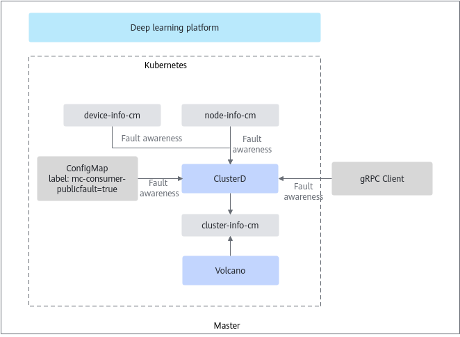

# Public Faults

Public faults are faults reported by other fault providers (not MindCluster components). Public faults include the following types: NPU faults, node faults, network faults, and storage faults.

>[!NOTE]
>For ClusterD to receive public faults, Ascend Device Plugin must be installed on the target node, and the corresponding `device-info-cm` must be generated.

## Reporting Mechanism

After a public fault provider detects a fault, it sends the fault information to ClusterD through a ConfigMap or gRPC. ClusterD summarizes the received information, writes it to `cluster-info-device-cm`, and reports it to ascend-volcano-plugin.

- Obtaining through a ConfigMap: The fault detector writes the fault information into a ConfigMap, and ClusterD obtains the fault information from it. You can inject public faults by calling the ConfigMap API. For details, see [ConfigMap](../../../06_api/04_clusterd/03_public_fault_apis.md#configmap).
- Obtaining through gRPC: The fault detector sends the fault information to ClusterD through a gRPC channel, and ClusterD obtains the fault information from it. You can inject public faults by calling the gRPC API. For details, see [gRPC Interface](../../../06_api/04_clusterd/03_public_fault_apis.md#grpc-interface).

**Figure 1** Public fault reporting

## Required Components

To ensure that the public fault detection function works properly, install the following components.

- Mandatory components: Volcano, Ascend Operator, Ascend Device Plugin, and ClusterD
- Optional component: NodeD

## Supported Fault Handling Types

Job-level rescheduling, Pod-level rescheduling, and process-level rescheduling

## (Optional) Configuring the Fault Detection Level and Provider

The fault detection feature provides a default fault level and supported fault providers for **public faults**. If you need to change the level and fault provider of public faults, see [Public Faults](../03_configuration/08_public_faults.md#ZH-CN_TOPIC_0000002479386564). Unless otherwise required, do not change them at will.

## Related Operations

- [Configuring Public Faults](../03_configuration/08_public_faults.md)
- [Querying and Verifying Faults](../04_querying_and_verifying_faults.md)
