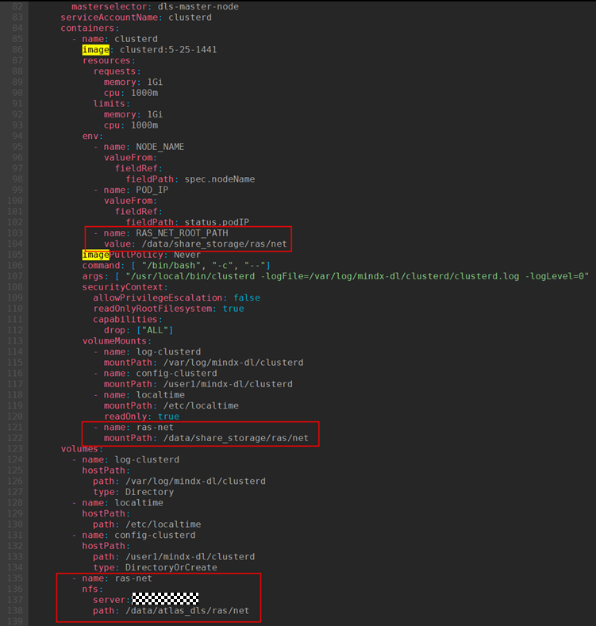

# Configuring Network Faults

## Configuring Parameter Plane Network Faults<a name="ZH-CN_TOPIC_0000002479226486"></a>

### Bus Device Faults<a name="ZH-CN_TOPIC_0000002511346423"></a>

#### Configuration File Description<a name="ZH-CN_TOPIC_0000002511346513"></a>

To handle bus device faults by level, Ascend Device Plugin obtains the fault code of the current fault and handles the fault accordingly based on the fault level configured for the fault code in `SwitchFaultCode.json`. `SwitchFaultCode.json` is a system configuration file. Do not modify it unless necessary. If you need to change the fault level corresponding to a fault code, use the `mindx-dl-fault-config` file created from `faultCode.json` and `SwitchFaultCode.json`.

>[!NOTE]
>Only <term>Atlas A3 training products</term> involve **bus devices**, and their fault codes can be viewed in the `SwitchFaultCode.json` file.

The fault detection feature handles **bus device** faults by level. If you need to change the fault level of a fault code, see [(Optional) Configuring the Bus Device Fault Level](#ZH-CN_TOPIC_0000002511426433).

After obtaining a fault code from the driver, Ascend Device Plugin classifies the fault into several levels based on the impact of the fault code on devices and jobs and performs the corresponding rescheduling. For details, see [Fault Level and Handling Description Table](../../../06_api/02_ascend_device_plugin.md#ZH-CN_TOPIC_0000002511426735).

#### (Optional) Configuring the Bus Device Fault Level<a name="ZH-CN_TOPIC_0000002511426433"></a>

When the Ascend Device Plugin image is built, the fault level configuration file `SwitchFaultCode.json` is built into the image. When Ascend Device Plugin is started, the default configuration of this file is read as the basis for current fault handling.

If you want to customize fault levels or graceful fault tolerance related configurations, you can create a ConfigMap file (`mindx-dl-fault-config`) in the cluster.

- If `mindx-dl-fault-config` already exists in the cluster when Ascend Device Plugin is started, Ascend Device Plugin preferentially uses the content configured in the existing `mindx-dl-fault-config` as the basis for current fault handling.
- If `mindx-dl-fault-config` already exists in the cluster after Ascend Device Plugin is reinstalled, the default `SwitchFaultCode.json` of Ascend Device Plugin does not take effect, and the existing `mindx-dl-fault-config` in the cluster is used.
- If `mindx-dl-fault-config` already exists in the cluster after Ascend Device Plugin is reinstalled and the ConfigMap contains the `SwitchFaultCode.json` field, the default `SwitchFaultCode.json` of Ascend Device Plugin does not take effect, and the existing `mindx-dl-fault-config` in the cluster is used.
- If you want to use the default configuration of `SwitchFaultCode.json`, delete `mindx-dl-fault-config` so that Ascend Device Plugin reads the default `SwitchFaultCode.json` file.
- If the content of the ConfigMap file has problems such as format errors, Ascend Device Plugin reads the content of the ConfigMap file built into the image by default as the basis for current fault handling.

**Configuring Fault Levels Using SwitchFaultCode.json<a name="section067783615137"></a>**

Take the bus device fault code `[0x00f1ff09,155913,cpu,na]` as an example. The fault code consists of four parts: alarm ID, fault ID, peer device type, and port number, as shown in [Table 1 Fault code description](#zh-cn_topic_0000002007978080_table167355241939).

**Table 1** Fault code description

<a name="zh-cn_topic_0000002007978080_table167355241939"></a>

|Parameter|Description|Value|
|--|--|--|
|Alarm ID|In the preceding example, the alarm ID is 0x00f1ff09.|The value is the same for in-band and out-of-band.|
|Fault ID|In the preceding example, the fault ID is 155913.|The value is the same for in-band and out-of-band.|
|Peer device type|Type of the peer device corresponding to the fault. In the preceding example, the peer device type is cpu.|<ul><li>If the value is na: The fault is a chip fault and does not involve a peer device.</li><li>If the value is cpu: The peer device corresponding to the fault is a CPU.</li><li>If the value is npu: The peer device corresponding to the fault is an NPU.</li><li>If the value is L2: The peer device corresponding to the fault is L2.</li></ul>|
|Port number|In the preceding example, the port number is na.|The value can only be na.|

The following is an example of changing the handling policy of the current fault from `NotHandleFaultCodes` (no handling required) to `SeparateFaultCodes` (isolate the chip and perform job rescheduling).

1. Log in to the environment and go to the Ascend Device Plugin decompression directory.
2. Run the following command to check whether `mindx-dl-fault-config` has been created based on the `SwitchFaultCode.json` file.

    ```shell
    kubectl describe cm -n kube-system mindx-dl-fault-config
    ```

    - If m`indx-dl-fault-config` already exists and contains the `SwitchFaultCode.json`-related field, perform [step 4](#zh-cn_topic_0000002007978080_li1014819812423) to edit the file.
    - If `mindx-dl-fault-config` already exists but does not contain the `SwitchFaultCode.json`-related field, save the content of `mindx-dl-fault-config` first, delete the `mindx-dl-fault-config` file, and then perform [step 3](#zh-cn_topic_0000002007978080_li14147485427) to create the file.
    - If `mindx-dl-fault-config` does not exist, perform [step 3](#zh-cn_topic_0000002007978080_li14147485427) to create the file.

3. <a name="zh-cn_topic_0000002007978080_li14147485427"></a>Run the following command to create the ConfigMap file (`mindx-dl-fault-config`) required for dynamically configuring fault codes.

    ```shell
    kubectl create cm mindx-dl-fault-config -n kube-system  --from-file=./faultCode.json --from-file=./SwitchFaultCode.json --from-literal="PollInterval=300"
    ```

    Command output:

    ```ColdFusion
    configmap/mindx-dl-fault-config created
    ```

    **Table 2** Parameter description

    <a name="zh-cn_topic_0000002007978080_table14147138184211"></a>
    <table><thead align="left"><tr id="zh-cn_topic_0000002007978080_row1814716812426"><th class="cellrowborder" valign="top" width="33.33333333333333%" id="mcps1.2.4.1.1"><p id="zh-cn_topic_0000002007978080_p141471483423"><a name="zh-cn_topic_0000002007978080_p141471483423"></a>Parameter</p>
    </th>
    <th class="cellrowborder" valign="top" width="11.701170117011701%" id="mcps1.2.4.1.2"><p id="zh-cn_topic_0000002007978080_p101477811428"><a name="zh-cn_topic_0000002007978080_p101477811428"></a>Required</p>
    </th>
    <th class="cellrowborder" valign="top" width="54.96549654965496%" id="mcps1.2.4.1.3"><p id="zh-cn_topic_0000002007978080_p1014718154210"><a name="zh-cn_topic_0000002007978080_p1014718154210"></a>Description</p>
    </th>
    </tr>
    </thead>
    <tbody><tr id="zh-cn_topic_0000002007978080_row1514810811424"><td class="cellrowborder" valign="top" width="33.33333333333333%" headers="mcps1.2.4.1.1 "><p id="zh-cn_topic_0000002007978080_p714817819421"><a name="zh-cn_topic_0000002007978080_p714817819421"></a>mindx-dl-fault-config</p>
    </td>
    <td class="cellrowborder" valign="top" width="11.701170117011701%" headers="mcps1.2.4.1.2 "><p id="zh-cn_topic_0000002007978080_p201488804220"><a name="zh-cn_topic_0000002007978080_p201488804220"></a>Yes</p>
    </td>
    <td class="cellrowborder" valign="top" width="54.96549654965496%" headers="mcps1.2.4.1.3 "><p id="zh-cn_topic_0000002007978080_p161481689426"><a name="zh-cn_topic_0000002007978080_p161481689426"></a>Name of the <span id="zh-cn_topic_0000002007978080_ph214819813425"><a name="zh-cn_topic_0000002007978080_ph214819813425"></a>ConfigMap</span> file required for dynamically configuring fault codes. This file name cannot be modified.</p>
    </td>
    </tr>
    <tr id="zh-cn_topic_0000002007978080_row814819819422"><td class="cellrowborder" valign="top" width="33.33333333333333%" headers="mcps1.2.4.1.1 "><p id="zh-cn_topic_0000002007978080_p101481589424"><a name="zh-cn_topic_0000002007978080_p101481589424"></a>kube-system</p>
    </td>
    <td class="cellrowborder" valign="top" width="11.701170117011701%" headers="mcps1.2.4.1.2 "><p id="zh-cn_topic_0000002007978080_p214814819427"><a name="zh-cn_topic_0000002007978080_p214814819427"></a>Yes</p>
    </td>
    <td class="cellrowborder" valign="top" width="54.96549654965496%" headers="mcps1.2.4.1.3 "><p id="zh-cn_topic_0000002007978080_p1614814815424"><a name="zh-cn_topic_0000002007978080_p1614814815424"></a>Namespace where mindx-dl-fault-config resides. This namespace name cannot be modified.</p>
    </td>
    </tr>
    <tr id="zh-cn_topic_0000002007978080_row1714868114215"><td class="cellrowborder" valign="top" width="33.33333333333333%" headers="mcps1.2.4.1.1 "><p id="zh-cn_topic_0000002007978080_p182611591222"><a name="zh-cn_topic_0000002007978080_p182611591222"></a>SwitchFaultCode.json</p>
    </td>
    <td class="cellrowborder" valign="top" width="11.701170117011701%" headers="mcps1.2.4.1.2 "><p id="zh-cn_topic_0000002007978080_p1314868184217"><a name="zh-cn_topic_0000002007978080_p1314868184217"></a>Yes</p>
    </td>
    <td class="cellrowborder" valign="top" width="54.96549654965496%" headers="mcps1.2.4.1.3 "><p id="zh-cn_topic_0000002007978080_p17148118174218"><a name="zh-cn_topic_0000002007978080_p17148118174218"></a>Used to save fault codes and must be consistent with the SwitchFaultCode.json file name.</p>
    </td>
    </tr>
    <tr id="zh-cn_topic_0000002007978080_row1714868114216"><td class="cellrowborder" valign="top" width="33.33333333333333%" headers="mcps1.2.4.1.1 "><p id="zh-cn_topic_0000002007978080_p182611591223"><a name="zh-cn_topic_0000002007978080_p182611591223"></a>faultCode.json</p>
    </td>
    <td class="cellrowborder" valign="top" width="11.701170117011701%" headers="mcps1.2.4.1.2 "><p id="zh-cn_topic_0000002007978080_p1314868184218"><a name="zh-cn_topic_0000002007978080_p1314868184218"></a>Yes</p>
    </td>
    <td class="cellrowborder" valign="top" width="54.96549654965496%" headers="mcps1.2.4.1.3 "><p id="zh-cn_topic_0000002007978080_p17148118174219"><a name="zh-cn_topic_0000002007978080_p17148118174219"></a>Used to save basic fault codes and must be consistent with the faultCode.json file name.</p>
    </td>
    </tr>
    <tr id="zh-cn_topic_0000002007978080_row1714868114217"><td class="cellrowborder" valign="top" width="33.33333333333333%" headers="mcps1.2.4.1.1 "><p id="zh-cn_topic_0000002007978080_p182611591224"><a name="zh-cn_topic_0000002007978080_p182611591224"></a>PollInterval</p>
    </td>
    <td class="cellrowborder" valign="top" width="11.701170117011701%" headers="mcps1.2.4.1.2 "><p id="zh-cn_topic_0000002007978080_p1314868184219"><a name="zh-cn_topic_0000002007978080_p1314868184219"></a>No</p>
    </td>
    <td class="cellrowborder" valign="top" width="54.96549654965496%" headers="mcps1.2.4.1.3 "><p id="zh-cn_topic_0000002007978080_p17148118174220"><a name="zh-cn_topic_0000002007978080_p17148118174220"></a>Configures the fault code polling interval, in seconds. The value range is 30 to 3600. If not specified, the default value is 300s.</p>
    </td>
    </tr>
    </tbody>
    </table>

4. <a name="zh-cn_topic_0000002007978080_li1014819812423"></a>Run the following command to edit the `mindx-dl-fault-config` file.

    ```shell
    kubectl edit cm -n kube-system mindx-dl-fault-config
    ```

5. In the `mindx-dl-fault-config` file, find the fault code `[0x00f1ff09,155913,cpu,na]`.

    ```text
    Data
    ====
    SwitchFaultCode.json:
    ----
    {"NotHandleFaultCodes":[0x00f1ff09,155913,cpu,na],
    ...
    ```

6. Delete the fault code from `NotHandleFaultCodes` and add it to `SeparateFaultCodes`.

    ```text
    Data
    ====
    SwitchFaultCode.json:
    ----
    {"NotHandleFaultCodes":[],
    ```

    ```json
    ...
    "SeparateFaultCodes":["[0x00f1ff09,155913,cpu,na]","[0x00f103b0,155907,na,na]",...]
    }
    ```

7. After the modification, press `Esc`, type `:wq!`, and press `Enter` to save and exit.
8. After the update of the `mindx-dl-fault-config` file takes effect (300s if `PollInterval` is not specified), check whether the operation is successful.
    1. Run the following command to query the name of the Ascend Device Plugin log.

        ```shell
        kubectl get pods -A | grep ascend-device-plugin
        ```

        Command output:

        ```ColdFusion
        kube-system      ascend-device-plugin-daemonset-910-jmlf5   1/1     Running   0              6h34m
        ```

    2. Use the queried component log name to query the Ascend Device Plugin log information.

        ```shell
        kubectl logs -n kube-system ascend-device-plugin-daemonset-910-jmlf5
        ```

        If "load switch fault code from configmap success" appears in the log, the manual fault code configuration is successful.

### Related Faults<a name="ZH-CN_TOPIC_0000002511426403"></a>

#### Configuration File Description<a name="ZH-CN_TOPIC_0000002479386560"></a>

For related faults (in which a special fault is accompanied by other related fault scenarios), the fault detection feature needs to ignore the companion faults induced by the special fault. ClusterD obtains the special fault and performs special handling on the faulty job based on the related fault policies configured in the `relationFaultCustomization.json` and `faultDuration.json` files.

`relationFaultCustomization.json` and `faultDuration.json` are system configuration files. Do not modify them unless necessary.

**Table 3** relationFaultCustomization file description

<a name="zh-cn_topic_0000002157130117_table5148194813113"></a>
<table><thead align="left"><tr id="zh-cn_topic_0000002157130117_row1614914482114"><th class="cellrowborder" valign="top" width="13.701370137013702%" id="mcps1.2.4.1.1"><p id="zh-cn_topic_0000002157130117_p278365710116"><a name="zh-cn_topic_0000002157130117_p278365710116"></a>Parameter</p>
</th>
<th class="cellrowborder" valign="top" width="69.05690569056905%" id="mcps1.2.4.1.2"><p id="zh-cn_topic_0000002157130117_p127832571915"><a name="zh-cn_topic_0000002157130117_p127832571915"></a>Description</p>
</th>
<th class="cellrowborder" valign="top" width="17.241724172417243%" id="mcps1.2.4.1.3"><p id="zh-cn_topic_0000002157130117_p47831857912"><a name="zh-cn_topic_0000002157130117_p47831857912"></a>Value</p>
</th>
</tr>
</thead>
<tbody><tr id="zh-cn_topic_0000002157130117_row1514912481715"><td class="cellrowborder" valign="top" width="13.701370137013702%" headers="mcps1.2.4.1.1 "><p id="zh-cn_topic_0000002157130117_p14783115717117"><a name="zh-cn_topic_0000002157130117_p14783115717117"></a>TriggerFault</p>
</td>
<td class="cellrowborder" valign="top" width="69.05690569056905%" headers="mcps1.2.4.1.2 "><p id="zh-cn_topic_0000002157130117_p1878313577120"><a name="zh-cn_topic_0000002157130117_p1878313577120"></a>Companion fault code. Currently, fault codes configured in faultCode.json and SwitchFaultCode.json are supported.</p>
</td>
<td class="cellrowborder" valign="top" width="17.241724172417243%" headers="mcps1.2.4.1.3 "><p id="zh-cn_topic_0000002157130117_p117831557615"><a name="zh-cn_topic_0000002157130117_p117831557615"></a>String</p>
</td>
</tr>
<tr id="zh-cn_topic_0000002157130117_row1714944814110"><td class="cellrowborder" valign="top" width="13.701370137013702%" headers="mcps1.2.4.1.1 "><p id="zh-cn_topic_0000002157130117_p6783657411"><a name="zh-cn_topic_0000002157130117_p6783657411"></a>RelationFaults</p>
</td>
<td class="cellrowborder" valign="top" width="69.05690569056905%" headers="mcps1.2.4.1.2 "><p id="zh-cn_topic_0000002157130117_p278411575113"><a name="zh-cn_topic_0000002157130117_p278411575113"></a>List of faults to be related, which can contain one or more fault codes. Currently, fault codes configured in faultCode.json and SwitchFaultCode.json are supported.</p>
</td>
<td class="cellrowborder" valign="top" width="17.241724172417243%" headers="mcps1.2.4.1.3 "><p id="zh-cn_topic_0000002157130117_p178414571018"><a name="zh-cn_topic_0000002157130117_p178414571018"></a>String list</p>
</td>
</tr>
<tr id="zh-cn_topic_0000002157130117_row111493481216"><td class="cellrowborder" valign="top" width="13.701370137013702%" headers="mcps1.2.4.1.1 "><p id="zh-cn_topic_0000002157130117_p578414571818"><a name="zh-cn_topic_0000002157130117_p578414571818"></a>FaultStrategy</p>
</td>
<td class="cellrowborder" valign="top" width="69.05690569056905%" headers="mcps1.2.4.1.2 "><p id="zh-cn_topic_0000002157130117_p178405710112"><a name="zh-cn_topic_0000002157130117_p178405710112"></a>Handling policy for the corresponding job when related faults are matched successfully.</p>
<a name="zh-cn_topic_0000002157130117_ul17849570118"></a><ul id="zh-cn_topic_0000002157130117_ul17849570118"><li>Separate: Job isolation</li><li>SubHealth: Job sub-health</li></ul>
</td>
<td class="cellrowborder" valign="top" width="17.241724172417243%" headers="mcps1.2.4.1.3 "><p id="zh-cn_topic_0000002157130117_p1378413577119"><a name="zh-cn_topic_0000002157130117_p1378413577119"></a>String</p>
</td>
</tr>
<tr id="zh-cn_topic_0000002157130117_row84116191226"><td class="cellrowborder" colspan="3" valign="top" headers="mcps1.2.4.1.1 mcps1.2.4.1.2 mcps1.2.4.1.3 "><p id="zh-cn_topic_0000002157130117_p114317681616"><a name="zh-cn_topic_0000002157130117_p114317681616"></a>Note:</p>
<p id="zh-cn_topic_0000002157130117_p47413216213"><a name="zh-cn_topic_0000002157130117_p47413216213"></a>When a device has a configured RelationFaults fault, <span id="zh-cn_topic_0000002157130117_ph12291515161616"><a name="zh-cn_topic_0000002157130117_ph12291515161616"></a>ClusterD</span> adds the corresponding fault to the queue of fault codes to be handled. Within the configured TimeOutInterval, if a fault corresponding to TriggerFault occurs, the job is handled according to the FaultStrategy configured by the user. If the configured TimeOutInterval is exceeded, for the bus device fault type, the job is handled as sub-healthy; for chip faults or parameter plane network faults, the fault is ignored.</p>
</td>
</tr>
</tbody>
</table>

**Table 4** faultDuration.json file description

<a name="zh-cn_topic_0000002157130117_table1484617498414"></a>
<table><thead align="left"><tr id="zh-cn_topic_0000002157130117_row1284615492415"><th class="cellrowborder" valign="top" width="13.36133613361336%" id="mcps1.2.4.1.1"><p id="zh-cn_topic_0000002157130117_p116699222514"><a name="zh-cn_topic_0000002157130117_p116699222514"></a>Parameter</p>
</th>
<th class="cellrowborder" valign="top" width="70.36703670367037%" id="mcps1.2.4.1.2"><p id="zh-cn_topic_0000002157130117_p56691922055"><a name="zh-cn_topic_0000002157130117_p56691922055"></a>Description</p>
</th>
<th class="cellrowborder" valign="top" width="16.271627162716275%" id="mcps1.2.4.1.3"><p id="zh-cn_topic_0000002157130117_p466911221257"><a name="zh-cn_topic_0000002157130117_p466911221257"></a>Value</p>
</th>
</tr>
</thead>
<tbody><tr id="zh-cn_topic_0000002157130117_row084615491413"><td class="cellrowborder" valign="top" width="13.36133613361336%" headers="mcps1.2.4.1.1 "><p id="zh-cn_topic_0000002157130117_p066920221954"><a name="zh-cn_topic_0000002157130117_p066920221954"></a>FaultCode</p>
</td>
<td class="cellrowborder" valign="top" width="70.36703670367037%" headers="mcps1.2.4.1.2 "><p id="zh-cn_topic_0000002157130117_p96702227514"><a name="zh-cn_topic_0000002157130117_p96702227514"></a>Fault code. Currently, fault codes configured in faultCode.json and SwitchFaultCode.json are supported.</p>
</td>
<td class="cellrowborder" valign="top" width="16.271627162716275%" headers="mcps1.2.4.1.3 "><p id="zh-cn_topic_0000002157130117_p56701922954"><a name="zh-cn_topic_0000002157130117_p56701922954"></a>String</p>
</td>
</tr>
<tr id="zh-cn_topic_0000002157130117_row18467491043"><td class="cellrowborder" valign="top" width="13.36133613361336%" headers="mcps1.2.4.1.1 "><p id="zh-cn_topic_0000002157130117_p167022212517"><a name="zh-cn_topic_0000002157130117_p167022212517"></a>FaultType</p>
</td>
<td class="cellrowborder" valign="top" width="70.36703670367037%" headers="mcps1.2.4.1.2 "><p id="zh-cn_topic_0000002157130117_p667020225515"><a name="zh-cn_topic_0000002157130117_p667020225515"></a>Fault type:</p>
<a name="zh-cn_topic_0000002157130117_ul1367017221559"></a><ul id="zh-cn_topic_0000002157130117_ul1367017221559"><li>faultDevice: Chip fault or parameter plane network fault</li><li>faultSwitch: Bus device fault</li></ul>
</td>
<td class="cellrowborder" valign="top" width="16.271627162716275%" headers="mcps1.2.4.1.3 "><p id="zh-cn_topic_0000002157130117_p967010221359"><a name="zh-cn_topic_0000002157130117_p967010221359"></a>String</p>
</td>
</tr>
<tr id="zh-cn_topic_0000002157130117_row208478499416"><td class="cellrowborder" valign="top" width="13.36133613361336%" headers="mcps1.2.4.1.1 "><p id="zh-cn_topic_0000002157130117_p16713225511"><a name="zh-cn_topic_0000002157130117_p16713225511"></a>TimeOutInterval</p>
</td>
<td class="cellrowborder" valign="top" width="70.36703670367037%" headers="mcps1.2.4.1.2 "><p id="zh-cn_topic_0000002157130117_p36711221159"><a name="zh-cn_topic_0000002157130117_p36711221159"></a>Maximum duration for which a fault code can be related, in seconds.</p>
</td>
<td class="cellrowborder" valign="top" width="16.271627162716275%" headers="mcps1.2.4.1.3 "><p id="zh-cn_topic_0000002157130117_p186718221450"><a name="zh-cn_topic_0000002157130117_p186718221450"></a>Integer</p>
</td>
</tr>
</tbody>
</table>

#### (Optional) Configuring the Handling Policy for Related Faults<a name="ZH-CN_TOPIC_0000002479226478"></a>

When the ClusterD image is built, the two related fault configuration files are built into the image. When ClusterD is started, the default configurations of the two files are read as the basis for current fault handling.

If you want to customize related fault codes and the corresponding handling policies, you can modify the corresponding `relationFaultCustomization.json` and `faultDuration.json` configuration files when building the ClusterD image.

**Procedure<a name="zh-cn_topic_0000002157048501_section2086912531189"></a>**

The following uses `RelationFaults` with fault code `81078603` and `TriggerFault` with fault code `8C1F8609` as an example. If the `8C1F8609` fault occurs, and `8C1F8609` occurs within the following 60s, the `8C1F8609` fault needs to be ignored and the job with the `81078603` fault needs to be isolated. You can manually configure the handling policy for related faults as `Separate`.

1. Log in to the environment and go to the decompressed ClusterD directory.
2. Run the `vi relationFaultCustomization.json` command to edit the configuration file.

    ```shell
    vi relationFaultCustomization.json
    ```

    Associate the two faults. After the modification, press `Esc`, type `:wq!`, and press `Enter` to save and exit.

    ```json
    …
      {
        "TriggerFault": "8C1F8609",
        "RelationFaults": [
          "81078603"
        ],
        "FaultStrategy": "Separate"
      }
    …
    ```

3. Run the `vi faultDuration.json` command to edit the configuration file.

    ```shell
    vi faultDuration.json
    ```

    Configure the fault type, fault association time, and so on. After the modification, press `Esc`, type `:wq!`, and press `Enter` to save and exit.

    ```json
    …
      {
        "FaultCode": "81078603",
        "FaultType": "faultDevice",
        "TimeOutInterval": 60
      }
    …
    ```

## Configuring UnifiedBus Network Detection<a name="zh-cn_topic_0000002193288232_section18190175418362"></a>

### Prerequisites<a name="zh-cn_topic_0000002193288232_section8281518121516"></a>

- (Mandatory) [Create a namespace](../../../05_developer_guide/00_installation_deployment/00_manual_installation/01_preparing_for_installation.md#ZH-CN_TOPIC_0000002479226384).
- (Mandatory) [Configure the NodeD startup parameter resultMaxAge](../../../05_developer_guide/00_installation_deployment/00_manual_installation/09_noded.md#section1851191618362).

### Procedure

To configure UnifiedBus network detection, perform the following steps.

1. Configure shared storage.

    ClusterD and NodeD interact through shared storage, and their shared storage root paths must be consistent. The owner of the root path of the shared directory is user `9000`, which is the same as the user running ClusterD.

    1. Configure the server.

        

    2. Modify the NodeD configuration.

        

    3. If ClusterD exists, modify the ClusterD configuration.

        

    4. If the output of the `kubectl get pods -o wide -A` command is similar to the following example, the shared storage configuration is complete.

        

2. Enable or disable UnifiedBus network detection.
    - (Recommended) Ascend Device Plugin and ClusterD have been installed
        1. Log in to the environment and go to the NodeD decompression directory.
        2. Run the following command to create a ConfigMap named `pingmesh-config`.

            `pingmesh-config.yaml` is the pingmesh configuration file, which can be obtained from the NodeD installation package.

            ```shell
            kubectl apply -f pingmesh-config.yaml
            ```

            Command output:

            ```ColdFusion
            configmap/pingmesh-config created
            ```

        3. Run the following command to edit the `pingmesh-config` file. For details about how to fill in the parameters in this file, see [Table 5](#zh-cn_topic_0000002193288232_table985012534578).

            ```shell
            kubectl edit cm -n cluster-system pingmesh-config
            ```

            **Table 5** pingmesh-config cm

            <a name="zh-cn_topic_0000002193288232_table985012534578"></a>

            |Parameter|Description|Value|
            |--|--|--|
            |app|Key of one of the labels of the ConfigMap.|pingmesh|
            |global|Cluster configuration information.|-|
            |"1"|Configuration example for the super node whose ID is 1. You can modify or add configurations based on the actual situation. After a super node is configured, NodeD uses the configuration information of the super node and ignores the global configuration information.|Super node ID|
            |activate|Whether to enable the pingmesh function.|on or off|
            |task_interval|Interval of pingmesh tasks, in seconds.|[1~60]|

    - Ascend Device Plugin and ClusterD are not installed

        Generate a ConfigMap whose namespace is `cluster-system`, `name` is `super-pod-<superPodID>`, and label is `app=pingmesh`. Fill in the fields of the ConfigMap according to the [super-pod-<super-pod-id\>](../../../06_api/04_clusterd/00_cluster_resources.md#section53741611135414) table. The following is an example.

        ```yaml
        apiVersion: v1
        data:
          superPodDevice: '{"SuperPodID":"0","NodeDeviceMap":{"node-**-**":{"NodeName":"node-**-**","DeviceMap":{"0":"62914560","1":"62980097","10":"64225290","11":"64290827","12":"64487436","13":"64552973","14":"64749582","15":"64815119","2":"63176706","3":"63242243","4":"63438852","5":"63504389","6":"63700998","7":"63766535","8":"63963144","9":"64028681"}},"node-**-**":{"NodeName":"node-**-**","DeviceMap":{"0":"67108864","1":"67174401","10":"68419594","11":"68485131","12":"68681740","13":"68747277","14":"68943886","15":"69009423","2":"67371010","3":"67436547","4":"67633156","5":"67698693","6":"67895302","7":"67960839","8":"68157448","9":"68222985"}},"node-**-**":{"NodeName":"node-**-**","DeviceMap":{"0":"104857600","1":"104923137","10":"106168330","11":"106233867","12":"106430476","13":"106496013","14":"106692622","15":"106758159","2":"105119746","3":"105185283","4":"105381892","5":"105447429","6":"105644038","7":"105709575","8":"105906184","9":"105971721"}},"node-**-*":{"NodeName":"node-**-*","DeviceMap":{"0":"4194304","1":"4259841","10":"5505034","11":"5570571","12":"5767180","13":"5832717","14":"6029326","15":"6094863","2":"4456450","3":"4521987","4":"4718596","5":"4784133","6":"4980742","7":"5046279","8":"5242888","9":"5308425"}},"node-**-**":{"NodeName":"node-**-**","DeviceMap":{"0":"142606336","1":"142671873","10":"143917066","11":"143982603","12":"144179212","13":"144244749","14":"144441358","15":"144506895","2":"142868482","3":"142934019","4":"143130628","5":"143196165","6":"143392774","7":"143458311","8":"143654920","9":"143720457"}},"node-**-**":{"NodeName":"node-**-**","DeviceMap":{"0":"146800640","1":"146866177","10":"148111370","11":"148176907","12":"148373516","13":"148439053","14":"148635662","15":"148701199","2":"147062786","3":"147128323","4":"147324932","5":"147390469","6":"147587078","7":"147652615","8":"147849224","9":"147914761"}},"node-**-**":{"NodeName":"node-**-**","DeviceMap":{"0":"83886080","1":"83951617","10":"85196810","11":"85262347","12":"85458956","13":"85524493","14":"85721102","15":"85786639","2":"84148226","3":"84213763","4":"84410372","5":"84475909","6":"84672518","7":"84738055","8":"84934664","9":"85000201"}}}}'
        kind: ConfigMap
        metadata:
          labels:
            app: pingmesh
          name: super-pod-0       # 0 is the SuperPoD ID
          namespace: cluster-system
        ```

## Configuring Optical Link Member Port Faults<a name="ZH-CN_TOPIC_0000002479387566"></a>

### Configuration File Description<a name="ZH-CN_TOPIC_0000002479387566_section_specifications "></a>

Parameter plane optical link member port faults are detected by Ascend Device Plugin. This function involves the following configuration file:

`faultCode.json`: Configures the fault level of parameter plane optical link member port faults.

### (Optional) Parameter Plane Optical Link Member Port Faults<a name="zh-cn_topic_0000002479387566_section_custom_opticalportfaultlevel"></a>

If you need to allow or otherwise handle the NPU after a parameter plane optical link member port fault, you can change the fault level of this fault code by referring to [Configuring Fault Levels Using faultCode.json](./03_chip_faults.md#zh-cn_topic_0000001951258609_section112139052513). The modified `mindx-dl-fault-config` is as follows.
For customization, distinguish the configured product forms. When the UBoE outbound port of Atlas 850E, Atlas 850, Atlas 650E, or Atlas 650 is faulty, configure `110001024` and `110000002`. For Atlas 950 SuperPoD and other product forms, configure `020001002` and `020000002`.

```json
   ...
  "SeparateNPUCodes":[
    ...,"020001002"
  ],
    ...
```

## Configuring Watchdog Fault Detection

### PyTorch Scenario

Because parameter plane network faults in a cluster do not necessarily affect training jobs, cluster scheduling components do not forcibly interrupt jobs. When a parameter plane network fault affects a training job, the network timeout waiting mechanism of collective communication is triggered, and the cluster scheduling component can perceive the fault only after the waiting period (30 minutes by default), thereby triggering resumable training. To address this problem, the PyTorch Adapter plugin (TorchNPU) provides the **watchdog fault detection** function, which can detect whether a training job is affected and shorten the fault detection time. For details, see [Table 6](#zh-cn_topic_0000002163883997_zh-cn_topic_0000002017918296_table4822175901415).

**Table 6** Watchdog fault detection description

<a name="zh-cn_topic_0000002163883997_zh-cn_topic_0000002017918296_table4822175901415"></a>
<table><tbody><tr id="zh-cn_topic_0000002163883997_zh-cn_topic_0000002017918296_row9823145931412"><th class="firstcol" valign="top" width="20%" id="mcps1.2.3.1.1"><p id="zh-cn_topic_0000002163883997_zh-cn_topic_0000002017918296_p188231359141419"><a name="zh-cn_topic_0000002163883997_zh-cn_topic_0000002017918296_p188231359141419"></a>Function</p>
</th>
<td class="cellrowborder" valign="top" width="80%" headers="mcps1.2.3.1.1 "><p id="zh-cn_topic_0000002163883997_zh-cn_topic_0000002017918296_p128231659131413"><a name="zh-cn_topic_0000002163883997_zh-cn_topic_0000002017918296_p128231659131413"></a><span id="zh-cn_topic_0000002163883997_zh-cn_topic_0000002017918296_ph12943926103611"><a name="zh-cn_topic_0000002163883997_zh-cn_topic_0000002017918296_ph12943926103611"></a>Watchdog</span> fault detection</p>
</td>
</tr>
<tr id="zh-cn_topic_0000002163883997_zh-cn_topic_0000002017918296_row58231859181412"><th class="firstcol" valign="top" width="20%" id="mcps1.2.3.2.1"><p id="zh-cn_topic_0000002163883997_zh-cn_topic_0000002017918296_p1882355910149"><a name="zh-cn_topic_0000002163883997_zh-cn_topic_0000002017918296_p1882355910149"></a>Function Characteristics</p>
</th>
<td class="cellrowborder" valign="top" width="80%" headers="mcps1.2.3.2.1 "><p id="zh-cn_topic_0000002163883997_zh-cn_topic_0000002017918296_p98238590143"><a name="zh-cn_topic_0000002163883997_zh-cn_topic_0000002017918296_p98238590143"></a>When training starts, a monitoring thread is started at the same time to continuously obtain communication exceptions and task execution exceptions. After a fault is detected, an exception is thrown quickly, the training job process is terminated, and the rescheduling process is triggered.</p>
</td>
</tr>
<tr id="zh-cn_topic_0000002163883997_zh-cn_topic_0000002017918296_row138235598144"><th class="firstcol" valign="top" width="20%" id="mcps1.2.3.3.1"><p id="zh-cn_topic_0000002163883997_zh-cn_topic_0000002017918296_p15823155941416"><a name="zh-cn_topic_0000002163883997_zh-cn_topic_0000002017918296_p15823155941416"></a>Usage Instructions</p>
</th>
<td class="cellrowborder" valign="top" width="80%" headers="mcps1.2.3.3.1 "><p id="zh-cn_topic_0000002163883997_zh-cn_topic_0000002017918296_p1982365912149"><a name="zh-cn_topic_0000002163883997_zh-cn_topic_0000002017918296_p1982365912149"></a>Only <span id="zh-cn_topic_0000002163883997_zh-cn_topic_0000002017918296_ph1810104910187"><a name="zh-cn_topic_0000002163883997_zh-cn_topic_0000002017918296_ph1810104910187"></a>PyTorch</span> 1.11.0, 2.1.0, and later versions are supported; the version of <span id="zh-cn_topic_0000002163883997_zh-cn_topic_0000002017918296_ph1758915488355"><a name="zh-cn_topic_0000002163883997_zh-cn_topic_0000002017918296_ph1758915488355"></a></span> TorchNPU must be later than 6.0.RC1.</p>
</td>
</tr>
<tr id="zh-cn_topic_0000002163883997_zh-cn_topic_0000002017918296_row11823195941410"><th class="firstcol" valign="top" width="20%" id="mcps1.2.3.4.1"><p id="zh-cn_topic_0000002163883997_zh-cn_topic_0000002017918296_p17823959121418"><a name="zh-cn_topic_0000002163883997_zh-cn_topic_0000002017918296_p17823959121418"></a>Key Operations</p>
</th>
<td class="cellrowborder" valign="top" width="80%" headers="mcps1.2.3.4.1 "><p id="zh-cn_topic_0000002163883997_zh-cn_topic_0000002017918296_p132201841114917"><a name="zh-cn_topic_0000002163883997_zh-cn_topic_0000002017918296_p132201841114917"></a><span id="zh-cn_topic_0000002163883997_zh-cn_topic_0000002017918296_ph14998597340"><a name="zh-cn_topic_0000002163883997_zh-cn_topic_0000002017918296_ph14998597340"></a>PyTorch</span> 2.1.0 and later versions have <span id="zh-cn_topic_0000002163883997_zh-cn_topic_0000002017918296_ph6991859163419"><a name="zh-cn_topic_0000002163883997_zh-cn_topic_0000002017918296_ph6991859163419"></a>watchdog</span> fault detection enabled by default, and <strong id="zh-cn_topic_0000002163883997_zh-cn_topic_0000002017918296_b28088598507"><a name="zh-cn_topic_0000002163883997_zh-cn_topic_0000002017918296_b28088598507"></a>no environment variable needs to be manually configured</strong>.</p>
<p id="zh-cn_topic_0000002163883997_zh-cn_topic_0000002017918296_p1099185913342"><a name="zh-cn_topic_0000002163883997_zh-cn_topic_0000002017918296_p1099185913342"></a> (Optional) To disable <span id="zh-cn_topic_0000002163883997_zh-cn_topic_0000002017918296_ph355416217352"><a name="zh-cn_topic_0000002163883997_zh-cn_topic_0000002017918296_ph355416217352"></a>watchdog</span> fault detection, modify the following environment variables in the training shell startup script (for example, train_start.sh).</p>
<pre class="screen" id="zh-cn_topic_0000002163883997_zh-cn_topic_0000002017918296_screen129905913414"><a name="zh-cn_topic_0000002163883997_zh-cn_topic_0000002017918296_screen129905913414"></a>...
# env for breakpoint ckpt
export RESUME_MODE_ENABLE=1
<br>
export HCCL_ASYNC_ERROR_HANDLING=0  <strong id="zh-cn_topic_0000002163883997_zh-cn_topic_0000002017918296_b177584103519"><a name="zh-cn_topic_0000002163883997_zh-cn_topic_0000002017918296_b177584103519"></a>          </strong># For details about this environment variable, see <a href="../../../06_api/13_environment_variable_description.md#section6616275583">TaskD Environment Variables</a></pre>
</td>
</tr>
</tbody>
</table>

### MindSpore Scenario

Because parameter plane network faults in a cluster do not necessarily affect training jobs, cluster scheduling components do not forcibly interrupt jobs. When a parameter plane network fault affects a training job, the network timeout waiting mechanism of collective communication is triggered, and the cluster scheduling component can perceive the fault only after the waiting period (30 minutes by default), thereby triggering resumable training. To address this problem, MindSpore provides the **watchdog fault detection** function, which can detect whether a training job is affected and shorten the fault detection time. For details, see [Table 7](#zh-cn_topic_0000002128524426_zh-cn_topic_0000002053878705_table17897155873217).

**Table 7** Watchdog fault detection description

<a name="zh-cn_topic_0000002128524426_zh-cn_topic_0000002053878705_table17897155873217"></a>
<table><tbody><tr id="zh-cn_topic_0000002128524426_zh-cn_topic_0000002053878705_row289715810326"><th class="firstcol" valign="top" width="20%" id="mcps1.2.3.1.1"><p id="zh-cn_topic_0000002128524426_zh-cn_topic_0000002053878705_p15897135815323"><a name="zh-cn_topic_0000002128524426_zh-cn_topic_0000002053878705_p15897135815323"></a>Function</p>
</th>
<td class="cellrowborder" valign="top" width="80%" headers="mcps1.2.3.1.1 "><p id="zh-cn_topic_0000002128524426_zh-cn_topic_0000002053878705_p148971958143217"><a name="zh-cn_topic_0000002128524426_zh-cn_topic_0000002053878705_p148971958143217"></a><span id="zh-cn_topic_0000002128524426_zh-cn_topic_0000002053878705_ph389717582323"><a name="zh-cn_topic_0000002128524426_zh-cn_topic_0000002053878705_ph389717582323"></a>Watchdog</span> fault detection</p>
</td>
</tr>
<tr id="zh-cn_topic_0000002128524426_zh-cn_topic_0000002053878705_row1589716585326"><th class="firstcol" valign="top" width="20%" id="mcps1.2.3.2.1"><p id="zh-cn_topic_0000002128524426_zh-cn_topic_0000002053878705_p1689713588324"><a name="zh-cn_topic_0000002128524426_zh-cn_topic_0000002053878705_p1689713588324"></a>Function Characteristics</p>
</th>
<td class="cellrowborder" valign="top" width="80%" headers="mcps1.2.3.2.1 "><p id="zh-cn_topic_0000002128524426_zh-cn_topic_0000002053878705_p9897658123215"><a name="zh-cn_topic_0000002128524426_zh-cn_topic_0000002053878705_p9897658123215"></a>When training starts, a monitoring thread is started at the same time to continuously obtain communication exceptions and task execution exceptions. After a fault is detected, an exception is thrown quickly, the training job process is terminated, and rescheduling is triggered.</p>
</td>
</tr>
<tr id="zh-cn_topic_0000002128524426_zh-cn_topic_0000002053878705_row189775853220"><th class="firstcol" valign="top" width="20%" id="mcps1.2.3.3.1"><p id="zh-cn_topic_0000002128524426_zh-cn_topic_0000002053878705_p7897105873219"><a name="zh-cn_topic_0000002128524426_zh-cn_topic_0000002053878705_p7897105873219"></a>Usage Instructions</p>
</th>
<td class="cellrowborder" valign="top" width="80%" headers="mcps1.2.3.3.1 "><p id="zh-cn_topic_0000002128524426_zh-cn_topic_0000002053878705_p789713583324"><a name="zh-cn_topic_0000002128524426_zh-cn_topic_0000002053878705_p789713583324"></a>Only MindSpore 2.4 and later versions are supported.</p>
</td>
</tr>
<tr id="zh-cn_topic_0000002128524426_zh-cn_topic_0000002053878705_row5898058143215"><th class="firstcol" valign="top" width="20%" id="mcps1.2.3.4.1"><p id="zh-cn_topic_0000002128524426_zh-cn_topic_0000002053878705_p19898458173211"><a name="zh-cn_topic_0000002128524426_zh-cn_topic_0000002053878705_p19898458173211"></a>Key Operations</p>
</th>
<td class="cellrowborder" valign="top" width="80%" headers="mcps1.2.3.4.1 "><p id="zh-cn_topic_0000002128524426_zh-cn_topic_0000002053878705_p6898145818329"><a name="zh-cn_topic_0000002128524426_zh-cn_topic_0000002053878705_p6898145818329"></a>MindSpore <strong id="zh-cn_topic_0000002128524426_zh-cn_topic_0000002053878705_b171861451155620"><a name="zh-cn_topic_0000002128524426_zh-cn_topic_0000002053878705_b171861451155620"></a>has </strong><span id="zh-cn_topic_0000002128524426_zh-cn_topic_0000002053878705_ph289835820329"><a name="zh-cn_topic_0000002128524426_zh-cn_topic_0000002053878705_ph289835820329"></a>watchdog</span> fault detection enabled by default, and <strong id="zh-cn_topic_0000002128524426_zh-cn_topic_0000002053878705_b2843133219564"><a name="zh-cn_topic_0000002128524426_zh-cn_topic_0000002053878705_b2843133219564"></a>no manual configuration is required</strong>. To disable <span id="ph1052517411176"><a name="ph1052517411176"></a>watchdog</span> fault detection, add the following bold fields to the model configuration file.</p>
<pre class="screen" id="zh-cn_topic_0000002128524426_zh-cn_topic_0000002053878705_screen1898205823219"><a name="zh-cn_topic_0000002128524426_zh-cn_topic_0000002053878705_screen1898205823219"></a>...
context:
  <strong id="b393317297113"><a name="b393317297113"></a>ascend_config:</strong>
    <strong id="b12660461696"><a name="b12660461696"></a>hccl_watchdog: False</strong>
...</pre>
</td>
</tr>
</tbody>
</table>
