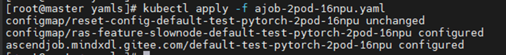
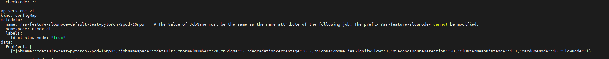
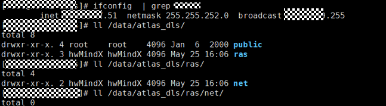
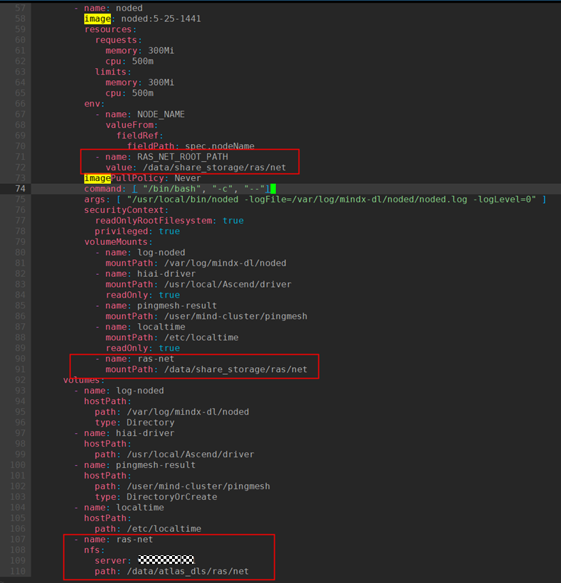
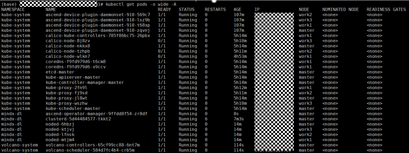

# Configuring Performance Degradation, Slow Node, and Slow Network Diagnosis

## Configuring Performance Degradation Fault Detection

### Using TaskD 7.1.RC1 or Later

#### Prerequisites<a name="zh-cn_topic_0000002194466236_section138036504533"></a>

- (Optional) [ClusterD](../../../05_developer_guide/00_installation_deployment/00_manual_installation/06_clusterd.md), [Ascend Device Plugin](../../../05_developer_guide/00_installation_deployment/00_manual_installation/04_ascend_device_plugin.md), and [Volcano](../../../05_developer_guide/00_installation_deployment/00_manual_installation/05_volcano.md) have been installed (the versions of the preceding MindCluster components must match the TaskD version).
- Install the following in the container: [TorchNPU](../../05_fault_recovery/01_resumable_training/03_examples_and_verification/01_pytorch_examples_and_verification.md#ZH-CN_TOPIC_0000002511426469) (**optional**, required for the PyTorch scenario, version 7.1.RC1 or later), MindSpore (**optional**, required for the MindSpore scenario, version 2.7.0 or later), [CANN](../../05_fault_recovery/01_resumable_training/03_examples_and_verification/01_pytorch_examples_and_verification.md#ZH-CN_TOPIC_0000002511426469) (**mandatory**, version 8.2.RC1 or later), and [TaskD](../../05_fault_recovery/01_resumable_training/03_examples_and_verification/01_pytorch_examples_and_verification.md#ZH-CN_TOPIC_0000002511426469) (**mandatory**).

#### Preparing Software Packages<a name="zh-cn_topic_0000002194466236_section8281518121516"></a>

**Table 1** Preparing software packages

<a name="zh-cn_topic_0000002194466236_table232305471415"></a>

|Software Package|Required|Description|Obtaining Method|Scenario|
|--|--|--|--|--|
|mstx_torch_plugin|No|<p>The [Collecting and Parsing msproftx Data](https://www.hiascend.com/document/detail/en/canncommercial/800/devaids/devtools/profiling/atlasprofiling_16_0033.html) function in Ascend PyTorch Profiler already has built-in instrumentation for communication operators. To make it easier for users to obtain the time consumption data of more key phases without modifying service code, mstx_torch_plugin has built-in instrumentation for the four key phase functions dataloader, forward, step, and save_checkpoint in Ascend PyTorch Profiler.</p><ul><li>mstx_torch_plugin must be installed if you want to use FP instrumentation data. It does not need to be installed in other scenarios.</li><li>mstx_torch_plugin 1.0 or later is required.</li></ul>|[Download link](https://ptdbg.obs.myhuaweicloud.com/profiler/example/1.0/mstx_torch_plugin-1.0-py3-none-any.whl)|PyTorch|

#### Configuring Performance Degradation Fault Detection<a name="section1831691464111"></a>

This solution applies only to TaskD 7.1.RC1 or later. If you use a component earlier than 7.1.RC1, see [Using Other TaskD Versions](#using-other-taskd-versions).

- **PyTorch scenario**

  1. Choose either of the following two methods based on your actual needs.
      - Install mstx\_torch\_plugin in the container.
          1. Download the [mstx\_torch\_plugin](https://ptdbg.obs.myhuaweicloud.com/profiler/example/1.0/mstx_torch_plugin-1.0-py3-none-any.whl) wheel package.
          2. Install the software package.

              ```shell
              pip install mstx_torch_plugin-1.0-py3-none-any.whl
              ```

          3. Import the wheel package in the AI job execution script.

              Make sure that the import order comes after `import torch` and `import torch_npu`. An example is shown below.

              ```shell
              import torch
              import torch_npu
              import mstx_torch_plugin
              ```

      - If a non-native optimizer is used or mstx\_torch\_plugin is not used, to obtain the Step time consumption data of training, modify the training iteration loop in the training script and add Step instrumentation code.

          The following example is for the PyTorch-MindSpeed scenario. Modify the `./mindspeed_llm/training/training.py` file and add the following bold fields.

          <pre codetype="Python">
          def train(forward_step_func, model, optimizer, opt_param_scheduler,
                    train_data_iterator, valid_data_iterator,
                    process_non_loss_data_func, config):
                      # Cache into one-logger for callback
              ……
              ……
              if is_profile_enabled():
                  prof = get_profiler()
                  prof.start()
              <strong>step_id = iteration</strong>
              while iteration < args.train_iters:
                  <strong>stream = torch.npu.current_stream()      # Obtain the execution stream of the current environment, used to obtain the NPU-side time</strong>
                  <strong>range_id = torch.npu.mstx.range_start(f"step {step_id}", stream) # Mark the start of the current training step</strong>
                  ……
                  ……
                  if args.manual_gc:
                      if args.manual_gc_interval != 0 and iteration % args.manual_gc_interval == 0:
                          gc.collect()

                  if is_profile_enabled():
                      prof.step()
                  <strong>step_id +=1  # Increment the training step by one, used to mark the next step</strong>
                  <strong>torch.npu.mstx.range_end(range_id) # Mark the end of the current training step</strong></pre>

  2. In the container, log in to the environment as the user running the CANN software package and run the source `\$\{install_path}/set_env.sh` command to set environment variables. `\$\{install_path}` is the installation directory of the CANN software. An example is shown below.

      ```shell
      source /usr/local/Ascend/cann/set_env.sh
      ```

  3. Before training starts, import the `LD_PRELOAD` environment variable in the training script. This environment variable allows the system to preload specified so files. An example is shown below.

      ```shell
      export LD_PRELOAD=/usr/local/Ascend/cann/lib64/libmspti.so:/usr/local/python3.10.5/lib/python3.10/site-packages/taskd/python/cython_api/libs/libtaskd.so:$LD_PRELOAD
      ```

      - `libmspti.so`: This so file is provided by MindStudio and integrated within the CANN package. When the default installation path is used, the path is `/usr/local/Ascend/cann/lib64/libmspti.so`.

      - `libtaskd.so`: This so file is provided by TaskD. After the wheel package is installed, the path is `TaskD_installation_path/taskd/python/cython_api/libs/libtaskd.so`.

          The TaskD installation path can be queried using the following command. The `Location` field in the output is the TaskD installation path.

          ```shell
          pip show taskd
          ```

  4. After the distributed environment is initialized and the global rank is obtained, modify the training script to start TaskD Manager in the script, start TaskD Proxy in the management process, and start TaskD Worker within the training process.
      1. <a name="li399811541"></a>(Optional) Start TaskD Manager and TaskD Proxy. If you enable lightweight profiling to obtain persisted data through the gRPC interface, perform the following steps. If you enable it through the ConfigMap, skip this step.
          1. Create a `manager.py` file in the current directory when the training script is called. The content of the `manager.py` file is as follows.

              ```python
              from taskd.api import init_taskd_manager, start_taskd_manager
              import os

              job_id=os.getenv("MINDX_TASK_ID")
              node_nums=XX         # Total number of nodes
              proc_per_node=XX     # Number of training processes per node

              init_taskd_manager({"job_id":job_id, "node_nums": node_nums, "proc_per_node": proc_per_node})
              start_taskd_manager()
              ```

              >[!NOTE]
              >For detailed parameter descriptions in the `manager.py` file, see [def init\_taskd\_manager\(config:dict\) -\> bool:](../../../06_api/07_taskd/04_taskd_manager_apis.md#def-init_taskd_managerconfigdict---bool).

          2. Add the following code to the training script to start TaskD Manager and TaskD Proxy.

              ```shell
              sed -i '/import os/i import taskd.python.adaptor.patch' $(pip3 show torch | grep Location | awk -F ' ' '{print $2}')/torch/distributed/run.py

              if [[ "${RANK}" -eq 0 ]]; then
                  export MASTER_ADDR=${POD_IP}
                  python /job/code/manager.py 2>> /job/code/alllogs/$MINDX_TASK_ID/taskd/error.log &      # The specific execution path of manager.py is determined by the current path, and the error.log path must be created in advance.
              fi

              torchrun ...
              ```

      2. <a name="li23023"></a>Start TaskD Worker.

         The following example is for the PyTorch-MindSpeed scenario. Modify the `QWEN3_for_PyTorch_2.7_code/mindspeed_llm/training/training.py` file and add the following bold fields.

          <pre codetype="Python">
          def pretrain(train_valid_test_dataset_provider,
                        model_provider,
                        model_type,
                        forward_step_func,
                        process_non_loss_data_func=None,
                        extra_args_provider=None,
                        args_defaults={}):
              print_rank_0('time to initialize megatron (seconds): {:.3f}'.format(
                  time.time() - _TRAIN_START_TIME))
              print_datetime('after megatron is initialized')
              <strong>import torch.distributed as dist</strong>
              <strong>if dist.is_initialized():</strong>
                  <strong>rank = dist.get_rank()</strong>
                  <strong>from taskd.api.taskd_worker_api import init_taskd_worker</strong>
                  <strong>from taskd.api.taskd_worker_api import start_taskd_worker</strong>
                  <strong>init_taskd_worker(rank,5000)</strong>
                  <strong>start_taskd_worker()</strong>
              app_metrics['app_model_init_finish_time'] = one_logger_utils.get_timestamp_in_ms()
              one_logger_utils.on_pretrain_start()</pre>

         >[!NOTE]
        >In the preceding code `init_taskd_worker(rank,5000)`, the input parameter 5000 is the upper limit of `/user/cluster-info/profiling`. For details, see the `upper_limit_of_disk_in_mb` parameter in [def init\_taskd\_worker\(rank\_id: int, upper\_limit\_of\_disk\_in\_mb: int = 5000, framework: str = "pt"\) -\> bool](../../../06_api/07_taskd/01_taskd_worker_apis.md#ZH-CN_TOPIC_0000002479226866).

  5. <a name="li5236yaml"></a>Modify the job YAML.
      1. Modify the container ports and add port 9601 used for TaskD communication under all Pods.

          ```yaml
          ...
                spec:
          ...
                  containers:
          ...
                    ports:
                    - containerPort: 9601
                      name: taskd-port
          ...
          ```

      2. Mount files.
          1. Mount the lightweight profiling configuration file: persist the `data-trace` ConfigMap corresponding to the job on the host to the `/user/cluster-info/datatrace-config/{namespace}.data-trace-{job name}/` folder, and mount the file named `profilingSwitch` to the specified path in the container: `/user/cluster-info/datatrace-config/`.
          2. Mount the lightweight profiling persisted file: lightweight profiling data is written to the `/user/cluster-info/profiling` path in the container. To obtain it on the host, modify the job YAML to mount this path out.
              - The following is an example of mounting in the container YAML.

                  ```yaml
                  volumeMounts:
                  - name: profilingdata
                    mountPath: /user/cluster-info/
                  - name: profileswitch
                    mountPath: /user/cluster-info/datatrace-config
                  ```

              - The following is an example of mounting in the host YAML.

                  ```yaml
                  volumes:
                  - name: profileswitch
                    hostPath:
                      path: /user/cluster-info/datatrace-config/default.data-trace-default-test-pytorch-fault-mixtral
                  - name: profilingdata
                    hostPath:
                      path: /home/profilingdatapath
                  ```

  6. <a name="li52986profiling"></a>Enable lightweight profiling to obtain persisted data. The following two methods are supported:
      - Modify the gRPC interface provided by ClusterD: If the step "[Start TaskD Manager and TaskD Proxy](#li399811541)" is configured, use this method. For details about the interface, see [ModifyTrainingDataTraceSwitch](../../../06_api/04_clusterd/04_performance_degradation_apis.md#modifytrainingdatatraceswitch).

          >[!NOTE]
          >When you enable or modify lightweight profiling persisted data through the gRPC interface provided by ClusterD, the lifecycle of the created `data-trace-<job name>` ConfigMap ends when the job is deleted. When the job does not exist, the interface call fails.

      - Modify the `data-trace` ConfigMap corresponding to the job: If the step "[Start TaskD Manager and TaskD Proxy](#li399811541)" is not configured, use this method. The detailed procedure is as follows:

          The following uses the job named `default-test-pytorch-fault-mixtral` in the `default` namespace as an example to enable lightweight profiling persisted data by editing the ConfigMap.

          1. Run the following command on the master node to query the ConfigMap corresponding to the job.

              ```shell
              kubectl get cm
              ```

              - If `data-trace-default-test-pytorch-fault-mixtral` already exists, perform [step 3](#zh-cn_topic_0000002194466236_li4751182133418) to edit the file.

                  Output example:

                  ```ColdFusion
                  NAME                                              DATA   AGE
                  data-trace-default-test-pytorch-fault-mixtral     1      18h
                  ```

              - If `data-trace-default-test-pytorch-fault-mixtral` does not exist, perform [step 2](#zh-cn_topic_0000002194466236_li1633768104412) to create the file.

          2. <a name="zh-cn_topic_0000002194466236_li1633768104412"></a>Run the following command to create the ConfigMap file required for configuring lightweight profiling persisted data.
              1. Write the following content to `datacm.yaml`.

                  ```yaml
                  apiVersion: v1
                  kind: ConfigMap
                  metadata:
                    name: data-trace-default-test-pytorch-fault-mixtral  # The CM name must be prefixed with data-trace plus the job name
                    labels:
                      reset: "true"
                  data:
                    profilingSwitch: '{"CommunicationOperator":"off","Step":"on","SaveCheckpoint":"on","FP":"on","DataLoader":"on"}'
                  ```

              2. Run the following command on the master node to create the ConfigMap.

                  ```shell
                  kubectl apply -f datacm.yaml
                  ```

                  The following output indicates that the ConfigMap is created successfully.

                  ```ColdFusion
                  configmap/data-trace-default-test-pytorch-fault-mixtral created
                  ```

          3. <a name="zh-cn_topic_0000002194466236_li4751182133418"></a>Run the following command to edit the ConfigMap file.

              ```shell
              kubectl edit cm data-trace-default-test-pytorch-fault-mixtral
              ```

          4. To enable communication operators, change the value of the `CommunicationOperator` field to `"on"`.

              ```yaml
              apiVersion: v1
              data:
                profilingSwitch: '{"CommunicationOperator":"on","Step":"on","SaveCheckpoint":"on","FP":"on","DataLoader":"on"}'
              ```

              >[!NOTE]
              >Enabling communication operators may degrade training performance. Enabling them all the time is not recommended.

          5. Press `Esc`, type `:wq!`, and press `Enter` to save and exit.

- **MindSpore scenario**

  1. In the container, log in to the environment as the user running the CANN software package and run the `source \$\{install_path}/set_env.sh` command to set environment variables. \$\{install\_path\} is the installation directory of the CANN software. An example is shown below.

      ```shell
      source /usr/local/Ascend/cann/set_env.sh
      ```

  2. Before training starts, import the `LD_PRELOAD` environment variable in the training script. This environment variable allows the system to preload specified so files. An example is shown below.

      ```shell
      export LD_PRELOAD=/usr/local/Ascend/cann/lib64/libmspti.so:/usr/local/python3.10.5/lib/python3.10/site-packages/taskd/python/cython_api/libs/libtaskd.so:$LD_PRELOAD
      ```

      - `libmspti.s`o: This so file is provided by MindStudio and integrated within the CANN package. When the default installation path is used, the path is `/usr/local/Ascend/cann/lib64/libmspti.so`.

      - `libtaskd.so`: This so file is provided by TaskD. After the wheel package is installed, the path is `TaskD_installation_path/taskd/python/cython_api/libs/libtaskd.so`.

          The TaskD installation path can be queried using the following command. The Location field in the output is the TaskD installation path.

          ```shell
          pip show taskd
          ```

  3. After the distributed environment is initialized and the global rank is obtained, modify the training script to start TaskD Manager in the script, start TaskD Proxy in the management process, and start TaskD Worker within the training process.
      1. <a name="li399811541-duplicate-2"></a>(Optional) Start TaskD Manager and TaskD Proxy. If you enable lightweight profiling to obtain persisted data through the gRPC interface, perform the following steps. If you enable it through the ConfigMap, skip this step.

          1. Create a `manager.py` file in the current directory when the training script is called. The content of the `manager.py` file is as follows.

              ```python
              from taskd.api import init_taskd_manager, start_taskd_manager
              import os

              job_id=os.getenv("MINDX_TASK_ID")
              node_nums=XX         # Total number of nodes
              proc_per_node=XX     # Number of training processes per node

              init_taskd_manager({"job_id":job_id, "node_nums": node_nums, "proc_per_node": proc_per_node})
              start_taskd_manager()
              ```

              >[!NOTE]
              >For detailed parameter descriptions in the `manager.py` file, see [def init\_taskd\_manager\(config:dict\) -\> bool:](../../../06_api/07_taskd/04_taskd_manager_apis.md#def-init_taskd_managerconfigdict---bool).

          2. Add the following code to the training script to start TaskD Manager.

              ```shell
              if [[ "${MS_SCHED_HOST}" -eq "${POD_IP}" ]]; then
                  python /job/code/manager.py 2>> /job/code/alllogs/$MINDX_TASK_ID/taskd/error.log &       # The specific execution path of manager.py is determined by the current path, and the error.log path must be created in advance.
              fi

              msrun ...
              ```

      2. <a name="li2302301"></a>Start TaskD Worker.

          The following example is for the MindSpore-MindFormers scenario. Modify the `./mindformers/trainer/base_trainer.py` file and add the following bold fields.

          <pre codetype="Python">
          def training_process(
                  self,
                  config: Optional[Union[dict, MindFormerConfig, ConfigArguments, TrainingArguments]] = None,
                  network: Optional[Union[Cell, PreTrainedModel]] = None,
                  dataset: Optional[Union[BaseDataset, GeneratorDataset]] = None,
                  optimizer: Optional[Optimizer] = None,
                  callbacks: Optional[Union[Callback, List[Callback]]] = None,
                  compute_metrics: Optional[Union[dict, set]] = None,
                  **kwargs):
              ……
              ……
              logger.info(".........Starting Training Model..........")
              if get_real_rank() % 8 == 0:
                  pprint(config)
              logger.info(".........Model Compiling, Please Wait a Moment...........")
              ......
              <strong>try:</strong>
                  <strong>rank = get_rank()</strong>
                  <strong>from taskd.api.taskd_worker_api import init_taskd_worker</strong>
                  <strong>from taskd.api.taskd_worker_api import start_taskd_worker</strong>
                  <strong>init_taskd_worker(rank,5000,"ms")</strong>
                  <strong>start_taskd_worker()</strong>
              <strong>except Exception as e:</strong>
                  <strong>print("failed to call mindcluster taskd")</strong>
              model.train(config.runner_config.epochs, dataset,
                          callbacks=callbacks,
                          dataset_sink_mode=config.runner_config.sink_mode,
                          sink_size=config.runner_config.sink_size,
                          initial_epoch=config.runner_config.initial_epoch)</pre>

      >[!NOTE]
      >In the preceding code `init_taskd_worker(rank,5000)`, the input parameter 5000 is the upper limit of `/user/cluster-info/profiling`. For details, see the "upper\_limit\_of\_disk\_in\_mb" parameter in [def init\_taskd\_worker\(rank\_id: int, upper\_limit\_of\_disk\_in\_mb: int = 5000, framework: str = "pt"\) -\> bool](../../../06_api/07_taskd/01_taskd_worker_apis.md#ZH-CN_TOPIC_0000002479226866).

  4. Modify the job YAML. For details, see [step 5 in the PyTorch scenario](#li5236yaml).
  5. Enable lightweight profiling to obtain persisted data. For details, see [step 6 in the PyTorch scenario](#li52986profiling).

### Using Other TaskD Versions

#### Prerequisites<a name="zh-cn_topic_0000002194466236_section138036504533-duplicate-2"></a>

- (Optional) [ClusterD](../../../05_developer_guide/00_installation_deployment/00_manual_installation/06_clusterd.md), [Ascend Device Plugin](../../../05_developer_guide/00_installation_deployment/00_manual_installation/04_ascend_device_plugin.md), and [Volcano](../../../05_developer_guide/00_installation_deployment/00_manual_installation/05_volcano.md) have been installed (the versions of the preceding MindCluster components must match TaskD).
- Install the following in the container: [TorchNPU](../../05_fault_recovery/01_resumable_training/03_examples_and_verification/01_pytorch_examples_and_verification.md#ZH-CN_TOPIC_0000002511426469) (**optional**, required for the PyTorch scenario, version 7.0.0 or later), MindSpore (**optional**, required for the MindSpore scenario, version 2.6.RC1 or later), [CANN](../../05_fault_recovery/01_resumable_training/03_examples_and_verification/01_pytorch_examples_and_verification.md#ZH-CN_TOPIC_0000002511426469) (**mandatory**, version 8.1.RC1 or later), and [TaskD](../../05_fault_recovery/01_resumable_training/03_examples_and_verification/01_pytorch_examples_and_verification.md#ZH-CN_TOPIC_0000002511426469) (**mandatory**, version 7.0.RC1 or later).

#### Preparing Software Packages<a name="zh-cn_topic_0000002194466236_section8281518121516-duplicate-2"></a>

**Table 2** Preparing software packages

<a name="zh-cn_topic_0000002194466236_table232305471415-duplicate-2"></a>

|Software Package|Required|Description|Obtaining Method|Scenario|
|--|--|--|--|--|
|mstx_torch_plugin|No|<p>The [Collecting and Parsing msproftx Data](https://www.hiascend.com/document/detail/zh/canncommercial/800/devaids/devtools/profiling/atlasprofiling_16_0033.html) function in Ascend PyTorch Profiler already has built-in instrumentation for communication operators. To make it easier for users to obtain the time consumption data of more key phases without modifying service code, mstx_torch_plugin has built-in instrumentation for the four key phase functions dataloader, forward, step, and save_checkpoint in Ascend PyTorch Profiler.</p><ul><li>mstx_torch_plugin must be installed if you want to use FP data. It does not need to be installed in other scenarios.</li><li>mstx_torch_plugin 1.0 or later is required.</li></ul>|[Download link](https://ptdbg.obs.myhuaweicloud.com/profiler/example/1.0/mstx_torch_plugin-1.0-py3-none-any.whl)|PyTorch|

#### Configuring Performance Degradation Fault Detection<a name="section167141313174510"></a>

This solution applies only to TaskD earlier than 7.1.RC1. If you use a component of 7.1.RC1 or later, see [Using TaskD 7.1.RC1 or Later](#using-taskd-71rc1-or-later).

- **PyTorch scenario**

  1. (Optional) Install mstx\_torch\_plugin in the container.
      1. Download the [mstx\_torch\_plugin](https://ptdbg.obs.myhuaweicloud.com/profiler/example/1.0/mstx_torch_plugin-1.0-py3-none-any.whl) wheel package.
      2. Install the software package.

          ```shell
          pip install mstx_torch_plugin-1.0-py3-none-any.whl
          ```

      3. Import the wheel package in the AI job execution script.

          Make sure that the import order comes after `import torch` and `import torch_npu`. An example is shown below.

          ```python
          import torch
          import torch_npu
          import mstx_torch_plugin
          ```

  2. (Optional) If a non-native optimizer is used or mstx\_torch\_plugin is not used, to obtain the Step time consumption data of training, modify the training iteration loop in the training script and add Step instrumentation code.

      The following example is for the PyTorch-MindSpeed scenario. Modify the `./mindspeed_llm/training/training.py` file and add the following bold fields.

      <pre codetype="Python">
      def train(forward_step_func, model, optimizer, opt_param_scheduler,
                train_data_iterator, valid_data_iterator,
                process_non_loss_data_func, config):
                  # Cache into one-logger for callback
          ……
          ……
          if is_profile_enabled():
              prof = get_profiler()
              prof.start()
          <strong>step_id = iteration</strong>
          while iteration < args.train_iters:
                  <strong>stream = torch.npu.current_stream()      # Obtain the execution stream of the current environment, used to obtain the NPU-side time</strong>
                  <strong>range_id = torch.npu.mstx.range_start(f"step {step_id}", stream) # Mark the start of the current training step</strong>
              ……
              ……
              if args.manual_gc:
                  if args.manual_gc_interval != 0 and iteration % args.manual_gc_interval == 0:
                      gc.collect()

              if is_profile_enabled():
                  prof.step()
                  <strong>step_id +=1  # Increment the training step by one, used to mark the next step</strong>
                  <strong>torch.npu.mstx.range_end(range_id) # Mark the end of the current training step</strong></pre>

  3. In the container, log in to the environment as the user running the CANN software package and run the `source \$\{install_path}/set_env.sh` command to set environment variables. `\$\{install_path}` is the installation directory of the CANN software. An example is shown below.

      ```shell
      source /usr/local/Ascend/cann/set_env.sh
      ```

  4. Before training starts, import the `LD_PRELOAD` environment variable in the training script. This environment variable allows the system to preload specified so files. An example is shown below.

      ```shell
      export LD_PRELOAD=/usr/local/Ascend/cann/lib64/libmspti.so:/usr/local/python3.10.5/lib/python3.10/site-packages/taskd/python/cython_api/libs/libtaskd.so:$LD_PRELOAD
      ```

      - `libmspti.so`: This so file is provided by MindStudio and integrated within the CANN package. When the default installation path is used, the path is `/usr/local/Ascend/cann/lib64/libmspti.so`.

      - `libtaskd.so`: This so file is provided by TaskD. After the wheel package is installed, the path is `TaskD_installation_path/taskd/python/cython_api/libs/libtaskd.so`.

          The TaskD installation path can be queried using the following command. The Location field in the output is the TaskD installation path.

          ```shell
          pip show taskd
          ```

  5. <a name="li230238965"></a>After the distributed environment is initialized and the global rank is obtained, modify the training script to start TaskD Worker within the training process.

      The following example is for the PyTorch-MindSpeed scenario. Modify the `QWEN3_for_PyTorch_2.7_code/mindspeed_llm/training/training.py` file and add the following bold fields.

        <pre codetype="Python">
        def pretrain(train_valid_test_dataset_provider,
                      model_provider,
                      model_type,
                      forward_step_func,
                      process_non_loss_data_func=None,
                      extra_args_provider=None,
                      args_defaults={}):
            print_rank_0('time to initialize megatron (seconds): {:.3f}'.format(
                time.time() - _TRAIN_START_TIME))
            print_datetime('after megatron is initialized')
            <strong>import torch.distributed as dist</strong>
            <strong>if dist.is_initialized():</strong>
                <strong>rank = dist.get_rank()</strong>
                <strong>from taskd.api.taskd_worker_api import init_taskd_worker</strong>
                <strong>from taskd.api.taskd_worker_api import start_taskd_worker</strong>
                <strong>init_taskd_worker(rank,5000)</strong>
                <strong>start_taskd_worker()</strong>
            app_metrics['app_model_init_finish_time'] = one_logger_utils.get_timestamp_in_ms()
            one_logger_utils.on_pretrain_start()</pre>

        >[!NOTE]
        >In the preceding code `init_taskd_worker(rank,5000)`, the input parameter 5000 is the upper limit of `/user/cluster-info/profiling`. For details, see the "upper\_limit\_of\_disk\_in\_mb" parameter in [def init\_taskd\_worker\(rank\_id: int, upper\_limit\_of\_disk\_in\_mb: int = 5000, framework: str = "pt"\) -\> bool](../../../06_api/07_taskd/01_taskd_worker_apis.md#ZH-CN_TOPIC_0000002479226866).

  6. <a name="li5236890yaml"></a>Modify the job YAML.
          1. Mount the lightweight profiling configuration file: persist the data-trace ConfigMap corresponding to the job on the host to the `/user/cluster-info/datatrace-config/{namespace}.data-trace-{job name}/` folder, and mount the file named profilingSwitch to the specified path in the container: `/user/cluster-info/datatrace-config/`.
          2. Mount the lightweight profiling persisted file: lightweight profiling data is written to the `/user/cluster-info/profiling` path in the container. To obtain it on the host, modify the job YAML to mount this path out.
              - The following is an example of mounting in the container YAML.

              ```yaml
              volumeMounts:
              - name: profilingdata
                mountPath: /user/cluster-info/
              - name: profileswitch
                mountPath: /user/cluster-info/datatrace-config
              ```

              - The following is an example of mounting in the host YAML.

              ```yaml
              volumes:
              - name: profileswitch
                hostPath:
                  path: /user/cluster-info/datatrace-config/default.data-trace-default-test-pytorch-fault-mixtral
              - name: profilingdata
                hostPath:
                  path: /home/profilingdatapath
              ```

  7. <a name="li52986890profiling"></a>Enable lightweight profiling to obtain persisted data. Modify the data-trace ConfigMap corresponding to the job or the gRPC interface provided by ClusterD (for details about the interface, see [ModifyTrainingDataTraceSwitch](../../../06_api/04_clusterd/04_performance_degradation_apis.md#modifytrainingdatatraceswitch)) to dynamically enable or disable the lightweight profiling capability.

          The following uses the job named `default-test-pytorch-fault-mixtral` in the `default` namespace as an example to enable lightweight profiling persisted data by editing the ConfigMap.

          1. Run the following command on the master node to query the ConfigMap corresponding to the job.

          ```shell
          kubectl get cm
          ```

          - If `data-trace-default-test-pytorch-fault-mixtral` already exists, perform [step 3](#zh-cn_topic_0000002194466236_li47511821334189) to edit the file.

                  The following is an example.

              ```ColdFusion
              NAME                                              DATA   AGE
              data-trace-default-test-pytorch-fault-mixtral     1      18h
              ```

          - If `data-trace-default-test-pytorch-fault-mixtral` does not exist, perform [step 2](#zh-cn_topic_0000002194466236_li16337681044126) to create the file.

      1. <a name="zh-cn_topic_0000002194466236_li16337681044126"></a>Run the following command to create the ConfigMap file required for configuring lightweight profiling persisted data.
          1. Write the following content to `datacm.yaml`.

              ```yaml
              apiVersion: v1
              kind: ConfigMap
              metadata:
                name: data-trace-default-test-pytorch-fault-mixtral  # The CM name must be prefixed with data-trace plus the job name
                labels:
                  reset: "true"
              data:
                profilingSwitch: '{"CommunicationOperator":"off","Step":"on","SaveCheckpoint":"on","FP":"on","DataLoader":"on"}'
              ```

          2. Run the following command on the master node to create the ConfigMap.

              ```shell
              kubectl apply -f datacm.yaml
              ```

              The following output indicates that the ConfigMap is created successfully.

              ```ColdFusion
              configmap/data-trace-default-test-pytorch-fault-mixtral created
              ```

      2. <a name="zh-cn_topic_0000002194466236_li47511821334189"></a>Run the following command to edit the ConfigMap file.

          ```shell
          kubectl edit cm data-trace-default-test-pytorch-fault-mixtral
          ```

      3. To enable communication operators, change the value of the `CommunicationOperator` field to `"on"`.

          ```yaml
          apiVersion: v1
          data:
            profilingSwitch: '{"CommunicationOperator":"on","Step":"on","SaveCheckpoint":"on","FP":"on","DataLoader":"on"}'
          ```

          >[!NOTE]
          >Enabling communication operators may degrade training performance. Enabling them all the time is not recommended.

      4. Press `Esc`, type `:wq!`, and press `Enter` to save and exit.

- **MindSpore scenario**

  1. In the container, log in to the environment as the user running the CANN software package and run the source `\$\{install_path}/set_env.sh` command to set environment variables. `\$\{install_path}` is the installation directory of the CANN software. An example is shown below.

      ```shell
      source /usr/local/Ascend/cann/set_env.sh
      ```

  2. Before training starts, import the `LD_PRELOAD` environment variable in the training script. This environment variable allows the system to preload specified so files. An example is shown below.

      ```shell
      export LD_PRELOAD=/usr/local/Ascend/cann/lib64/libmspti.so:/usr/local/python3.10.5/lib/python3.10/site-packages/taskd/python/cython_api/libs/libtaskd.so:$LD_PRELOAD
      ```

      - `libmspti.so`: This so file is provided by MindStudio and integrated within the CANN package. When the default installation path is used, the path is `/usr/local/Ascend/cann/lib64/libmspti.so`.

      - `libtaskd.so`: This so file is provided by TaskD. After the wheel package is installed, the path is `TaskD_installation_path/taskd/python/cython_api/libs/libtaskd.so`.

          The TaskD installation path can be queried using the following command. The Location field in the output is the TaskD installation path.

          ```shell
          pip show taskd
          ```

  3. <a name="li23023896501"></a>After the distributed environment is initialized and the global rank is obtained, modify the training script to start TaskD Worker within the training process.

      The following example is for the MindSpore-MindFormers scenario. Modify the `./mindformers/trainer/base_trainer.py` file and add the following bold fields.

       <pre codetype="Python">
       def training_process(
               self,
               config: Optional[Union[dict, MindFormerConfig, ConfigArguments, TrainingArguments]] = None,
               network: Optional[Union[Cell, PreTrainedModel]] = None,
               dataset: Optional[Union[BaseDataset, GeneratorDataset]] = None,
               optimizer: Optional[Optimizer] = None,
               callbacks: Optional[Union[Callback, List[Callback]]] = None,
               compute_metrics: Optional[Union[dict, set]] = None,
               **kwargs):
           ……
           ……
           logger.info(".........Starting Training Model..........")
           if get_real_rank() % 8 == 0:
               pprint(config)
           logger.info(".........Model Compiling, Please Wait a Moment...........")
           ......
           <strong>try:</strong>
               <strong>rank = get_rank()</strong>
               <strong>from taskd.api.taskd_worker_api import init_taskd_worker</strong>
               <strong>from taskd.api.taskd_worker_api import start_taskd_worker</strong>
               <strong>init_taskd_worker(rank,5000,"ms")</strong>
               <strong>start_taskd_worker()</strong>
           <strong>except Exception as e:</strong>
               <strong>print("failed to call mindcluster taskd")</strong>
           model.train(config.runner_config.epochs, dataset,
                       callbacks=callbacks,
                       dataset_sink_mode=config.runner_config.sink_mode,
                       sink_size=config.runner_config.sink_size,
                       initial_epoch=config.runner_config.initial_epoch)</pre>

      >[!NOTE]
      >In the preceding code `init_taskd_worker(rank,5000)`, the input parameter 5000 is the upper limit of `/user/cluster-info/profiling`. For details, see the "upper\_limit\_of\_disk\_in\_mb" parameter in [def init\_taskd\_worker\(rank\_id: int, upper\_limit\_of\_disk\_in\_mb: int = 5000, framework: str = "pt"\) -\> bool](../../../06_api/07_taskd/01_taskd_worker_apis.md#ZH-CN_TOPIC_0000002479226866).

  4. Modify the job YAML. For details, see [step 6 in the PyTorch scenario](#li5236890yaml).
  5. Enable lightweight profiling to obtain persisted data. For details, see [step 7 in the PyTorch scenario](#li52986890profiling).

## Configuring Slow Node and Slow Network Diagnosis

### Before You Start<a name="zh-cn_topic_0000002333550505_section420815439315"></a>

Before using the slow node and slow network fault diagnosis function, increase the CPU and memory resource sizes in NodeD. Change the resource information in the NodeD startup YAML file.

The current YAML file content is as follows:

```yaml
resources:
            requests:
              memory: 300Mi
              cpu: 500m
            limits:
              memory: 300Mi
              cpu: 500m
```

The modified YAML file content is as follows:

```yaml
resources:
            requests:
              memory: 10Gi
              cpu: 5000m
            limits:
              memory: 10Gi
              cpu: 5000m
```

### Deployment Mode<a name="zh-cn_topic_0000002333550505_section1048011118418"></a>

ClusterD and the FD-OL (Fault Diagnose Online) framework are in the same process and are both deployed on the management node. ClusterD automatically starts the FD-OL framework when it is started.

### Configuring Slow Node Diagnosis

#### Prerequisites

- The deployment for [Performance Degradation Faults](#configuring-performance-degradation-fault-detection) has been completed.
- Modify the group owner of the "/user/slownode-cluster" directory.

  ```shell
  mkdir -m 750 /user/slownode-cluster
  chown hwMindX:hwMindX /user/slownode-cluster
  ```

#### Usage Example<a name="zh-cn_topic_0000002278667326_section19867823600"></a>

Start a slow node diagnosis job.

1. To obtain the parallel domain information, add a function call that obtains the parallel domain information to the training iteration loop in the training script. The following example is for the PyTorch-MindSpeed scenario. Add the following bold fields to the `./mindspeed_llm/training/training.py` file.

    <pre codetype="Python">
    def train(forward_step_func, model, optimizer, opt_param_scheduler,
              train_data_iterator, valid_data_iterator,
              process_non_loss_data_func, config):
        ……
        if is_profile_enabled():
            prof = get_profiler()
            prof.start()
        <strong>m_iter = 0</strong>
        while iteration < args.train_iters:
            ……
            args.curr_iteration = iteration
            loss_dict, skipped_iter, grad_norm, num_zeros_in_grad = \
                train_step(forward_step_func,
                           train_data_iterator,
                           model,
                           optimizer,
                           opt_param_scheduler,
                           config)
            iteration += 1
            <strong>m_iter += 1</strong>
            <strong>if m_iter == 5:</strong>
                <strong>from taskd.python.adaptor.pytorch.group_info import dump_group_info</strong>
                <strong>dump_group_info()</strong>
            batch_size = mpu.get_data_parallel_world_size() * \
                         args.micro_batch_size * \
                         get_num_microbatches()</pre>

2. Complete [Before You Start](#zh-cn_topic_0000002333550505_section420815439315) and [Deployment Mode](#zh-cn_topic_0000002333550505_section1048011118418).
3. Run the `kubectl apply -f ajob-2pod-16npu.yaml` command to create a slow node diagnosis job and write it to the ConfigMap.

    

4. The content of `ajob-2pod-16npu.yaml` is as follows. For details about each output, see [Table 3](#zh-cn_topic_0000002278667326_table1834456175114).

    

    The following is a YAML example. It cannot be directly copied and compiled, and is for reference only.

    ```yaml
    ---
    apiVersion: v1
    kind: ConfigMap
    metadata:
      name: ras-feature-slownode-default-test-pytorch-2pod-16npu    # The value of JobName must be the same as the name attribute of the following job. The prefix ras-feature-slownode- cannot be modified.
      namespace: mindx-dl
      labels:
        fd-ol-slow-node: "true"
    data:
      FeatConf: |
        {"jobName":"default-test-pytorch-2pod-16npu","jobNamespace":"default","normalNumber":20,"nSigma":3,"degradationPercentage":0.3,"nConsecAnomaliesSignifySlow":3,"nSecondsDoOneDetection":30,"clusterMeanDistance":1.3,"cardOneNode":16,"SlowNode":1}
    ---
    ```

    **Table 3** YAML file output description

    <a name="zh-cn_topic_0000002278667326_table1834456175114"></a>

    |Field Name|Default Value|Description|
    |--|--|--|
    |jobNamespace|default|Namespace where the job resides.|
    |jobName|-|Job name.|
    |normalNumber|20|Initial threshold (normal count) for calculation.|
    |nSigma|3|Number of σ to set to calculate the upper and lower bounds.|
    |degradationPercentage|0.3|Threshold, the degradation percentage. 0.3 indicates a degradation of 30%.|
    |nConsecAnomaliesSignifySlow|3|Number of anomalies to set. Detection is performed only after consecutive anomalies occur multiple times.|
    |nSecondsDoOneDetection|30 seconds|Interval for detection, in seconds.|
    |clusterMeanDistance|1.3|After clustering, the threshold distance between two categories (mean1 and mean2).|
    |cardOneNode|16 cards|Number of cards on one node.|
    |slowNode|The default value is 1, and the job is enabled.|<p>Whether to enable the job.</p><ul><li>1: Enable the job.</li><li>0: Disable the job.</li></ul>|

### Configuring Slow Network Diagnosis

#### Usage Example<a name="zh-cn_topic_0000002313236861_section1969604665710"></a>

1. Configure shared storage.

    ClusterD and NodeD interact through shared storage, and their shared storage root paths must be consistent. The owner of the root path of the shared directory is user `9000`, which is the same as the user running ClusterD.

    1. Configure the server.

        

    2. Modify the NodeD configuration.

        

    3. Modify the ClusterD configuration.

        

    4. If the output of the `kubectl get pods -o wide -A` command is similar to the following example, the shared storage configuration is complete.

        

2. Enable the fault detection switch.
    1. Log in to the environment and go to the NodeD decompression directory.
    2. Run the following command to create a ConfigMap named `pingmesh-config`. `pingmesh-config.yaml` is the pingmesh configuration file, which can be obtained from the NodeD installation package.

        ```shell
        kubectl apply -f pingmesh-config.yaml
        ```

        Command output:

        ```ColdFusion
        configmap/pingmesh-config created
        ```

    3. Run the following command to edit the `pingmesh-config` file. For details about how to fill in the parameters in this file, see the table below.

        ```shell
        kubectl edit cm -n cluster-system pingmesh-config
        ```

        **Table 4** pingmesh-config file parameter description

        <a name="zh-cn_topic_0000002313236861_table15591134151811"></a>

        |Parameter|Value|Description|
        |--|--|--|
        |app|pingmesh|Key of one of the labels of the ConfigMap.|
        |global|-|Cluster configuration information.|
        |"1"|Super node ID|Configuration example for the super node whose ID is 1. You can modify or add configurations based on the actual situation. After a super node is configured, NodeD uses the configuration information of the super node and ignores the global configuration information.|
        |activate|<ul><li>on: enabled</li><li>off: disabled</li></ul>|Whether to enable the pingmesh function.|
        |task_interval|[1~60]|Interval of pingmesh tasks, in seconds.|
