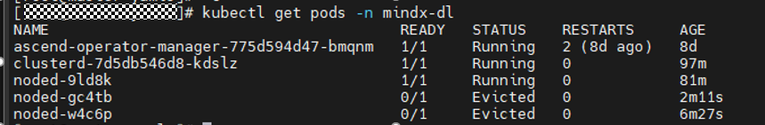
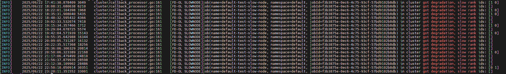
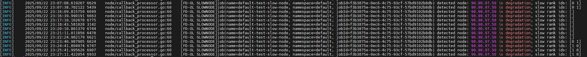
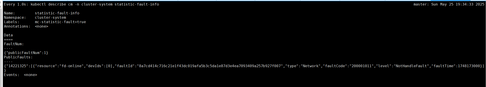

# Querying and Verifying Faults

This chapter is used only to verify whether faults are detected, diagnosed, aggregated, and reported.

## Querying ConfigMap Reporting Results

- The Ascend Device Plugin on each compute node creates a ConfigMap file that records information about the NPUs and UnifiedBus devices on the node. The ConfigMap file is named "mindx-dl-deviceinfo-&lt;nodename&gt;" (hereinafter referred to as "device-info-cm"), and fault information is reported through this ConfigMap. For details about the fields in the ConfigMap file, see the [DeviceInfoCfg](../../06_api/02_ascend_device_plugin.md#chip-resources) table.
- K8s RDMA Shared Dev Plugin on each compute node creates a ConfigMap file that records the UB NIC fault information of the node. The ConfigMap file is named "dpuinfo-&lt;nodename&gt;", and UB NIC fault information is reported through this ConfigMap. For details about the fields in the ConfigMap file, see [ConfigMap Description](../../06_api/11_k8s_rdma_shared_dev_plugin.md#table_dpuconfigmap_k8s_rdma_shared_dev_plugin).
- When a node fault exists on a node, NodeD on each compute node creates a ConfigMap file that records the device information of the node. The ConfigMap file is named "mindx-dl-nodeinfo-&lt;nodename&gt;" (hereinafter referred to as "node-info-cm"), and node fault information is reported through this ConfigMap. For details about the fields in the ConfigMap file, see the [mindx-dl-nodeinfo-&lt;nodename&gt;](../../06_api/03_noded.md#node-resources) table.
- ClusterD creates ConfigMap files that record the device information of the cluster. The ConfigMap files are named "cluster-info-<device/switch>-<[0-5]>" and "cluster-info-node-cm" (hereinafter referred to as "cluster-info-cm"). Node and chip fault information is reported through [cluster-info-cm](../../06_api/04_clusterd/00_cluster_resources.md).

Related query entries:

- [Ascend Device Plugin fault information](../../07_references/02_common_operations.md#ZH-CN_TOPIC_0000002479387086)
- [ClusterD fault information](../../07_references/02_common_operations.md#ZH-CN_TOPIC_0000002511347035)
- [NodeD fault information](../../07_references/02_common_operations.md#ZH-CN_TOPIC_0000002511427003)
- [UB NIC fault information](../../07_references/02_common_operations.md)

## Querying pingmesh UnifiedBus Network Detection Results

### Viewing Detection Result Information<a name="zh-cn_topic_0000002193288232_section772614207398"></a>

>[!NOTE]
>The detection result query period is 10 times the value of the configuration parameter `task_interval`.

The pingmesh result of UnifiedBus network detection is written to the file "&lt;nodename&gt;.log". The fields in the file are described in the following table.

**Table 1** &lt;nodename&gt;.log

<a name="zh-cn_topic_0000002193288232_table313985322113"></a>

|Parameter|Description|Value|
|--|--|--|
|uid|ID of this pingmesh task.|A 64-character string|
|config|User configuration of this pingmesh task.|String|
|physicID|Physical ID of the NPU card.|[0—15]|
|taskID|Task ID. 0 indicates intra-node, and 1 indicates inter-node.|0 or 1|
|DestNum|Number of target addresses of this pingmesh task.|[0—47]|
|source_addr|Source address|IPv4 network address|
|target_addr|Target address|IPv4 network address|
|suc_pkt_num|Number of successfully sent packets.|-|
|fail_pkt_num|Number of packets that failed to be sent.|-|
|max_time|Longest response time.|<ul><li>When the ping fails, the value is -1.</li><li>Under normal conditions, the value is a non-negative value.</li></ul>|
|min_time|Shortest response time.|<ul><li>When the ping fails, the value is -1.</li><li>Under normal conditions, the value is a non-negative value.</li></ul>|
|avg_time|Average response time.|<ul><li>When the ping fails, the value is -1.</li><li>Under normal conditions, the value is a non-negative value.</li></ul>|
|tp95_time|Response time at the 95th percentile.|<ul><li>When the ping fails, the value is -1.</li><li>Under normal conditions, the value is a non-negative value.</li></ul>|
|reply_stat_num|Number of responses queried this time.|-|
|ping_total_num|Cumulative number of responses of this task.|-|

### Viewing Fault Information<a name="zh-cn_topic_0000002193288232_section7712929183110"></a>

Run the following command on the management node to view the fault information of UnifiedBus network detection.

```shell
kubectl describe cm -n cluster-system pingmesh-fault-<nodename>
```

The fields in the fault information are described as follows.

**Table 2** pingmesh-fault-&lt;nodename&gt;

<a name="zh-cn_topic_0000002193288232_table2371535113510"></a>

|Parameter|Description|Value|
|--|--|--|
|mc-consumer-publicfault|Label key required by ClusterD for listening|true|
|PublicFault|Public fault information key|For details, see the [fault field description](../../06_api/04_clusterd/03_public_fault_apis.md#configmap) table.|

## Querying Performance Degradation Fault Detection Data

- The data written to disks is classified by rank. Lightweight profiling data is written to the `/user/cluster-info/profiling` path in the container.
- For a Pod with the environment variable [MINDX\_TASK\_ID](../../06_api/13_environment_variable_description.md#ascend-operator-environment-variables), the path of the rank 0 data in the container is `/user/cluster-info/profiling/$MINDX_TASK_ID/0`.

    >[!NOTE]
    >- If this environment variable does not exist, the data is written to a folder named `default_task_id_timestamp` by default.
    >- After `/user/cluster-info/profiling` reaches the configured upper limit, file aging is performed, and by default, the earliest 20% of files by modification time are deleted each time. For the upper limit configuration of different TaskD versions, see:
    >    - Using TaskD 7.1.RC1 or later: For PyTorch, see [Starting TaskD Worker](./03_configuration/06_performance_diagnosis.md#li23023); for MindSpore, see [Starting TaskD Worker](./03_configuration/06_performance_diagnosis.md#li2302301).
    >    - Using another TaskD version: For PyTorch, see [Step 5](./03_configuration/06_performance_diagnosis.md#li230238965); for MindSpore, see [Step 3](./03_configuration/06_performance_diagnosis.md#li23023896501).
    >- Lightweight profiling files are named by timestamp, records are separated by line breaks, and each record is appended to the latest file under the rank. When the size of the latest file exceeds 10 MB, TaskD creates a new profiling file. If network storage such as NFS is used and data synchronization is slow, a new file may be created before the file size reaches 10 MB.

## Querying Slow Node Diagnosis Results

After a slow node task is created, you can view the diagnosis task details by querying the logs of ClusterD and NodeD.

### Method 1: Querying Cluster-Side Slow Node Diagnosis Logs Through K8s Logs

1. Run the `kubectl get pods -n mindx-dl` command to query the started ClusterD and NodeD node data.

    

2. Then run the `kubectl logs -n mindx-dl clusterd-7d5db546d8-kdslz | grep "got degradation, slow rank"` command to query log data.
3. If data shown in the following figure appears in the log, node degradation occurs.

    

### Method 2: Querying Cluster-Side Slow Node Diagnosis Logs Through Persistent Logs

1. Run the `cat /var/log/mindx-dl.clusterd.clusterd.log | grep "got degradation, slow rank"` command to query log data.
2. If data shown in the following figure appears in the log, node degradation occurs.

    

### Method 3: Querying Node-Side Slow Node Diagnosis Logs

Run the `kubectl logs -n mindx-dl node-9ld8k | grep "is degradation"` command to query logs. If data shown in the following figure appears in the log, node degradation occurs.



### Supported Slow Node Network Faults<a name="zh-cn_topic_0000002278667326_section10496211245"></a>

<a name="zh-cn_topic_0000002278667326_table4804164084414"></a>

|Fault Code|Fault Description|Fault Level|
|--|--|--|
|110001010|Slow node fault, reported as a one-time message.|SubHealthFault: sub-health fault.|
|100001011|The fault degradation has been recovered.|NotHandleFault: the fault is not handled for now.|

## Querying Slow Network Diagnosis Results

The pingmesh result of network detection is written to the file "&lt;nodename&gt;.log". The fields in the file are described in the following table.

**Table 3** &lt;nodename&gt;.log file description

<a name="zh-cn_topic_0000002313236861_table1485915561131"></a>

|Parameter|Value|Description|
|--|--|--|
|uid|A 64-character string|ID of this pingmesh task.|
|config|String|User configuration of this pingmesh task.|
|physicID|[0~15]|Physical ID of the NPU card.|
|taskID|<ul><li>Intra-node task: 0</li><li>Inter-node task: 1</li></ul>|Task ID.|
|DestNum|[0~47]|Number of target addresses of this pingmesh task.|
|source_addr|IPv4 network address|Source address.|
|target_addr|IPv4 network address|Target address.|
|suc_pkt_num|-|Number of successfully sent packets.|
|fail_pkt_num|-|Number of packets that failed to be sent.|
|max_time|<ul><li>Normal: a non-negative value</li><li>Ping failure: -1</li></ul>|Longest response time.|
|min_time|<ul><li>Normal: a non-negative value</li><li>Ping failure: -1</li></ul>|Shortest response time.|
|avg_time|<ul><li>Normal: a non-negative value</li><li>Ping failure: -1</li></ul>|Average response time.|
|tp95_time|<ul><li>Normal: a non-negative value</li><li>Ping failure: -1</li></ul>|Response time at the 95th percentile.|
|reply_stat_num|-|Number of responses queried this time.|
|ping_total_num|-|Cumulative number of responses of this task.|

### Viewing gRPC Reporting Results<a name="zh-cn_topic_0000002313236861_section28851054410"></a>

When a slow network fault is diagnosed, it is reported to the public fault management center of ClusterD through gRPC.

The related information is displayed in the ConfigMap file and is automatically cleared after 5 seconds.



### Supported Slow Network Faults<a name="zh-cn_topic_0000002313236861_section19919834124518"></a>

<a name="zh-cn_topic_0000002313236861_table4804164084414"></a>

|Fault Code|Fault Description|Fault Level|
|--|--|--|
|200001010|A slow network is generated/recovered in a node.|NotHandleFault: the fault is not handled for now.|
|200001011|A slow network is generated/recovered between nodes in a SuperPoD.|NotHandleFault: the fault is not handled for now.|
|200001012|The slow network is not caused by a card fault.|NotHandleFault: the fault is not handled for now.|
