# Fault Handling Principles

## Fault Input and Triggering Process

After fault detection is complete, resumable training recovers the training service through fault handling or fault tolerance for each fault mode. According to the recovery granularity from coarse to fine, the resumable training feature provides a multi-layer fault handling system consisting of job-level rescheduling, Pod-level rescheduling, process-level rescheduling, elastic training, process-level online recovery, and operator-level online recovery. You can select the corresponding sub-feature based on the actual situation.

For the detailed principle of fault detection and the definition of public fault levels, see the [Fault Detection Feature Guide](../../../04_fault_detection_and_diagnosis/01_working_principle.md).

## Fault Handling Policy Selection

**Figure 1** Fault decision description

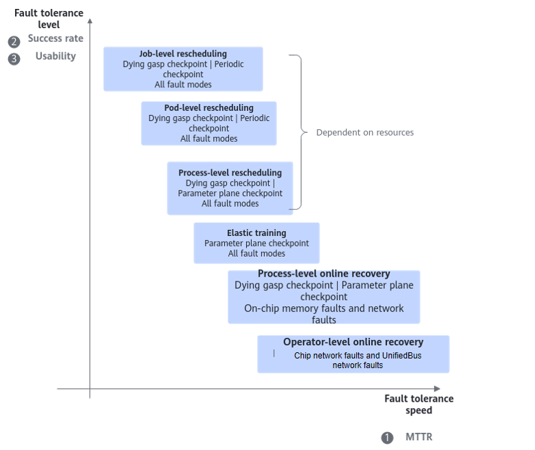

In the figure above, "fault tolerance speed" represents the speed from fault occurrence to fault recovery, "success rate" represents the success rate of completing fault recovery after a fault occurs, and "usability" represents the cost for users to use or integrate the feature.

Job-level rescheduling, Pod-level rescheduling, and process-level rescheduling support all fault modes currently supported by resumable training, but they depend on the availability of backup redundant computing server resources. If an unrecoverable hardware fault occurs and no backup redundant computing server is available, you can configure the elastic training function for scale-in training. Process-level online recovery currently supports on-chip memory faults and network faults. Operator-level online recovery currently supports chip network faults and UnifiedBus network faults.

The layers of the resumable training multi-layer fault handling system can fall back level by level according to the recovery granularity from fine to coarse, as shown in [Figure 2](#fig477415371217). If recovery at one layer fails, the system can fall back to the handling method of the next layer.

**Figure 2** Recovery failure description

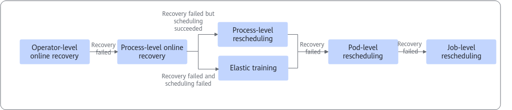

### Rescheduling Mode

#### Rescheduling Levels

Rescheduling mode: Schedule the job to healthy chips and isolate the faulty chips.

The default rescheduling mode is **job-level rescheduling**, which stops all Pods on each fault. However, in large-scale jobs, stopping all Pods and then rescheduling is costly and takes too long to recover. In addition, resumable training provides the **Pod-level rescheduling** function. You can configure it based on the job scale so that on a fault only the fault-related Pods are stopped and a small number of Pods are rescheduled, achieving fast fault recovery. To further shorten fault recovery time and reduce the fault impact scope, resumable training also provides process-level rescheduling and process-level online recovery.

**Table 1** Differences between rescheduling levels

|Rescheduling Level|Training Recovery Time|Configuration Steps|Description|
|--|--|--|--|
|Job-level rescheduling|Job-level rescheduling takes a long time to recover, and the recovery time deteriorates super-linearly as the job scale increases.|
Job-level rescheduling is simple to operate: users of MindCluster only need to turn on the configuration switch.

For the key configuration steps, see [Configuring Job-Level Rescheduling](../02_configuration/01_configuring_fault_handling_policies.md#ZH-CN_TOPIC_0000002479226580).
|To further reduce the resource scheduling time during recovery, you can enable the Pod-level rescheduling capability on top of job-level rescheduling.|
|Pod-level rescheduling|Pod-level rescheduling shortens the resource scheduling time and is independent of the job scale. However, it cannot optimize the time overhead in the training initialization process, and the overall recovery time still deteriorates super-linearly as the job scale increases.|
Pod-level rescheduling requires users to additionally integrate training process management capabilities into the training container. Users of MindCluster can use it once they have the corresponding process management capability.

For the key configuration steps, see [Configuring Pod-Level Rescheduling](../02_configuration/01_configuring_fault_handling_policies.md#configuring-pod-level-rescheduling).
|To further reduce the recovery time in training initialization, you can enable the process-level rescheduling capability on top of Pod-level rescheduling.|
|Process-level rescheduling (process-level recovery)|Process-level rescheduling reduces the training initialization time, shortens the overall recovery time, and is independent of or weakly correlated with the job scale.|
Compared with Pod-level rescheduling, process-level rescheduling requires users to additionally integrate high-availability training capabilities into the training framework. Users of MindCluster need to modify the training script and turn on the corresponding configuration switch.

For the key configuration steps, see [Configuring Process-Level Rescheduling](../02_configuration/01_configuring_fault_handling_policies.md#ZH-CN_TOPIC_0000002511426407).
|To address the short MTBF in large-scale scenarios and further reduce the overall recovery time, you can enable the process-level online recovery capability on top of process-level rescheduling.|
|Process-level online recovery|Process-level online recovery takes less time to recover training than process-level rescheduling.|
Compared with process-level rescheduling, process-level online recovery requires users to configure the corresponding switch before use.

For the key configuration steps, see [Configuring Process-Level Online Recovery](../02_configuration/01_configuring_fault_handling_policies.md#ZH-CN_TOPIC_0000002479386492).
|Process-level online recovery currently supports on-chip memory faults and network faults; other fault scenarios fall back to other handling methods.|
|Operator-level online recovery|-|For the key configuration steps, see [Configuring Operator-Level Online Recovery](../02_configuration/01_configuring_fault_handling_policies.md#configuring-operator-level-online-recovery).|-|

#### Rescheduling Policies

The rescheduling mode has the following two rescheduling policies.

- **Direct rescheduling**: When a hardware fault that cluster scheduling components can detect occurs during training, the system isolates the faulty node or chip and directly reschedules the job.
- **Unconditional retry**: When a fault that cluster scheduling components cannot detect occurs during training and causes the job container to exit abnormally, the system unconditionally reschedules the job.

**Table 2** Rescheduling policy description

|Rescheduling Policy|Description|Supported Fault Types|
|--|--|--|
|Direct rescheduling|The system isolates the faulty node or chip and then directly reschedules the job.|Known node faults or chip faults at the rescheduling handling level.|
|Unconditional retry|
The system reschedules a job configured with a number of unconditional retries within the specified number of times.

After a successful rescheduling, the number of retries available for the job decreases by 1. When the number of retries reaches 0, rescheduling cannot be triggered again.

To use the unconditional retry function, configure the fault-retry-times parameter in the YAML. For details, see [Job YAML Configuration](../../../../06_api/15_yaml_configuration.md#yaml_configuration).
|Faults that cause the job to exit abnormally and the Pod status to change to Failed due to parameter plane network faults or training-related software faults.|

### Fault Levels and Training Behavior

For the fault levels and the corresponding rescheduling and graceful fault tolerance handling descriptions, see [Fault Levels and Handling Description](../../../04_fault_detection_and_diagnosis/03_configuration/01_fault_classification.md#table103716651410).

### Sub-Healthy Fault Handling Policies

For the current job behavior, CKPT requirements, follow-up actions, and configuration entry of each sub-healthy fault handling policy, see [Configuring Hot Switching](../02_configuration/01_configuring_fault_handling_policies.md#configuring-hot-switching).

## Rescheduling Recovery

### Job-Level Rescheduling

**Job-level rescheduling** stops all Pods on each fault, recreates and reschedules all Pods, and then restarts the training job. The default rescheduling mode is **job-level rescheduling**.

For the key configuration steps of job-level rescheduling, see [Configuring Job-Level Rescheduling](../02_configuration/01_configuring_fault_handling_policies.md#ZH-CN_TOPIC_0000002479226580).

**Usage Constraints**

- This function can be used only in 6.0.RC2 and later versions.
- In large-scale K8s cluster scenarios, the ConfigMap mapping latency is uncontrollable. You are advised to store RankTable on shared storage.

**Supported Product Models and AI Frameworks**

**Table 3** Products and frameworks supported by job-level rescheduling

|Product Type|Hardware Form|Training Framework|
|--|--|--|
|Atlas training products|<ul><li>Atlas 800 training server (model 9000)</li><li>Atlas 800 training server (model 9010)</li></ul>If the chip working mode of the Atlas 800 training server is SMP and the number of NPUs requested by each Pod is 1 or 2, the rescheduling mode is not supported. For details about how to query and set the NPU chip working mode, see the "Querying and Setting the NPU Chip Working Mode (npuworkmode)" section in the [Atlas 800 Training Server iBMC User Guide (Model 9000)](https://support.huawei.com/enterprise/en/doc/EDOC1100136580/426cffd9/about-this-document?idPath=23710424%7C269761314%7C269769397%7C269769917%7C250702818).|<ul><li>MindSpore</li><li>PyTorch</li></ul>|
|Atlas A2 training products|<ul><li>Atlas 800T A2</li><li>Atlas 200T A2 Box16</li><li>Atlas 900 A2 PoD</li></ul>|<ul><li>MindSpore</li><li>PyTorch</li></ul>|
|Atlas A3 training products|<ul><li>Atlas 800T A3</li><li>Atlas 900 A3 SuperPoD</li><li>Atlas 9000 A3 SuperPoD</li><li>A200T A3 Box8</li></ul>|<ul><li>MindSpore</li><li>PyTorch</li></ul>|
|Ascend 950PR&950DT products|
Ascend 950PR:<ul><li>Atlas 850</li><li>Atlas 650</li></ul>

Ascend 950DT:<ul><li>Atlas 850E</li><li>Atlas 650E</li><li>Atlas 950 SuperPoD</li></ul>
|PyTorch|

**Rescheduling Principle**

If a hardware or software fault occurs during training, the training state becomes abnormal. Job-level rescheduling first destroys all training containers, then isolates the faulty devices, and then reschedules and starts the training containers again. After the training containers are restarted, training is started again, which is similar to the process of starting training for the first time.

**Figure 3** Principle diagram

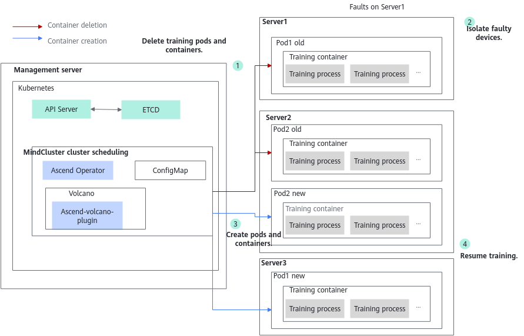

In the principle diagram above, the steps are described as follows.

1. After a fault is detected, first delete all Pods and containers of the current job.
2. Isolate the device where the fault occurs to prevent the device from being used again.
3. Recreate and schedule the training Pods and containers.
4. After the containers are started, start the training process to recover the training job.

### Pod-Level Rescheduling

**Pod-level rescheduling** stops only the fault-related Pods on each fault, recreates and reschedules the fault-related Pods, and then restarts the training job. If the current fault cannot be recovered, the system falls back to job-level rescheduling mode. Compared with job-level rescheduling, Pod-level rescheduling reduces part of the resource scheduling and Pod creation time.

For the key configuration steps of Pod-level rescheduling, see [Configuring Pod-Level Rescheduling](../02_configuration/01_configuring_fault_handling_policies.md#configuring-pod-level-rescheduling).

**Usage Constraints**

- When using **Pod-level rescheduling** in large-cluster training jobs, you are advised to set the `open files` parameter (the maximum number of files that can be opened) large enough; if it is too small, Pod rescheduling may become abnormal. For example, run the **ulimit -n 100000** command to set the `open files` parameter to `100000`.
- When the Pod whose `hccl`/`rankIndex` field in the `annotation` is 0 becomes faulty, Pod-level rescheduling and process-level rescheduling are not triggered, and job-level rescheduling is triggered directly.
- Do not use a ConfigMap to mount the RankTable file; otherwise, job rescheduling may fail.
- If the soft affinity feature is enabled (that is, the `super-pod-affinity` parameter value of the job is set to `soft`, so that when cluster resources do not meet SuperPoD affinity requirements, a SuperPoD job can continue to be scheduled using fragmented resources in the cluster), Pod-level rescheduling is not supported.

**Supported Product Models and AI Frameworks**

**Table 4** Products and frameworks supported by rescheduling

|Product Type|Hardware Form|Training Framework|
|--|--|--|
|Atlas training products|<ul><li>Atlas 800 training server (model 9000)</li><li>Atlas 800 training server (model 9010)</li></ul>If the chip working mode of the Atlas 800 training server is SMP and the number of NPUs requested by each Pod is 1 or 2, the rescheduling mode is not supported. For details about how to query and set the NPU chip working mode, see the "Querying and Setting the NPU Chip Working Mode (npuworkmode)" section in the [Atlas 800 Training Server iBMC User Guide (Model 9000)](https://support.huawei.com/enterprise/en/doc/EDOC1100136580/426cffd9/about-this-document?idPath=23710424%7C269761314%7C269769397%7C269769917%7C250702818).|<ul><li>MindSpore</li><li>PyTorch</li></ul>|
|Atlas A2 training products|<ul><li>Atlas 800T A2</li><li>Atlas 200T A2 Box16</li><li>Atlas 900 A2 PoD</li></ul>|<ul><li>MindSpore</li><li>PyTorch</li></ul>|
|Atlas A3 training products|<ul><li>Atlas 800T A3</li><li>Atlas 900 A3 SuperPoD</li><li>Atlas 9000 A3 SuperPoD</li><li>A200T A3 Box8</li></ul>|<ul><li>MindSpore</li><li>PyTorch</li></ul>|
|Ascend 950PR&950DT products|
Ascend 950PR:<ul><li>Atlas 850</li><li>Atlas 650</li></ul>

Ascend 950DT:<ul><li>Atlas 850E</li><li>Atlas 650E</li><li>Atlas 950 SuperPoD</li></ul>
|PyTorch|

**Rescheduling Principle**

If a hardware or software fault occurs during training, the training state becomes abnormal. Pod-level rescheduling first destroys the faulty Pods and containers in the current job and notifies the management process in other training containers to destroy all training processes, then isolates the faulty devices, and then reschedules and starts the training containers again. After the training containers are restarted, the management process in all containers is notified to start the training process again to recover training.

1. After a fault is detected, delete only the faulty Pods and containers in the current job and destroy all training processes.
2. Isolate the device where the fault occurs to prevent the device from being used again.
3. Recreate and schedule the training Pods and containers.
4. After the containers are started, start the training process to recover the training job.

### Process-Level Rescheduling

Process-level rescheduling stops only the processes on fault-related nodes on each fault, and determines whether to exit the faulty node based on the configured policy.

- `recover` policy: Migrate the containers of the faulty node to a healthy node.
- `recover-in-place` policy: For nodes where the following two types of faults occur, only the faulty process is restarted and the containers of the faulty node are not migrated. If multiple nodes become faulty at the same time, containers are not migrated for nodes where only the following two types of faults occur, and containers are migrated for nodes where other types of faults occur. If the faults on multiple nodes include only service process exceptions, containers are migrated for all faulty nodes.
    - Service process exception.
    - Chip faults of the `RestartRequest` and `RestartBusiness` levels.

If recovery fails, the system falls back to job-level or Pod-level rescheduling mode. Compared with Pod-level rescheduling, this function reschedules only the faulty process, which greatly reduces the waiting time caused by the desynchronization between processes. In addition, a new HCCL link establishment solution greatly reduces the link establishment time, and CKPT information is transferred through the parameter plane high-speed network P2P between NPU cards, avoiding the time consumed by CKPT saving and loading.

For the key configuration steps of process-level rescheduling, see [Configuring Process-Level Rescheduling](../02_configuration/01_configuring_fault_handling_policies.md#ZH-CN_TOPIC_0000002511426407).

>[!NOTE]
>
>- Transferring CKPT information over the parameter plane depends on the full optimizer replica in the faulty card. If the full optimizer replica does not exist, the system falls back to loading the CKPT file from storage to recover the parameters.
>- The optimizer replica requires additional memory. If memory is insufficient, you can select the local loading mode, in which the CKPT file in storage is loaded directly to recover parameters regardless of whether an optimizer replica exists.

**Usage Constraints**

- For the PyTorch training framework, it must be used with a matching MindSpeed version. For version matching, see [MindSpeed-LLM](https://gitcode.com/Ascend/MindSpeed-LLM/tree/2.3.0).
- For the MindSpore training framework, it must be used with a matching MindFormers version. For version matching, see [MindSpore MindFormers](https://gitcode.com/mindspore/mindformers/tree/master).
- When the Pod whose `hccl`/`rankIndex` field in the annotation is 0 becomes faulty and containers need to be migrated, Pod-level rescheduling and process-level rescheduling are not triggered, and job-level rescheduling is triggered directly.
- It cannot be enabled at the same time as graceful fault tolerance. If both are enabled, resumable training recovers training through job-level rescheduling.
- In the MindSpore scenario, to ensure that this function works properly, install MindSpore and MindIO in the same path.
- In the MindSpore scenario, due to framework mechanism limitations, process-level rescheduling has a very small probability of failure.
- Do not use a ConfigMap to mount the RankTable file; otherwise, job rescheduling may fail.
- For PyTorch, only single-operator mode and models based on the Megatron framework are supported.
- Only acjob-type training jobs are supported.
- Only single-container migration is supported, and affinity-based migration is not supported.
- Multimodal models are not supported.
- The watchdog function cannot be enabled.
- Triggering process-level rescheduling while a checkpoint is being saved is not supported.
- In Atlas A3 training product scenarios, NPU card loss faults or OS disconnection faults may cause process-level rescheduling to fail.
- A fault that occurs during HCCL link establishment causes process-level rescheduling to fail. If, in addition to the HCCL link establishment for training initialization, HCCL link establishment also exists in other training phases, you can establish links in advance by referring to [Configuring Proactive HCCL Link Establishment](../02_configuration/02_configuring_training_recovery.md#ZH-CN_TOPIC_0000002511346489) to prevent faults from occurring during HCCL link establishment.
- This function depends on the MindIO component. Before use, familiarize yourself with the [Constraints](../../../../07_references/00_fault_recovery_acceleration/02_installation_and_deployment.md#constraints) of MindIO.
- This feature is no longer supported in MindSpore 2.11.0.

**Supported Product Models and AI Frameworks**

**Table 5** Products and frameworks supported by rescheduling

|Product Type|Hardware Form|Training Framework|
|--|--|--|
|Atlas A2 training products|<ul><li>Atlas 800T A2</li><li>Atlas 200T A2 Box16</li><li>Atlas 900 A2 PoD</li></ul>|<ul><li>MindSpore</li><li>PyTorch</li></ul>|
|Atlas A3 training products|<ul><li>Atlas 800T A3</li><li>Atlas 900 A3 SuperPoD</li><li>Atlas 9000 A3 SuperPoD</li></ul>|<ul><li>MindSpore</li><li>PyTorch</li></ul>|
|Ascend 950PR&950DT products|Atlas 950 SuperPoD|PyTorch|

**Rescheduling Principle**

If a hardware or software fault occurs during training, the training state becomes abnormal. Process-level rescheduling first destroys the faulty training process or container according to the configured policy and notifies the training processes in other training containers to pause the current training job, then isolates the faulty devices, and then reschedules and starts the training containers again. After the faulty training container is restarted, the training processes in all containers are notified to re-establish collective communication links. After link establishment is complete, the CKPT is sent over the parameter plane to the newly started training process to recover parameters. After recovery, all processes re-execute the current step to resume training.

**Figure 4** Process-level rescheduling principle diagram

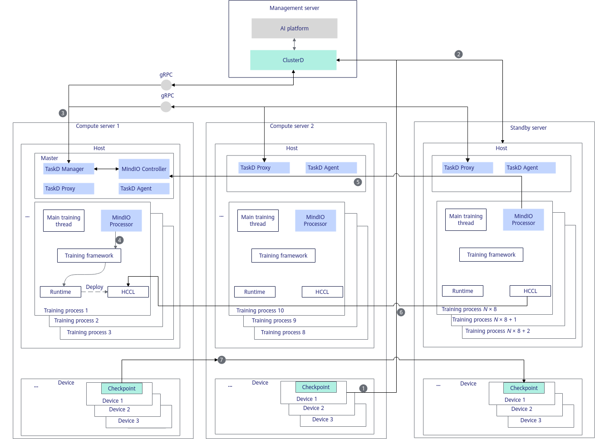

In the principle diagram above, the steps are described as follows.

1. After a hardware fault occurs on a device, the MindCluster detection component on the server reports the fault information to ClusterD; a software fault is perceived by the MindIO Controller in the container and reported to ClusterD.
2. ClusterD exits the faulty training process in the job container on the faulty server and reschedules it to a standby server.
3. ClusterD notifies the MindIO Controller on the master node to perform fault tolerance. The fault tolerance process includes notifying to stop training, notifying the global fault, and notifying the recovery policy.
4. The MindIO Controller notifies the MindIO Processor in each training process, and the MindIO Processor calls TorchNPU to forcibly stop the training process. The MindIO Processor clears the resources of normal nodes, destroys the communication domain, and waits for new processes to join after cleanup.
5. After the management process on the standby server starts the training process and creates a new MindIO Processor, the MindIO Controller notifies the MindIO Processor in each training process to resume training.
6. Each process re-establishes collective communication links.
7. The NPU on the normal server transfers the CKPT to the standby server over the parameter plane, and training continues after the parameter state is recovered.

**Adaptation Function Points**

In process-level rescheduling, the cluster brain decides the recovery policy based on the global fault information and delivers the policy to MindIO. The scheduler must support scheduling of faulty Pods instead of rescheduling the entire job and support level-by-level fallback of recovery policies. In the training container, the framework first initializes the MindIO service, and after the service is started, reports the corresponding status to MindIO when the optimizer is updated. Then, it creates a DP replica group and an optimizer replica to ensure redundant backup of model parameters. When an exception occurs, the fault mode is captured through the exception capture decorator, operator resource cleanup is performed during recovery, and communication re-establishment is triggered after the node restarts. Process-level rescheduling recovery is completed through parameter plane online repair and state rollback.

For users who do not use MindSpeed-LLM and the MindCluster platform, the function adaptation in [Table 6](#table1995514113610) must be completed on the framework side.

**Table 6** Framework adaptation function points for process-level rescheduling

<table><thead align="left"><tr id="row169591493619"><th class="cellrowborder" valign="top" width="16.77167716771677%" id="mcps1.2.5.1.1">
Adaptation Point

</th>
<th class="cellrowborder" valign="top" width="43.23432343234324%" id="mcps1.2.5.1.2">
Function Brief

</th>
<th class="cellrowborder" valign="top" width="18.13181318131813%" id="mcps1.2.5.1.3">
Involved Component

</th>
<th class="cellrowborder" valign="top" width="21.862186218621858%" id="mcps1.2.5.1.4">
Reference Link

</th>
</tr>
</thead>
<tbody><tr id="row893618158397"><td class="cellrowborder" valign="top" width="16.77167716771677%" headers="mcps1.2.5.1.1 ">
Initialization while startup

</td>
<td class="cellrowborder" valign="top" width="43.23432343234324%" headers="mcps1.2.5.1.2 ">
Start the MindIO service when the training framework is initialized.

</td>
<td class="cellrowborder" rowspan="9" valign="top" width="18.13181318131813%" headers="mcps1.2.5.1.3 ">
Distributed training framework

</td>
<td class="cellrowborder" rowspan="9" valign="top" width="21.862186218621858%" headers="mcps1.2.5.1.4 ">
<a href="../../../../07_references/00_fault_recovery_acceleration/03_usage_guidance.md#integrating-with-non-mindspeed-llm-frameworks">Integrating with Non-MindSpeed-LLM Frameworks</a>

</td>
</tr>
<tr id="row1793717157396"><td class="cellrowborder" valign="top" headers="mcps1.2.5.1.1 ">
Reporting the optimizer update status

</td>
<td class="cellrowborder" valign="top" headers="mcps1.2.5.1.2 ">
Report the start and end of the optimizer update before the optimizer update.

</td>
</tr>
<tr id="row193701523914"><td class="cellrowborder" valign="top" headers="mcps1.2.5.1.1 ">
Creating a DP replica group

</td>
<td class="cellrowborder" valign="top" headers="mcps1.2.5.1.2 ">
Add the creation logic of the dp_cp/dp_ep replica groups and the gloo group, and create the related replica groups after the native Megatron distributed parallel group is created.

</td>
</tr>
<tr id="row144014113397"><td class="cellrowborder" valign="top" headers="mcps1.2.5.1.1 ">
Optimizer replica

</td>
<td class="cellrowborder" valign="top" headers="mcps1.2.5.1.2 ">
Take over and inherit the related native Megatron optimizer functions, and embed the MindIO optimizer replica management logic.

</td>
</tr>
<tr id="row74014111391"><td class="cellrowborder" valign="top" headers="mcps1.2.5.1.1 ">
Exception capture decorator

</td>
<td class="cellrowborder" valign="top" headers="mcps1.2.5.1.2 ">
Use the exception capture decorator to decorate the train function to capture the fault mode.

</td>
</tr>
<tr id="row74025111392"><td class="cellrowborder" valign="top" headers="mcps1.2.5.1.1 ">
Operator resource cleanup

</td>
<td class="cellrowborder" valign="top" headers="mcps1.2.5.1.2 ">
Complete operator resource cleanup through a callback function.

</td>
</tr>
<tr id="row19531411367"><td class="cellrowborder" valign="top" headers="mcps1.2.5.1.1 ">
Node restart and communication re-establishment

</td>
<td class="cellrowborder" valign="top" headers="mcps1.2.5.1.2 ">
Implement communication domain re-establishment between healthy nodes and faulty nodes through a registered rebuild callback.

</td>
</tr>
<tr id="row1708112845416"><td class="cellrowborder" valign="top" headers="mcps1.2.5.1.1 ">
Parameter plane online repair

</td>
<td class="cellrowborder" valign="top" headers="mcps1.2.5.1.2 ">
Complete recovery processing of replica cards and recovery cards through a callback function.

</td>
</tr>
<tr id="row1911610240547"><td class="cellrowborder" valign="top" headers="mcps1.2.5.1.1 ">
Status rollback

</td>
<td class="cellrowborder" valign="top" headers="mcps1.2.5.1.2 ">
Complete data iterator rebuild and framework variable reset through a callback function.

</td>
</tr>
<tr id="row1311652445414"><td class="cellrowborder" valign="top" width="16.77167716771677%" headers="mcps1.2.5.1.1 ">
Recovery policy decision

</td>
<td class="cellrowborder" valign="top" width="43.23432343234324%" headers="mcps1.2.5.1.2 ">
Decide the recovery policy based on the global fault information and deliver it to MindIO. Support recovery policy fallback: if process-level rescheduling fails, the system falls back to Pod-level or job-level rescheduling.

</td>
<td class="cellrowborder" rowspan="2" valign="top" width="18.13181318131813%" headers="mcps1.2.5.1.3 ">
AI platform

</td>
<td class="cellrowborder" valign="top" width="21.862186218621858%" headers="mcps1.2.5.1.4 ">
<a href="https://gitcode.com/Ascend/mind-cluster/tree/release_v26.2.0/component/clusterd/pkg/application/recover" target="_blank" rel="noopener noreferrer">Link</a>

</td>
</tr>
<tr id="row18952145365"><td class="cellrowborder" valign="top" headers="mcps1.2.5.1.1 ">
Faulty Pod scheduling

</td>
<td class="cellrowborder" valign="top" headers="mcps1.2.5.1.2 ">
Schedule faulty Pods and support scheduling recovery policy fallback.

</td>
<td class="cellrowborder" valign="top" headers="mcps1.2.5.1.3 ">
<a href="https://gitcode.com/Ascend/mind-cluster/tree/release_v26.2.0/component/ascend-for-volcano/internal/rescheduling" target="_blank" rel="noopener noreferrer">Link</a>

</td>
</tr>
</tbody>
</table>

### Sub-Healthy Exit and Rescheduling

- `graceExit`: Do not use the sub-healthy node. After the dying gasp CKPT file is saved, perform rescheduling, and subsequent jobs are not scheduled to this node.
- `forceExit`: Do not use the sub-healthy node. Exit directly without saving the job, and perform rescheduling; subsequent jobs are not scheduled to this node.

When the `graceExit` policy is used, ensure that the dying gasp CKPT saving function is enabled for the job.

### Hot Switching

After the training job is configured with the sub-healthy hot switchover policy (`hotSwitch`), when a sub-healthy fault occurs, the standby node is started, the training process is paused, and then the training job is started again on the standby node.

**Usage Constraints**

- For the PyTorch training framework, it must be used with MindSpeed-LLM 2.3.0. For version matching, see [MindSpeed-LLM](https://gitcode.com/Ascend/MindSpeed-LLM/tree/2.3.0).
- For the MindSpore training framework, it must be used with the MindFormers master version. For version matching, see [MindSpore MindFormers](https://gitcode.com/mindspore/mindformers/tree/master).
- Only the PyTorch single-operator mode, models based on the Megatron framework, and acjob-type training jobs are supported.
- In the MindSpore scenario, to ensure that this function works properly, install MindSpore and MindIO in the same path.
- Multimodal models are not supported.
- The watchdog function cannot be enabled.
- If hot switching is triggered before the training job produces any iteration, MindIO may be blocked, and job-level rescheduling is finally triggered.
- When a sub-healthy fault occurs on the Pod whose hccl/rankIndex field in the job annotation is 0, sub-healthy hot switching cannot be triggered.
- In the following abnormal cases, the system falls back to job-level rescheduling, and the job sub-healthy handling policy is downgraded to ignore, so sub-healthy faults are no longer handled:
    - After the standby Pod is started, pausing training fails.
    - After the standby Pod is started, MindCluster times out waiting for the training pause status to be reported (15 minutes).
    - The standby Pod fails to run.
    - After the original Pod is deleted, resuming training fails.
    - After the original Pod is deleted, MindCluster times out waiting for the training recovery status to be reported (15 minutes).

- After the hot switching policy is configured, the process-level recovery switch is automatically added. If a non-sub-healthy fault occurs, the process-level recovery process is triggered.
- When no standby node is available, the hot switching process cannot be completed, and the job sub-healthy handling policy is downgraded to ignore, so sub-healthy faults are no longer handled.
- This function depends on the MindIO component. Before use, familiarize yourself with the [Constraints](../../../../07_references/00_fault_recovery_acceleration/02_installation_and_deployment.md#constraints) of MindIO.
- This feature is no longer supported in MindSpore 2.11.0.

**Supported Product Models and AI Frameworks**

**Table 14** Products and frameworks supported by hot switching

|Product Type|Hardware Form|Training Framework|
|--|--|--|
|Atlas A2 training products|Atlas 800T A2|<ul><li>MindSpore</li><li>PyTorch</li></ul>|
|Atlas A3 training products|<ul><li>Atlas 800T A3</li><li>Atlas 9000 A3 SuperPoD</li></ul>|<ul><li>MindSpore</li><li>PyTorch</li></ul>|

**Hot Switching Principle**

**Figure 9** Principle diagram

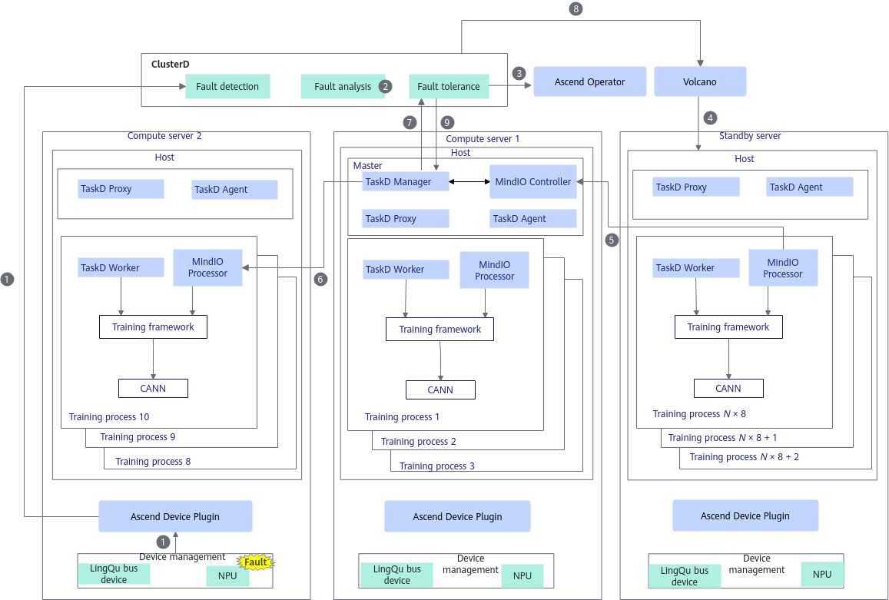

In the principle diagram above, the steps are described as follows.

1. ClusterD detects the sub-healthy fault through Ascend Device Plugin.
2. ClusterD decides whether to perform hot switching based on the configured policy.
3. ClusterD notifies Ascend Operator to start a standby Pod.
4. Volcano schedules the standby Pod.
5. A new MindIO Processor is created in the standby Pod, and the MindIO Processor registers with the MindIO Controller.
6. The MindIO Controller delivers a training pause notification.
7. The MindIO Controller notifies ClusterD that training is paused.
8. ClusterD notifies Volcano to delete the faulty Pod.
9. ClusterD notifies MindIO to resume training.

**Adaptation Function Points**

In hot switching, the cluster brain sets annotations for faulty Pods based on the sub-healthy fault information, starts and schedules standby Pods, notifies MindIO of the hot switching policy, and resumes training after training is switched to the standby Pod. In the training container, the framework first initializes the MindIO service; after the service is started, it reports the corresponding status to MindIO when the optimizer is updated. When an exception occurs, the fault mode is captured through the exception capture decorator. After a new node is started, the normal node pauses training and then re-establishes the communication domain to complete parameter plane recovery for the new node; after the training state is restored, node hot switching is completed.

For users who do not use MindSpeed-LLM and the MindCluster platform, the function adaptation in [Table 15](#table19955141136104) must be completed on the framework side.

**Table 15** Framework adaptation function points for hot switching

<table><thead align="left"><tr id="row169591493619"><th class="cellrowborder" valign="top" width="18.200000000000003%" id="mcps1.2.5.1.1">
Adaptation Point

</th>
<th class="cellrowborder" valign="top" width="39.330000000000005%" id="mcps1.2.5.1.2">
Function Brief

</th>
<th class="cellrowborder" valign="top" width="19.670000000000005%" id="mcps1.2.5.1.3">
Adaptation Component

</th>
<th class="cellrowborder" valign="top" width="22.800000000000004%" id="mcps1.2.5.1.4">
Reference Link

</th>
</tr>
</thead>
<tbody><tr id="row893618158397"><td class="cellrowborder" valign="top" width="18.200000000000003%" headers="mcps1.2.5.1.1 ">
Initialization while startup

</td>
<td class="cellrowborder" valign="top" width="39.330000000000005%" headers="mcps1.2.5.1.2 ">
Start the MindIO service when the training framework is initialized.

</td>
<td class="cellrowborder" rowspan="9" valign="top" width="19.670000000000005%" headers="mcps1.2.5.1.3 ">
Distributed training framework

</td>
<td class="cellrowborder" rowspan="9" valign="top" width="22.800000000000004%" headers="mcps1.2.5.1.4 ">
<a href="../../../../07_references/00_fault_recovery_acceleration/03_usage_guidance.md#integrating-with-non-mindspeed-llm-frameworks">Integrating with Non-MindSpeed-LLM Frameworks</a>

</td>
</tr>
<tr id="row1793717157396"><td class="cellrowborder" valign="top" headers="mcps1.2.5.1.1 ">
Reporting the optimizer update status

</td>
<td class="cellrowborder" valign="top" headers="mcps1.2.5.1.2 ">
Report the start and end of the optimizer update before the optimizer update.

</td>
</tr>
<tr id="row193701523914"><td class="cellrowborder" valign="top" headers="mcps1.2.5.1.1 ">
Creating a DP replica group

</td>
<td class="cellrowborder" valign="top" headers="mcps1.2.5.1.2 ">
Add the creation logic of the dp_cp/dp_ep replica groups and the gloo group, and create the related replica groups after the native Megatron distributed parallel group is created.

</td>
</tr>
<tr id="row191961528155914"><td class="cellrowborder" valign="top" headers="mcps1.2.5.1.1 ">
Optimizer replica

</td>
<td class="cellrowborder" valign="top" headers="mcps1.2.5.1.2 ">
Take over and inherit the related native Megatron optimizer functions, and embed the MindIO optimizer replica management logic.

</td>
</tr>
<tr id="row111971728195915"><td class="cellrowborder" valign="top" headers="mcps1.2.5.1.1 ">
Exception capture decorator

</td>
<td class="cellrowborder" valign="top" headers="mcps1.2.5.1.2 ">
Use the exception capture decorator to decorate the train function to capture the fault mode.

</td>
</tr>
<tr id="row1519712855916"><td class="cellrowborder" valign="top" headers="mcps1.2.5.1.1 ">
Node restart and communication re-establishment

</td>
<td class="cellrowborder" valign="top" headers="mcps1.2.5.1.2 ">
Implement communication domain re-establishment between healthy nodes and faulty nodes through a registered rebuild callback.

</td>
</tr>
<tr id="row1375943411593"><td class="cellrowborder" valign="top" headers="mcps1.2.5.1.1 ">
Parameter plane online repair

</td>
<td class="cellrowborder" valign="top" headers="mcps1.2.5.1.2 ">
Complete recovery processing of replica cards and recovery cards through a callback function.

</td>
</tr>
<tr id="row876023415918"><td class="cellrowborder" valign="top" headers="mcps1.2.5.1.1 ">
Status rollback

</td>
<td class="cellrowborder" valign="top" headers="mcps1.2.5.1.2 ">
Complete data iterator rebuild and framework variable reset through a callback function.

</td>
</tr>
<tr id="row17605341596"><td class="cellrowborder" valign="top" headers="mcps1.2.5.1.1 ">
Graceful pause

</td>
<td class="cellrowborder" valign="top" headers="mcps1.2.5.1.2 ">
Add a MindIO function call at the very end of the training iteration loop to implement the active pause function.

</td>
</tr>
<tr id="row144412445361"><td class="cellrowborder" valign="top" width="18.200000000000003%" headers="mcps1.2.5.1.1 ">
Hot switching process control

</td>
<td class="cellrowborder" valign="top" width="39.330000000000005%" headers="mcps1.2.5.1.2 ">
Manage the hot switching process, and manage standby Pods and faulty Pods by setting annotations.

</td>
<td class="cellrowborder" rowspan="2" valign="top" width="19.670000000000005%" headers="mcps1.2.5.1.3 ">
AI platform

</td>
<td class="cellrowborder" valign="top" width="22.800000000000004%" headers="mcps1.2.5.1.4 ">
<a href="https://gitcode.com/Ascend/mind-cluster/blob/release_v26.2.0/component/clusterd/pkg/application/recover/hot_switch_controller.go" target="_blank" rel="noopener noreferrer">Link</a>

</td>
</tr>
<tr id="row14716101112393"><td class="cellrowborder" valign="top" headers="mcps1.2.5.1.1 ">
Pod creation and deletion

</td>
<td class="cellrowborder" valign="top" headers="mcps1.2.5.1.2 ">
Delete and create Pods by identifying specific annotations.

</td>
<td class="cellrowborder" valign="top" headers="mcps1.2.5.1.3 ">
<a href="https://gitcode.com/Ascend/mind-cluster/blob/release_v26.2.0/component/ascend-operator/pkg/controllers/v1/ascendjob_controller.go" target="_blank" rel="noopener noreferrer">Link</a>

</td>
</tr>
</tbody>
</table>

## Online Recovery

### Operator-Level Online Recovery

Atlas A3 training products support HCCL operator retransmission when a parameter plane network fault occurs. Without exiting the faulty process, operator-level online recovery can tolerate network exceptions for a longer time, and the training job is not interrupted.

If operator-level online recovery for a network fault (HCCL communication operator re-execution) fails, the system falls back to process-level online recovery.

For the key configuration steps of operator-level online recovery, see [Configuring Operator-Level Online Recovery](../02_configuration/01_configuring_fault_handling_policies.md#ZH-CN_TOPIC_0000002511426477).

>[!NOTE]
>Huawei Collective Communication Library (HCCL) is a distributed communication library designed by Huawei for Ascend AI processors. It optimizes efficient collaboration between multiple devices (such as NPUs and GPUs) to accelerate distributed training of deep learning models, and applies to AI scenarios that require large-scale computing power. In distributed training, HCCL coordinates data synchronization between multiple Ascend processors (such as gradient aggregation and parameter update), reducing communication overhead and improving training efficiency.

**Application Scenarios**

Operator-level online recovery is currently supported in the following two fault scenarios.

- For chip network-related faults, when operator retransmission succeeds, Volcano handles the job as a sub-healthy job. When operator retransmission fails, Volcano triggers rescheduling.
- For UnifiedBus device-related faults, after HCCL performs operator-level online recovery, Volcano handles the job as a sub-healthy job.

**Usage Constraints**

- This feature is not supported when MC2 is enabled.
- The watchdog function cannot be enabled.

**Products and Frameworks Supported by Operator-Level Online Recovery**

**Table 7** Supported products and frameworks

|Product Type|Hardware Form|Training Framework|
|--|--|--|
|Atlas A3 training products|<ul><li>Atlas 900 A3 SuperPoD</li><li>Atlas 9000 A3 SuperPoD</li></ul>|-|

**Operator-Level Online Recovery Principle**

**Figure 5** Principle diagram

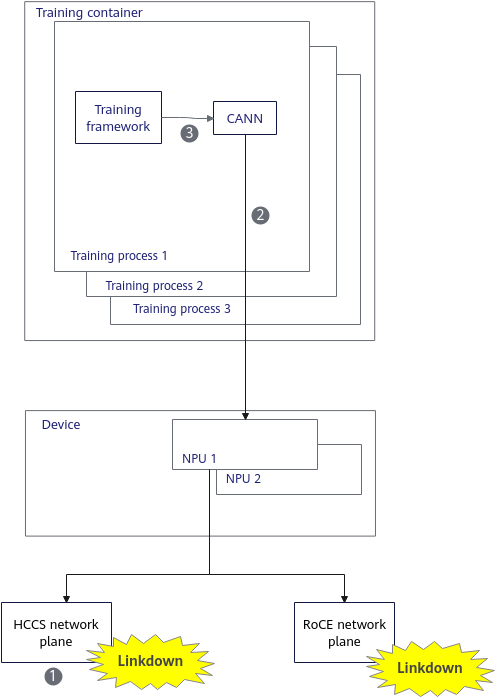

In the principle diagram above, the steps are described as follows.

1. During training, a LinkDown fault occurs on the HCCS network plane or the RoCE network plane.
2. CANN detects the network fault. After the current operator is terminated, network link recovery is performed (BGP route switching on the HCCS network plane, and link failover communication on the RoCE network plane). After the communication link is recovered, network operator re-execution is performed.
3. After the operator re-execution succeeds, training iteration is resumed.

### Process-Level Online Recovery

Process-level online recovery (step-level recomputation recovery) mainly handles the following two fault types:

- Network faults: currently only the following three scenarios are supported.
    - When an HCCS L1-L2 port or link becomes faulty, after BGP route switching, if operator-level online recovery is enabled and fails, a step-level retry is performed to achieve fast fault recovery without exiting the process; if operator-level online recovery is disabled, a step-level retry is performed on the training process to achieve fast fault recovery without exiting the process.
    - When a RoCE uplink port or link becomes faulty and operator-level online recovery is enabled but fails, a step-level retry is performed on the training process to achieve fast fault recovery without exiting the process.
    - In the Atlas 950 SuperPoD scenario, when the UB port or link from a unions to the upper-level unions/5808 becomes faulty, a step-level retry is performed on the training process to achieve fast fault recovery without exiting the process.

- On-chip memory faults: For an uncorrectable error on the on-chip memory (for example, fault code 0x80E01801), isolate the faulty on-chip memory space first, and then perform a step-level retry on the training process to achieve fast fault recovery without exiting the process.

In the above two scenarios, if the fault cannot be recovered, the system falls back to the **rescheduling mode**.

Compared with process-level rescheduling, process-level online recovery does not reschedule the faulty process, which greatly reduces the waiting time caused by the desynchronization between processes. In addition, CKPT information is transferred through the parameter plane high-speed network P2P between NPU cards, avoiding the time consumed by CKPT saving and loading.

This fault handling mode is disabled by default. To enable it, see [(Optional) Configuring Components](../03_examples_and_verification/menu_examples_and_verification.md#ZH-CN_TOPIC_0000002511346449).

For the key configuration steps of process-level online recovery, see [Configuring Process-Level Online Recovery](../02_configuration/01_configuring_fault_handling_policies.md#ZH-CN_TOPIC_0000002479386492).

>[!NOTE]
>
>- Transferring CKPT information over the parameter plane depends on the full optimizer replica in the non-faulty cards. If the full optimizer replica does not exist, the system falls back to loading the CKPT file from storage to recover the parameters.
>- The optimizer replica requires additional video memory. If video memory is insufficient, you can select the local loading mode, in which the CKPT file in storage is loaded directly to recover parameters regardless of whether an optimizer replica exists.

**Usage Constraints**

- For the PyTorch training framework, it must be used with a matching MindSpeed version. For version matching, see [MindSpeed-LLM](https://gitcode.com/Ascend/MindSpeed-LLM/tree/2.3.0).
- For the MindSpore training framework, it must be used with a matching MindFormers version. For version matching, see [MindSpore MindFormers](https://gitcode.com/mindspore/mindformers/tree/master).
- This function depends on the memory management mechanism of PyTorch and can be used only when `PYTORCH_NO_NPU_MEMORY_CACHING` is not configured.
- This function does not take effect in some on-chip memory fault scenarios. For example, a fault in the memory address used by HCCL collective communication still needs to be recovered through process-level rescheduling or a higher-layer fault tolerance solution.
- For a fault in a global variable defined in a model or training script such as MindSpeed-LLM or MindSpeed, see the [FAQ](https://gitcode.com/Ascend/mind-cluster/issues/368) for the detailed handling policy.
- It cannot be enabled at the same time as graceful fault tolerance. If both are enabled, resumable training recovers training through job-level rescheduling.
- In the MindSpore scenario, to ensure that this function works properly, install MindSpore and MindIO in the same path.
- In the MindSpore scenario, set `export TASKD_PROCESS_ENABLE="on"` before starting TaskD Manager.
- Do not use a ConfigMap to mount the RankTable file; otherwise, job rescheduling may fail.
- Multimodal models are not supported.
- MC2 enabled scenarios are not supported.
- The watchdog function cannot be enabled.
- Network faults and on-chip memory faults occurring multiple times (more than once) in the same step are not supported.
- A fault that occurs during HCCL link establishment causes process-level online recovery to fail. If, in addition to the HCCL link establishment for training initialization, HCCL link establishment also exists in other training phases, you can establish links in advance by referring to [Configuring Proactive HCCL Link Setup](../02_configuration/02_configuring_training_recovery.md#ZH-CN_TOPIC_0000002511346489) to prevent faults from occurring during HCCL link establishment.
- This function depends on the MindIO component. Before use, familiarize yourself with the [Constraints](../../../../07_references/00_fault_recovery_acceleration/02_installation_and_deployment.md#constraints) of MindIO.
- This feature is no longer supported in MindSpore 2.11.0.

**Supported Product Models and AI Frameworks**

**Table 8** Products and frameworks supported by process-level online recovery for network faults

|Product Type|Hardware Form|Training Framework|
|--|--|--|
|Atlas A3 training products|<ul><li>Atlas 800T A3</li><li>Atlas 900 A3 SuperPoD</li><li>Atlas 9000 A3 SuperPoD</li></ul>|<ul><li>MindSpore</li><li>PyTorch</li></ul>|
|Ascend 950PR&950DT products|Atlas 950 SuperPoD|PyTorch|

**Table 9** Products and frameworks supported by process-level online recovery for on-chip memory faults

|Product Type|Hardware Form|Training Framework|
|--|--|--|
|Atlas A2 training products|<ul><li>Atlas 800T A2</li><li>Atlas 900 A2 PoD</li><li>Atlas 900 A2 PoDc</li></ul>|<ul><li>MindSpore</li><li>PyTorch</li></ul>|
|Atlas A3 training products|<ul><li>Atlas 800T A3</li><li>Atlas 900 A3 SuperPoD</li><li>Atlas 9000 A3 SuperPoD</li></ul>|<ul><li>MindSpore</li><li>PyTorch</li></ul>|
|Ascend 950PR&950DT products|Atlas 950 SuperPoD|PyTorch|

**Process-Level Online Recovery Principle**

If an on-chip memory fault or network fault occurs during training, the training state becomes abnormal. Process-level online recovery first notifies all training processes to stop the current training, and then retains the current training information and repairs the fault. After the repair is complete, all training processes roll back the training state to the end of the previous step. The normal server transfers the CKPT to the faulty server over the parameter plane. After parameter recovery is complete, the current step is re-executed, and then the training job is resumed.

**Figure 6** Process-level online recovery principle

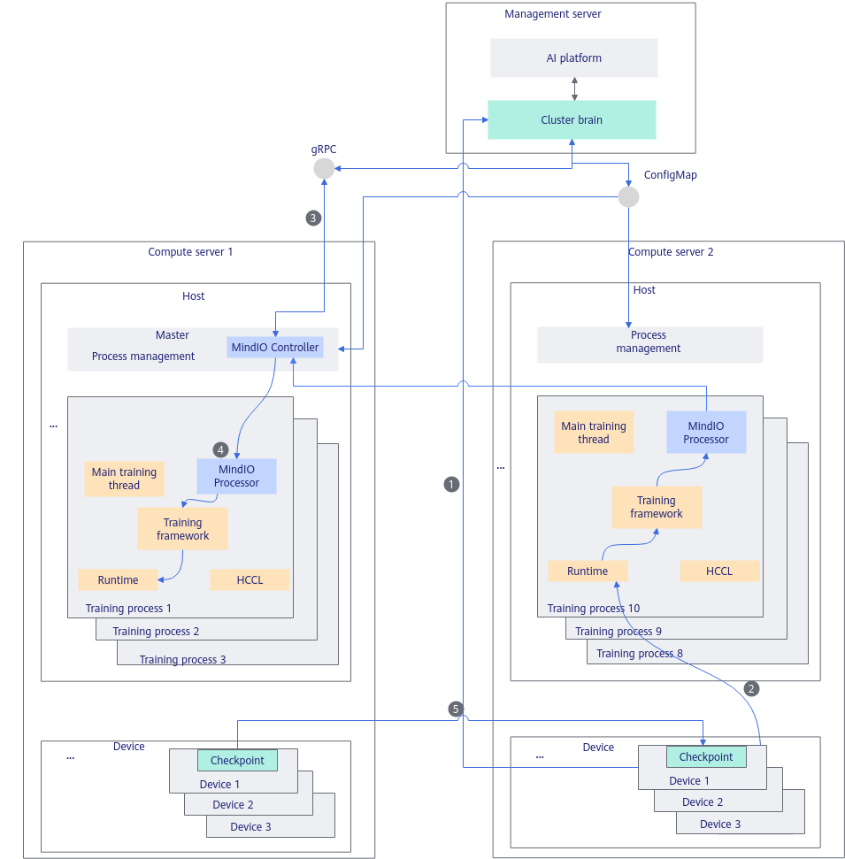

In the principle diagram above, the steps are described as follows.

1. After an on-chip memory fault or network fault occurs on a device, the MindCluster detection component on the server reports the fault information to the cluster brain ClusterD.
2. The on-chip memory fault or network fault is perceived by CANN software and reported to the MindIO Processor and MindIO Controller through the training framework.
3. The MindIO Controller requests the cluster brain to decide whether to perform step-level recomputation recovery, and the cluster brain makes the decision based on the health status of other nodes in the cluster.
4. The MindIO Controller notifies the MindIO Processor in each training process to call the training framework to stop the job and repair the fault, retaining the communication domain information.
5. The NPU on the normal server transfers the CKPT to the faulty (repaired) server over the parameter plane. After the parameter state is recovered, training continues and the current step computation is restarted.

**Adaptation Function Points**

In process-level online recovery, the cluster brain identifies network faults and on-chip memory faults based on the fault information, delivers the corresponding recovery policy, and supports recovery policy fallback. In the training container, the framework first initializes the MindIO service; after the service is started, it reports the corresponding status to MindIO when the optimizer is updated. Then, it creates a DP replica group and an optimizer replica to ensure redundant backup of model parameters. When an exception occurs, the fault mode is captured through the exception capture decorator. During recovery, operator resource cleanup, UCE model optimizer rebuild, parameter plane online repair, and status rollback are performed for different faults to complete process-level online recovery.

For users who do not use MindSpeed-LLM and the MindCluster platform, the following function adaptation must be completed on the framework side for different faults.

**Table 10** Framework adaptation function points of process-level online recovery for network faults

<table><thead align="left"><tr id="row169591493619"><th class="cellrowborder" valign="top" width="18.61186118611861%" id="mcps1.2.5.1.1">
Adaptation Point

</th>
<th class="cellrowborder" valign="top" width="36.72367236723672%" id="mcps1.2.5.1.2">
Function Brief

</th>
<th class="cellrowborder" valign="top" width="17.981798179817982%" id="mcps1.2.5.1.3">
Involved Component

</th>
<th class="cellrowborder" valign="top" width="26.68266826682668%" id="mcps1.2.5.1.4">
Reference Link

</th>
</tr>
</thead>
<tbody><tr id="row199614191876"><td class="cellrowborder" valign="top" width="18.61186118611861%" headers="mcps1.2.5.1.1 ">
Initialization while startup

</td>
<td class="cellrowborder" valign="top" width="36.72367236723672%" headers="mcps1.2.5.1.2 ">
Start the MindIO service when the training framework is initialized.

</td>
<td class="cellrowborder" rowspan="5" valign="top" width="17.981798179817982%" headers="mcps1.2.5.1.3 ">
Distributed training framework

</td>
<td class="cellrowborder" rowspan="5" valign="top" width="26.68266826682668%" headers="mcps1.2.5.1.4 ">
<a href="../../../../07_references/00_fault_recovery_acceleration/03_usage_guidance.md#integrating-with-non-mindspeed-llm-frameworks">Integrating with Non-MindSpeed-LLM Frameworks</a>

</td>
</tr>
<tr id="row149661916713"><td class="cellrowborder" valign="top" headers="mcps1.2.5.1.1 ">
Reporting the optimizer update status

</td>
<td class="cellrowborder" valign="top" headers="mcps1.2.5.1.2 ">
Report the start and end of the optimizer update before the optimizer update.

</td>
</tr>
<tr id="row1239411299541"><td class="cellrowborder" valign="top" headers="mcps1.2.5.1.1 ">
Exception capture decorator

</td>
<td class="cellrowborder" valign="top" headers="mcps1.2.5.1.2 ">
Use the exception capture decorator to decorate the train function to capture the fault mode.

</td>
</tr>
<tr id="row13395629115418"><td class="cellrowborder" valign="top" headers="mcps1.2.5.1.1 ">
Operator resource cleanup

</td>
<td class="cellrowborder" valign="top" headers="mcps1.2.5.1.2 ">
Complete operator resource cleanup through a callback function.

</td>
</tr>
<tr id="row7395142913549"><td class="cellrowborder" valign="top" headers="mcps1.2.5.1.1 ">
Status rollback

</td>
<td class="cellrowborder" valign="top" headers="mcps1.2.5.1.2 ">
Complete data iterator rebuild and framework variable reset through a callback function.

</td>
</tr>
<tr id="row539519296541"><td class="cellrowborder" valign="top" width="18.61186118611861%" headers="mcps1.2.5.1.1 ">
Recovery policy decision

</td>
<td class="cellrowborder" valign="top" width="36.72367236723672%" headers="mcps1.2.5.1.2 ">
Identify network faults or on-chip memory faults based on the fault information, deliver the corresponding recovery policy, and support recovery policy fallback.

</td>
<td class="cellrowborder" rowspan="2" valign="top" width="17.981798179817982%" headers="mcps1.2.5.1.3 ">
AI platform

</td>
<td class="cellrowborder" valign="top" width="26.68266826682668%" headers="mcps1.2.5.1.4 ">
<a href="https://gitcode.com/Ascend/mind-cluster/tree/release_v26.2.0/component/clusterd/pkg/application/recover" target="_blank" rel="noopener noreferrer">Link</a>

</td>
</tr>
<tr id="row7396029145419"><td class="cellrowborder" valign="top" headers="mcps1.2.5.1.1 ">
Faulty Pod scheduling

</td>
<td class="cellrowborder" valign="top" headers="mcps1.2.5.1.2 ">
Schedule faulty Pods and support scheduling recovery policy fallback.

</td>
<td class="cellrowborder" valign="top" headers="mcps1.2.5.1.3 ">
<a href="https://gitcode.com/Ascend/mind-cluster/tree/release_v26.2.0/component/ascend-for-volcano/internal/rescheduling" target="_blank" rel="noopener noreferrer">Link</a>

</td>
</tr>
</tbody>
</table>

**Table 11** Framework adaptation function points of process-level online recovery for on-chip memory faults

<table><thead align="left"><tr id="row866213619553"><th class="cellrowborder" valign="top" width="17.119999999999997%" id="mcps1.2.5.1.1">
Adaptation Point

</th>
<th class="cellrowborder" valign="top" width="38.769999999999996%" id="mcps1.2.5.1.2">
Function Brief

</th>
<th class="cellrowborder" valign="top" width="17.43%" id="mcps1.2.5.1.3">
Involved Component

</th>
<th class="cellrowborder" valign="top" width="26.68%" id="mcps1.2.5.1.4">
Reference Link

</th>
</tr>
</thead>
<tbody><tr id="row19662436145518"><td class="cellrowborder" valign="top" width="17.119999999999997%" headers="mcps1.2.5.1.1 ">
Initialization while startup

</td>
<td class="cellrowborder" valign="top" width="38.769999999999996%" headers="mcps1.2.5.1.2 ">
Start the MindIO service when the training framework is initialized.

</td>
<td class="cellrowborder" rowspan="9" valign="top" width="17.43%" headers="mcps1.2.5.1.3 ">
Distributed training framework

</td>
<td class="cellrowborder" rowspan="9" valign="top" width="26.68%" headers="mcps1.2.5.1.4 ">
<a href="../../../../07_references/00_fault_recovery_acceleration/03_usage_guidance.md#integrating-with-non-mindspeed-llm-frameworks">Integrating with Non-MindSpeed-LLM Frameworks</a>

</td>
</tr>
<tr id="row566215364551"><td class="cellrowborder" valign="top" headers="mcps1.2.5.1.1 ">
Reporting the optimizer update status

</td>
<td class="cellrowborder" valign="top" headers="mcps1.2.5.1.2 ">
Report the start and end of the optimizer update before the optimizer update.

</td>
</tr>
<tr id="row06621936185512"><td class="cellrowborder" valign="top" headers="mcps1.2.5.1.1 ">
Creating a DP replica group

</td>
<td class="cellrowborder" valign="top" headers="mcps1.2.5.1.2 ">
Add the creation logic of the dp_cp/dp_ep replica groups and the gloo group, and create the related replica groups after the native Megatron distributed parallel group is created.

</td>
</tr>
<tr id="row2662133617558"><td class="cellrowborder" valign="top" headers="mcps1.2.5.1.1 ">
Optimizer replica

</td>
<td class="cellrowborder" valign="top" headers="mcps1.2.5.1.2 ">
Take over and inherit the related native Megatron optimizer functions, and embed the MindIO optimizer replica management logic.

</td>
</tr>
<tr id="row066213685511"><td class="cellrowborder" valign="top" headers="mcps1.2.5.1.1 ">
Exception capture decorator

</td>
<td class="cellrowborder" valign="top" headers="mcps1.2.5.1.2 ">
Use the exception capture decorator to decorate the train function to capture the fault mode.

</td>
</tr>
<tr id="row666243613555"><td class="cellrowborder" valign="top" headers="mcps1.2.5.1.1 ">
Operator resource cleanup

</td>
<td class="cellrowborder" valign="top" headers="mcps1.2.5.1.2 ">
Complete operator resource cleanup through a callback function.

</td>
</tr>
<tr id="row14662143645516"><td class="cellrowborder" valign="top" headers="mcps1.2.5.1.1 ">
UCE model optimizer rebuild

</td>
<td class="cellrowborder" valign="top" headers="mcps1.2.5.1.2 ">
Complete the cleanup and rebuild of the model optimizer object on the faulty card through a callback function.

</td>
</tr>
<tr id="row43068171121"><td class="cellrowborder" valign="top" headers="mcps1.2.5.1.1 ">
Parameter plane online repair

</td>
<td class="cellrowborder" valign="top" headers="mcps1.2.5.1.2 ">
Complete recovery processing of replica cards and recovery cards through a callback function.

</td>
</tr>
<tr id="row17307161715127"><td class="cellrowborder" valign="top" headers="mcps1.2.5.1.1 ">
Status rollback

</td>
<td class="cellrowborder" valign="top" headers="mcps1.2.5.1.2 ">
Complete data iterator rebuild and framework variable reset through a callback function.

</td>
</tr>
<tr id="row966233613558"><td class="cellrowborder" valign="top" width="17.119999999999997%" headers="mcps1.2.5.1.1 ">
Recovery policy decision

</td>
<td class="cellrowborder" valign="top" width="38.769999999999996%" headers="mcps1.2.5.1.2 ">
Identify network faults or on-chip memory faults based on the fault information, deliver the corresponding recovery policy, and support recovery policy fallback.

</td>
<td class="cellrowborder" rowspan="2" valign="top" width="17.43%" headers="mcps1.2.5.1.3 ">
AI platform

</td>
<td class="cellrowborder" valign="top" width="26.68%" headers="mcps1.2.5.1.4 ">
<a href="https://gitcode.com/Ascend/mind-cluster/tree/release_v26.2.0/component/clusterd/pkg/application/recover" target="_blank" rel="noopener noreferrer">Link</a>

</td>
</tr>
<tr id="row16621936105516"><td class="cellrowborder" valign="top" headers="mcps1.2.5.1.1 ">
Faulty Pod scheduling

</td>
<td class="cellrowborder" valign="top" headers="mcps1.2.5.1.2 ">
Schedule faulty Pods and support scheduling recovery policy fallback.

</td>
<td class="cellrowborder" valign="top" headers="mcps1.2.5.1.3 ">
<a href="https://gitcode.com/Ascend/mind-cluster/tree/release_v26.2.0/component/ascend-for-volcano/internal/rescheduling" target="_blank" rel="noopener noreferrer">Link</a>

</td>
</tr>
</tbody>
</table>

## Switchback Recovery

### Suspension and Switchback of Link Failover Communication

For Atlas A3 training products, the MindCluster cluster scheduling components provide the suspension and switchback of link failover communication for training jobs. That is, during training, the RoCE port used by an NPU chip can be switched freely by using the proactive link failover and switchback API.

For the detailed configuration method of suspension and switchback of link failover communication, see [Configuring Suspension and Switchback for Link Failover Communication](../02_configuration/01_configuring_fault_handling_policies.md#ZH-CN_TOPIC_0000002511346495).

- Before calling the [Link Failover and Switchback API](../../../../06_api/04_clusterd/08_link_failover_and_switchback_apis.md) to perform a link failover or switchback action, familiarize yourself with the NPU chip networking relationship and ensure that the network link of the target NPU is normal. If the target NPU is in linkdown state, the operation fails.
- Taking the interface interconnection relationship in the preceding networking guide as an example, for the following cases, specify dev and op as follows when calling the `SwitchNicTrack` API:
    1. To switch device0 and device8 from QDD8 to QDD7 by link failover, pass `dev` as \[device0, device8\] and `op` as \[true, true\].
    2. To switch device0 and device8 back from QDD7 to QDD8, pass `dev` as \[device0, device8\] and `op` as \[false, false\].
    3. To switch only device0 from PortA of QDD8 to PortA of QDD7 by link failover, pass `dev` as \[device0\] and `op` as \[true\].
    4. To switch only device0 back from PortA of QDD7 to PortA of QDD8, pass `dev` as \[device0\] and `op` as \[false\].
    5. To switch all devices under Leaf1 to Leaf2 by link failover, pass `dev` as \[device0, device8, device2, device10, device4, device12, device6, device14 \] and `op` as \[true, true, true, true, true, true, true, true\].
    6. To switch all devices under Leaf2 back to Leaf1, pass `dev` as \[device0, device8, device2, device10, device4, device12, device6, device14 \] and `op` as \[false, false, false, false, false, false, false, false\].

    **Figure 7** Interface interconnection relationship

    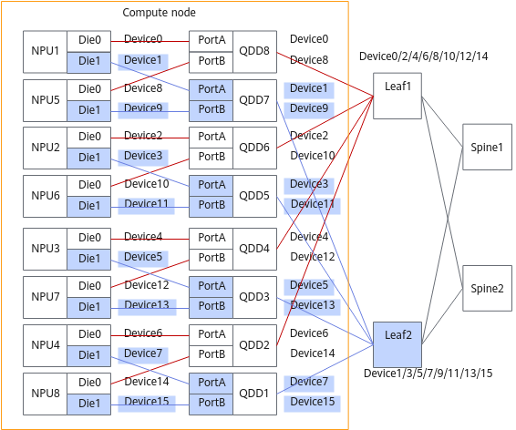

**Application Scenarios**

Suspension and switchback of link failover communication is currently supported in the following two scenarios.

- Switch upgrade scenario: Manually trigger link failover, upgrade the switch, and then switch back.
- Fault handling scenario: After the faulty port on which link failover is performed is repaired, manually switch back.

**Usage Constraints**

- Issue the link failover or switchback command only after the training iteration is running normally.
- Ensure that the process-level recovery related functions are enabled.
- Only the scenario where RoCE communication is used between Pods is supported.
- This function depends on the MindIO component. Before use, familiarize yourself with the [Constraints](../../../../07_references/00_fault_recovery_acceleration/02_installation_and_deployment.md#constraints) of MindIO.
- This feature is no longer supported in MindSpore 2.11.0.

**Supported Product Models and AI Frameworks**

**Table 12** Supported products and frameworks

|Product Type|Hardware Form|Training Framework|
|--|--|--|
|Atlas A3 training products|<ul><li>Atlas 800T A3</li><li>Atlas 900 A3 SuperPoD</li></ul>|<ul><li>MindSpore</li><li>PyTorch</li></ul>|

**Suspension and Switchback Principle of Link Failover Communication**

**Figure 8** Principle diagram

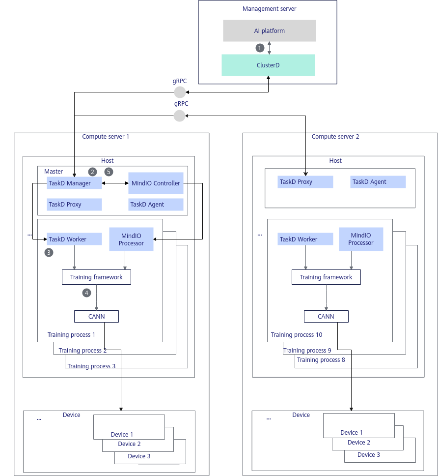

In the principle diagram above, the steps are described as follows.

1. The AI platform integrates ClusterD and calls the ClusterD gRPC interface to deliver the switchover operation, specifying the NPUs to be switched.
2. ClusterD notifies MindIO to pause training.
3. TaskD Manager notifies all TaskD Workers to call the training framework interface to perform the switchover operation.
4. The training framework calls the CANN interface one by one by communication domain to perform the switchover operation.
5. After ClusterD determines that the switchover operations on all NPUs are complete, TaskD notifies MindIO to continue with the next step of training after the switchover is complete.

**Adaptation Function Points**

In suspension and switchback of link failover communication, the framework first initializes the MindIO service; after the service is started, it reports the corresponding status to MindIO when the optimizer is updated. By proactively calling the graceful pause mechanism, the job pause and job switchover on the current card are completed. The cluster brain must provide external interfaces to receive switchover instructions and manage the link failover communication process.

For users who do not use MindSpeed-LLM and the MindCluster platform, the function adaptation in [Table 13](#table19955141136102) must be completed on the framework side.

**Table 13** Framework adaptation function points for suspension and switchback of link failover communication

<table><thead align="left"><tr id="row169591493619"><th class="cellrowborder" valign="top" width="18.87%" id="mcps1.2.5.1.1">
Adaptation Point

</th>
<th class="cellrowborder" valign="top" width="43.419999999999995%" id="mcps1.2.5.1.2">
Function Brief

</th>
<th class="cellrowborder" valign="top" width="14.719999999999999%" id="mcps1.2.5.1.3">
Invloved Component

</th>
<th class="cellrowborder" valign="top" width="22.99%" id="mcps1.2.5.1.4">
Reference Link

</th>
</tr>
</thead>
<tbody><tr id="row893618158397"><td class="cellrowborder" valign="top" width="18.87%" headers="mcps1.2.5.1.1 ">
Initialization while startup

</td>
<td class="cellrowborder" valign="top" width="43.419999999999995%" headers="mcps1.2.5.1.2 ">
Start the MindIO service when the training framework is initialized.

</td>
<td class="cellrowborder" rowspan="3" valign="top" width="14.719999999999999%" headers="mcps1.2.5.1.3 ">
Distributed training framework

</td>
<td class="cellrowborder" rowspan="3" valign="top" width="22.99%" headers="mcps1.2.5.1.4 ">
<a href="../../../../07_references/00_fault_recovery_acceleration/03_usage_guidance.md#integrating-with-non-mindspeed-llm-frameworks">Integrating with Non-MindSpeed-LLM Frameworks</a>

</td>
</tr>
<tr id="row1793717157396"><td class="cellrowborder" valign="top" headers="mcps1.2.5.1.1 ">
Reporting the optimizer update status

</td>
<td class="cellrowborder" valign="top" headers="mcps1.2.5.1.2 ">
Report the start and end of the optimizer update before the optimizer update.

</td>
</tr>
<tr id="row193701523914"><td class="cellrowborder" valign="top" headers="mcps1.2.5.1.1 ">
Graceful pause

</td>
<td class="cellrowborder" valign="top" headers="mcps1.2.5.1.2 ">
Add a MindIO function call at the very end of the training iteration loop to implement the active pause function.

</td>
</tr>
<tr id="row1297881015253"><td class="cellrowborder" valign="top" width="18.87%" headers="mcps1.2.5.1.1 ">
Link failover switchover process management

</td>
<td class="cellrowborder" valign="top" width="43.419999999999995%" headers="mcps1.2.5.1.2 ">
Provide the capability of delivering link failover switchover requests, and control the pause and restart of training processes.

</td>
<td class="cellrowborder" valign="top" width="14.719999999999999%" headers="mcps1.2.5.1.3 ">
AI platform

</td>
<td class="cellrowborder" valign="top" width="22.99%" headers="mcps1.2.5.1.4 ">
<a href="https://gitcode.com/Ascend/mind-cluster/blob/release_v26.2.0/component/clusterd/pkg/application/recover/om_controller.go" target="_blank" rel="noopener noreferrer">Link</a>

</td>
</tr>
</tbody>
</table>

## Elastic Recovery

### Elastic Training

When a hardware fault occurs and no backup resource is available in the K8s cluster, MindCluster first scales in some nodes by data parallel domain to continue training, and then triggers scale-out to restore the original scale of training when idle resources become available in the cluster. Compared with process-level rescheduling, this solves the problem that there is no available backup resource in the cluster for rescheduling.

**Usage Constraints**

- Only PyTorch used with MindSpeed-LLM 2.3.0 is supported. For version matching, see [MindSpeed-LLM](https://gitcode.com/Ascend/MindSpeed-LLM/tree/2.3.0).
- Only acjob-type training jobs are supported.
- This function depends on the MindIO optimizer replica, and a full optimizer replica must exist. Therefore, MindIO and TaskD must be installed and used together.
- This function cannot be enabled at the same time as graceful fault tolerance.
- When the Pod whose `hccl`/`rankIndex` field in the job annotation is 0 becomes faulty, elastic training cannot be triggered.
- Multimodal models are not supported.
- The watchdog function cannot be enabled.
- Because elastic training creates additional communication groups, on-chip memory usage may increase.

    Formula for calculating the additional memory: maximum additional memory (MB) = HCCL\_BUFFSIZE \* 2 \* 9, where the default value of HCCL\_BUFFSIZE is 200 MB. For details about HCCL\_BUFFSIZE, see the "[HCCL_BUFFSIZE](https://www.hiascend.com/document/detail/en/CANNCommunityEdition/910/commlib/hcclug/docs/en/user_guide/hccl_env/HCCL_BUFFSIZE.md)" section in *CANN HCCL Collective Communication Library*.

- This function depends on MindIO. Before use, familiarize yourself with the [Constraints](../../../../07_references/00_fault_recovery_acceleration/02_installation_and_deployment.md#constraints) of MindIO.

For more usage constraints, see [MindSpeed-LLM Elastic Training Usage Constraints](https://gitcode.com/Ascend/MindSpeed-LLM/blob/2.3.0/docs/pytorch/features/high_availability.md).

**Supported Product Models and AI Frameworks**

**Table 16** Products and frameworks supported by elastic training

|Product Type|Hardware Form|Training Framework|
|--|--|--|
|Atlas A2 training products|Atlas 800T A2|PyTorch|
|Atlas A3 training products|Atlas 900 A3 SuperPoD|PyTorch|

**Elastic Training Principle**

**Figure 10** Principle diagram

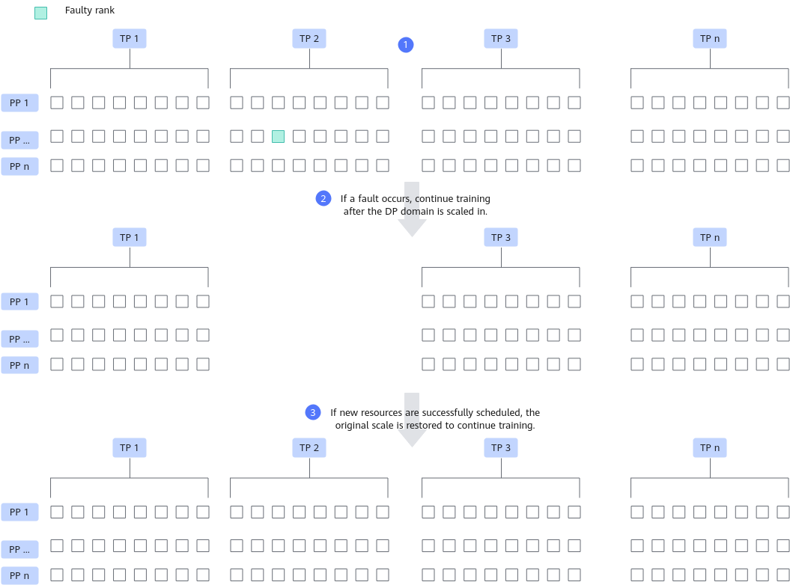

The preceding figure uses scale-in of one DP domain as an example only. In actual elastic training, multiple DP domains may be scaled in at a time. Each square in the figure represents a rank.

1. Distributed training is performed normally with TP Tensor Parallelism (TP), Pipeline Parallelism (PP), and Data Parallelism (DP).
2. At some point during training, if a rank becomes faulty and no more idle resources in the cluster can be scheduled for resumable training, scale in by DP domain, that is, scale in the Pods corresponding to one DP domain (possibly multiple Pods) and then continue training.
3. At some point during scale-in training, when idle resources become available in the cluster, the scaled-in Pods are rescheduled, and scale-out restores the original scale to continue training.

**Figure 11** Flowchart

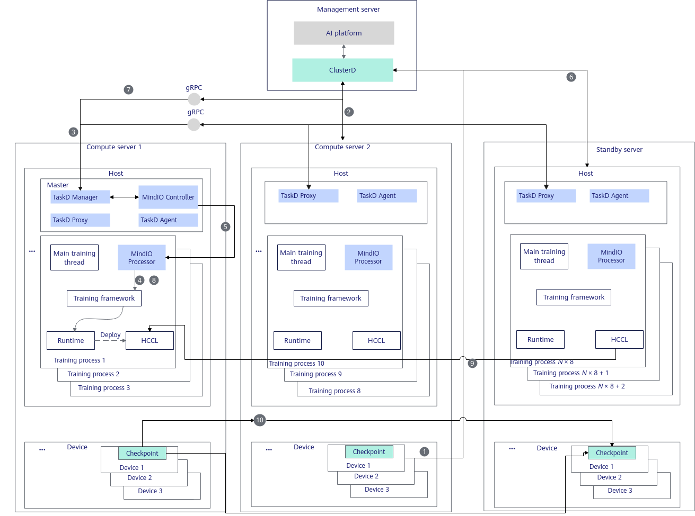

In the flowchart above, the steps are described as follows.

1. After a hardware fault occurs on a device, the MindCluster detection component on the server reports the fault information to ClusterD; a software fault is perceived by the MindIO Controller in the container and reported to ClusterD.
2. ClusterD destroys the job container on the faulty server.
3. If no backup node is available to schedule a new container, ClusterD notifies the MindIO Controller on the master node to perform scale-in training.
4. The MindIO Controller notifies the MindIO Processor in each training process, and the MindIO Processor calls TorchNPU to stop the training process and clears the resources of normal nodes.
5. The MindIO Controller notifies the MindIO Processor in normal training processes to perform scale-in procedures such as communication group rebuilding, and then performs scale-in training.
6. It is detected that the Pods deleted during scale-in are successfully rescheduled.
7. ClusterD notifies the MindIO Controller through TaskD Manager to perform scale-out.
8. The MindIO Controller notifies the MindIO Processor in each training process, and the MindIO Processor calls TorchNPU to stop the training process and clears the resources of normal nodes.
9. Each process establishes collective communication links.
10. The NPU on the normal server transfers the CKPT to the standby server over the parameter plane, and training continues after the parameter state is recovered.

**Adaptation Function Points**

In elastic training, the cluster brain decides the recovery policy based on the global fault information and delivers the policy to MindIO. The scheduler must support faulty Pod scheduling instead of rescheduling the entire job, and support level-by-level fallback of recovery policies. In the training container, the framework first initializes the MindIO service. After the service is started, it reports the corresponding status to MindIO when the optimizer is updated. Then, it creates a DP replica group and an optimizer replica to ensure redundant backup of model parameters. When an exception occurs, the fault mode is captured through the exception capture decorator and reported by MindIO to the cluster brain for decision-making.

- When the cluster brain detects a fault and no redundant backup resource is available, it delivers the scale-in policy to MindIO, performs operator resource cleanup and scale-in rebuild, and continues training in the scaled-in state.
- When the cluster brain detects that resources are available and the new nodes are successfully started, it delivers the scale-out policy to MindIO, performs operator resource cleanup, scale-out communication re-establishment, scale-out parameter plane recovery, and scale-out status rollback, and completes elastic scale-out to restore the original scale and continue training.

For users who do not use MindSpeed-LLM and the MindCluster platform, the function adaptation in [Table 17](#table19955141136107) must be completed on the framework side.

**Table 17** Framework adaptation function points for elastic training

<table><thead align="left"><tr id="row169591493619"><th class="cellrowborder" valign="top" width="7.520000000000001%" id="mcps1.2.6.1.1">
No.

</th>
<th class="cellrowborder" valign="top" width="18.810000000000002%" id="mcps1.2.6.1.2">
Adaptation Point

</th>
<th class="cellrowborder" valign="top" width="34.39%" id="mcps1.2.6.1.3">
Function Brief

</th>
<th class="cellrowborder" valign="top" width="18.190000000000005%" id="mcps1.2.6.1.4">
Involved Component

</th>
<th class="cellrowborder" valign="top" width="21.090000000000003%" id="mcps1.2.6.1.5">
Reference Link

</th>
</tr>
</thead>
<tbody><tr id="row893618158397"><td class="cellrowborder" valign="top" width="7.520000000000001%" headers="mcps1.2.6.1.1 ">
1

</td>
<td class="cellrowborder" valign="top" width="18.810000000000002%" headers="mcps1.2.6.1.2 ">
Initialization while startup

</td>
<td class="cellrowborder" valign="top" width="34.39%" headers="mcps1.2.6.1.3 ">
Start the MindIO service when the training framework is initialized.

</td>
<td class="cellrowborder" rowspan="16" valign="top" width="18.190000000000005%" headers="mcps1.2.6.1.4 ">
Distributed training framework

</td>
<td class="cellrowborder" rowspan="6" valign="top" width="21.090000000000003%" headers="mcps1.2.6.1.5 ">
<a href="../../../../07_references/00_fault_recovery_acceleration/03_usage_guidance.md#integrating-with-non-mindspeed-llm-frameworks">Table 2</a>

</td>
</tr>
<tr id="row1793717157396"><td class="cellrowborder" valign="top" headers="mcps1.2.6.1.1 ">
2

</td>
<td class="cellrowborder" valign="top" headers="mcps1.2.6.1.2 ">
Reporting the optimizer update status

</td>
<td class="cellrowborder" valign="top" headers="mcps1.2.6.1.3 ">
Report the start and end status of the optimizer update before the optimizer update.

</td>
</tr>
<tr id="row193701523914"><td class="cellrowborder" valign="top" headers="mcps1.2.6.1.1 ">
3

</td>
<td class="cellrowborder" valign="top" headers="mcps1.2.6.1.2 ">
Creating a DP replica group

</td>
<td class="cellrowborder" valign="top" headers="mcps1.2.6.1.3 ">
Add the creation logic of the dp_cp/dp_ep replica groups and the gloo group, and create the related replica groups after the native Megatron distributed parallel group is created.

</td>
</tr>
<tr id="row191961528155914"><td class="cellrowborder" valign="top" headers="mcps1.2.6.1.1 ">
4

</td>
<td class="cellrowborder" valign="top" headers="mcps1.2.6.1.2 ">
Optimizer replica

</td>
<td class="cellrowborder" valign="top" headers="mcps1.2.6.1.3 ">
Take over and inherit the related native Megatron optimizer functions, and embed the MindIO optimizer replica management logic.

</td>
</tr>
<tr id="row111971728195915"><td class="cellrowborder" valign="top" headers="mcps1.2.6.1.1 ">
5

</td>
<td class="cellrowborder" valign="top" headers="mcps1.2.6.1.2 ">
Exception capture decorator

</td>
<td class="cellrowborder" valign="top" headers="mcps1.2.6.1.3 ">
Use the exception capture decorator to decorate the train function to capture the fault mode.

</td>
</tr>
<tr id="row1519712855916"><td class="cellrowborder" valign="top" headers="mcps1.2.6.1.1 ">
6

</td>
<td class="cellrowborder" valign="top" headers="mcps1.2.6.1.2 ">
Operator resource cleanup

</td>
<td class="cellrowborder" valign="top" headers="mcps1.2.6.1.3 ">
Complete operator resource cleanup through a callback function.

</td>
</tr>
<tr id="row1375943411593"><td class="cellrowborder" valign="top" headers="mcps1.2.6.1.1 ">
7

</td>
<td class="cellrowborder" valign="top" headers="mcps1.2.6.1.2 ">
Elastic training callback registration

</td>
<td class="cellrowborder" valign="top" headers="mcps1.2.6.1.3 ">
Register the callback functions of elastic training with MindIO.

</td>
<td class="cellrowborder" valign="top" headers="mcps1.2.6.1.4 ">
<a href="https://gitcode.com/Ascend/MindSpeed-LLM/blob/2.3.0/mindspeed_llm/core/high_availability/elastic_training_register.py" target="_blank" rel="noopener noreferrer">LLM Repository Reference Link</a>

</td>
</tr>
<tr id="row876023415918"><td class="cellrowborder" valign="top" headers="mcps1.2.6.1.1 ">
8

</td>
<td class="cellrowborder" valign="top" headers="mcps1.2.6.1.2 ">
Scale-in rebuild

</td>
<td class="cellrowborder" valign="top" headers="mcps1.2.6.1.3 ">
Rebuild the communication group and data iterator after scale-in, and record and update some framework variables.

</td>
<td class="cellrowborder" valign="top" headers="mcps1.2.6.1.4 ">
<a href="https://gitcode.com/Ascend/MindSpeed-LLM/blob/2.3.0/mindspeed_llm/core/high_availability/elastic_training_scale_in_rebuild.py" target="_blank" rel="noopener noreferrer">LLM Repository Reference Link</a>

</td>
</tr>
<tr id="row17605341596"><td class="cellrowborder" valign="top" headers="mcps1.2.6.1.1 ">
9

</td>
<td class="cellrowborder" valign="top" headers="mcps1.2.6.1.2 ">
Scale-out communication re-establishment

</td>
<td class="cellrowborder" valign="top" headers="mcps1.2.6.1.3 ">
The new node re-establishes the communication group with the scaled-in node.

</td>
<td class="cellrowborder" valign="top" headers="mcps1.2.6.1.4 ">
<a href="https://gitcode.com/Ascend/MindSpeed-LLM/blob/2.3.0/mindspeed_llm/core/high_availability/elastic_training_scale_out_rebuild.py" target="_blank" rel="noopener noreferrer">LLM Repository Reference Link</a>

</td>
</tr>
<tr id="row144412445361"><td class="cellrowborder" valign="top" headers="mcps1.2.6.1.1 ">
10

</td>
<td class="cellrowborder" valign="top" headers="mcps1.2.6.1.2 ">
Scale-out parameter plane recovery

</td>
<td class="cellrowborder" valign="top" headers="mcps1.2.6.1.3 ">
Recover parameters such as the optimizer of the new node by transferring parameters between the replica rank and the newly started rank.

</td>
<td class="cellrowborder" valign="top" headers="mcps1.2.6.1.4 ">
<a href="https://gitcode.com/Ascend/MindSpeed-LLM/blob/2.3.0/mindspeed_llm/core/high_availability/elastic_training_repair.py" target="_blank" rel="noopener noreferrer">LLM Repository Reference Link</a>

</td>
</tr>
<tr id="row14716101112393"><td class="cellrowborder" valign="top" headers="mcps1.2.6.1.1 ">
11

</td>
<td class="cellrowborder" valign="top" headers="mcps1.2.6.1.2 ">
Scale-out status rollback

</td>
<td class="cellrowborder" valign="top" headers="mcps1.2.6.1.3 ">
Restore the framework variables changed during scale-in and rebuild the dataset.

</td>
<td class="cellrowborder" valign="top" headers="mcps1.2.6.1.4 ">
<a href="https://gitcode.com/Ascend/MindSpeed-LLM/blob/2.3.0/mindspeed_llm/core/high_availability/elastic_training_rollback.py" target="_blank" rel="noopener noreferrer">LLM Repository Reference Link</a>

</td>
</tr>
<tr id="row164994019817"><td class="cellrowborder" valign="top" headers="mcps1.2.6.1.1 ">
12

</td>
<td class="cellrowborder" valign="top" headers="mcps1.2.6.1.2 ">
Torch communication adaptation for newly started nodes

</td>
<td class="cellrowborder" valign="top" headers="mcps1.2.6.1.3 ">
Skip communication before recovery on newly started nodes.

</td>
<td class="cellrowborder" rowspan="2" valign="top" headers="mcps1.2.6.1.4 ">
<a href="https://gitcode.com/Ascend/MindSpeed-LLM/blob/2.3.0/mindspeed_llm/features_manager/high_availability/high_availability.py#:~text=def pre_register_patches(self, patch_manager, args):" target="_blank" rel="noopener noreferrer">LLM Repository Reference Link</a>

</td>
</tr>
<tr id="row5499401185"><td class="cellrowborder" valign="top" headers="mcps1.2.6.1.1 ">
13

</td>
<td class="cellrowborder" valign="top" headers="mcps1.2.6.1.2 ">
Global group communication adaptation for scale-in training

</td>
<td class="cellrowborder" valign="top" headers="mcps1.2.6.1.3 ">
During scale-in training, replace the original global group communication with the global group after scale-in.

</td>
</tr>
<tr id="row1550640684"><td class="cellrowborder" valign="top" headers="mcps1.2.6.1.1 ">
14

</td>
<td class="cellrowborder" valign="top" headers="mcps1.2.6.1.2 ">
Replica group communication adaptation for scale-in training

</td>
<td class="cellrowborder" valign="top" headers="mcps1.2.6.1.3 ">
During scale-in training, the replica rank replaces the faulty rank to communicate with the replica group of the faulty rank.

</td>
<td class="cellrowborder" rowspan="2" valign="top" headers="mcps1.2.6.1.4 ">
<a href="https://gitcode.com/Ascend/MindSpeed-LLM/blob/2.3.0/mindspeed_llm/features_manager/high_availability/high_availability.py" target="_blank" rel="noopener noreferrer">LLM Repository Reference Link</a>

</td>
</tr>
<tr id="row1650540489"><td class="cellrowborder" valign="top" headers="mcps1.2.6.1.1 ">
15

</td>
<td class="cellrowborder" valign="top" headers="mcps1.2.6.1.2 ">
Parameter adaptation for scale-in training

</td>
<td class="cellrowborder" valign="top" headers="mcps1.2.6.1.3 ">
Modify parameters such as num_microbatches, world_size, and global_batch_size during scale-in training.

</td>
</tr>
<tr id="row7501940584"><td class="cellrowborder" valign="top" headers="mcps1.2.6.1.1 ">
16

</td>
<td class="cellrowborder" valign="top" headers="mcps1.2.6.1.2 ">
Gradient precision calculation adaptation

</td>
<td class="cellrowborder" valign="top" headers="mcps1.2.6.1.3 ">
Adapt to the precision gradient changes caused by changes in num_microbatches and other parameters during scale-in.

</td>
<td class="cellrowborder" valign="top" headers="mcps1.2.6.1.4 ">
<a href="https://gitcode.com/Ascend/MindSpeed-LLM/blob/2.3.0/mindspeed_llm/features_manager/high_availability/high_availability.py" target="_blank" rel="noopener noreferrer">LLM Repository Reference Link 1</a>

<a href="https://gitcode.com/Ascend/MindSpeed-LLM/blob/2.3.0/pretrain_gpt.py#:~text=if args.enable_elastic_training:" target="_blank" rel="noopener noreferrer">LLM Repository Reference Link 2</a>

</td>
</tr>
<tr id="row145017409813"><td class="cellrowborder" valign="top" width="7.520000000000001%" headers="mcps1.2.6.1.1 ">
17

</td>
<td class="cellrowborder" valign="top" width="18.810000000000002%" headers="mcps1.2.6.1.2 ">
Recovery policy decision

</td>
<td class="cellrowborder" valign="top" width="34.39%" headers="mcps1.2.6.1.3 ">
Decide the recovery policy based on the global fault information and deliver the policy to MindIO. Support recovery policy fallback: if elastic training fails, the system falls back to policies such as dying gasp.

</td>
<td class="cellrowborder" rowspan="2" valign="top" width="18.190000000000005%" headers="mcps1.2.6.1.4 ">
AI platform

</td>
<td class="cellrowborder" valign="top" width="21.090000000000003%" headers="mcps1.2.6.1.5 ">
<a href="https://gitcode.com/Ascend/mind-cluster/tree/release_v26.2.0/component/clusterd/pkg/application/recover" target="_blank" rel="noopener noreferrer">Link</a>

</td>
</tr>
<tr id="row155014017818"><td class="cellrowborder" valign="top" headers="mcps1.2.6.1.1 ">
18

</td>
<td class="cellrowborder" valign="top" headers="mcps1.2.6.1.2 ">
Faulty Pod scheduling

</td>
<td class="cellrowborder" valign="top" headers="mcps1.2.6.1.3 ">
Schedule faulty Pods.

</td>
<td class="cellrowborder" valign="top" headers="mcps1.2.6.1.4 ">
<a href="https://gitcode.com/Ascend/mind-cluster/tree/release_v26.2.0/component/ascend-for-volcano/internal/rescheduling" target="_blank" rel="noopener noreferrer">Link</a>

</td>
</tr>
</tbody>
</table>

Adaptation items 1-6 in [Table 17](#table19955141136107) are the common logic of MindIO TFT (MindCluster MindIO Training Fault Tolerance), and adaptation items 17-18 are the common logic of resumable training. They are not described in detail in this section. The following briefly describes the function points specific to elastic training based on Megatron 0.12.1.

- Elastic training callback registration

    Called during training startup and initialization to register the callback functions required for scale-in and scale-out recovery in elastic training with MindIO, so that they can be called during the recovery process.

- Scale-in rebuild
    1. Create and record a new global communication group based on the members after scale-in, which will replace the original global communication group for communication.
    2. Record the original `DP size`, `num_microbatches`, and other parameters of the framework for subsequent scale-out recovery, and update them to the values after scale-in.
    3. Rebuild other local communication groups after scale-in based on the faulty rank information, and update the communication groups in instance objects such as the model and optimizer.
    4. Rebuild the dataset and reinitialize some framework instances and parameters.

- Scale-out communication rebuild
    1. Rebuild the global and local communication groups after scale-out, and update the communication groups in instance objects such as the model and optimizer.
    2. Restore framework parameters such as DP size and reinitialize some framework instances.

- Scale-out parameter plane recovery
    1. Create communication groups for newly started rank training processes and backup rank training processes to send and receive optimizer parameters.
    2. The backup rank training process sends the optimizer parameters required for recovery to the newly started rank training process.
    3. After receiving the optimizer parameters, the newly started rank training process updates parameters such as `optimizer`, `opt_param_scheduler`, and global `args` as required.

- Scale-out status rollback
    1. Restore framework parameters such as `num_microbatches`.
    2. Before resuming training, copy the optimizer parameters to the model parameters and perform an all\_gather communication operation in the corresponding DP domain to ensure that the model parameters are up to date.
    3. Fix the printed training iteration log.
    4. Rebuild the dataset and reinitialize some framework instances and parameters.
    5. Destroy the communication groups that send and receive parameters during the recovery process.

- Torch communication adaptation for newly started nodes
    1. For a restarted node, communication operators are delivered between the pretrain startup process and entering train. However, normal training ranks do not rebuild the communication domain together with the restarted node in this phase, so collective communication cannot succeed and is therefore skipped directly.
    2. For a restarted node, a parallel communication domain is created between the pretrain startup process and entering train. However, normal training ranks do not rebuild the communication domain together with the restarted node in this phase, and the gloo group reports an error, so creating a new gloo communication group is skipped directly.

- Global group communication adaptation for scale-in training

    During scale-in training, because the faulty node has been deleted, communication using the original global communication group fails, so it must be replaced with the global communication group after scale-in.

- Replica group communication adaptation for scale-in training

    In the [LLM Repository Reference Link](https://gitcode.com/Ascend/MindSpeed-LLM/blob/2.3.0/mindspeed_llm/features_manager/high_availability/high_availability.py), `start_param_sync_wrapper`, `get_grad_norm_fp32_wrapper`, and `get_parameter_state_dp_zero_wrapper` are patched to adapt to replica group communication during scale-in training. The following uses `get_parameter_state_dp_zero_wrapper` as an example to describe the replica group adaptation principle:

    Assume that tp=8, pp=1, and dp=4. The DP groups are rank \[0,8,16,24\], \[1,9,17,25\], \[2,10,18,26\], …, \[7,15,23,31\]. According to the replica optimizer principle, the replica groups are rank \[0,8\], \[16,24\], \[1,9\], \[17,25\], \[2,10\], \[18,26\], …, \[7,15\], \[23,31\], and rank 0-15 and rank 16-31 are replicas of each other. After rank 31 becomes faulty, the DP domain corresponding to rank 24-31 is deleted and scale-in training continues.

    Native Megatron uses the group corresponding to the `data_parallel_group_gloo` member variable of the optimizer instance (that is, the DP group, or the replica group when the MindIO optimizer replica is used) for communication. After scale-in, replica groups that do not contain the deleted rank 24-31 continue to communicate using the original communication group, and replica groups that contain scaled-in ranks communicate using a scale-in group composed of the normal ranks in the group and the replica ranks corresponding to the scaled-in ranks. For example, after the replica group rank \[23,31\] is scaled in, the communication group used is rank \[23,15\].

- Parameter adaptation for scale-in training

    In the [LLM Repository Reference Link](https://gitcode.com/Ascend/MindSpeed-LLM/blob/2.3.0/mindspeed_llm/features_manager/high_availability/high_availability.py), `patch_worl_size_func_wrapper`, `log_wrapper`, `is_last_rank_wrapper`, `optimizer_param_scheduler_step_wrapper`, `track_app_tag_wrapper`, `print_rank_last_wrapper`, and `num_floating_point_operations_wrapper` are patched to adapt to parameters used in training such as `global_batch_size` and `world_size`. For example, the original implementation uses `dp_size*micro_batch_size*num_microbatches`, and after scale-in, the `num_microbatches` in each DP may differ, so `args.global_batch_size` is used directly. After scale-in, whether a rank is the last one is determined by using the global group after scale-in, and the global group size is changed to the size after scale-in.

- Gradient precision calculation adaptation

    In [LLM Repository Reference Link 1](https://gitcode.com/Ascend/MindSpeed-LLM/blob/2.3.0/mindspeed_llm/features_manager/high_availability/high_availability.py), `start_grad_sync_wrapper`, `forward_step_wrapper`, and `elastic_training_get_forward_backward_func_wrapper`, as well as the `loss_func` code pointed to by [LLM Repository Reference Link 2](https://gitcode.com/Ascend/MindSpeed-LLM/blob/2.3.0/pretrain_gpt.py#:~text=if%20args.enable_elastic_training%3A), are patched or modified to adapt to the precision gradient changes caused by scale-in.

    - `loss_func` is changed from performing DP group all\_reduce communication for each `micro_batch` to not performing communication during scale-in training, because after scale-in the number of `num_micro_batches` in each DP domain may differ, which causes the first few DPs to execute all\_reduce one extra time and get stuck.
    - In s`tart_grad_sync_wrapper`, `gradient_scaling_factor` is changed to `1.0/(arguments.global_batch_size/arguments.micro_batch_size)`, that is, the original `1/dp_size` is further divided by `num_micro_batches`.
    - `forward_step_wrapper` changes the input parameter `num_microbatches` to 1, so that loss calculation no longer divides by `num_microbatches`, because `num_microbatches` has already been divided in `start_grad_sync_wrapper`.
    - Because `loss_func` does not perform DP group all\_reduce, `elastic_training_get_forward_backward_func_wrapper`, after the native `forward_backward_func` is executed, performs an all\_reduce operation in the DP group at the last PP to sum the value of each key in `losses_reduced` (that is, the sum of `lm loss` of all `micro_batches`).

## Graceful Fault Tolerance Mechanism

### (Optional) Graceful Fault Tolerance

>[!NOTE]
>This feature has been sunset. It is not supported in PyTorch versions later than 7.2.RC1 or MindSpore versions later than 7.1.RC1.

When the training job has no backup resources or you want the device to recover automatically, you can use the **graceful fault tolerance** function. That is, after a chip device fault occurs during training, the system attempts to automatically recover the faulty chip. If recovery succeeds, the job is restarted in place while the Pod keeps running and training continues; if recovery fails, the system falls back to the **rescheduling mode**.

The graceful fault tolerance function automatically recovers faulty devices without resource scheduling. However, it cannot reduce the recovery time in training initialization; usually, the recovery time required by graceful fault tolerance is longer than that of process-level rescheduling and process-level online recovery.

For the key configuration steps of graceful fault tolerance, see [Configuring Graceful Fault Tolerance](../02_configuration/01_configuring_fault_handling_policies.md#ZH-CN_TOPIC_0000002511346501).

**Usage Constraints**

- Currently, the graceful fault tolerance function is supported only for chip faults.
- The graceful fault tolerance function cannot be enabled at the same time as process-level rescheduling and process-level online recovery. If both are enabled, resumable training recovers training through job-level rescheduling.

**Supported Product Models and AI Frameworks**

**Table 18** Products and frameworks supported by graceful fault tolerance

|Product Type|Hardware Form|Training Framework|
|--|--|--|
|Atlas training products|<ul><li>Atlas 800 training server (model 9000)</li><li>Atlas 800 training server (model 9010)</li></ul>|<ul><li>MindSpore</li><li>PyTorch</li></ul>|
|Atlas A2 training products|<ul><li>Atlas 800T A2</li><li>Atlas 900 A2 PoD</li></ul>|<ul><li>MindSpore</li><li>PyTorch</li></ul>|
|Atlas A3 training products|<ul><li>Atlas 800T A3</li><li>Atlas 900 A3 SuperPoD</li></ul>|<ul><li>MindSpore</li><li>PyTorch</li></ul>|

**Graceful Fault Tolerance Principle**

During node or chip fault handling, if the rescheduling mode is used, O&M personnel must recover devices manually. If the job is not recovered in time, many scattered faults may occur in the training cluster, reducing cluster computing power utilization. Therefore, resumable training adds the **graceful fault tolerance** function on top of the **rescheduling mode** to optimize the fault tolerance capability for some NPU chip faults.

Some NPU chip faults can be recovered by exiting the training process on the chip and hot-resetting the chip. The graceful fault tolerance function handles recovery for these faults and does not require job rescheduling.

Ascend Device Plugin is responsible for fault reporting and device recovery. The management process (the Elastic Agent component in the PyTorch scenario and the TaskD component in the MindSpore scenario) stops and restarts the training process based on the information reported by Ascend Device Plugin to complete fault recovery (if recovery fails, the system falls back to the **rescheduling mode**). Integrating the graceful fault tolerance mode requires adding a management process to the service container. The management process must be capable of fault awareness, stopping training jobs, and restarting training jobs.

The graceful fault tolerance mode reports faults directly to the management process in the service container (usually by mounting a file). The management process in the container reads the fault file to obtain the fault information. The procedure for obtaining fault information is shown in [Figure 12](#zh-cn_topic_0000002098609234_fig135111361314).

**Figure 12** Obtaining fault information

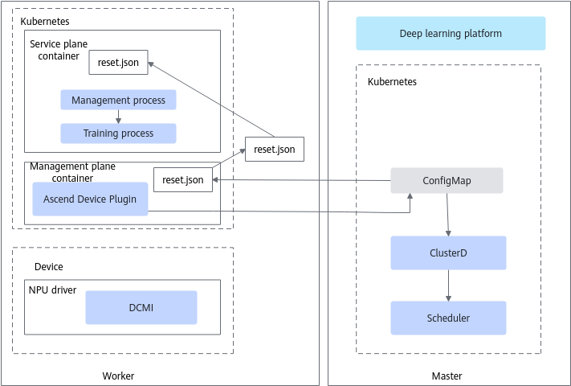

The graceful fault tolerance mode classifies faults into the following four types: **no handling required**, **re-execute services**, **chip reset required**, and **rescheduling required**. The handling of each fault type is shown in [Figure 13](#zh-cn_topic_0000002098609234_fig12620181591012).

**Figure 13**  Graceful fault tolerance fault handling process

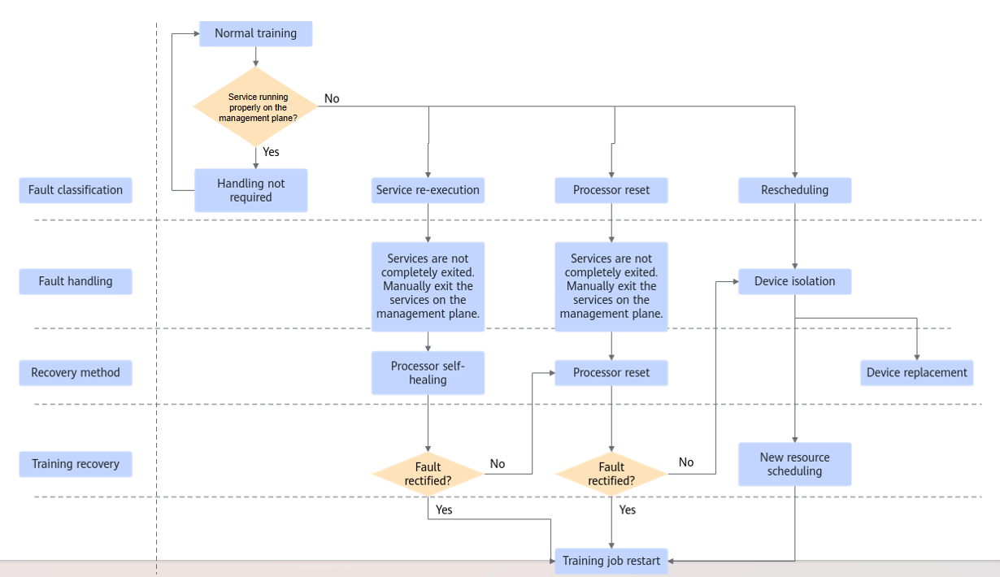
