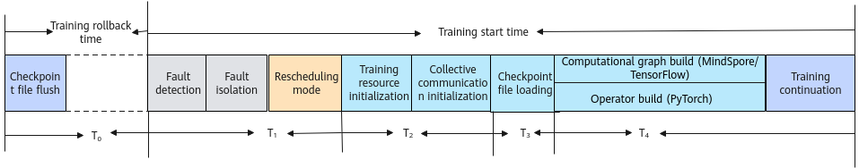
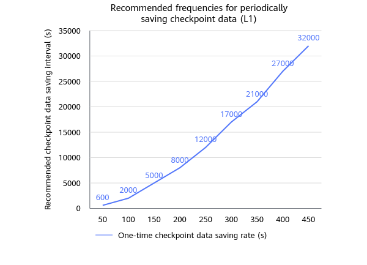

# Recovery Acceleration Principles

## Fault Recovery Time and Training Loss

The resumable training feature can resume training after a training fault occurs, reducing the training loss caused by the fault. The overall fault recovery time of resumable training can be divided into the training rollback time and the training startup time, as shown in [Figure 1](#zh-cn_topic_0000002003001306_fig13371418134510).

**Figure 1** Fault recovery stages

- T0: Training rollback loss time

    After a training fault occurs, the original training data is lost, and training needs to be resumed from the saved checkpoint (CKPT) file. In large model training, because saving a CKPT each time reduces training efficiency, a CKPT file is usually saved only once every 1 hour or more. After each fault, the training data from the last CKPT saving time point to the current fault time point is lost. The training rollback time is the time required to train from the last saved CKPT file to the fault point. Assume that the average training rollback time is T0 and the CKPT saving period is Gf. Then the average training rollback time is T0=Gf/2.

    After a training fault occurs, the training job needs to be started again to restore the training container and training process, and training continues only after the procedures of fault detection, faulty resource handling or isolation, rescheduling of the resources required for recovery, collective communication initialization, CKPT loading, and compilation are completed. After a training fault, a complete training startup time must elapse before training can continue. An excessively long training startup time causes resource waste.

- T1: Fault discovery and resource handling time

    T1 is the time required to complete fault detection, faulty resource handling or isolation, and rescheduling of the resources required for recovery after a fault occurs.

- T2: Collective communication time

    The collective communication time T2 is the time required to complete collective communication initialization when the training job is started again.

- T3: CKPT loading time

    The CKPT loading time T3 is the time required to load the CKPT and restore the training state when the training job is started again.

- T4: Compilation and initialization time

    The compilation and initialization time T4 is the time required to complete compilation and initialization when the training job is started again. Therefore, the training startup time is T1+T2+T3+T4.

The total training loss time of a single fault is T=T0+T1+T2+T3+T4. For details, see [Training Recovery Time Reference](../00_feature_description.md#zh-cn_topic_0000002003001306_section1672017599123).

>[!NOTE]
>The time of each part is related to the parameter scale and cluster scale, and the network and storage performance also affect the total training loss time.

Watchdog is used to shorten the fault detection time in T1, and the configuration is still described in the separate [Configuring watchdog Fault Detection](../../../04_fault_detection_and_diagnosis/03_configuration/04_network_faults.md#configuring-watchdog-fault-detection) guide. The existing recovery acceleration capabilities of resumable training still act on T0, T2, T3, and T4.

## Reducing Training State Rollback

### Periodic CKPT

Existing large-scale cluster training mainly uses the CKPT mechanism, that is, periodically saving training process data (such as model parameters) as a CKPT during training. When the service platform detects that a fault has occurred, it can exit the current training job and resume training from the CKPT saving time by reloading the CKPT data, avoiding retraining from scratch.

**Recommended Configuration**

When the CKPT saving capability of fault rescheduling is used, the frequency of periodically saving CKPTs must be selected based on actual conditions. You can refer to the recommended frequency shown in [Figure 2](#fig41241253101).

**Figure 2** Recommended periodic CKPT saving frequency

If the periodic CKPT recovery capability is used, the training state from the last periodic saving point to the fault point is lost after training recovery. Therefore, to reduce the training state loss caused by each fault, the periodic saving interval needs to be reduced. However, each saving requires interrupting training and writing the CKPT from the device side to the storage side, which wastes a large amount of training time. If the periodic saving interval is reduced, training time is wasted, which also causes training time loss. In summary, if the time of a single saving is constant, a comprehensive trade-off between the saving loss and the fault loss is usually required.

To reduce the preceding losses, the time of a single saving needs to be reduced. The time of a single saving is affected by the amount of saved data and the storage performance, and it is usually difficult to change these two factors. This product provides the MindIO ACP product to solve the problem of high periodic CKPT recovery loss.

For the configuration procedure, see [Configuring Periodic CKPT Saving](../02_configuration/02_configuring_training_recovery.md#ZH-CN_TOPIC_0000002479226552).

### Asynchronous CKPT Saving

MindIO ACP provides the capability of asynchronously saving periodic CKPTs. When MindIO ACP is not used, the parameters to be saved need to be copied from the device to the host side and then written from the host side to the storage, which usually takes minutes. MindIO ACP provides the asynchronous disk writing capability. After the parameters to be saved are copied from the device to the host side, an asynchronous process writes them to the storage, which does not block the training process, and training can continue during disk writing.

For the configuration procedure, see [Configuring Asynchronous CKPT Saving (PyTorch)](../02_configuration/02_configuring_training_recovery.md).

### Dying Gasp CKPT

Although asynchronously saving periodic CKPTs can reduce the periodic saving interval and thus reduce the loss of each fault, the fault loss is still difficult to control at the second level because of the saving overhead. Therefore, the MindCluster cluster scheduling components provide the dying gasp CKPT saving capability, which saves the parameter state at the beginning of the current step at the fault moment, thereby reducing the training recovery state loss to within one "step".

MindCluster MindIO Try To Persist (hereinafter referred to as MindIO TTP) provides the dying gasp CKPT capability to help users save the CKPT upon faults.

For details about dying gasp CKPT saving, see [Fault Recovery Acceleration](../../../../07_references/00_fault_recovery_acceleration/01_product_description.md).

For the configuration procedure of dying gasp CKPT saving, see [Configuring Dying Gasp CKPT Saving](../02_configuration/02_configuring_training_recovery.md#ZH-CN_TOPIC_0000002479226544).

**Adaptation Function Points**

In dying gasp CKPT, the framework first initializes the MindIO service. After the service is started, the corresponding status is reported to MindIO when the optimizer is updated. Then, a DP replica group and an optimizer replica are created to ensure redundant backup of model parameters. When an exception occurs, the fault mode is captured by the exception capture decorator, and then operator resource cleanup is performed, and dying gasp CKPT saving is completed based on the replica.

For users who do not use MindSpeed-LLM, complete the function adaptation in [Table 1](#table19955141136109) on the framework side.

**Table 1** Function points to be adapted for dying gasp CKPT saving

<table><thead align="left"><tr id="row169591493619"><th class="cellrowborder" valign="top" width="20.632063206320634%" id="mcps1.2.4.1.1">
Adaptation Point

</th>
<th class="cellrowborder" valign="top" width="50.51505150515051%" id="mcps1.2.4.1.2">
Function Brief

</th>
<th class="cellrowborder" valign="top" width="28.852885288528853%" id="mcps1.2.4.1.3">
Reference Link

</th>
</tr>
</thead>
<tbody><tr id="row893618158397"><td class="cellrowborder" valign="top" width="20.632063206320634%" headers="mcps1.2.4.1.1 ">
Initialization while startup

</td>
<td class="cellrowborder" valign="top" width="50.51505150515051%" headers="mcps1.2.4.1.2 ">
Start the MindIO service when the training framework is initialized.

</td>
<td class="cellrowborder" rowspan="7" valign="top" width="28.852885288528853%" headers="mcps1.2.4.1.3 ">
<a href="../../../../07_references/00_fault_recovery_acceleration/03_usage_guidance.md#integrating-with-non-mindspeed-llm-frameworks">Integrating with Non-MindSpeed-LLM Frameworks</a>

</td>
</tr>
<tr id="row1793717157396"><td class="cellrowborder" valign="top" headers="mcps1.2.4.1.1 ">
Reporting the optimizer update status

</td>
<td class="cellrowborder" valign="top" headers="mcps1.2.4.1.2 ">
Report the start and end of the optimizer update before the optimizer update.

</td>
</tr>
<tr id="row193701523914"><td class="cellrowborder" valign="top" headers="mcps1.2.4.1.1 ">
Creating a DP replica group

</td>
<td class="cellrowborder" valign="top" headers="mcps1.2.4.1.2 ">
Add the creation logic of the dp_cp/dp_ep replica groups and the gloo group, and create the related replica groups after the native Megatron distributed parallel group is created.

</td>
</tr>
<tr id="row191961528155914"><td class="cellrowborder" valign="top" headers="mcps1.2.4.1.1 ">
Optimizer replica

</td>
<td class="cellrowborder" valign="top" headers="mcps1.2.4.1.2 ">
Take over and inherit the related native Megatron optimizer functions, and embed the MindIO optimizer replica management logic.

</td>
</tr>
<tr id="row111971728195915"><td class="cellrowborder" valign="top" headers="mcps1.2.4.1.1 ">
Exception capture decorator

</td>
<td class="cellrowborder" valign="top" headers="mcps1.2.4.1.2 ">
Use the exception capture decorator to decorate the train function to capture the fault mode.

</td>
</tr>
<tr id="row1519712855916"><td class="cellrowborder" valign="top" headers="mcps1.2.4.1.1 ">
Operator resource cleanup

</td>
<td class="cellrowborder" valign="top" headers="mcps1.2.4.1.2 ">
Complete operator cleanup and restore the operator delivery capability through a callback function.

</td>
</tr>
<tr id="row1375943411593"><td class="cellrowborder" valign="top" headers="mcps1.2.4.1.1 ">
Dying gasp CKPT

</td>
<td class="cellrowborder" valign="top" headers="mcps1.2.4.1.2 ">
Complete dying gasp CKPT saving by adding a callback function and an optimizer replica dump method.

</td>
</tr>
</tbody>
</table>

### Proactive Sub-Health CKPT

When a sub-health fault occurs, the dying gasp can be saved through proactive sub-health CKPT. This capability requires that the sub-health policy be configured as `graceExit`, the fault recovery policy be configured as `dump`, and TaskD and ClusterD work properly. For details, see [Configuring Proactive Checkpoint Saving for Sub-healthy Policy](../02_configuration/02_configuring_training_recovery.md#configuring-proactive-checkpoint-saving-for-subhealthy-policy).

## Shortening State Recovery Time

### Memory-Based CKPT Loading

MindIO ACP provides the capability of memory-based periodic CKPT loading. During training recovery, the previously saved periodic CKPT usually needs to be loaded from the storage, and training continues only after the training state is restored. However, due to the large data volume and storage performance limitations, the loading time of large model jobs is usually minutes. To reduce the CKPT loading time and thus reduce the training recovery time, MindIO ACP provides a memory-based periodic CKPT loading mechanism, which loads directly from the memory after a fault, greatly reducing the loading time.

For the configuration procedure, see [Configuring Memory-Based CKPT Loading (PyTorch)](../02_configuration/02_configuring_training_recovery.md).

### Parameter Plane CKPT Transmission

The dying gasp CKPT capability can reduce the training rollback loss caused by the CKPT rollback mechanism in each training to within one "step". However, when a fault occurs, data needs to be written to disks, and after fault tolerance completes training recovery, the CKPT in the storage needs to be loaded for recovery, which prolongs the overall fault recovery time. Therefore, to reduce the fault recovery time, the MindCluster cluster scheduling component provides the parameter plane CKPT transmission recovery capability.

At fault occurrence, the parameter state is retained on the device side. When fault tolerance completes training recovery, the parameter state in the healthy cards is transmitted to the cards that underwent fault tolerance handling through the parameter plane network, so as to quickly restore the parameter state of those cards. Currently, this capability must be used together with process-level rescheduling and process-level online recovery, and cannot be used independently by users.

For the configuration procedure of parameter plane CKPT, see [Configuring Parameter Plane CKPT Transmission Recovery](../02_configuration/02_configuring_training_recovery.md#ZH-CN_TOPIC_0000002479386502).

## Shortening Training Startup Time

### Collective Communication Initialization Optimization

Parallel Store multi-threaded link setup optimization: When the PyTorch framework creates a communication group, TCP Store is used for information exchange. As the job scale increases, the information processing performance of the native TCP Store is affected, resulting in an excessively long communication group creation time. To solve this problem, the PyTorch Adapter plugin supports Parallel Store, an optimized version of the native TCP Store. For details, see [Parallel Store Function Description](../02_configuration/02_configuring_training_recovery.md#zh-cn_topic_0000002163883997_zh-cn_topic_0000002017918296_table14133757143220).

Native HCCL link setup performance optimization: In the PyTorch framework, after collective communication information is exchanged on the NPU side, links are established between NPUs. As the job scale increases, the link setup time increases greatly. To solve this problem, CANN optimizes the performance of native HCCL link setup. For details, see [Native HCCL Link Setup Performance Optimization Function Description](../02_configuration/02_configuring_training_recovery.md#zh-cn_topic_0000002163883997_zh-cn_topic_0000002017918296_table10637950133911).

RankTable-based link setup optimization: Ascend Operator provides the function of generating a collective communication configuration file (RankTable file, also called `hccl.json` file) for the PyTorch framework. Links can be established in RankTable mode to shorten the cluster communication link setup time. For details, see [Collective Communication Link Setup in RankTable Mode](../02_configuration/02_configuring_training_recovery.md#zh-cn_topic_0000002163883997_zh-cn_topic_0000002017918296_table1749892464019).

### Compilation and Initialization Optimization

When a training job is started again during resumable training, operators need to be re-executed, and operator compilation consumes a large amount of time. To solve this problem, you can choose the operator binary or the operator compilation cache to reduce the compilation time. For details, see [Operator Binary Function Description](../02_configuration/02_configuring_training_recovery.md#zh-cn_topic_0000002163883997_zh-cn_topic_0000002017918296_table8599191019143) and [Operator Compilation Cache Function Description](../02_configuration/02_configuring_training_recovery.md#zh-cn_topic_0000002163883997_zh-cn_topic_0000002017918296_table2193759172110).

>[!NOTE]
>The operator binary and the operator compilation cache are incompatible. Use only one of them.

When a training job is started again during resumable training, a computation graph needs to be built. In large model scenarios, building and compiling the computation graph consumes a large amount of time. To solve this problem, MindSpore supports storing the compilation cache file during the first compilation, so that the graph compilation cache in the storage can be directly read during fault recovery, reducing the graph compilation time. For details, see [Graph Compilation Cache Function Description](../02_configuration/02_configuring_training_recovery.md#zh-cn_topic_0000002128524426_zh-cn_topic_0000002053878705_table175224282139).

## Improving the Recovery Success Rate

### Proactive HCCL Link Setup

**PyTorch Single-Operator Scenario**

In the PyTorch single-operator scenario, HCCL link setup is in lazy loading mode. After a Torch communication group is established, the first operator delivered by the communication group triggers the creation of the HCCL communication domain, and inter-card link setup is completed after the creation. Therefore, to complete the link setup of all communication domains in the training initialization phase, you only need to deliver one communication operator to each communication group in the initialization phase.

Proactive HCCL link setup is used to reduce the risk of recovery failure caused by a fault occurring in the link setup phase. The existing text does not provide direct evidence that it shortens T2, so it is not counted in the collective communication initialization time optimization.
