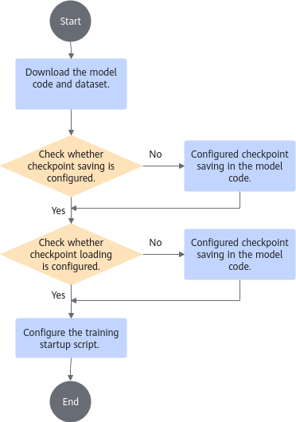
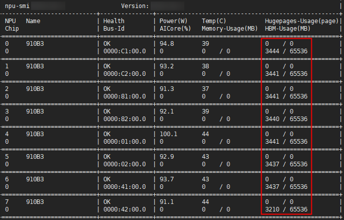
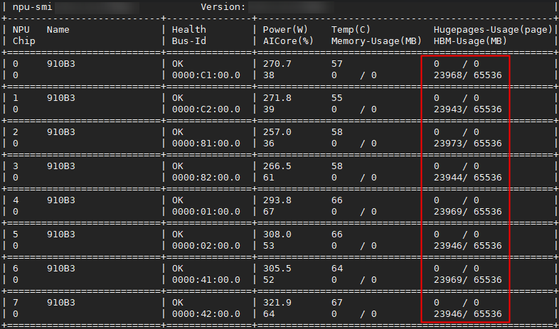

# Examples and Verification in PyTorch Scenario

## Building an Image<a name="ZH-CN_TOPIC_0000002511426469"></a>

[MindSpeed-LLM](https://gitcode.com/Ascend/MindSpeed-LLM/tree/26.2.0), as the Ascend large model training framework, aims to provide an end-to-end large language model training solution for Ascend chips, including distributed pre-training, distributed instruction fine-tuning, distributed preference alignment, and the corresponding development toolchain. The [MindSpeed-LLM User Guide](https://gitcode.com/Ascend/MindSpeed-LLM/blob/1.0.0/docs/USER_GUIDE.md) includes chapters on repository cloning, environment setup, and large model training. To build a MindSpeed-LLM training framework image, you can refer to this section and the [MindSpeed-LLM User Guide](https://gitcode.com/Ascend/MindSpeed-LLM/blob/1.0.0/docs/USER_GUIDE.md).

Resumable training can be built based on the base training image. For details on building the base training image, see the [Building a Container Image Using Dockerfile (PyTorch)](../../../../07_references/02_common_operations.md#building-a-container-image-using-dockerfile-pytorch) section.

This chapter uses DeepSeek-V4-Flash to describe resumable training with PyTorch 2.10.0 and torch_npu 2.10.0 on Atlas A3 and Atlas 950 SuperPoD (A5). Build separate images using Ubuntu 22.04 for A3 and openEuler 24.03 for A5.

>[!NOTE]
>
>- Use a MindSpeed-LLM version supporting DeepSeek-V4-Flash with matching MindSpeed and Megatron-LM versions. The examples use Python 3.12.16, CANN 9.2.0, PyTorch 2.10.0, and torch_npu 2.10.0.post7. Select actual versions according to component compatibility and model requirements. Use TaskD and MindIO TFT packages matching the cluster release.
>- For product forms with UB, such as Atlas 850E, Atlas 850, Atlas 650E, Atlas 650, and Atlas 950 SuperPoD, UB driver related files need to be added to the training image. The following two methods are supported:
>   - Download from the archive directory of the <a href="https://mirrors.huaweicloud.com/ascend/">Huawei Cloud image repository</a> and install it in the training image.
>   - Install Ascend Docker Runtime, which mounts the UB driver related content in `ub_driver.list` by default. The files in `ub_driver.list` depend on the glibc version of the host. The currently supported OS versions and glibc versions are as follows:
>     - Host: openEuler24.03 (glibc2.38)
>     - Container: openEuler24.03 (glibc2.38), Ubuntu24.04 (glibc2.39).

**Preparing Software Packages<a name="zh-cn_topic_0000002039339945_section18254161612586"></a>**

As shown in [Table 1](#zh-cn_topic_0000002039339945_table1172542119019),obtain the software packages of the corresponding OS and prepare the Dockerfile and script file required by the image. In the package names, `{version}` indicates the version number, `{arch}` indicates the architecture, and `{chip_type}` indicates the chip type.

**Table 1** Preparing software packages

<a name="zh-cn_topic_0000002039339945_table1172542119019"></a>
<table><thead align="left"><tr id="zh-cn_topic_0000002039339945_row157251121508"><th class="cellrowborder" valign="top" width="24.55%" id="mcps1.2.5.1.1"><p id="zh-cn_topic_0000002039339945_p1441653254"><a name="zh-cn_topic_0000002039339945_p1441653254"></a>Software Package</p>
</th>
<th class="cellrowborder" valign="top" width="25.45%" id="mcps1.2.5.1.2"><p id="zh-cn_topic_0000002039339945_p2052053751"><a name="zh-cn_topic_0000002039339945_p2052053751"></a>Required</p>
</th>
<th class="cellrowborder" valign="top" width="25%" id="mcps1.2.5.1.3"><p id="zh-cn_topic_0000002039339945_p657531455"><a name="zh-cn_topic_0000002039339945_p657531455"></a>Description</p>
</th>
<th class="cellrowborder" valign="top" width="25%" id="mcps1.2.5.1.4"><p id="zh-cn_topic_0000002039339945_p1859531759"><a name="zh-cn_topic_0000002039339945_p1859531759"></a>Obtaining Method</p>
</th>
</tr>
</thead>
<tbody><tr id="zh-cn_topic_0000002039339945_row16726192116014"><td class="cellrowborder" valign="top" width="24.55%" headers="mcps1.2.5.1.1 "><p id="zh-cn_topic_0000002039339945_p1754534515"><a name="zh-cn_topic_0000002039339945_p1754534515"></a>taskd-<em id="i2511021165615"><a name="i2511021165615"></a>{version}</em>-py3-none-linux_{arch}.whl</p>
</td>
<td class="cellrowborder" valign="top" width="25.45%" headers="mcps1.2.5.1.2 "><p id="p4321152352612"><a name="p4321152352612"></a>Yes</p>
</td>
<td class="cellrowborder" valign="top" width="25%" headers="mcps1.2.5.1.3 "><p id="zh-cn_topic_0000002039339945_p205155310512"><a name="zh-cn_topic_0000002039339945_p205155310512"></a>Resumable training whl package.</p>
<div class="note" id="zh-cn_topic_0000002039339945_note494818501423"><a name="zh-cn_topic_0000002039339945_note494818501423"></a><span class="notetitle">[!NOTE]</span><div class="notebody"><p id="zh-cn_topic_0000002039339945_p159489506423"><a name="zh-cn_topic_0000002039339945_p159489506423"></a>Before installing <span id="ph1670711477256"><a name="ph1670711477256"></a>TaskD</span>, ensure that the <span id="zh-cn_topic_0000002039339945_ph998914174412"><a name="zh-cn_topic_0000002039339945_ph998914174412"></a>PyTorch</span> framework is correctly installed. The currently supported <span id="zh-cn_topic_0000002039339945_ph2908133144419"><a name="zh-cn_topic_0000002039339945_ph2908133144419"></a>PyTorch</span> versions are 2.1.0 to 2.10.0. TaskD depends on the PyTorch framework. Select a PyTorch version without known security vulnerabilities or obtain the corresponding version with security issues fixed from the official community.</p>
</div></div>
</td>
<td class="cellrowborder" valign="top" width="25%" headers="mcps1.2.5.1.4 "><p id="zh-cn_topic_0000002039339945_p19595310517"><a name="zh-cn_topic_0000002039339945_p19595310517"></a><a href="https://www.hiascend.com/en/developer/software/mindcluster/download?versionId=460&ids=53%2C154%2C%2C58%2C60%2C63%2C" target="_blank" rel="noopener noreferrer">Download Link</a></p>
<div class="note" id="zh-cn_topic_0000002039339945_note1386820525510"><a name="zh-cn_topic_0000002039339945_note1386820525510"></a><span class="notetitle">[!NOTE]</span><div class="notebody"><p id="zh-cn_topic_0000002039339945_p12512532515"><a name="zh-cn_topic_0000002039339945_p12512532515"></a>The link points to the download page of the <span id="ph480901420289"><a name="ph480901420289"></a>TaskD's</span> compressed package Ascend-mindxdl-taskd_<em id="i112838253389"><a name="i112838253389"></a>{version}</em>_linux-<em id="i1328312515383"><a name="i1328312515383"></a>{arch}</em>.zip. You need to decompress it to obtain the corresponding whl software package.</p>
</div></div>
</td>
</tr>
<tr id="zh-cn_topic_0000002039339945_row572619211108"><td class="cellrowborder" valign="top" width="24.55%" headers="mcps1.2.5.1.1 "><p id="zh-cn_topic_0000002039339945_p1863531756"><a name="zh-cn_topic_0000002039339945_p1863531756"></a>mindio_ttp-<em id="zh-cn_topic_0000002039339945_i15340181201416"><a name="zh-cn_topic_0000002039339945_i15340181201416"></a>{version}</em>-py3-none-linux_<em id="zh-cn_topic_0000002039339945_i19614531957"><a name="zh-cn_topic_0000002039339945_i19614531957"></a>{arch}</em>.whl</p>
</td>
<td class="cellrowborder" valign="top" width="25.45%" headers="mcps1.2.5.1.2 "><p id="zh-cn_topic_0000002039339945_p96553958"><a name="zh-cn_topic_0000002039339945_p96553958"></a>Yes</p>
</td>
<td class="cellrowborder" valign="top" width="25%" headers="mcps1.2.5.1.3 "><p id="zh-cn_topic_0000002039339945_p66253359"><a name="zh-cn_topic_0000002039339945_p66253359"></a><span id="zh-cn_topic_0000002039339945_ph845710020145"><a name="zh-cn_topic_0000002039339945_ph845710020145"></a>MindIO TFT</span> installation package.</p>
</td>
<td class="cellrowborder" valign="top" width="25%" headers="mcps1.2.5.1.4 "><p id="zh-cn_topic_0000002039339945_p1862053354"><a name="zh-cn_topic_0000002039339945_p1862053354"></a><a href="https://www.hiascend.com/en/developer/software/mindcluster/download?versionId=460&ids=53%2C154%2C%2C58%2C60%2C63%2C" target="_blank" rel="noopener noreferrer">Download Link</a></p>
</td>
</tr>
<tr id="zh-cn_topic_0000002039339945_row672652117018"><td class="cellrowborder" valign="top" width="24.55%" headers="mcps1.2.5.1.1 "><p id="zh-cn_topic_0000002039339945_p1468532510"><a name="zh-cn_topic_0000002039339945_p1468532510"></a>apex-0.1+ascend-cp3x-cp3x-linux_{arch}.whl</p>
</td>
<td class="cellrowborder" valign="top" width="25.45%" headers="mcps1.2.5.1.2 "><p id="zh-cn_topic_0000002039339945_p1869531256"><a name="zh-cn_topic_0000002039339945_p1869531256"></a>Yes</p>
<p id="zh-cn_topic_0000002039339945_p156353454"><a name="zh-cn_topic_0000002039339945_p156353454"></a>MindSpeed-LLM dependency</p>
<p id="zh-cn_topic_0000002039339945_p1861353651"><a name="zh-cn_topic_0000002039339945_p1861353651"></a></p>
</td>
<td class="cellrowborder" valign="top" width="25%" headers="mcps1.2.5.1.3 "><p id="zh-cn_topic_0000002039339945_p166105316515"><a name="zh-cn_topic_0000002039339945_p166105316515"></a>Mixed precision training uses a mix of single-precision (float32) and half-precision (float16) data types during training, combining both and using the same hyperparameters to achieve almost the same precision as float32.</p>
<p id="zh-cn_topic_0000002039339945_zh-cn_topic_0000001497364957_p626262173118"><a name="zh-cn_topic_0000002039339945_zh-cn_topic_0000001497364957_p626262173118"></a>The cp3x in the software package indicates the Python version number. For example, x being 12 indicates Python 3.12. The specific Python version is subject to the MindSpeed-LLM version.</p>
</td>
<td class="cellrowborder" valign="top" width="25%" headers="mcps1.2.5.1.4 "><p id="zh-cn_topic_0000002039339945_zh-cn_topic_0000001497364957_p39761346403"><a name="zh-cn_topic_0000002039339945_zh-cn_topic_0000001497364957_p39761346403"></a>For details, see the "<a href="https://gitcode.com/Ascend/apex/blob/master/docs/en/installing_apex.md">Installing the APEX Module</a>" section in <span id="zh-cn_topic_0000002039339945_ph156792413596"><a name="zh-cn_topic_0000002039339945_ph156792413596"></a>Ascend Extension for PyTorch Installation Guide</span>, and compile the APEX package based on the actual situation.</p>
<p id="zh-cn_topic_0000002039339945_p1761531257"><a name="zh-cn_topic_0000002039339945_p1761531257"></a></p>
</td>
</tr>
<tr id="zh-cn_topic_0000002039339945_row197268213011"><td class="cellrowborder" valign="top" width="24.55%" headers="mcps1.2.5.1.1 "><p id="zh-cn_topic_0000002039339945_p1361953254"><a name="zh-cn_topic_0000002039339945_p1361953254"></a>torch_npu-2.10.0.post<em id="zh-cn_topic_0000002039339945_i16204112111321"><a name="zh-cn_topic_0000002039339945_i16204112111321"></a>{version}</em>-cp3x-cp3x-manylinux_2_28_{arch}.whl</p>
</td>
<td class="cellrowborder" valign="top" width="25.45%" headers="mcps1.2.5.1.2 "><p id="zh-cn_topic_0000002039339945_p56185314510"><a name="zh-cn_topic_0000002039339945_p56185314510"></a>Yes</p>
<p id="zh-cn_topic_0000002039339945_p186653757"><a name="zh-cn_topic_0000002039339945_p186653757"></a>MindSpeed-LLM dependency</p>
</td>
<td class="cellrowborder" valign="top" width="25%" headers="mcps1.2.5.1.3 "><p id="zh-cn_topic_0000002039339945_p15720535517"><a name="zh-cn_topic_0000002039339945_p15720535517"></a>Ascend Extension for PyTorch is a deep learning adaptation framework based on Ascend, enabling Ascend NPUs to support the PyTorch framework, providing PyTorch users with the superior computing power of Ascend AI processors.</p>
<p id="zh-cn_topic_0000002039339945_zh-cn_topic_0000001497364957_p849562217019"><a name="zh-cn_topic_0000002039339945_zh-cn_topic_0000001497364957_p849562217019"></a>The cp3x in the software package indicates the Python version number. For example, x being 12 indicates Python 3.12. The specific Python version is subject to the MindSpeed-LLM version.</p>
</td>
<td class="cellrowborder" valign="top" width="25%" headers="mcps1.2.5.1.4 "><p id="zh-cn_topic_0000002039339945_p10718533510"><a name="zh-cn_topic_0000002039339945_p10718533510"></a><a href="https://www.hiascend.com/document/detail/en/Pytorch/720/configandinstg/instg/insg_0004.html" target="_blank" rel="noopener noreferrer">Download Link</a></p>
<div class="note" id="zh-cn_topic_0000002039339945_note1165115165020"><a name="zh-cn_topic_0000002039339945_note1165115165020"></a><span class="notetitle">[!NOTE]</span><div class="notebody"><p id="zh-cn_topic_0000002039339945_p167047813263"><a name="zh-cn_topic_0000002039339945_p167047813263"></a>To use the <span id="zh-cn_topic_0000002039339945_ph1987542822613"><a name="zh-cn_topic_0000002039339945_ph1987542822613"></a>PyTorch</span> model from the MindSpeed-LLM code repository, <span id="zh-cn_topic_0000002039339945_ph1412723132619"><a name="zh-cn_topic_0000002039339945_ph1412723132619"></a>Ascend Extension for PyTorch</span> 2.6.0 or later is required.</p>
</div></div>
</td>
</tr>
<tr id="zh-cn_topic_0000002039339945_row1412215399516"><td class="cellrowborder" valign="top" width="24.55%" headers="mcps1.2.5.1.1 "><a name="zh-cn_topic_0000002039339945_ul104867135415"></a><ul id="zh-cn_topic_0000002039339945_ul104867135415"><li><span id="zh-cn_topic_0000002039339945_ph0853174512272"><a name="zh-cn_topic_0000002039339945_ph0853174512272"></a>x86_64</span> architecture: torch-2.10.0+cpu-cp3x-cp3x-manylinux_2_28_x86_64.whl</li><li><span id="zh-cn_topic_0000002039339945_ph7852164518272"><a name="zh-cn_topic_0000002039339945_ph7852164518272"></a>ARM</span> architecture: torch-2.10.0+cpu-cp3x-cp3x-manylinux_2_28_aarch64.whl</li></ul>
</td>
<td class="cellrowborder" valign="top" width="25.45%" headers="mcps1.2.5.1.2 "><p id="zh-cn_topic_0000002039339945_p871953357"><a name="zh-cn_topic_0000002039339945_p871953357"></a>Yes</p>
<p id="zh-cn_topic_0000002039339945_p17715531453"><a name="zh-cn_topic_0000002039339945_p17715531453"></a>MindSpeed-LLM dependency</p>
</td>
<td class="cellrowborder" valign="top" width="25%" headers="mcps1.2.5.1.3 "><p id="zh-cn_topic_0000002039339945_zh-cn_topic_0000001497364957_p11461347141013"><a name="zh-cn_topic_0000002039339945_zh-cn_topic_0000001497364957_p11461347141013"></a>Official <span id="zh-cn_topic_0000002039339945_ph19355165113512"><a name="zh-cn_topic_0000002039339945_ph19355165113512"></a>PyTorch</span> package.</p><p>The cp3x in the software package indicates the Python version number. For example, x being 12 indicates Python 3.12. The specific Python version is subject to the MindSpeed-LLM version.</p>
</td>
<td class="cellrowborder" valign="top" width="25%" headers="mcps1.2.5.1.4 "><p id="zh-cn_topic_0000002039339945_p99745421447"><a name="zh-cn_topic_0000002039339945_p99745421447"></a><a href="https://download.pytorch.org/whl/torch/" target="_blank" rel="noopener noreferrer">Download Link</a></p>
<p id="zh-cn_topic_0000002039339945_p483943610920"><a name="zh-cn_topic_0000002039339945_p483943610920"></a></p>
</td>
</tr>
<tr id="zh-cn_topic_0000002039339945_row151232039750"><td class="cellrowborder" valign="top" width="24.55%" headers="mcps1.2.5.1.1 "><p id="zh-cn_topic_0000002039339945_p4714531658"><a name="zh-cn_topic_0000002039339945_p4714531658"></a>Ascend-cann-{chip_type}-ops_{version}_linux-{arch}.run</p>
</td>
<td class="cellrowborder" valign="top" width="25.45%" headers="mcps1.2.5.1.2 "><p id="zh-cn_topic_0000002039339945_p1774531250"><a name="zh-cn_topic_0000002039339945_p1774531250"></a>Yes</p><p>For versions before CANN 8.5.0, this package is named Ascend-cann-kernels-<em>{chip_type}</em>_<em>{version}</em>_linux-<em>{arch}</em>.run</p>
</td>
<td class="cellrowborder" valign="top" width="25%" headers="mcps1.2.5.1.3 "><p id="zh-cn_topic_0000002039339945_p5720531514"><a name="zh-cn_topic_0000002039339945_p5720531514"></a>CANN operator package.</p>
</td>
<td class="cellrowborder" valign="top" width="25%" headers="mcps1.2.5.1.4 "><p id="zh-cn_topic_0000002039339945_p87153755"><a name="zh-cn_topic_0000002039339945_p87153755"></a><a href="https://www.hiascend.com/en/cann/download?versionId=791&ids=d806%2Ch0501%2Ch0601%2Ch0703" target="_blank" rel="noopener noreferrer">Download Link</a></p>
<div class="note" id="zh-cn_topic_0000002039339945_note13775154104217"><a name="zh-cn_topic_0000002039339945_note13775154104217"></a><span class="notetitle">[!NOTE]</span><div class="notebody"><p id="zh-cn_topic_0000002039339945_p2075812144313"><a name="zh-cn_topic_0000002039339945_p2075812144313"></a>Obtain the software package that matches the server.</p>
</div></div>
</td>
</tr>
<tr id="row1173819266428"><td class="cellrowborder" valign="top" width="24.55%" headers="mcps1.2.5.1.1 "><p id="p7738142674217"><a name="p7738142674217"></a>Ascend-cann-toolkit_{version}_linux-{arch}.run</p>
</td>
<td class="cellrowborder" valign="top" width="25.45%" headers="mcps1.2.5.1.2 "><p id="p12738626184214"><a name="p12738626184214"></a>Yes</p>
</td>
<td class="cellrowborder" valign="top" width="25%" headers="mcps1.2.5.1.3 "><p id="p13738226114218"><a name="p13738226114218"></a>CANN Toolkit package.</p>
</td>
<td class="cellrowborder" valign="top" width="25%" headers="mcps1.2.5.1.4 "><p id="p19271154916428"><a name="p19271154916428"></a><a href="https://www.hiascend.com/en/cann/download?versionId=791&ids=d806%2Ch0501%2Ch0601%2Ch0703" target="_blank" rel="noopener noreferrer">Download Link</a></p>
<div class="note" id="note3272104913427"><a name="note3272104913427"></a><span class="notetitle">[!NOTE]</span><div class="notebody"><p id="p2272174920421"><a name="p2272174920421"></a>Obtain the software package that matches the server.</p>
</div></div>
</td>
</tr>
<tr id="zh-cn_topic_0000002039339945_row121231639952"><td class="cellrowborder" valign="top" width="24.55%" headers="mcps1.2.5.1.1 "><p id="zh-cn_topic_0000002039339945_p1048218391768"><a name="zh-cn_topic_0000002039339945_p1048218391768"></a>MindSpeed</p>
</td>
<td class="cellrowborder" valign="top" width="25.45%" headers="mcps1.2.5.1.2 "><p id="zh-cn_topic_0000002039339945_p3482939367"><a name="zh-cn_topic_0000002039339945_p3482939367"></a>Yes</p>
</td>
<td class="cellrowborder" valign="top" width="25%" headers="mcps1.2.5.1.3 "><p id="zh-cn_topic_0000002039339945_p048215393610"><a name="zh-cn_topic_0000002039339945_p048215393610"></a>MindSpeed is a large model acceleration library for Ascend devices.</p>
</td>
<td class="cellrowborder" valign="top" width="25%" headers="mcps1.2.5.1.4 "><p id="zh-cn_topic_0000002039339945_p7482193913619"><a name="zh-cn_topic_0000002039339945_p7482193913619"></a>git clone https://gitcode.com/Ascend/MindSpeed.git</p>
<p id="zh-cn_topic_0000002039339945_p9482139663"><a name="zh-cn_topic_0000002039339945_p9482139663"></a>cd MindSpeed</p>
<p id="zh-cn_topic_0000002039339945_p1948213912618"><a name="zh-cn_topic_0000002039339945_p1948213912618"></a>git checkout eb0ad7e73dc8227291e44504041aa7c58136aaa3  # 26.2.0_core_r0.12.1 branch</p>
</td>
</tr>
<tr id="zh-cn_topic_0000002039339945_row144125121466"><td class="cellrowborder" valign="top" width="24.55%" headers="mcps1.2.5.1.1 "><p id="zh-cn_topic_0000002039339945_p848215391768"><a name="zh-cn_topic_0000002039339945_p848215391768"></a>version.info</p>
</td>
<td class="cellrowborder" valign="top" width="25.45%" headers="mcps1.2.5.1.2 "><p id="zh-cn_topic_0000002039339945_p1548319391465"><a name="zh-cn_topic_0000002039339945_p1548319391465"></a>Yes</p>
<p id="zh-cn_topic_0000002039339945_p16483239968"><a name="zh-cn_topic_0000002039339945_p16483239968"></a>Dependency file for installing CANN.</p>
</td>
<td class="cellrowborder" valign="top" width="25%" headers="mcps1.2.5.1.3 "><p id="zh-cn_topic_0000002039339945_p14483939561"><a name="zh-cn_topic_0000002039339945_p14483939561"></a>Driver version information file.</p>
</td>
<td class="cellrowborder" valign="top" width="25%" headers="mcps1.2.5.1.4 "><p id="zh-cn_topic_0000002039339945_p748314394617"><a name="zh-cn_topic_0000002039339945_p748314394617"></a>Copy /usr/local/Ascend/driver/version.info from the host.</p>
</td>
</tr>
<tr id="zh-cn_topic_0000002039339945_row17301171913614"><td class="cellrowborder" valign="top" width="24.55%" headers="mcps1.2.5.1.1 "><p id="zh-cn_topic_0000002039339945_p148310396616"><a name="zh-cn_topic_0000002039339945_p148310396616"></a>ascend_install.info</p>
</td>
<td class="cellrowborder" valign="top" width="25.45%" headers="mcps1.2.5.1.2 "><p id="zh-cn_topic_0000002039339945_p348313399610"><a name="zh-cn_topic_0000002039339945_p348313399610"></a>Yes</p>
<p id="zh-cn_topic_0000002039339945_p1348313391961"><a name="zh-cn_topic_0000002039339945_p1348313391961"></a>Dependency file for installing CANN.</p>
</td>
<td class="cellrowborder" valign="top" width="25%" headers="mcps1.2.5.1.3 "><p id="zh-cn_topic_0000002039339945_p5483239564"><a name="zh-cn_topic_0000002039339945_p5483239564"></a>Driver installation information file.</p>
</td>
<td class="cellrowborder" valign="top" width="25%" headers="mcps1.2.5.1.4 "><p id="zh-cn_topic_0000002039339945_p2483339861"><a name="zh-cn_topic_0000002039339945_p2483339861"></a>Copy /etc/ascend_install.info from the host.</p>
</td>
</tr>
<tr id="zh-cn_topic_0000002039339945_row93022191368"><td class="cellrowborder" valign="top" width="24.55%" headers="mcps1.2.5.1.1 "><p id="zh-cn_topic_0000002039339945_p15485173911615"><a name="zh-cn_topic_0000002039339945_p15485173911615"></a>Dllogger code repository</p>
</td>
<td class="cellrowborder" valign="top" width="25.45%" headers="mcps1.2.5.1.2 "><p id="zh-cn_topic_0000002039339945_p248514391563"><a name="zh-cn_topic_0000002039339945_p248514391563"></a>Yes</p>
</td>
<td class="cellrowborder" valign="top" width="25%" headers="mcps1.2.5.1.3 "><p id="zh-cn_topic_0000002039339945_p164850391565"><a name="zh-cn_topic_0000002039339945_p164850391565"></a>PyTorch log tool.</p>
</td>
<td class="cellrowborder" valign="top" width="25%" headers="mcps1.2.5.1.4 "><p id="zh-cn_topic_0000002039339945_p1548619391164"><a name="zh-cn_topic_0000002039339945_p1548619391164"></a>git clone https://github.com/NVIDIA/dllogger.git</p>
</td>
</tr>
<tr id="zh-cn_topic_0000002039339945_row33025197610"><td class="cellrowborder" valign="top" width="24.55%" headers="mcps1.2.5.1.1 "><p id="zh-cn_topic_0000002039339945_p0486133919618"><a name="zh-cn_topic_0000002039339945_p0486133919618"></a>Python-3.12.16.tar.xz</p>
</td>
<td class="cellrowborder" valign="top" width="25.45%" headers="mcps1.2.5.1.2 "><p id="zh-cn_topic_0000002039339945_p1148619393610"><a name="zh-cn_topic_0000002039339945_p1148619393610"></a>Yes</p>
</td>
<td class="cellrowborder" valign="top" width="25%" headers="mcps1.2.5.1.3 "><p id="zh-cn_topic_0000002039339945_p164861439461"><a name="zh-cn_topic_0000002039339945_p164861439461"></a>Used to build Python 3.12; pip is installed with ensurepip during the build.</p>
</td>
<td class="cellrowborder" valign="top" width="25%" headers="mcps1.2.5.1.4 "><p id="zh-cn_topic_0000002039339945_p34865396611"><a name="zh-cn_topic_0000002039339945_p34865396611"></a>Obtain the Python 3.12.16 source archive from the official Python release source.</p>
</td>
</tr>
<tr id="zh-cn_topic_0000002039339945_row03021191165"><td class="cellrowborder" valign="top" width="24.55%" headers="mcps1.2.5.1.1 "><p id="zh-cn_topic_0000002039339945_p15486163919616"><a name="zh-cn_topic_0000002039339945_p15486163919616"></a>Dockerfile</p>
</td>
<td class="cellrowborder" valign="top" width="25.45%" headers="mcps1.2.5.1.2 "><p id="zh-cn_topic_0000002039339945_p1448693915619"><a name="zh-cn_topic_0000002039339945_p1448693915619"></a>Yes</p>
</td>
<td class="cellrowborder" valign="top" width="25%" headers="mcps1.2.5.1.3 "><p id="zh-cn_topic_0000002039339945_p74862391165"><a name="zh-cn_topic_0000002039339945_p74862391165"></a>Used to image creation.</p>
</td>
<td class="cellrowborder" valign="top" width="25%" headers="mcps1.2.5.1.4 "><p id="zh-cn_topic_0000002039339945_p9571628104613"><a name="zh-cn_topic_0000002039339945_p9571628104613"></a>-</p>
</td>
</tr>
</tbody>
</table>

>[!NOTE]
>The build context must contain the packages in Table 1, `Python-3.12.16.tar.xz`, and the MindSpeed and MindSpeed-LLM source directories. Prepare matching source versions and requirements.txt files according to their release instructions. Use `CHIP=A3` for A3 and `CHIP=950` for A5. Install only one chip-specific ops package in each image.

**Procedure<a name="zh-cn_topic_0000002039339945_section20489630477"></a>**

1. Prepare the software packages on the host by referring to [Table 1](#zh-cn_topic_0000002039339945_table1172542119019).
    For build directory layout and arguments, see the [mindcluster-deploy PyTorch image guide](https://gitcode.com/Ascend/mindcluster-deploy/blob/master/samples/docker/pytorch/OVERVIEW.md) and [Dockerfile](https://gitcode.com/Ascend/mindcluster-deploy/blob/master/samples/docker/pytorch/Dockerfile). The manual example below requires an APEX wheel and installs it explicitly.

    Place matching torch, torch_npu, and APEX wheels in the build context `whl/` directory. Prepare APEX as described in [Installing the APEX Module](https://gitcode.com/Ascend/apex/blob/master/docs/en/installing_apex.md). When building from Ascend/apex source, run the following in an environment matching the target image architecture, Python, and PyTorch versions:

    ```shell
    git clone https://gitcode.com/Ascend/apex.git
    cd apex
    bash scripts/build.sh --python=3.12
    ```

    Copy the generated `apex/dist/apex-*.whl` to `whl/` in the image build directory. The script creates a wheel; the pip command below installs it in the image. The reference image provides the Python part of APEX. If the model uses fused extensions such as `apex_C`, prepare a matching wheel containing those extensions according to the APEX installation instructions.

    ```shell
    mkdir -p whl
    ```

    **DeepSeek-V4-Flash Optimizer State Adaptation**

    The following changes apply to the MindSpeed-LLM baseline `bfa35e3c8502995810d64077ed7fd18b8b296012` used here. File paths are relative to the MindSpeed-LLM root, and line numbers refer to this baseline.

    | File | Location | Change |
    |---|---|---|
    | `mindspeed_llm/core/optimizer/distrib_optimizer.py` | In `distributed_optimizer_init()`, after the `_build_model_and_main_param_groups()` call ending at line 131 and before `if isinstance(self.optimizer, HybridDeviceOptimizer)` at line 133 | Rebuild `model_param_group_index_map` in the actual FP32-then-FP16 parameter order |
    | `mindspeed_llm/core/high_availability/tft_replica_optimizer.py` | In `TTPReplicaOptimizer`, after `state_dict_memory()` ends at line 565 and before `load_state_dict_memory()` at line 567 | Add `load_state_dict()` to initialize empty optimizer state storage using local main-parameter shards |

    Save the complete diff below as `mindspeed_llm_26_2_0_arf_optimizer_state_fix.patch` at the image build context root, preserving leading spaces and the `+` and `-` prefixes. The Dockerfile below applies it.

    ```diff
    diff --git a/mindspeed_llm/core/optimizer/distrib_optimizer.py b/mindspeed_llm/core/optimizer/distrib_optimizer.py
    --- a/mindspeed_llm/core/optimizer/distrib_optimizer.py
    +++ b/mindspeed_llm/core/optimizer/distrib_optimizer.py
    @@ -130,6 +130,12 @@
             self.gbuf_ranges, self.model_param_gbuf_map, self.opt_group_ranges, config
         )

    +    for group_index, (model_fp32_params, model_float16_params) in enumerate(
    +        zip(self.model_fp32_groups, self.model_float16_groups)
    +    ):
    +        for group_order, model_param in enumerate([*model_fp32_params, *model_float16_params]):
    +            self.model_param_group_index_map[model_param] = (group_index, group_order)
    +
         if isinstance(self.optimizer, HybridDeviceOptimizer):
             self.optimizer = HybridDeviceOptimizer(
                 params=[g["orig_group"] for g in self.opt_group_ranges], **self.optimizer.defaults
    diff --git a/mindspeed_llm/core/high_availability/tft_replica_optimizer.py b/mindspeed_llm/core/high_availability/tft_replica_optimizer.py
    --- a/mindspeed_llm/core/high_availability/tft_replica_optimizer.py
    +++ b/mindspeed_llm/core/high_availability/tft_replica_optimizer.py
    @@ -564,5 +564,10 @@
         def state_dict_memory(self):
             return self.state_dict()

    +    def load_state_dict(self, state_dict):
    +        if len(self.optimizer.state) == 0 and self.init_state_fn is not None:
    +            self.init_state_fn(self.optimizer, self.config)
    +        super().load_state_dict(state_dict)
    +
         def load_state_dict_memory(self, state_dict):
             self.load_state_dict(state_dict)
    ```

    From the image build context root, check the source version and patch compatibility:

    ```shell
    git -C MindSpeed-LLM rev-parse HEAD
    git -C MindSpeed-LLM apply --check \
        "$PWD/mindspeed_llm_26_2_0_arf_optimizer_state_fix.patch"
    ```

    Retain the `.git` directory in the build context MindSpeed-LLM source for the in-image baseline check. Initialization allocates matching storage only when optimizer state is empty; checkpoint or peer data fills it during recovery. Applying the patch during the build is sufficient, without inserting the changes manually again. If the source already includes both changes, omit patch application and update the source version and build steps together.

    The key build context directories are shown below. Place the CANN, TaskD, MindIO TFT, and Python source packages as described in Table 1 and the Dockerfile.

    ```text
    build-context/
    ├── Dockerfile
    ├── MindSpeed/
    ├── MindSpeed-LLM/
    ├── mindspeed_llm_26_2_0_arf_optimizer_state_fix.patch
    ├── dllogger/
    └── whl/
        ├── torch-2.10.0+cpu-cp312-cp312-manylinux_2_28_aarch64.whl
        ├── torch_npu-2.10.0.post7-cp312-cp312-manylinux_2_28_aarch64.whl
        └── apex-0.1+ascend-cp312-cp312-linux_aarch64.whl
    ```

2. Write the following Dockerfile.

    ```dockerfile
    # MindCluster resumable-training PyTorch sample image
    # Build with --network=host; the context must provide version.info, ascend_install.info,
    # whl/, dllogger/, and the MindSpeed-LLM optimizer-state patch.

    ARG BASE_IMAGE=ubuntu:22.04
    FROM ${BASE_IMAGE}

    # A3 uses CHIP=A3 and A5 uses CHIP=950; each image installs one chip ops package.
    ARG CHIP=A3
    ARG PYTHON_VERSION=3.12
    ARG CANN_VERSION=9.2.0

    # Download sources
    ARG CANN_BASE_URL=https://ascend-repo.obs.cn-east-2.myhuaweicloud.com/CANN/CANN%209.2.0
    ARG PIP_INDEX_URL=https://repo.huaweicloud.com/repository/pypi/simple
    ARG PIP_TRUSTED_HOST=repo.huaweicloud.com
    ARG APT_MIRROR=repo.huaweicloud.com
    ARG TRITON_ASCEND_INDEX_URL=https://mirrors.huaweicloud.com/ascend/repos/pypi

    # PyTorch, torch_npu, torchvision, and wheel Python ABI must match.
    ARG TORCH_VERSION=2.10.0
    ARG TORCH_NPU_PKG_VERSION=2.10.0.post7
    ARG TASKD_WHEEL_VERSION=26.3.0
    ARG MINDIO_TTP_WHEEL_VERSION=26.2.0
    ARG TRITON_ASCEND_VERSION=3.6.0

    # Pinned model source versions and matching Megatron-LM.
    ARG MINDSPEED_COMMIT=eb0ad7e73dc8227291e44504041aa7c58136aaa3
    ARG MINDSPEED_LLM_COMMIT=bfa35e3c8502995810d64077ed7fd18b8b296012
    ARG MINDSPEED_LLM_ARF_PATCH=mindspeed_llm_26_2_0_arf_optimizer_state_fix.patch
    ARG MEGATRON_TAG=core_v0.12.1
    ARG MINDCLUSTER_TAG=v26.2.0

    # Validate package file names and versions before build.
    COPY check_packages.sh /tmp/check_packages.sh
    RUN bash /tmp/check_packages.sh --filename-only \
          "taskd-${TASKD_WHEEL_VERSION}-py3-none-linux_aarch64.whl:${TASKD_WHEEL_VERSION}" \
          "mindio_ttp-${MINDIO_TTP_WHEEL_VERSION}-py3-none-linux_aarch64.whl:${MINDIO_TTP_WHEEL_VERSION}"

    # Base system dependencies
    COPY version.info /tmp/ascend-driver/version.info
    COPY ascend_install.info /tmp/ascend-driver/ascend_install.info

    ENV DEBIAN_FRONTEND=noninteractive
    ENV TZ=UTC

    RUN set -eux; \
        for f in /tmp/ascend-driver/version.info /tmp/ascend-driver/ascend_install.info; do \
            if [ ! -s "$f" ]; then \
                echo "ERROR: Missing driver metadata file $f" >&2; \
                echo "Provide it in the build context: cp /usr/local/Ascend/driver/version.info ." >&2; \
                echo "                        cp /etc/ascend_install.info ." >&2; \
                exit 1; \
            fi; \
        done; \
        if command -v apt-get >/dev/null 2>&1; then \
            echo "deb http://${APT_MIRROR}/ubuntu-ports/ jammy main restricted universe multiverse" >  /etc/apt/sources.list; \
            echo "deb http://${APT_MIRROR}/ubuntu-ports/ jammy-updates main restricted universe multiverse" >> /etc/apt/sources.list; \
            echo "deb http://${APT_MIRROR}/ubuntu-ports/ jammy-security main restricted universe multiverse" >> /etc/apt/sources.list; \
            apt-get update -qq; \
            apt-get install -y -qq --no-install-recommends \
                ca-certificates curl wget git \
                gcc g++ make cmake patch \
                zlib1g zlib1g-dev libsqlite3-dev libssl-dev libffi-dev \
                unzip pciutils net-tools binutils procps hostname \
                libblas-dev libblas3 libopenblas-dev gfortran \
                liblapack3 liblapack-dev libhdf5-dev libxml2 \
                swig \
                libexpat1-dev libbz2-dev libreadline-dev liblzma-dev libncurses-dev libgdbm-dev libnss3-dev uuid-dev \
                tzdata; \
            ln -sf /usr/share/zoneinfo/UTC /etc/localtime; \
            echo UTC > /etc/timezone; \
        elif command -v dnf >/dev/null 2>&1 || command -v yum >/dev/null 2>&1; then \
            PKG=$(command -v dnf >/dev/null 2>&1 && echo dnf || echo yum); \
            ${PKG} install -y \
                ca-certificates curl wget git tar \
                gcc gcc-c++ gcc-gfortran make cmake patch \
                zlib zlib-devel sqlite-devel openssl openssl-devel libffi-devel \
                unzip pciutils net-tools binutils procps-ng hostname \
                openblas-devel lapack-devel hdf5-devel libxml2-devel \
                expat-devel bzip2-devel readline-devel xz-devel ncurses-devel gdbm-devel uuid-devel \
                nss nss-devel nspr nspr-devel \
                tzdata swig; \
            ${PKG} clean all || true; \
        else \
            echo "ERROR: Neither apt-get nor dnf/yum; unsupported BASE_IMAGE" >&2; exit 1; \
        fi

    # Build Python from source to match cp312 wheels.
    ARG PY_VERSION=3.12.16
    ARG PY_BASE_URL=https://mirrors.huaweicloud.com/python

    RUN set -eux; \
        cd /tmp; \
        curl -fsSL --retry 3 -o py.tgz "${PY_BASE_URL}/${PY_VERSION}/Python-${PY_VERSION}.tgz"; \
        tar -xzf py.tgz; \
        cd "Python-${PY_VERSION}"; \
        S=$(date +%s); \
        ./configure --prefix=/usr/local --enable-shared --with-ensurepip=install > /tmp/pycfg.log 2>&1 \
            || { echo "ERROR: Python configure failed"; tail -30 /tmp/pycfg.log; exit 1; }; \
        echo "python configure: $(( $(date +%s) - S ))s"; \
        make -j"$(nproc)" > /tmp/pymake.log 2>&1 \
            || { echo "ERROR: Python make failed"; tail -30 /tmp/pymake.log; exit 1; }; \
        echo "python make: $(( $(date +%s) - S ))s"; \
        make install > /tmp/pyinst.log 2>&1 \
            || { echo "ERROR: Python make install failed"; tail -40 /tmp/pyinst.log; exit 1; }; \
        echo "python install: $(( $(date +%s) - S ))s"; \
        if [ -d /etc/ld.so.conf.d ]; then \
            echo "/usr/local/lib" > /etc/ld.so.conf.d/usr-local.conf; \
        else \
            echo "/usr/local/lib" >> /etc/ld.so.conf; \
        fi; \
        ldconfig; \
        rm -rf /tmp/Python-${PY_VERSION} /tmp/py.tgz; \
        /usr/local/bin/python3 -V; \
        /usr/local/bin/python3 -c "import pyexpat, ssl, sqlite3, zlib, bz2, lzma, ctypes; print('stdlib extensions OK')"

    ENV PATH=/usr/local/bin:${PATH}
    # openEuler does not search /usr/local/lib by default; configure the shared-library path.
    ENV LD_LIBRARY_PATH=/usr/local/lib:${LD_LIBRARY_PATH}
    RUN set -eux; \
        ln -sf /usr/local/bin/python3 /usr/bin/python3; \
        ln -sf /usr/local/bin/python3 /usr/bin/python; \
        ln -sf /usr/local/bin/pip3 /usr/bin/pip3; \
        ln -sf /usr/local/bin/pip3 /usr/bin/pip; \
        python3 -V; \
        python3 -c "import sys; assert sys.version_info[:3] == (3, 12, 16), sys.version; print('python version OK: 3.12.16')"; \
        mkdir -p /root/.pip; \
        printf '[global]\nindex-url=%s\ntrusted-host=%s\ntimeout=120\n' \
            "${PIP_INDEX_URL}" "${PIP_TRUSTED_HOST}" > /root/.pip/pip.conf; \
        python3 -m pip install --no-cache-dir -U pip setuptools wheel packaging; \
        python3 -m pip --version

    # Provide build-host driver metadata only for CANN install; runtime driver is host-mounted.
    RUN set -eux; \
        cd /tmp; \
        mkdir -p /usr/local/Ascend/driver; \
        cp /tmp/ascend-driver/version.info /usr/local/Ascend/driver/version.info; \
        cp /tmp/ascend-driver/ascend_install.info /etc/ascend_install.info; \
        curl -fsSL --retry 3 -o toolkit.run "${CANN_BASE_URL}/Ascend-cann-toolkit_${CANN_VERSION}_linux-aarch64.run"; \
        curl -fsSL --retry 3 -o ops.run     "${CANN_BASE_URL}/Ascend-cann-${CHIP}-ops_${CANN_VERSION}_linux-aarch64.run"; \
        chmod +x toolkit.run ops.run; \
        ./toolkit.run --install-path=/usr/local/Ascend/ --install --quiet; \
        ./ops.run     --install --quiet; \
        rm -f /etc/ascend_install.info; \
        rm -f /tmp/ascend-driver/version.info /tmp/ascend-driver/ascend_install.info; \
        rm -rf /tmp/ascend-driver /usr/local/Ascend/driver; \
        rm -f toolkit.run ops.run; \
        find /usr/local/Ascend -maxdepth 4 -name 'ascend_ops_install.info' -exec cat {} \; ; \
        echo "--- kernel directory size (only Ascend 93-series should be GB scale) ---"; \
        du -sh /usr/local/Ascend/ascend-toolkit/latest/opp/built-in/op_impl/ai_core/tbe/kernel/* 2>/dev/null || true

    ENV ASCEND_HOME_PATH=/usr/local/Ascend/ascend-toolkit/latest
    ENV PATH=${ASCEND_HOME_PATH}/bin:${ASCEND_HOME_PATH}/tools/ccec_compiler/bin:${PATH}

    # ENV provides runtime values; RUN commands that need the full CANN environment still source set_env.sh.
    ENV ASCEND_TOOLKIT_HOME=${ASCEND_HOME_PATH}
    ENV ASCEND_OPP_PATH=${ASCEND_HOME_PATH}/opp
    ENV LD_LIBRARY_PATH=${ASCEND_HOME_PATH}/lib64:${ASCEND_HOME_PATH}/lib64/plugin/opskernel:${ASCEND_HOME_PATH}/lib64/plugin/nnengine:${ASCEND_HOME_PATH}/opp/built-in/op_impl/ai_core/tbe/op_tiling:/usr/local/Ascend/ascend-toolkit/latest/devlib:${LD_LIBRARY_PATH}

    RUN echo "source /usr/local/Ascend/ascend-toolkit/set_env.sh" >> /root/.bashrc; \
        echo "source /usr/local/Ascend/ascend-toolkit/set_env.sh" >> /etc/profile.d/ascend.sh

    # whl/ must provide cp312/aarch64 wheels for torch, torch_npu, torchvision, and APEX.
    # When using fused extensions such as apex_C, the APEX wheel must include them.
    ARG APEX_WHL=apex-0.1+ascend-cp312-cp312-linux_aarch64.whl
    COPY whl/ /tmp/whl/

    # Prevent later model-dependency installs from replacing pinned PyTorch / torch_npu versions.
    RUN printf 'torch==%s\ntorch_npu==%s\n' "${TORCH_VERSION}" "${TORCH_NPU_PKG_VERSION}" > /tmp/constraints.txt
    ENV PIP_CONSTRAINT=/tmp/constraints.txt

    RUN set -eux; \
        ls -l /tmp/whl/; \
        python3 -m pip install --no-cache-dir --no-deps \
            "/tmp/whl/torch-${TORCH_VERSION}+cpu-cp312-cp312-manylinux_2_28_aarch64.whl"; \
        python3 -m pip install --no-cache-dir \
            filelock "typing-extensions>=4.10.0" "sympy>=1.13.3" \
            networkx jinja2 fsspec numpy pyyaml; \
        python3 -m pip install --no-cache-dir --no-deps \
            "/tmp/whl/torch_npu-${TORCH_NPU_PKG_VERSION}-cp312-cp312-manylinux_2_28_aarch64.whl"; \
        python3 -m pip install --no-cache-dir --no-deps \
            "/tmp/whl/torchvision-0.25.0+cpu-cp312-cp312-manylinux_2_28_aarch64.whl"; \
        . /usr/local/Ascend/ascend-toolkit/set_env.sh; \
        TORCH_DEVICE_BACKEND_AUTOLOAD=0 \
        python3 -c "import torch, torch_npu; print('torch', torch.__version__); print('torch_npu', torch_npu.__version__)"; \
        python3 -c "import numpy, yaml; print('numpy', numpy.__version__); print('pyyaml', yaml.__version__)"; \
        echo "ASCEND_OPP_PATH=$ASCEND_OPP_PATH"; \
        test -f "/tmp/whl/${APEX_WHL}" || { echo "ERROR: A matching APEX wheel is required: whl/${APEX_WHL}" >&2; exit 1; }; \
        python3 -m pip install --no-cache-dir "/tmp/whl/${APEX_WHL}"; \
        TORCH_DEVICE_BACKEND_AUTOLOAD=0 python3 -c "import apex; print('apex', apex.__file__)"; \
        rm -rf /tmp/whl

    # Triton-Ascend matches MindSpeed-LLM 26.2.0 and is installed from the Huawei Cloud Ascend PyPI index.
    RUN set -eux; \
        . /usr/local/Ascend/ascend-toolkit/set_env.sh; \
        python3 -m pip install --no-cache-dir \
            "triton-ascend==${TRITON_ASCEND_VERSION}" \
            --extra-index-url="${TRITON_ASCEND_INDEX_URL}"; \
        python3 -c "import triton; print('triton', triton.__version__)"

    RUN set -eux; \
        python3 -m pip install --no-cache-dir \
            cffi grpcio grpcio-tools absl-py apscheduler; \
        python3 -m pip install --no-cache-dir numpy pillow

    # TaskD source build requires Go 1.21.13.
    ARG GO_VERSION=1.21.13
    RUN set -eux; \
        cd /tmp; \
        curl -fsSL --retry 3 -o go.tar.gz \
            "https://golang.google.cn/dl/go${GO_VERSION}.linux-arm64.tar.gz"; \
        tar -C /usr/local -xzf go.tar.gz; \
        rm -f go.tar.gz; \
        /usr/local/go/bin/go version; \
        ln -sf /usr/local/go/bin/go /usr/local/bin/go; \
        ln -sf /usr/local/go/bin/gofmt /usr/local/bin/gofmt
    ENV GOROOT=/usr/local/go
    ENV GOPATH=/root/go
    ENV PATH=${GOROOT}/bin:${GOPATH}/bin:${PATH}
    ENV GOPROXY=https://goproxy.cn,https://mirrors.aliyun.com/goproxy/,direct
    ENV GOSUMDB=off

    RUN set -eux; \
        python3 -m pip install --no-cache-dir datasets; \
        TORCH_DEVICE_BACKEND_AUTOLOAD=0 \
        python3 -c "import torch, torchvision; print('torch', torch.__version__); print('torchvision', torchvision.__version__); assert torchvision.__version__.startswith('0.25.0'), torchvision.__version__"

    # Apply the optimizer-state patch and validate the baseline before installing model dependencies.
    # transformers / tokenizers versions are determined by the model source requirements.txt.
    COPY ${MINDSPEED_LLM_ARF_PATCH} /tmp/mindspeed_llm_arf.patch
    COPY dllogger/ /tmp/dllogger/
    RUN set -eux; \
        clone5() { i=0; until git clone "$1" "$2"; do i=$((i+1)); if [ "$i" -ge 5 ]; then echo "ERROR: Failed to clone $1" >&2; return 1; fi; echo "Clone $1 failed on attempt $i; retrying"; rm -rf "$2"; sleep 5; done; }; \
        . /usr/local/Ascend/ascend-toolkit/set_env.sh; \
        cd /root; \
        clone5 https://gitcode.com/Ascend/MindSpeed.git MindSpeed; \
        cd MindSpeed; \
        git checkout "${MINDSPEED_COMMIT}"; \
        python3 -m pip install --no-cache-dir -r requirements.txt; \
        python3 -m pip install --no-cache-dir -e .; \
        cd /root; \
        clone5 https://gitcode.com/Ascend/MindSpeed-LLM.git MindSpeed-LLM; \
        cd MindSpeed-LLM; \
        git checkout "${MINDSPEED_LLM_COMMIT}"; \
        test "$(git rev-parse HEAD)" = "${MINDSPEED_LLM_COMMIT}"; \
        git apply --check /tmp/mindspeed_llm_arf.patch; \
        git apply /tmp/mindspeed_llm_arf.patch; \
        git diff --check; \
        python3 -m pip install --no-cache-dir -r requirements.txt; \
        python3 -m pip install --no-cache-dir /tmp/dllogger; \
        rm -rf /tmp/dllogger /tmp/mindspeed_llm_arf.patch; \
        cd /root

    RUN set -eux; \
        cd /root; \
        ( git clone --depth 1 --branch "${MEGATRON_TAG}" https://github.com/NVIDIA/Megatron-LM.git \
          || git clone --depth 1 --branch "${MEGATRON_TAG}" https://gitee.com/mirrors/Megatron-LM.git \
          || git clone --depth 1 --branch "${MEGATRON_TAG}" https://gitcode.com/gh_mirrors/me/Megatron-LM.git ); \
        test -d Megatron-LM; \
        cp -r /root/Megatron-LM/megatron /root/MindSpeed-LLM/; \
        rm -rf /root/Megatron-LM

    ENV PYTHONPATH=/root/MindSpeed:/root/MindSpeed-LLM

    # Check imports after model dependencies are installed.
    RUN python3 -c "import transformers, tokenizers; print('transformers', transformers.__version__); print('tokenizers', tokenizers.__version__)"

    # Build TaskD / MindIO TTP: set the TaskD version, fix C++17 and ZIP timestamps.
    # CMake must use Python 3.12 under /usr/local to avoid mixing system Python ABI.
    RUN set -eux; \
        cd /tmp; \
        i=0; \
        until git clone --depth 1 --branch "${MINDCLUSTER_TAG}" https://gitcode.com/Ascend/mind-cluster.git mc; do \
            i=$((i+1)); rm -rf mc; \
            if [ "$i" -ge 5 ]; then echo "ERROR: Failed to clone mind-cluster" >&2; exit 1; fi; \
            echo "mind-cluster clone failed on attempt $i; retrying"; sleep 5; \
        done; \
        cd mc/component/taskd; \
        printf 'mindxdlversion=%s\n' "${TASKD_WHEEL_VERSION}" > service_config.ini; \
        cd build && bash build.sh; \
        cd /tmp/mc/component/mindio/tft; \
        test -f build/build.sh || { echo "ERROR: mindio build.sh does not exist"; exit 1; }; \
        sed -i 's|-std=c++11|-std=c++17|g' cmake_modules/ttp_common.cmake; \
        sed -i "s|os.environ\['SOURCE_DATE_EPOCH'\] = '0'|os.environ['SOURCE_DATE_EPOCH'] = '315532800'|" src/python/setup.py; \
        grep -n 'std=c++17' cmake_modules/ttp_common.cmake; \
        grep -n 'SOURCE_DATE_EPOCH' src/python/setup.py; \
        echo '--- PYTHON DIAG ---'; \
        echo "PATH=$PATH"; \
        (which -a python3 || true); \
        (python3 -V || true); \
        /usr/local/bin/python3 -V; \
        (/usr/bin/python3 -V || true); \
        echo '--- END DIAG ---'; \
        cd build; \
        bash build.sh -f -DPython3_EXECUTABLE=/usr/local/bin/python3 -DPython3_ROOT_DIR=/usr/local -DPython3_FIND_STRATEGY=LOCATION > /tmp/mindio_build.log 2>&1 || { \
            echo "ERROR: mindio_ttp build failed"; \
            grep -nE 'error:|ValueError|CMake Error|Could NOT find' /tmp/mindio_build.log | head -20; \
            tail -25 /tmp/mindio_build.log; \
            exit 1; \
        }; \
        PYINC=$(find /tmp/mc/component/mindio/tft -name flags.make -exec grep -hoE '\-I[^ ]*python3\.[0-9]+' {} \; | sort -u); \
        echo "PYINC=[$PYINC]"; \
        if ! echo "$PYINC" | grep -q 'python3\.12'; then echo "ERROR: CMake did not use Python 3.12 headers (found: $PYINC)"; exit 1; fi; \
        if echo "$PYINC" | grep -Eq 'python3\.(10|11)'; then echo "ERROR: Build mixed Python 3.10/3.11 headers; extension ABI does not match runtime 3.12.16"; exit 1; fi; \
        echo "OK: CMake build uses Python 3.12 headers"; \
        TTP_SO=$(find /tmp/mc -name '_ttp_c2python_api.so' | head -1); \
        test -n "$TTP_SO" || { echo "ERROR: _ttp_c2python_api.so was not generated"; exit 1; }; \
        echo "OK: Generated $TTP_SO"; \
        mkdir -p /tmp/wheels; \
        find /tmp/mc -name "taskd-*.whl" -exec cp {} /tmp/wheels/ \; ; \
        find /tmp/mc -name "mindio_ttp-*.whl" -exec cp {} /tmp/wheels/ \; ; \
        ls -l /tmp/wheels/; \
        test -f "/tmp/wheels/taskd-${TASKD_WHEEL_VERSION}-py3-none-linux_aarch64.whl" \
          || { echo "ERROR: taskd wheel was not generated"; exit 1; }; \
        test -f "/tmp/wheels/mindio_ttp-${MINDIO_TTP_WHEEL_VERSION}-py3-none-linux_aarch64.whl" \
          || { echo "ERROR: mindio_ttp wheel was not generated (check CMake output above; common cause: missing SWIG)"; exit 1; }

    # Validate wheel file names and METADATA versions before install.
    RUN set -eux; \
        cd /tmp/wheels; \
        bash /tmp/check_packages.sh \
            "taskd-${TASKD_WHEEL_VERSION}-py3-none-linux_aarch64.whl:${TASKD_WHEEL_VERSION}" \
            "mindio_ttp-${MINDIO_TTP_WHEEL_VERSION}-py3-none-linux_aarch64.whl:${MINDIO_TTP_WHEEL_VERSION}"; \
        python3 -m pip install --no-cache-dir \
            "taskd-${TASKD_WHEEL_VERSION}-py3-none-linux_aarch64.whl" \
            "mindio_ttp-${MINDIO_TTP_WHEEL_VERSION}-py3-none-linux_aarch64.whl"; \
        rm -rf /tmp/wheels /tmp/mc /tmp/check_packages.sh

    # TaskD process-level recovery requires adapting torch/distributed/run.py.
    RUN set -eux; \
        DIST_RUN=$(TORCH_DEVICE_BACKEND_AUTOLOAD=0 python3 -c "import torch,os;print(os.path.join(os.path.dirname(torch.__file__),'distributed','run.py'))"); \
        test -f "$DIST_RUN"; \
        if ! grep -q '^import taskd.python.adaptor.patch' "$DIST_RUN"; then \
            sed -i '/^import os/i import taskd.python.adaptor.patch' "$DIST_RUN"; \
        fi; \
        grep -n '^import taskd.python.adaptor.patch' "$DIST_RUN"

    # Runtime environment
    ENV HCCL_WHITELIST_DISABLE=1

    RUN set -eux; \
        (getent group HwHiAiUser >/dev/null || groupadd -g 1000 HwHiAiUser); \
        (getent passwd HwHiAiUser >/dev/null || useradd -d /home/HwHiAiUser -u 1000 -g 1000 -m -s /bin/bash HwHiAiUser)

    RUN set -eux; \
        if [ ! -d /lib64 ]; then mkdir -p /lib64; ln -sf /lib/ld-linux-aarch64.so.1 /lib64/ld-linux-aarch64.so.1; fi

    # Image build information
    ARG BUILD_DATE=unknown
    LABEL org.opencontainers.image.title="torch-npu-sample-dl" \
          org.opencontainers.image.description="MindCluster resumable-training PyTorch sample image" \
          org.opencontainers.image.version="v26.3.0" \
          org.opencontainers.image.created="${BUILD_DATE}" \
          org.opencontainers.image.licenses="Apache-2.0" \
          com.mindcluster.cann.version="${CANN_VERSION}" \
          com.mindcluster.chip="${CHIP}" \
          com.mindcluster.torch="${TORCH_VERSION}+cpu" \
          com.mindcluster.torch_npu="${TORCH_NPU_PKG_VERSION}" \
          com.mindcluster.mindspeed="${MINDSPEED_COMMIT}" \
          com.mindcluster.mindspeed_llm="${MINDSPEED_LLM_COMMIT}" \
          com.mindcluster.megatron="${MEGATRON_TAG}" \
          com.mindcluster.taskd="${TASKD_WHEEL_VERSION}" \
          com.mindcluster.mindio_ttp="${MINDIO_TTP_WHEEL_VERSION}"

    RUN set -eux; \
        . /usr/local/Ascend/ascend-toolkit/set_env.sh; \
        echo "=== Component version self-check ==="; \
        python3 -V; \
        echo "ASCEND_OPP_PATH=$ASCEND_OPP_PATH"; \
        TORCH_DEVICE_BACKEND_AUTOLOAD=0 python3 -c "import torch; print('torch', torch.__version__)"; \
        TORCH_DEVICE_BACKEND_AUTOLOAD=0 python3 -c "import torch_npu; print('torch_npu', torch_npu.__version__)"; \
        cat /usr/local/Ascend/ascend-toolkit/latest/opp/version.info | head -2; \
        find /usr/local/Ascend -maxdepth 4 -name 'ascend_ops_install.info' -exec sh -c 'grep -E "package_name|^version" $1' _ {} \; ; \
        python3 -m pip show taskd mindio_ttp 2>/dev/null | grep -E '^(Name|Version)' || echo "WARNING: taskd/mindio_ttp installation failed"; \
        TORCH_DEVICE_BACKEND_AUTOLOAD=0 python3 -c "import apex; print('apex OK')"; \
        python3 -c "import triton; print('triton', triton.__version__)"; \
        python3 -m pip check; \
        echo "=== Confirm driver credentials are not baked into the image (must be empty) ==="; \
        test ! -f /etc/ascend_install.info && echo "OK: /etc/ascend_install.info does not exist"; \
        test ! -d /usr/local/Ascend/driver && echo "OK: driver directory does not exist"

    WORKDIR /root
    CMD ["bash"]

    ```

    >[!NOTE]
    >Replace `{version}` with the matching package version. For another architecture, also change the base image and wheel architecture fields. The Python ABI of torch, torch_npu, and APEX must match Python 3.12. Install Transformers and tokenizers according to the model source requirements.txt. Install Triton-Ascend 3.6.0 from the Huawei Cloud Ascend PyPI source as described in the MindSpeed-LLM installation guide; the Dockerfile already includes this step.

    Before installing model dependencies, the build applies both adaptations to `/root/MindSpeed-LLM` in the image and checks the source baseline and patch context. The TaskD adaptation of `torch/distributed/run.py` remains a separate Dockerfile step.

    If a training job mounts shared source over the image code directory, use the same source versions and adaptations as the image. You can copy `/root/MindSpeed` and `/root/MindSpeed-LLM` from the completed image to shared storage to retain the adaptations.

3. Build an image for each server type from the Dockerfile directory. Retain the final period in each command.

    ```shell
    # A3
    docker build --network=host --build-arg BASE_IMAGE=ubuntu:22.04 --build-arg CHIP=A3 -t mindspeed-dl:deepseek4-a3 .
    # A5
    docker build --network=host --build-arg BASE_IMAGE=openeuler/openeuler:24.03-lts --build-arg CHIP=950 -t mindspeed-dl:deepseek4-a5 .
    ```

4. Push the images to a registry accessible to the cluster, or import them on every node that may host the job, and configure the image address in the job YAML. For A5, also configure the UB driver files described in this section.

    Instead of building an image manually, you can use the following ready-to-use example images available from [AscendHub](https://www.hiascend.com/developer/ascendhub). Select the image matching the server type.

    | Server Type | Image Name and Tag |
    |---|---|
    | A3 | `torch-npu-sample-dl:v26.3.0-cann9.2.0-torch_npu2.10.0-A3-ubuntu22.04-py3.12-aarch64` |
    | A5 (950) | `torch-npu-sample-dl:v26.3.0-cann9.2.0-torch_npu2.10.0-950-openeuler24.03-py3.12-aarch64` |

## Script Adaptation<a name="ZH-CN_TOPIC_0000002511426481"></a>

### Process Description<a name="ZH-CN_TOPIC_0000002511346469"></a>

Model scripts must be adapted for CKPT before the resumable training function can be used. The process and logic of script adaptation are shown in [Figure 1](#fig88341718121515).

**Figure 1** Script adaptation process<a name="fig88341718121515"></a>



### Adaptation Example<a name="ZH-CN_TOPIC_0000002511346445"></a>

This chapter guides users through the adaptation steps for resumable training, step by step.

>[!NOTE]
>
>- To ensure that resumable training works properly, keep the clocks of the master and worker nodes of the K8s cluster consistent.
>- The component code shown for resumable training is open-source code. For related security statements, see [Security Statement](../../../../07_references/05_appendix.md#ZH-CN_TOPIC_0000002479386374).
>- The model example code below may differ from the actual version. The actual version code prevails.
>- Write the model parameter configuration based on the model configuration in the model repository and the actual situation. Improper modification may cause unpredictable problems.
>- If the error "Failed to bind the IP port. Reason: The IP address and port have been bound already" occurs during training, configure it as follows. For details, see the "[HCCL_HOST_SOCKET_PORT_RANGE](https://www.hiascend.com/document/detail/en/CANNCommunityEdition/920/commlib/hcclug/docs/en/user_guide/hccl_env/HCCL_HOST_SOCKET_PORT_RANGE.md)" section.
>
>   ```shell
>   export HCCL_HOST_SOCKET_PORT_RANGE="60000-60050"
>   export HCCL_NPU_SOCKET_PORT_RANGE="61000-61050"
>   ```
>
>- If TaskD is used and the training container uses the host network, first query the current reserved port configuration by running `sysctl net.ipv4.ip_local_reserved_ports`, and then add reserved ports 9601 and 9602 by running `sysctl -w net.ipv4.ip_local_reserved_ports="xxx,9601,9602"` (where *xxx* refers to the ports already configured in the preceding query; omit it if there are none).

For training code and dataset preparation, see [MindSpeed-LLM User Guide](https://gitcode.com/Ascend/MindSpeed-LLM/blob/26.2.0/docs/en/pytorch/training/pretrain/mcore/pretrain.md). The following uses two A3 or two A5 servers with eight NPUs per server. Configure resources and parallelism according to the DeepSeek-V4-Flash training mode and memory requirements.

1. Prepare MindSpeed-LLM source supporting DeepSeek-V4-Flash, together with matching MindSpeed and Megatron-LM versions. Use the same source versions as the image. If the image already contains the source, you can copy it to shared storage.

    ```shell
    mkdir -p /data/atlas_dls/public/code
    cd /data/atlas_dls/public/code
    git clone https://gitcode.com/Ascend/MindSpeed-LLM.git DeepSeek_V4_Flash_for_PyTorch_2.10_code
    cd DeepSeek_V4_Flash_for_PyTorch_2.10_code
    # Select a branch or commit supporting DeepSeek-V4-Flash and matching the image.
    git checkout bfa35e3c8502995810d64077ed7fd18b8b296012
    ```

    To use process-level recovery with DeepSeek-V4-Flash, this source must also include the two optimizer state adaptations in [Building an Image](#zh-cn_topic_0000002039339945_section20489630477). Prefer copying the adapted `/root/MindSpeed-LLM` from the image to the shared code directory. If cloning source separately, apply the same patch to the matching baseline before mounting it at `/job/code`.

    The source example pairs with MindSpeed `eb0ad7e73dc8227291e44504041aa7c58136aaa3` and Megatron-LM `core_v0.12.1`; use the same versions when building the image. Prepare Megatron-LM according to the model instructions for that release and place its `megatron` directory in the model code directory. Mount the complete model code directory at `/job/code` and the data and weights root at `/job/data` in the training containers. All training and spare nodes must access the same code, data, and checkpoints.

2. Download the complete weights, configuration files, and tokenizer from the official [DeepSeek-V4-Flash model file directory](https://huggingface.co/deepseek-ai/DeepSeek-V4-Flash/tree/main) and place them in `/data/atlas_dls/public/dataset/DeepSeek-V4-Flash`. If dequantization or weight conversion is required, follow the DeepSeek-V4-Flash instructions for the selected MindSpeed-LLM release before configuring the training load path.

3. Obtain the training data. This resumable-training example uses the [Alpaca dataset](https://huggingface.co/datasets/tatsu-lab/alpaca). Download its [Parquet file](https://huggingface.co/datasets/tatsu-lab/alpaca/blob/main/data/train-00000-of-00001-a09b74b3ef9c3b56.parquet) to `/data/atlas_dls/public/dataset/deepseek4-alpaca/`. The file contains a `text` field matching `--json-keys text` in the preprocessing command below. You can also use the [direct download link](https://huggingface.co/datasets/tatsu-lab/alpaca/resolve/main/data/train-00000-of-00001-a09b74b3ef9c3b56.parquet):

    ```shell
    mkdir -p /data/atlas_dls/public/dataset/deepseek4-alpaca
    curl -fL \
        https://huggingface.co/datasets/tatsu-lab/alpaca/resolve/main/data/train-00000-of-00001-a09b74b3ef9c3b56.parquet \
        -o /data/atlas_dls/public/dataset/deepseek4-alpaca/train-00000-of-00001-a09b74b3ef9c3b56.parquet
    ```

4. Process the data in a container using the training image. Mount the shared code and data directories at `/job/code` and `/job/data`, respectively, and run the following commands. Install Transformers, tokenizers, and other model dependencies using the versions in the model source requirements.txt.

    ```shell
    source /usr/local/Ascend/ascend-toolkit/set_env.sh
    cd /job/code
    python preprocess_data.py \
        --input /job/data/deepseek4-alpaca/train-00000-of-00001-a09b74b3ef9c3b56.parquet \
        --tokenizer-name-or-path /job/data/DeepSeek-V4-Flash \
        --tokenizer-type PretrainedFromHF \
        --handler-name GeneralPretrainHandler \
        --output-prefix /job/data/deepseek4-alpaca/alpaca \
        --json-keys text \
        --append-eod \
        --workers 4 \
        --log-interval 1000
    ```

    The commands generate `alpaca_text_document.bin` and `alpaca_text_document.idx`. Set `DATA_PATH` in the training script to the file prefix without an extension.

5. Create `scripts/train_start.sh` in the model code directory based on the model training script under `examples/mcore/deepseek4_flash` in the selected release. Retain the DeepSeek-V4-Flash model structure, weight conversion, and training parameters, and adapt the launch and recovery logic as described in step 7.

    ```text
    DeepSeek_V4_Flash_for_PyTorch_2.10_code/
    ├── scripts/
    │   └── train_start.sh
    └── manager.py
    ```

6. Use the DeepSeek-V4-Flash example YAML at `samples/train/resumable-training/fault-tolerance/without-ranktable/pytorch/DeepSeek-V4-Flash/yamls/pytorch_multinodes_acjob_deepseek4.yaml` in the matching `mindcluster-deploy` repository. The file is named `pytorch_multinodes_acjob_deepseek4.yaml` and defaults to A5, two nodes with eight NPUs each, and process-level recovery. Replace the NFS server and confirm the shared code and data paths. For A3 images, scheduling policies, and alternative recovery settings, see `README.md` in the example directory and [Preparing a Job YAML](#ZH-CN_TOPIC_0000002511426415). Graceful fault tolerance is a sunset feature; use the recovery strategies described in this chapter for new configurations.

7. Configure `train_start.sh` and the training job YAML based on the actual situation.
    1. Modify the basic parameters of the startup script.

        ```shell
        mkdir -p /job/code/alllogs/$MINDX_TASK_ID/ttplogs
        mkdir -p /job/code/alllogs/$MINDX_TASK_ID/trainlogs
        mkdir -p /job/code/alllogs/$MINDX_TASK_ID/taskd
        # Log save path, which can be modified based on the actual situation
        export ASCEND_PROCESS_LOG_PATH=/job/code/alllogs/$MINDX_TASK_ID/plogs/$XDL_IP       # Set the plog save path, where $MINDX_TASK_ID is the task UID environment variable injected by Ascend Operator, and $XDL_IP is the environment variable status.hostIP written in the YAML
        export TTP_LOG_PATH=/job/code/alllogs/$MINDX_TASK_ID/ttplogs/ttplog$XDL_IP-$RANK    # Set the TTP log save path, where $RANK is the environment variable injected by Ascend Operator for the PyTorch framework
        export TRAIN_LOG_PATH=/job/code/alllogs/$MINDX_TASK_ID/trainlogs/$XDL_IP-$RANK      # Set the training log save path
        export GLOO_SOCKET_IFNAME=enp189s0f0               # The network port on the physical machine that can communicate. Configure it based on the actual high-speed NIC of the master node. If hostNetwork is set to false in the YAML, set it to eth0.
        export HCCL_SOCKET_IFNAME=enp189s0f0               # If hostNetwork is set to false in the YAML, set it to eth0.

        CKPT_SAVE_DIR="/job/code/output/ckpt" # The weight save path after training is completed
        DATA_PATH="/job/data/deepseek4-alpaca/alpaca_text_document" # Dataset path. Enter the data path saved during data preprocessing.
        TOKENIZER_PATH="/job/data/DeepSeek-V4-Flash" # Tokenizer path. Enter the downloaded open-source weight tokenizer path
        ```

        Set `--save "$CKPT_SAVE_DIR"`, `--save-interval 10`, and `--train-iters 60` in the model training command. Add the following load logic and pass the `LOAD_ARGS` array to the model entry point. `INITIAL_LOAD_DIR` is the converted initial weights directory. Use the same checkpoint save directory for the initial and recovery launches. If the initial weights contain no optimizer or RNG state, add `--no-load-optim --no-load-rng` only when loading those initial weights. Load the saved full state when resuming from a training checkpoint.

        ```shell
        INITIAL_LOAD_DIR="/job/data/DeepSeek-V4-Flash-mcore"
        LOAD_ARGS=(--load "$INITIAL_LOAD_DIR" --no-load-optim --no-load-rng)
        if [ -f "$CKPT_SAVE_DIR/latest_checkpointed_iteration.txt" ]; then
            LOAD_ARGS=(--load "$CKPT_SAVE_DIR")
        fi
        # Add to the model entry point arguments: "${LOAD_ARGS[@]}"
        ```

        Use `--enable-high-availability` for process-level rescheduling. For online recovery, also add `--enable-hbmfault-repair` and set `HCCL_ASYNC_ERROR_HANDLING=0`. Always pass `--load` for online recovery, retain optimizer replicas, and omit `--distributed-optimizer-no-replica`. Parallelism must also satisfy the HA replica group requirement: `DP/EP` must be a multiple of `REPLICA_NUM` (2 by default). Follow the DeepSeek-V4-Flash instructions for the selected release for model structure and weight conversion parameters.

    2. To use TaskD for pod-level rescheduling, process-level rescheduling, process-level online recovery, process-level in-place recovery, or elastic training, you also need to start TaskD Manager.
        1. Create a `manager.py` file in the current directory when calling the training script. The content of the `manager.py` file is as follows.

            ```python
            from taskd.api import init_taskd_manager, start_taskd_manager
            import os

            job_id=os.getenv("MINDX_TASK_ID")
            node_nums=2         # Total number of nodes
            proc_per_node=8     # Number of training processes per node

            init_taskd_manager({"job_id":job_id, "node_nums": node_nums, "proc_per_node": proc_per_node})
            start_taskd_manager()
            ```

            >[!NOTE]
            >For detailed parameter descriptions in the manager.py file, see [def init\_taskd\_manager\(config:dict\) -\> bool:](../../../../06_api/07_taskd/04_taskd_manager_apis.md#def-init_taskd_managerconfigdict---bool).

        2. Add the following code to the training script to start TaskD Manager.

            In the following code, the two statements `TASKD_SO_PATH` and `export LD_PRELOAD` are used to configure the path of `libtaskd.so` after installing TaskD into the environment variable `LD_PRELOAD`. If these two statements fail to configure successfully, you can manually run the `pip show taskd` command to obtain the value of Location, concatenate it with `/taskd/python/cython_api/libs/libtaskd.so`, and then set it via `export`.

            ```shell
            DIST_RUN=$(TORCH_DEVICE_BACKEND_AUTOLOAD=0 python -c 'import os, torch; print(os.path.join(os.path.dirname(torch.__file__), "distributed", "run.py"))')
            grep -q '^import taskd.python.adaptor.patch' "$DIST_RUN" || sed -i '/^import os/i import taskd.python.adaptor.patch' "$DIST_RUN"
            TASKD_SO_PATH="$(pip show taskd | awk '/^Location: / {print $2"/taskd/python/cython_api/libs/libtaskd.so"}')"
            export LD_PRELOAD=$TASKD_SO_PATH:$LD_PRELOAD
            export TASKD_PROCESS_ENABLE="${TASKD_PROCESS_ENABLE:-on}"
            if [[ "${RANK}" == 0 ]]; then
                export MASTER_ADDR=${POD_IP}
                python /job/code/manager.py 2>> /job/code/alllogs/$MINDX_TASK_ID/taskd/error.log &   # The specific execution path of manager.py is determined by the current path, and the error.log path must be created in advance.
            fi

            cd /job/code
            DISTRIBUTED_ARGS="--nnodes 2 --nproc_per_node 8 --node_rank ${RANK} --master_addr ${MASTER_ADDR} --master_port ${MASTER_PORT}"
            # MODEL_ARGS retains the full DeepSeek-V4-Flash model script arguments, including training, parallelism, and checkpoints.
            torchrun $DISTRIBUTED_ARGS --max_restarts 32767 pretrain_deepseek4.py $MODEL_ARGS "${LOAD_ARGS[@]}"
            ```

            The launch command uses the pretraining entry point `pretrain_deepseek4.py`. Set `MODEL_ARGS` to the complete arguments from the model script. For LoRA or another fine-tuning mode, retain that script's `posttrain_gpt.py` entry point and fine-tuning arguments, and adapt the same distributed launch, checkpoint, and recovery logic. Keep the node and per-node process counts consistent with `manager.py`.

        3. Modify the training job YAML to add container ports, and add port 9601 used for TaskD communication under all Pods (skip this step if it already exists).

            ```yaml
            ...
                    spec:
            ...
                      containers:
            ...
                        ports:
                         - containerPort: 9601
                           name: taskd-port
            ...
            ```

## Preparing a Job YAML<a name="ZH-CN_TOPIC_0000002511426415"></a>

Cluster scheduling components provide YAML examples. Select the corresponding YAML example based on the functions, model type, and job type in use as well as the fault handling mode, and modify it as required before use.

**Table 2** Training job YAML example

<a name="table350244433714"></a>
<table><thead align="left"><tr id="row135031644183710"><th class="cellrowborder" valign="top" width="15.393078615723146%" id="mcps1.2.8.1.1"><p id="p8503244173715"><a name="p8503244173715"></a>Job Type</p>
</th>
<th class="cellrowborder" valign="top" width="16.173234646929384%" id="mcps1.2.8.1.2"><p id="p145038448375"><a name="p145038448375"></a>Hardware Model</p>
</th>
<th class="cellrowborder" valign="top" width="8.521704340868173%" id="mcps1.2.8.1.3"><p id="p919210345266"><a name="p919210345266"></a>Training Framework</p>
</th>
<th class="cellrowborder" valign="top" width="13.672734546909378%" id="mcps1.2.8.1.4"><p id="p5503544193713"><a name="p5503544193713"></a>Model</p>
</th>
<th class="cellrowborder" valign="top" width="15.393078615723146%" id="mcps1.2.8.1.5"><p id="p19672186404"><a name="p19672186404"></a>YAML File Name</p>
</th>
<th class="cellrowborder" valign="top" width="15.433086617323463%" id="mcps1.2.8.1.6"><p id="p1096741894013"><a name="p1096741894013"></a>Source</p>
</th>
<th class="cellrowborder" valign="top" width="15.413082616523303%" id="mcps1.2.8.1.7"><p id="p2967518174012"><a name="p2967518174012"></a>Description</p>
</th>
</tr>
</thead>
<tbody><tr id="row4503174412371"><td class="cellrowborder" valign="top" width="15.393078615723146%" headers="mcps1.2.8.1.1 "><p id="p09365292408"><a name="p09365292408"></a>Ascend Job</p>
</td>
<td class="cellrowborder" valign="top" width="16.173234646929384%" headers="mcps1.2.8.1.2 "><a name="ul129364297402"></a><ul id="ul129364297402"><li><span id="ph157633217501"><a name="ph157633217501"></a>Atlas 800T A2</span></li><li>Atlas 900 A2 PoD</li></ul>
</td>
<td class="cellrowborder" valign="top" width="8.521704340868173%" headers="mcps1.2.8.1.3 "><p id="p319343422611"><a name="p319343422611"></a><span id="ph310231710274"><a name="ph310231710274"></a>PyTorch</span></p>
</td>
<td class="cellrowborder" valign="top" width="13.672734546909378%" headers="mcps1.2.8.1.4 "><p id="p493616294406"><a name="p493616294406"></a><span id="ph22631282914"><a name="ph22631282914"></a>DeepSeek-V4-Flash</span></p>
</td>
<td class="cellrowborder" valign="top" width="15.393078615723146%" headers="mcps1.2.8.1.5 "><p id="p893610293406"><a name="p893610293406"></a>pytorch_multinodes_acjob_deepseek4.yaml</p>
</td>
<td class="cellrowborder" valign="top" width="15.433086617323463%" headers="mcps1.2.8.1.6 "><p id="p1987716427402"><a name="p1987716427402"></a>In the matching mindcluster-deploy repository: <code>samples/train/resumable-training/fault-tolerance/without-ranktable/pytorch/DeepSeek-V4-Flash/yamls/pytorch_multinodes_acjob_deepseek4.yaml</code></p>
</td>
<td class="cellrowborder" valign="top" width="15.413082616523303%" headers="mcps1.2.8.1.7 "><p id="p8936152964011"><a name="p8936152964011"></a>A two-server eight-chip job is presented in the example file by default.</p>
</td>
</tr>
</tbody>
</table>

The example uses two servers of the same type (A3 or A5), with eight NPUs requested per Pod. Save the YAML as `pytorch_multinodes_acjob_deepseek4.yaml` and name the job `default-test-pytorch`. Both Master and Worker run `bash /job/code/scripts/train_start.sh` and share the code, data, and checkpoint directories. Select the image for the server type.

Select a recovery capability and add the corresponding fields to the job `metadata.labels`, `metadata.annotations`, and the Master/Worker container `env` entries. The following table describes configurations for experiencing each capability separately.

| Configuration | Job-Level Rescheduling | Pod-Level Rescheduling | Process-Level Rescheduling | Process-Level Online Recovery |
|---|---|---|---|---|
| `labels.fault-scheduling` | `"grace"` | `"grace"` | `"grace"` | `"grace"` |
| `labels.pod-rescheduling` | Omit | `"on"` | Omit | Omit |
| `annotations.recover-strategy` | Omit | Omit | `"recover,recover-in-place"` | `"retry"` |
| `TASKD_PROCESS_ENABLE` | Omit | `"off"` | `"on"` | `"on"` |
| TaskD Manager and container ports 8000 and 9601 | Not required | Required | Required | Required |
| Model launch arguments | Checkpoint save/load | Checkpoint save/load | `--enable-high-availability` | `--enable-high-availability --enable-hbmfault-repair` |

>[!NOTE]
>`TASKD_PROCESS_ENABLE=off` for pod-level recovery disables only process-level recovery. TaskD Manager must still be started. Retain the existing training and checkpoint arguments in the model launch command.

For scenarios using TaskD, add the following fields under `spec.replicaSpecs.<role>.template.spec.containers` for both Master and Worker, and ensure that each training Pod can communicate with ClusterD.

```yaml
env:
  - name: POD_IP
    valueFrom:
      fieldRef:
        fieldPath: status.podIP
  - name: XDL_IP
    valueFrom:
      fieldRef:
        fieldPath: status.hostIP
  - name: TTP_PORT
    value: "8000"
ports:
  - containerPort: 8000
    name: ttp-port
  - containerPort: 9601
    name: taskd-port
```

The job YAML must also include a `reset-config-<job-name>` ConfigMap mounted in both Master and Worker. For the job `default-test-pytorch` in namespace `default`, add the following resource.

```yaml
apiVersion: v1
kind: ConfigMap
metadata:
  name: reset-config-default-test-pytorch
  namespace: default
  labels:
    reset: "true"
data:
  reset.json: |
    {"status":"initializing"}
```

Add the following mount under the container `volumeMounts` and the volume under the Pod `volumes` in each role template.

```yaml
# spec.replicaSpecs.<role>.template.spec.containers[*]
volumeMounts:
  - name: reset-config
    mountPath: /user/restore/reset/config
# spec.replicaSpecs.<role>.template.spec
volumes:
  - name: reset-config
    configMap:
      name: reset-config-default-test-pytorch
```

Set the logical SuperPoD size and scheduling policy for A3 and A5 according to the actual resource topology. The following values illustrate a 16-NPU job. Add them under the job `metadata.annotations`, at the same level as `labels`.

| Server Type | `sp-block` | `huawei.com/schedule_policy` |
|---|---|---|
| A3 | `"16"` | `"chip2-node16-sp"` |
| A5 | `"16"` | `"chip8-node8-ra64-sp"` |

Before submitting the job, ensure that shared storage is readable and writable, container `/dev/shm` and file descriptor limits meet training requirements, and node clocks are synchronized. To experience rescheduling to another node, prepare a spare node with matching resources, image, and mounts.

## Delivering a Job<a name="ZH-CN_TOPIC_0000002479226548"></a>

In the example YAML, the job is deployed in the default namespace. This chapter uses the PyTorch framework as an example to deliver a training job.

1. Log in to the management node and go to the path where the YAML file is stored.
2. Run the following command on the management node to deliver the training job using the YAML.

    ```shell
    kubectl apply -f XXX.yaml
    ```

    For example:

    ```shell
    kubectl apply -f pytorch_multinodes_acjob_deepseek4.yaml
    ```

    Command output:

    ```ColdFusion
    configmap/reset-config-default-test-pytorch created
    ascendjob.mindxdl.gitee.com/default-test-pytorch created
    ```

## Viewing Job Processes<a name="ZH-CN_TOPIC_0000002511426461"></a>

After the training job is delivered successfully, it runs normally. You can check the running status of the training job as follows.

**Viewing All Training Jobs<a name="section16792164211375"></a>**

To view all training jobs running on the current node, perform the following steps.

1. Log in to the management node and go to the path where the YAML file is stored.
2. Run the following command to view the running status of the training job.

    ```shell
    kubectl get pods -A -o wide
    ```

    Command output:

    ```ColdFusion
    NAMESPACE        NAME                                       READY   STATUS    RESTARTS   AGE   IP                NODE           NOMINATED NODE   READINESS GATES
    default          default-test-pytorch-master-0              1/1     Running   0          5s    xxx.xxx.xxx.xxx   node1          <none>           <none>
    default          default-test-pytorch-worker-0              1/1     Running   0          5s    xxx.xxx.xxx.xxx   node2          <none>           <none>
    ……
    ```

**Viewing the Training Job of a Single Pod<a name="zh-cn_topic_0000001621551937_section1141119143319"></a>**

To view the training job running on one Pod, perform the following steps.

Run the following command to view the running status of the training job.

```shell
kubectl logs default-test-pytorch-worker-0 -n default -f
```

The following is an output example. The presence of `loss` indicates that the job is running properly.

```text
iteration        1/      60 | ... | lm loss: ...
iteration        2/      60 | ... | lm loss: ...
```

**Checking Whether CKPT Files Exist<a name="section979416428371"></a>**

The fault recovery function is implemented by referencing CKPT files, so you need to check whether CKPT files exist on the storage node.

After the training job has been running for longer than the CKPT saving interval you configured, check whether periodic CKPT files exist in the configured CKPT saving path. The steps are as follows.

1. Log in to the storage node and run the following command to go to the CKPT file path.

    ```shell
    cd /data/atlas_dls/public/code/DeepSeek_V4_Flash_for_PyTorch_2.10_code/output/ckpt
    ```

2. Run the following command to check whether a periodic CKPT file exists in the current directory.

    ```shell
    ll ./
    ```

    The following is an output example, which indicates that a periodic CKPT file exists.

    ```ColdFusion
    total 8
    drwxr-xr-x  18 root root   8192 Jun 22 18:39 iter_0000020
    -rw-r--r--  1 root root    2    Jun 22 18:39 latest_checkpointed_iteration.txt
    ```

3. (Optional) If the dying gasp feature is used, run the following command in the CKPT saving path to check whether a dying gasp CKPT file exists in the current directory.

    ```shell
    ll ./
    ```

    The following is an output example, which indicates that a dying gasp CKPT file exists.

    ```ColdFusion
    total 8
    drwxr-xr-x  18 root root   8192 Jun 22 15:39 iter_0000009
    -rw-r--r--  1 root root    2    Jun 22 15:39 latest_checkpointed_iteration.txt
    ```

## Viewing Training Results<a name="ZH-CN_TOPIC_0000002479386554"></a>

### (Optional) Constructing Faults<a name="ZH-CN_TOPIC_0000002511426449"></a>

This chapter guides users through constructing simple faults, including node faults, parameter plane network faults, and service plane faults.

>[!NOTE]
>Constructing a chip fault involves security risks.

**Constructing a Node Fault<a name="section173881558133914"></a>**

Simulate node status loss caused by node power-off by restarting the training node. This fault can be automatically recovered after the node restart is complete.

1. After the training job has trained for some iterations normally, log in to the node where training is running.
2. Run the following command to restart the training node to simulate a node status loss fault.

    ```shell
    reboot
    ```

3. Run the following command on the master node multiple times to view the Pod status.

    ```shell
    kubectl get pod -A
    ```

    You can see that the Pod status changes from `Terminating` to `Pending` and finally to `Running`, indicating that the training job has been restarted.

4. Run the following command on the master node to view the training logs and record the time when resumable training succeeds.

    ```shell
    kubectl logs -n <namespace_name> <pod_name>
    ```

    The following is an output example, which indicates that when the fault occurs, training is recovered from the most recently saved checkpoint at step 9, so that the training job continues from the 10th iteration.

    ```ColdFusion
    [2025-06-22 14:47:00] iteration       21/      60 | consumed samples:          336 | elapsed time per iteration (ms): 1932.5 | learning rate: 2.500000E-07 | global batch size:    16 | lm loss: 1.053084E+01 | loss scale: 1.0 | g      rad norm: 56.739 | num zeros: 0 | number of skipped iterations:   0 | number of nan iterations:   0 |
    [2025-06-22 14:47:02] iteration       22/      60 | consumed samples:          352 | elapsed time per iteration (ms): 1981.0 | learning rate: 2.750000E-07 | global batch size:    16 | lm loss: 1.044677E+01 | loss scale: 1.0 | g      rad norm: 57.590 | num zeros: 0 | number of skipped iterations:   0 | number of nan iterations:   0 |
    ......
    ```

**Constructing a Parameter Plane Network Fault<a name="section22113033919"></a>**

Simulate a parameter plane network fault by disconnecting the NPU network link. An NPU network fault does not affect single-node training jobs. You must manually recover the link after disconnecting it; otherwise, the fault persists.

1. After the training job has trained for some iterations normally, log in to the node where training is running.
2. Run the following command to construct an NPU network link fault.

    ```shell
    hccn_tool -i {device_id} -link -s down
    ```

    >[!NOTE]
    >`device_id` is the NPU ID. You can view the NPU ID by running the <b>npu-smi info</b> command.

3. Run the following command to view the NPU link status.

    ```shell
    hccn_tool -i {device_id} -net_health -g
    ```

    The following is an output example, which indicates that the NPU network link fault is constructed successfully.

    ```ColdFusion
    net health status: Fault
    ```

4. Run the following command on the master node multiple times to view the Pod status.

    ```shell
    kubectl get pod -A
    ```

    You can see that the Pod status changes from `Terminating` to `Pending` and finally to `Running`, indicating that the training job has been restarted.

5. Run the following command on the master node to view the training logs and record the time when resumable training succeeds.

    ```shell
    kubectl logs -n <namespace_name> <pod_name>
    ```

    The following is an output example, which indicates that when the fault occurs, training is recovered from the most recently saved checkpoint at step 9, so that the training job continues from the 10th iteration.

    ```ColdFusion
    [2025-06-22 14:47:00] iteration       21/      60 | consumed samples:          336 | elapsed time per iteration (ms): 1932.5 | learning rate: 2.500000E-07 | global batch size:    16 | lm loss: 1.053084E+01 | loss scale: 1.0 | g      rad norm: 56.739 | num zeros: 0 | number of skipped iterations:   0 | number of nan iterations:   0 |
    [2025-06-22 14:47:02] iteration       22/      60 | consumed samples:          352 | elapsed time per iteration (ms): 1981.0 | learning rate: 2.750000E-07 | global batch size:    16 | lm loss: 1.044677E+01 | loss scale: 1.0 | g      rad norm: 57.590 | num zeros: 0 | number of skipped iterations:   0 | number of nan iterations:   0 |
    ......
    ```

6. Run the following command to recover the NPU network link fault.

    ```shell
    hccn_tool -i {device_id} -cfg recovery
    ```

7. Run the following command to view the NPU link status.

    ```shell
    hccn_tool -i {device_id} -net_health -g
    ```

    The following is an output example, which indicates that the NPU network link fault has been recovered.

    ```ColdFusion
    net health status: Success
    ```

**Constructing a Service Plane Fault<a name="section9891038124213"></a>**

Simulate a service plane fault by deleting the training process.

1. After the training job has trained for some iterations normally, log in to the node where training is running.
2. Run the following command to query the training process information using the training startup script.

    ```shell
    ps -ef | grep python| grep <training_startup_script>.py
    ```

3. Run the following command to manually delete the training process with the smallest PID.

    ```shell
    kill -9 pid
    ```

4. Run the following command on the master node multiple times to view the Pod status.

    ```shell
    kubectl get pod -A
    ```

    You can see that the Pod status changes from `Terminating` to `Pending` and finally to `Running`, indicating that the training job has been restarted.

5. Run the following command on the master node to view the training logs and record the time when resumable training succeeds.

    ```shell
    kubectl logs -n <namespace_name> <pod_name>
    ```

    The following is an output example, which indicates that when the fault occurs, training is recovered from the most recently saved checkpoint at step 9, so that the training job continues from the 10th iteration.

    ```ColdFusion
    [2025-06-22 14:47:00] iteration       21/      60 | consumed samples:          336 | elapsed time per iteration (ms): 1932.5 | learning rate: 2.500000E-07 | global batch size:    16 | lm loss: 1.053084E+01 | loss scale: 1.0 | g      rad norm: 56.739 | num zeros: 0 | number of skipped iterations:   0 | number of nan iterations:   0 |
    [2025-06-22 14:47:02] iteration       22/      60 | consumed samples:          352 | elapsed time per iteration (ms): 1981.0 | learning rate: 2.750000E-07 | global batch size:    16 | lm loss: 1.044677E+01 | loss scale: 1.0 | g      rad norm: 57.590 | num zeros: 0 | number of skipped iterations:   0 | number of nan iterations:   0 |
    ......
    ```

### Rescheduling Mode<a name="ZH-CN_TOPIC_0000002479386534"></a>

**Rescheduling Status<a name="section87441013105513"></a>**

>[!NOTE]
>When a node becomes faulty, Volcano schedules the training job to another node that meets the conditions to continue running.

Log in to the management node and run the following command to view the running status of the training job.

```shell
kubectl get pods -A -o wide
```

The following illustrates job-level rescheduling. Before the fault, if the training job is scheduled to node1 and node2, and a fault occurs on node1, Volcano reschedules the training job on node1 and node2 to node2 and node3. The output after rescheduling is as follows.

```ColdFusion
NAMESPACE        NAME                                       READY   STATUS    RESTARTS   AGE   IP                NODE           NOMINATED NODE   READINESS GATES
default          default-test-pytorch-master-0              1/1     Running   0          5s    xxx.xxx.xxx.xxx   node2          <none>           <none>
default          default-test-pytorch-worker-0              1/1     Running   0          5s    xxx.xxx.xxx.xxx   node3          <none>           <none>
……
```

**Checking the Job Running Status on a Single Pod<a name="section28985295314"></a>**

Run the following command to check the running status of the training job on a single pod:

```shell
kubectl logs default-test-pytorch-worker-0 -n default -f
```

The sample output below shows that the latest checkpoint file from the 20th iteration is used to resume training at the 21st iteration after a fault occurs.

```text
load-checkpoint ................................: ...
iteration       21/      60 | consumed samples: 336 | ... | global batch size: 16 | lm loss: ...
iteration       22/      60 | consumed samples: 352 | ... | global batch size: 16 | lm loss: ...
```

**Viewing Job Rescheduling Records<a name="section97707231547"></a>**

Run the following command to view the job rescheduling records.

```shell
kubectl describe cm -n mindx-dl job-reschedule-reason
```

    Command output:

```ColdFusion
Name:         job-reschedule-reason
Namespace:    mindx-dl
Labels:       <none>
Annotations:  <none>
Data
====
recent-reschedule-records:
----
{"default/default-test-pytorch-141274b7-ce93-4d31-adde-6c24456a8a3b":{"JobID":"default/default-test-pytorch-141274b7-ce93-4d31-adde-6c24456a8a3b","TotalRescheduleTimes":1,"RescheduleRecords":[{"LogFileFormatTime":"I0908 11:36:10","RescheduleTimeStamp":1759683370,"ReasonOfTask":[{"RescheduleReason":"pod-failed","PodName":"default-test-pytorch-worker-0","NodeName":"node2","NodeRankIndex":"1"}]}]}}
Events:  <none>
```

### Graceful Fault Tolerance Mode (Sunset)<a name="ZH-CN_TOPIC_0000002511346479"></a>

This chapter guides users through viewing training information when the graceful fault tolerance mode of fault handling is used. When a chip becomes faulty, the process exits and graceful fault tolerance is performed, and the process is restarted after recovery.

**Log Description<a name="section83075820188"></a>**

The training logs of the restarted training process are stored in "_training_script_path_/newlog". The details are as follows.

- DeepSeek-V4-Flash (PyTorch) training logs: `/data/atlas_dls/public/code/DeepSeek_V4_Flash_for_PyTorch_2.10_code/alllogs`

**Procedure<a name="section25042117188"></a>**

1. Log in to the management node and run the following command to view the chip status.

    ```shell
    npu-smi info
    ```

    The following is an output example, which indicates that the training process occupies on-chip memory and training is running normally.

    

2. After the fault occurs, run the following command to view the chip information.

    ```shell
    npu-smi info
    ```

    The following is an output example, which indicates that the training process has exited and the on-chip memory is released.

    

3. After the fault is recovered, run the following command to view the chip information.

    ```shell
    npu-smi info
    ```

    The following is an output example, which indicates that the training process has been restarted and occupies the on-chip memory, and training is running normally.

    

## Constructing Faults and Verifying Fault Handling

This document provides verification methods for various fault handling policies. You can quickly jump to the corresponding verification section based on the fault handling policy actually configured.

**Quick Navigation**

- [Verifying Job-Level Rescheduling](#verifying-job-level-rescheduling)
- [Verifying Pod-Level Rescheduling](#verifying-pod-level-rescheduling)
- [Verifying Process-Level Rescheduling](#verifying-process-level-rescheduling)
- [Verifying Process-Level Online Recovery](#verifying-process-level-online-recovery)

Before proceeding, ensure that training is iterating normally. For job-level and pod-level recovery, wait until the latest checkpoint has been saved. Introduce one fault at a time and wait for training to resume before the next operation. Replace the example job names and namespaces with the actual values.

Record Pod UIDs, nodes, and container restart counts before and after recovery, and use training logs to identify the recovery scope and resume point.

```bash
kubectl get pods -n <namespace> -l job-name=<job-name> \
  -o custom-columns=NAME:.metadata.name,UID:.metadata.uid,NODE:.spec.nodeName,RESTARTS:.status.containerStatuses[0].restartCount
```

### Verifying Job-Level Rescheduling

**Prerequisites**

In the job YAML for basic scheduling, add the configuration for job-level rescheduling. For the configuration description, see [Configuring Job-Level Rescheduling](../02_configuration/01_configuring_fault_handling_policies.md#ZH-CN_TOPIC_0000002479226580); for the principle, see [Job-Level Rescheduling](../01_solutions_principles/01_fault_handling.md#ZH-CN_TOPIC_0000002479226586).

**Procedure**

1. Deliver the job.

   ```bash
   kubectl apply -f trjob.yaml
   ```

   >[!NOTE]
   > - Replace `trjob.yaml` with the actual job YAML file.
   > - The Pod name and namespace vary with the configuration in the job YAML. The `taskmgr-npu-020-default-test-` and `trjob` shown below are example values, and the actual values vary with the configuration in the job YAML.

2. Check the job status and UID.

   1. Check the job status.

      ```bash
      kubectl get pod -A -o wide
      ```

      The following is an output example. `Running` in the `STATUS` field indicates that the job is running properly.

      <pre codetype="ColdFusion">
      NAMESPACE        NAME                                            READY   STATUS    RESTARTS   AGE     IP                NODE                    NOMINATED NODE   READINESS GATES
      ...              ...                                             ...     ...       ...        ...     ...               ...                     ...              ...
      trjob            taskmgr-npu-020-default-test-0                  1/1     <strong>Running</strong>    0          2s     xx.xx.xx.xx      node1                 &lt;none&gt;           &lt;none&gt;
      trjob            taskmgr-npu-020-default-test-1                  1/1     <strong>Running</strong>    0          3s     xx.xx.xx.xx      node2   &lt;none&gt;           &lt;none&gt;
      </pre>

   2. Check the UIDs of the two Pods.

      ```bash
      kubectl get pod taskmgr-npu-020-default-test-0  -n trjob -o jsonpath='{.metadata.uid}'
      kubectl get pod taskmgr-npu-020-default-test-1  -n trjob -o jsonpath='{.metadata.uid}'
      ```

      Command output:

      ```bash
      7286faf8-f029-450a-b302-5e6e94d4346c
      997add9e-6115-456c-9e8e-e05e4b70bb12
      ```

3. Query the training launcher in the Master Pod, confirm its PID, and terminate that launcher to experience recovery of the entire job.

   ```bash
   kubectl exec -n trjob taskmgr-npu-020-default-test-0 -- pgrep -af 'torchrun|torch.distributed.run'
   kubectl exec -n trjob taskmgr-npu-020-default-test-0 -- kill -9 <launcher-pid>
   ```

   Target the launcher rather than an individual training rank. This operation demonstrates job-level recovery after training is interrupted. For parameter plane network faults, see [Constructing a Parameter Plane Network Fault](#section22113033919).

4. Observe the rescheduling process.

   Monitor the status changes of the two Pods of the job.

   ```bash
   kubectl get pod -A -o wide -w | grep trjob
   ```

   The historical statuses of the two Pods of the job are as follows. By observing the changes of the bold fields, you can see that the two Pods go through `Terminating`, `Pending`, `ContainerCreating`, and `Running` and then run normally, indicating that job rescheduling is successful:

   <pre codetype="ColdFusion">
   trjob            taskmgr-npu-020-default-test-0                  1/1     Running             0          2s      xx.xx.xx.xx       node1                 &lt;none&gt;           &lt;none&gt;
   trjob            taskmgr-npu-020-default-test-1                  1/1     Running             0          3s      xx.xx.xx.xx       node2   &lt;none&gt;           &lt;none&gt;
   // ===================== Inject a fault ======================
   trjob            <strong>taskmgr-npu-020-default-test-0</strong>                 1/1     <strong>Terminating</strong>         0          43s     xx.xx.xx.xx      node1                 &lt;none&gt;           &lt;none&gt;
   trjob            <strong>taskmgr-npu-020-default-test-0</strong>                 1/1     <strong>Terminating</strong>         0          43s     xx.xx.xx.xx      node1                 &lt;none&gt;           &lt;none&gt;
   trjob            <strong>taskmgr-npu-020-default-test-1</strong>                 1/1     <strong>Terminating</strong>         0          43s     xx.xx.xx.xx      node2   &lt;none&gt;           &lt;none&gt;
   trjob            <strong>taskmgr-npu-020-default-test-0</strong>                 0/1     <strong>Pending</strong>             0          0s      &lt;none&gt;            &lt;none&gt;                  &lt;none&gt;           &lt;none&gt;
   trjob            <strong>taskmgr-npu-020-default-test-0</strong>                 0/1     <strong>Pending</strong>             0          1s      &lt;none&gt;            &lt;none&gt;                  &lt;none&gt;           &lt;none&gt;
   trjob            <strong>taskmgr-npu-020-default-test-1</strong>                 0/1     <strong>Terminating</strong>         0          73s     xx.xx.xx.xx      node2   &lt;none&gt;           &lt;none&gt;
   trjob            <strong>taskmgr-npu-020-default-test-1</strong>                 0/1     <strong>Terminating</strong>         0          85s     xx.xx.xx.xx      node2   &lt;none&gt;           &lt;none&gt;
   trjob            <strong>taskmgr-npu-020-default-test-1</strong>                 0/1     <strong>Terminating</strong>         0          85s     xx.xx.xx.xx      node2   &lt;none&gt;           &lt;none&gt;
   trjob            <strong>taskmgr-npu-020-default-test-1</strong>                 0/1     <strong>Pending</strong>             0          0s      &lt;none&gt;            &lt;none&gt;                  &lt;none&gt;           &lt;none&gt;
   trjob            <strong>taskmgr-npu-020-default-test-1</strong>                 0/1     <strong>Pending</strong>             0          1s      &lt;none&gt;                 node2   &lt;none&gt;           &lt;none&gt;
   trjob            <strong>taskmgr-npu-020-default-test-0</strong>                 0/1     <strong>Pending</strong>             0          43s     &lt;none&gt;                 node1                 &lt;none&gt;           &lt;none&gt;
   trjob            <strong>taskmgr-npu-020-default-test-0</strong>                 0/1     <strong>Pending</strong>             0          43s     &lt;none&gt;                 node1                 &lt;none&gt;           &lt;none&gt;
   trjob            <strong>taskmgr-npu-020-default-test-1</strong>                 0/1     <strong>Pending</strong>             0          1s      &lt;none&gt;                 node2   &lt;none&gt;           &lt;none&gt;
   trjob            <strong>taskmgr-npu-020-default-test-0</strong>                 0/1     <strong>ContainerCreating</strong>   0          43s     xx.xx.xx.xx      node1                 &lt;none&gt;           &lt;none&gt;
   trjob            <strong>taskmgr-npu-020-default-test-1</strong>                 0/1     <strong>ContainerCreating</strong>   0          1s      xx.xx.xx.xx      node2   &lt;none&gt;           &lt;none&gt;
   trjob            <strong>taskmgr-npu-020-default-test-1</strong>                 0/1     <strong>ContainerCreating</strong>   0          1s      xx.xx.xx.xx      node2   &lt;none&gt;           &lt;none&gt;
   trjob            <strong>taskmgr-npu-020-default-test-0</strong>                 0/1     <strong>ContainerCreating</strong>   0          43s     xx.xx.xx.xx      node1                 &lt;none&gt;           &lt;none&gt;
   trjob            <strong>taskmgr-npu-020-default-test-0</strong>                 1/1     <strong>Running</strong>             0          43s     xx.xx.xx.xx      node1                 &lt;none&gt;           &lt;none&gt;
   trjob            <strong>taskmgr-npu-020-default-test-1</strong>                 1/1     <strong>Running</strong>             0          2s      xx.xx.xx.xx      node2   &lt;none&gt;           &lt;none&gt;
   </pre>

**Recovery Results**

1. Check the job status and UID.

   1. Check the job status.

      ```bash
      kubectl get pod -A -o wide
      ```

      The following is an output example. `Running` in the `STATUS` field indicates that the job is running properly.

      <pre codetype="ColdFusion">
      NAMESPACE        NAME                                            READY   STATUS    RESTARTS   AGE     IP                NODE                    NOMINATED NODE   READINESS GATES
      ...              ...                                             ...     ...       ...        ...     ...               ...                     ...              ...
      trjob            taskmgr-npu-020-default-test-0                  1/1     <strong>Running</strong>   0          2s      xx.xx.xx.xx      node1   &lt;none&gt;           &lt;none&gt;
      trjob            taskmgr-npu-020-default-test-1                  1/1     <strong>Running</strong>   0          33s     xx.xx.xx.xx      node1   &lt;none&gt;           &lt;none&gt;
      </pre>

   2. Check the UIDs of the two Pods:

      ```bash
      kubectl get pod taskmgr-npu-020-default-test-0  -n trjob -o jsonpath='{.metadata.uid}'
      kubectl get pod taskmgr-npu-020-default-test-1  -n trjob -o jsonpath='{.metadata.uid}'
      ```

      The following is an output example. The UIDs of both Pods of the job have changed, indicating that both Pods have been rescheduled, that is, job-level rescheduling is triggered:

      ```ColdFusion
      2a24eee8-88f1-4107-bc9d-dabcfb09dea9
      074f9f9c-35f1-4b9e-9298-5b2bcf3759e7
      ```

2. Check the resumed training logs and `job-reschedule-reason`. The UIDs of all job Pods change, and the logs show loading from the most recent checkpoint followed by subsequent iterations.

   ```bash
   kubectl describe cm -n mindx-dl job-reschedule-reason
   kubectl logs -n trjob taskmgr-npu-020-default-test-0 --all-containers=true
   ```

### Verifying Pod-Level Rescheduling

**Prerequisites**

In the job YAML for basic scheduling, add the configuration for Pod-level rescheduling. For the configuration description, see [Configuring Pod-Level Rescheduling](../02_configuration/01_configuring_fault_handling_policies.md#configuring-pod-level-rescheduling); for the principle, see [Pod-Level Rescheduling](../01_solutions_principles/01_fault_handling.md#ZH-CN_TOPIC_0000002511346429).

**Procedure**

1. Deliver the job.

   ```bash
   kubectl apply -f trjob.yaml
   ```

   >[!NOTE]
   > - Replace `trjob.yaml` with the actual job YAML file.
   > - The Pod name and namespace vary with the configuration in the job YAML. The `taskmgr-npu-020-default-test-` and `trjob` shown below are example values, and the actual values vary with the configuration in the job YAML.

2. Check the job status and UID.

   1. Check the job status.

      ```bash
      kubectl get pod -A -o wide
      ```

      The following is an output example. The presence of `Running` indicates that the job is running properly.

      <pre codetype="ColdFusion">
      trjob            taskmgr-npu-020-default-test-0                  1/1     <strong>Running</strong>             0          6s      xx.xx.xx.xx      node1                 &lt;none&gt;           &lt;none&gt;
      trjob            taskmgr-npu-020-default-test-1                  1/1     <strong>Running</strong>             0          6s      xx.xx.xx.xx      node2   &lt;none&gt;           &lt;none&gt;
      </pre>

   2. Check the UIDs of the two Pods.

      ```bash
      kubectl get pod taskmgr-npu-020-default-test-0  -n trjob -o jsonpath='{.metadata.uid}'
      kubectl get pod taskmgr-npu-020-default-test-1  -n trjob -o jsonpath='{.metadata.uid}'
      ```

      Command output:

      ```ColdFusion
      de1f8848-ed88-4e18-abda-7abc8dbede87
      47291595-85b0-47ff-8393-c922d0e2dfb2
      ```

3. Introduce a node fault on the node hosting the Worker Pod. Ensure that this node does not host the Master Pod and that a spare node has sufficient resources.

   ```bash
   kubectl get pod -n trjob taskmgr-npu-020-default-test-1 -o wide
   ```

   Log in to the Worker node identified above and run:

   ```bash
   reboot
   ```

   After the node recovers, confirm that it returns to Ready. To observe recovery on another node, run `kubectl cordon <worker-node>` before rebooting, then run `kubectl uncordon <worker-node>` after the faulty Pod has been scheduled on the spare node and the original node has recovered.

4. Observe the rescheduling process.

   Monitor the status changes of the two Pods of the job.

   ```bash
   kubectl get pod -A -o wide -w | grep trjob
   ```

   The historical statuses of the two Pods of the job are as follows. By observing the changes of the bold fields, you can see that the faulty Pod (`taskmgr-npu-020-default-test-1`) goes through `Error`, `Terminating`, `Pending`, `ContainerCreating`, and `Running` and then runs normally, indicating that Pod rescheduling is successful:

   <pre codetype="ColdFusion">
   trjob            taskmgr-npu-020-default-test-0                  1/1     Running              0          6s      xx.xx.xx.xx      node1                 &lt;none&gt;           &lt;none&gt;
   trjob            taskmgr-npu-020-default-test-1                  1/1     Running              0          6s      xx.xx.xx.xx      node2   &lt;none&gt;           &lt;none&gt;
   // ===================== Inject a fault ======================
   trjob            <strong>taskmgr-npu-020-default-test-1</strong>                 0/1     <strong>Error</strong>               0          34s     xx.xx.xx.xx      node3   &lt;none&gt;           &lt;none&gt;
   trjob            <strong>taskmgr-npu-020-default-test-1</strong>                 0/1     <strong>Terminating</strong>         0          35s     xx.xx.xx.xx      node3   &lt;none&gt;           &lt;none&gt;
   trjob            <strong>taskmgr-npu-020-default-test-1</strong>                 0/1     <strong>Terminating</strong>         0          35s     xx.xx.xx.xx      node3   &lt;none&gt;           &lt;none&gt;
   trjob            <strong>taskmgr-npu-020-default-test-1</strong>                 0/1     <strong>Pending</strong>             0           0s      &lt;none&gt;            &lt;none&gt;                  &lt;none&gt;           &lt;none&gt;
   trjob            <strong>taskmgr-npu-020-default-test-1</strong>                 0/1     <strong>Pending</strong>             0           1s      &lt;none&gt;                node3   &lt;none&gt;           &lt;none&gt;
   trjob            <strong>taskmgr-npu-020-default-test-1</strong>                 0/1     <strong>Pending</strong>             0           1s      &lt;none&gt;                node3   &lt;none&gt;           &lt;none&gt;
   trjob            <strong>taskmgr-npu-020-default-test-1</strong>                 0/1     <strong>ContainerCreating</strong>   0           1s      xx.xx.xx.xx     node3   &lt;none&gt;           &lt;none&gt;
   trjob            <strong>taskmgr-npu-020-default-test-1</strong>                 0/1     <strong>ContainerCreating</strong>   0           1s      xx.xx.xx.xx     node3   &lt;none&gt;           &lt;none&gt;
   trjob            <strong>taskmgr-npu-020-default-test-1</strong>                 1/1     <strong>Running</strong>             0           2s      xx.xx.xx.xx     node3   &lt;none&gt;           &lt;none&gt;
   </pre>

**Recovery Results**

1. Check the job status and UID.

   1. Check the job status.

      ```bash
      kubectl get pod -A -o wide
      ```

      The following is an output example. The presence of `Running` indicates that the job is running properly.

      <pre codetype="ColdFusion">
      trjob            taskmgr-npu-020-default-test-0                  1/1     <strong>Running</strong>   0          66s      xx.xx.xx.xx      node1                 &lt;none&gt;           &lt;none&gt;
      trjob            taskmgr-npu-020-default-test-1                  1/1     <strong>Running</strong>   0          31s      xx.xx.xx.xx      node3   &lt;none&gt;           &lt;none&gt;
      </pre>

   2. Check the UIDs of the two Pods again.

      ```bash
      kubectl get pod taskmgr-npu-020-default-test-0  -n trjob -o jsonpath='{.metadata.uid}'
      kubectl get pod taskmgr-npu-020-default-test-1  -n trjob -o jsonpath='{.metadata.uid}'
      ```

      The following is an output example. The UID of the `taskmgr-npu-020-default-test-0` Pod has not changed, while the UID of the `taskmgr-npu-020-default-test-1` Pod has changed, indicating that only the faulty Pod (`taskmgr-npu-020-default-test-1`) has been rescheduled, that is, Pod-level rescheduling is triggered:

      ```ColdFusion
      de1f8848-ed88-4e18-abda-7abc8dbede87
      6eb3c217-3b63-457a-9010-9d236d281634
      ```

2. Check the node hosting the resumed Pod and the training logs. The faulty Worker Pod receives a new UID and is scheduled on an available node. The Master Pod UID and container restart count remain unchanged, and training resumes from the most recent checkpoint. A fault on the Master node may require recovery of the entire job; this section therefore targets the Worker node.

### Verifying Process-Level Rescheduling

**Prerequisites**

In the job YAML for basic scheduling, add the configuration for process-level rescheduling. For the configuration description, see [Configuring Process-Level Rescheduling](../02_configuration/01_configuring_fault_handling_policies.md#ZH-CN_TOPIC_0000002511426407); for the principle, see [Process-Level Rescheduling](../01_solutions_principles/01_fault_handling.md#ZH-CN_TOPIC_0000002511346457).

**Procedure**

1. Deliver the job.

   ```bash
   kubectl apply -f trjob.yaml
   ```

   >[!NOTE]
   > - Replace `trjob.yaml` with the actual job YAML file.
   > - The Pod name and namespace vary with the configuration in the job YAML. The `process-reschedule-function-` and `trjob` shown below are example values, and the actual values vary with the configuration in the job YAML.

2. Check the job status.

   ```bash
   kubectl get pod -A -o wide
   ```

   The following is an output example. The presence of `Running` indicates that the job is running properly:
   <pre codetype="ColdFusion">
   trjob            process-reschedule-function-master-0   1/1     Running   0               14s   xx.xx.xx.xx     node1   &lt;none&gt;           &lt;none&gt;
   trjob            process-reschedule-function-worker-0   1/1     Running   0               14s   xx.xx.xx.xx     node2     &lt;none&gt;           &lt;none&gt;
   </pre>

3. Check the number of training log iterations to confirm that training iterates normally.

   ```bash
   kubectl logs -n trjob process-reschedule-function-worker-0 | grep -E 'iteration[[:space:]]+[0-9]+[[:space:]]*/' | tail -n 5
   ```

      Command output:

   ```text
   iteration       25/      60 | ...
   ```

4. Query the training processes and local ranks in the Worker Pod and select a non-rank0 training process. Depending on the training mode, the entry point may be `pretrain_deepseek4.py` or `posttrain_gpt.py`.

   ```bash
   kubectl exec -n trjob process-reschedule-function-worker-0 -- \
     pgrep -af 'pretrain_deepseek4.py|posttrain_gpt.py'
   kubectl exec -n trjob process-reschedule-function-worker-0 -- bash -c \
     "tr '\\0' '\\n' < /proc/<training-pid>/environ | grep -E '^(RANK|LOCAL_RANK)='"
   kubectl exec -n trjob process-reschedule-function-worker-0 -- kill -9 <training-pid>
   ```

   Confirm that the target belongs to this job before terminating it. Do not terminate the launcher or TaskD Manager.

**Recovery Results**

1. Observe the training logs.

   ```bash
   kubectl logs -n trjob process-reschedule-function-master-0
   ```

      Command output:

   ```ColdFusion
   # The following information indicates that the ARF process starts
   Mindx calling notify do ARF repair

   # The following information indicates that ARF succeeds
   ... Mindio do repair operation ok ...
   ```

2. Check whether job information exists in the ConfigMap `job-reschedule-reason`.

   ```bash
   kubectl describe cm -n mindx-dl job-reschedule-reason |grep process-reschedule-function
   ```

   The following is an output example, which contains information such as the rescheduling time, the pod, node, and rank that trigger rescheduling, and the current number of rescheduling attempts of this job:

   ```ColdFusion
   {"trjob/process-reschedule-function-ebfbc149-5312-4232-a021-453db0d4ce07":{"JobID":"trjob/process-reschedule-function-ebfbc149-5312-4232-a021-453db0d4ce07","TotalRescheduleTimes":1,"RescheduleRecords":[{"LogFileFormatTime":"I0603 05:16:52","RescheduleTimeStamp":1780435012,"ReasonOfTask":[{"RescheduleReason":"pod-failed","PodName":"process-reschedule-function-worker-0","NodeName":"node2","NodeRankIndex":"1"}]}]}}
   ```

3. Continue checking the training logs for subsequent iterations after repair. For in-place recovery, Pod UIDs and container restart counts remain unchanged while the faulty training process is relaunched. For migration recovery, only the faulty Pod receives a new UID. Compare the before/after snapshots and iteration positions to observe the selected recovery strategy.

### Verifying Process-Level Online Recovery

This section uses DeepSeek-V4-Flash and a training code stub to introduce a UCE exception and demonstrate process-level online recovery. On A5, you can also introduce an HCCL/UB business plane exception as described below to observe step retry after a communication exception.

>[!NOTE]
>
>- The modifications in this chapter are only used to guide users in verifying the process-level online recovery function in a test environment. Do not release this instrumented version to the production environment.
>- Before performing the steps in this chapter, ensure that training can be started properly and that process-level online recovery has been configured.
>- To ensure that process-level online recovery works properly, keep the clocks of the master and worker nodes of the K8s cluster consistent.
>- The code below may differ from the actual version. The actual version code prevails.

#### MindCluster Adaptation<a name="ZH-CN_TOPIC_0000002479386410"></a>

1. <a name="li977718409381"></a>Clone the MindCluster code.

    ```shell
    mkdir -p /data/atlas_dls/public/code
    cd /data/atlas_dls/public/code
    git clone https://gitcode.com/Ascend/mind-cluster.git
    cd ./mind-cluster/component/clusterd
    git checkout release_v26.2.0   # release_v26.2.0 is the version branch of the code repository; switch to the target branch yourself
    ```

2. Modify the ClusterD code.
   1. Open the "pkg/application/faultmanager/jobprocess/faultrank/job\_fault\_rank\_processor.go" file.

      ```shell
      vi pkg/application/faultmanager/jobprocess/faultrank/job_fault_rank_processor.go
      ```

   2. Press `i` to enter the edit mode and add the following bold code.

      <pre codetype="go">
         package faultrank

         import (
         …
            <strong>"clusterd/pkg/domain/faultdomain/collector"</strong>
         …
         )
         …
         func (processor *jobRankFaultInfoProcessor) findFaultRankForJob(
         …
               if deviceDetail, ok := processor.retryInBusinessPlane(podInfo.jobId, nodeName, deviceName); ok {
                  faultRankList = append(faultRankList, constant.FaultRank{RankId: deviceInfo.RankID, PodUid: podUid,
                     PodRank: podRankStr, FaultCode: faultdomain.GetRetryCodeByFaultType(deviceDetail.FaultType),
                     FaultLevel:  constant.RestartBusiness,
                     DoStepRetry: processor.canDoStepRetry(podInfo.jobId, nodeName, deviceName),
                     DeviceId:    deviceInfo.DeviceID,
               })
               <strong>collector.ReportInfoCollector.ReportRetryInfo(podInfo.jobId, deviceInfo.RankID, constant.JobNotRecover, deviceDetail.FaultType)   // Set the service plane fault time to an invalid time to prevent a single fault from repeatedly triggering process-level online recovery</strong>
            }
        …
      </pre>

   3. Press `Esc`, type `:wq!`, and press `Enter` to save and exit the editor.

3. <a name="li114977117517"></a>Build ClusterD.

   ```shell
   cd ./build/
   chmod +x build.sh && dos2unix build.sh
   sed -i 's|build_version="v[^"]\+"|build_version="xxx"|g' build.sh  # Replace xxx with the version number, for example, v26.2.0
   sed -i 's|export CGO_ENABLED=0|export CGO_ENABLED=1|g' build.sh  # Enable the CGO function
   ./build.sh # Build ClusterD. The Go SDK must be installed in advance; for the specific version, see the go.mod file of the ClusterD component code
   ```

   After the build succeeds, related files are generated in the "../output/" directory. Run the following command to view them:

   ```shell
   ll ../output/
   ```

    Command output:

   ```bash
   -r-x------. 1 root root 45891128 Aug 13 10:52 clusterd
   -r--------. 1 root root     4021 Aug 13 10:52 clusterd-v26.2.0.yaml
   -r--------. 1 root root      946 Aug 13 10:52 Dockerfile
   -r--------. 1 root root      209 Aug 13 10:52 faultDuration.json
   -r--------. 1 root root      207 Aug 13 10:52 fdConfig.yaml
   -r--------. 1 root root      467 Aug 13 10:52 publicFaultConfiguration.json
   -r--------. 1 root root      756 Aug 13 10:52 relationFaultCustomization.json
   ```

4. <a name="li89701053589"></a>Go to the output directory and build the ClusterD image.

   ```shell
   cd ../output/
   docker build --no-cache -t clusterd:{tag} ./  # {tag} must be the same as the value of build_version="xxx" in step 3
   ```

5. (Optional) Save the image and upload the saved image file and the `clusterd-{tag}.yaml` file to the master node. If [step 1](#li977718409381) to [step 4](#li89701053589) are performed on the master node, skip this step.

   ```shell
   docker save -o clusterd.tar clusterd:{tag}  # Save the image
   docker load -i clusterd.tar  # Import the image on the master node
   ```

6. Restart ClusterD on the master node.

   ```shell
   kubectl delete -f  clusterd-{tag}.yaml  # Delete the old ClusterD container
   kubectl apply -f  clusterd-{tag}.yaml  # Start the new container
   ```

#### Script Adaptation<a name="ZH-CN_TOPIC_0000002479226412"></a>

##### PyTorch Scenario Adaptation Example (Based on MindSpeed-LLM)<a name="ZH-CN_TOPIC_0000002511426361"></a>

1. Set up the training environment and start training. For details, see [PyTorch Scenario Adaptation Example (Based on MindSpeed-LLM)](#ZH-CN_TOPIC_0000002511346445).
2. Enable process-level online recovery. For details, see [Configuring Process-Level Online Recovery](../02_configuration/01_configuring_fault_handling_policies.md#ZH-CN_TOPIC_0000002479386492).
3. Add the following code to the training loop in `/job/code/mindspeed_llm/training/training.py`. Environment variables select the exception type, iteration, and global rank. Each injection point triggers only once per process to prevent repeated injection after rollback.

   ```python
   import ast
   import os

   _injected_faults = set()

   def train(forward_step_func, model, optimizer, opt_param_scheduler,
             train_data_iterator, valid_data_iterator,
             process_non_loss_data_func, config):
       # ... retain the original initialization ...
       while iteration < args.train_iters:
           # ... retain the original loop setup ...
           cur_rank = torch.distributed.get_rank()
           for env_name, error_message in (
               ("RAISE_UCE_ERROR_STEP_AND_RANK", "UCE ERROR"),
               ("RAISE_HCCL_ERROR_STEP_AND_RANK",
                "HCCL OP RETRY FAILED, device error type 7c000"),
           ):
               step_rank = ast.literal_eval(os.getenv(env_name, "{}"))
               fault_key = (env_name, iteration, cur_rank)
               if (step_rank.get(iteration) == cur_rank
                       and fault_key not in _injected_faults):
                   _injected_faults.add(fault_key)
                   print(f"inject {env_name}, rank:{cur_rank}, iteration:{iteration}",
                         flush=True)
                   raise RuntimeError(error_message)
           args.curr_iteration = iteration
           # ... retain the original training code ...
   ```

4. Modify `/job/code/scripts/train_start.sh` and select one exception type. The following introduces a UCE exception at iteration 26 on global rank 9 (local rank 1 on Worker).

   ```shell
   export RAISE_UCE_ERROR_STEP_AND_RANK="{26:9}"
   unset RAISE_HCCL_ERROR_STEP_AND_RANK
   export HCCL_ASYNC_ERROR_HANDLING=0
   sed -i 's/check_memory_result = torch_npu.npu.check_uce_in_memory(device)/check_memory_result = ha_constant.UCE_HIGH_LEVEL/g' /job/code/mindspeed_llm/core/high_availability/tft_stop_clean.py
   ```

   The interface return value replacement above is used only for the UCE software stub. To experience an HCCL/UB business plane exception on A5, restore the original file contents first and use the following variables instead. Run the two exception scenarios separately.

   ```shell
   unset RAISE_UCE_ERROR_STEP_AND_RANK
   export RAISE_HCCL_ERROR_STEP_AND_RANK="{26:9}"
   export HCCL_ASYNC_ERROR_HANDLING=0
   ```

   The HCCL/UB example demonstrates recovery from a training-side communication exception without operating physical UB ports. After the exercise, remove the stub, unset the injection variables, and restore the modified interface return value.

#### Verification Process

This example uses 16 NPUs across two nodes, with global ranks 0–7 on Master and 8–15 on Worker. For another scale, adjust the injection rank, TaskD Manager parameters, and Pod names below.

**Prerequisites**

- Complete the adaptation in this section and ensure that training iterates normally. Set `recover-strategy: "retry"` for the job.
- Set `--enable-high-availability --enable-hbmfault-repair`, retain optimizer replicas, always pass `--load`, and set `HCCL_ASYNC_ERROR_HANDLING=0`.
- The example uses `--train-iters 60` and injection configuration `{26:9}`. Introduce the exception during normal training iterations, rather than during HCCL connection setup.

**Procedure**

1. Save the configured online recovery job YAML as `trjob.yaml`, record the job name and namespace, and submit it.

   ```bash
   kubectl apply -f trjob.yaml
   ```

   The following uses namespace `trjob` and Pods `process-online-recovery-master-0` and `process-online-recovery-worker-0` as examples. Replace them with the actual values.

2. Before and after injection, check the UIDs, nodes, and container restart counts of both Pods.

   ```bash
   kubectl get pod -n trjob process-online-recovery-master-0 process-online-recovery-worker-0 \
     -o custom-columns=NAME:.metadata.name,UID:.metadata.uid,NODE:.spec.nodeName,RESTARTS:.status.containerStatuses[0].restartCount
   ```

3. Observe exception reporting and repair in the training logs. If the startup script writes logs to shared storage, inspect the corresponding training and TTP log files.

   ```bash
   kubectl logs -n trjob process-online-recovery-master-0 --all-containers=true | \
     grep -E 'status error, rank:9|Mindio do repair operation ok|rollback'
   kubectl logs -n trjob process-online-recovery-worker-0 --all-containers=true | \
     grep -E 'inject RAISE_|HCCL OP RETRY FAILED|Mindio do repair operation ok|rollback'
   ```

**Recovery Results**

1. In the UCE scenario, logs show the UCE status report for rank 9, memory replica repair, and rollback. In the HCCL/UB scenario, logs show recognition of `HCCL OP RETRY FAILED` and step retry. The repair result includes:

   ```text
   Mindio do repair operation ok
   successfully gather and rollback at iteration 26
   ```

2. The UIDs, nodes, and container restart counts of both Pods remain unchanged, and training continues from the rollback position. With injection at iteration 26, check for the subsequent iteration 27:

   ```bash
   kubectl logs -n trjob process-online-recovery-master-0 --all-containers=true | \
     grep -E 'iteration[[:space:]]+27[[:space:]]*/'
   kubectl logs -n trjob process-online-recovery-worker-0 --all-containers=true | \
     grep -E 'iteration[[:space:]]+27[[:space:]]*/'
   ```

   Iteration logs may appear only in some Pods or be redirected to files. Check the paths configured in the startup script. The expression matches the complete iteration number, excluding values such as 270.

3. Continue observing subsequent iterations until the configured training steps are complete. Online recovery resumes training through memory rollback without rescheduling Pods. Use the repair logs, Pod information, and continuous iteration output together to observe the recovery process.

## Deleting a Job<a name="ZH-CN_TOPIC_0000002479386566"></a>

**Procedure<a name="section324819211118"></a>**

Run the following command in the YAML directory where the job is delivered to delete the corresponding training job.

```shell
kubectl delete -f XXX.yaml
```

An example is shown below:

```shell
kubectl delete -f pytorch_multinodes_acjob_deepseek4.yaml
```

Command output:

```ColdFusion
configmap "reset-config-default-test-pytorch" deleted
ascendjob.mindxdl.gitee.com "default-test-pytorch" deleted
```

## O&M Process<a name="ZH-CN_TOPIC_0000002479386520"></a>

**Prerequisites<a name="section18751194535314"></a>**

This function applies only to specific scenarios where you need to use the rescheduling function and the `autoStowing` parameter (sunset) in the Ascend Device Plugin startup YAML is set to `false`.

**Procedure<a name="section8557331115714"></a>**

- You can use the following command to put a chip whose health status has been restored from unhealthy to healthy back into the resource pool.

    ```shell
    kubectl label nodes node_name huawei.com/Ascend910-Recover-
    ```

    After this command is executed, the "**huawei.com/Ascend910-Recover**" label is deleted, and the chips in this label are put back into the resource pool for scheduling.

    >[!NOTE]
    >This command is only used to clear the Recover label information. Do not use it to add labels.

- You can use the following command to put a chip whose parameter plane network health status has been restored from unhealthy to healthy back into the resource pool.

    ```shell
    kubectl label nodes node_name huawei.com/Ascend910-NetworkRecover-
    ```

    After this command is executed, the "**huawei.com/Ascend910-NetworkRecover**" label is deleted, and the corresponding chip is also removed from "**huawei.com/Ascend910-NetworkUnhealthy**".

    >[!NOTE]
    >This command is only used to clear the `NetworkRecover` label information. Do not use it to add labels.
