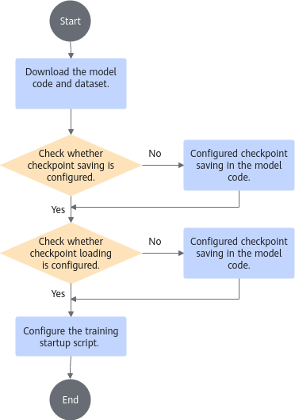
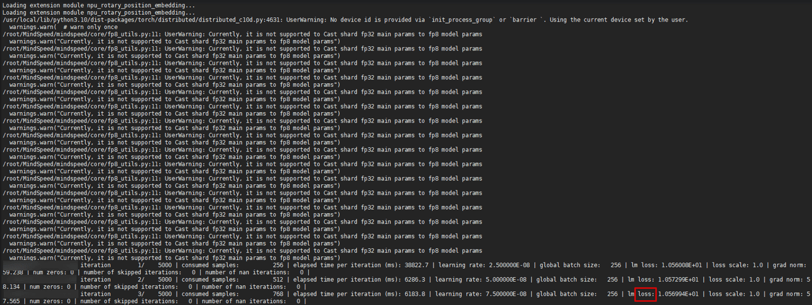
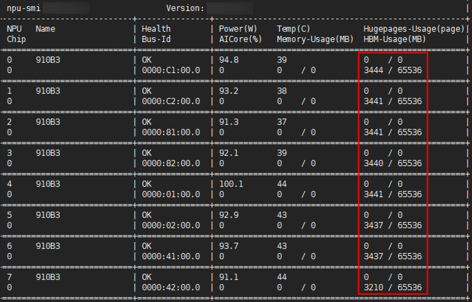
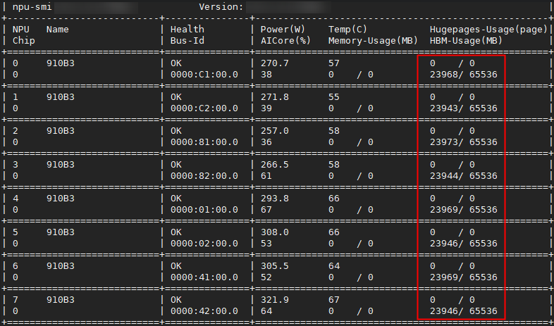

# Examples and Verification in MindSpore Scenario

## Building an Image<a name="ZH-CN_TOPIC_0000002511426469-mindspore"></a>

The [MindSpore Transformers suite](https://gitcode.com/mindspore/mindformers) (MindFormers for short) aims to build a full-process development suite for large model training, fine-tuning, evaluation, inference, and deployment. It provides mainstream Transformer pre-trained models and SOTA downstream task applications, covers rich parallel features, and helps users easily implement large model training and innovative R&D.

The quick start of the [MindSpore Transformers documentation](https://www.mindspore.cn/mindformers/docs/en/r1.3.0/start/overview.html) includes installation and quick launch chapters, which you can refer to when building the image.

The training image can be built based on a training base image by referring to the MindFormers documentation. For how to build a training base image, see [Building a Container Image Using a Dockerfile (MindSpore)](../../../../07_references/02_common_operations.md#ZH-CN_TOPIC_0000002511346627).

This chapter shows how to build a training image based on Ubuntu 20.04 by following the steps for building a training base image.

**Preparing Software Packages<a name="zh-cn_topic_0000002003180012_section181941327124212"></a>**

Obtain the software packages for the corresponding operating system as shown in [Table 1](#zh-cn_topic_0000002003180012_table223643812168), and prepare the Dockerfile and script files required for the image. In a software package name, `{version}` indicates the version number, `{arch}` indicates the architecture, and `{chip_type}` indicates the chip type.

**Table 1** Preparing software packages

<a name="zh-cn_topic_0000002003180012_table223643812168"></a>
<table><thead align="left"><tr id="zh-cn_topic_0000002003180012_row6236938171619"><th class="cellrowborder" valign="top" width="25%" id="mcps1.2.5.1.1-mindspore"><p id="zh-cn_topic_0000002003180012_p3390131317171"><a name="zh-cn_topic_0000002003180012_p3390131317171"></a>Software Package</p>
</th>
<th class="cellrowborder" valign="top" width="25%" id="mcps1.2.5.1.2-mindspore"><p id="zh-cn_topic_0000002003180012_p173901213151712"><a name="zh-cn_topic_0000002003180012_p173901213151712"></a>Required</p>
</th>
<th class="cellrowborder" valign="top" width="25%" id="mcps1.2.5.1.3-mindspore"><p id="zh-cn_topic_0000002003180012_p239018134178"><a name="zh-cn_topic_0000002003180012_p239018134178"></a>Description</p>
</th>
<th class="cellrowborder" valign="top" width="25%" id="mcps1.2.5.1.4-mindspore"><p id="zh-cn_topic_0000002003180012_p1539051321714"><a name="zh-cn_topic_0000002003180012_p1539051321714"></a>Obtaining Method</p>
</th>
</tr>
</thead>
<tbody><tr id="zh-cn_topic_0000002003180012_row13237173817161"><td class="cellrowborder" valign="top" width="25%" headers="mcps1.2.5.1.1-mindspore "><p id="zh-cn_topic_0000002003180012_p6390191319171"><a name="zh-cn_topic_0000002003180012_p6390191319171"></a>MindFormers code repository</p>
</td>
<td class="cellrowborder" valign="top" width="25%" headers="mcps1.2.5.1.2-mindspore "><p id="zh-cn_topic_0000002003180012_p13390113131712"><a name="zh-cn_topic_0000002003180012_p13390113131712"></a>Yes</p>
</td>
<td class="cellrowborder" valign="top" width="25%" headers="mcps1.2.5.1.3-mindspore "><p id="zh-cn_topic_0000002003180012_p153901913131711"><a name="zh-cn_topic_0000002003180012_p153901913131711"></a>Builds a full-process development suite for large model training, fine-tuning, evaluation, inference, and deployment, provides mainstream Transformer pre-trained models and SOTA downstream applications, and covers rich parallel features<span id="ph19351335211"><a name="ph19351335211"></a>.</span></p>
</td>
<td class="cellrowborder" valign="top" width="25%" headers="mcps1.2.5.1.4-mindspore "><p id="zh-cn_topic_0000002003180012_p3390131316172"><a name="zh-cn_topic_0000002003180012_p3390131316172"></a>git clone https://gitcode.com/mindspore/mindformers.git</p>
<p id="zh-cn_topic_0000002003180012_p5390101317175"><a name="zh-cn_topic_0000002003180012_p5390101317175"></a>cd mindformers</p>
<p id="zh-cn_topic_0000002003180012_p9390151318171"><a name="zh-cn_topic_0000002003180012_p9390151318171"></a>git checkout v1.8.0</p>
<div class="note"><span class="notetitle">[!NOTE]</span><div class="notebody"><p id="zh-cn_topic_0000002003180012_p_mindformers_version_note"><a name="zh-cn_topic_0000002003180012_p_mindformers_version_note"></a>The MindFormers version must match the MindSpore version. For the matching relationship, see <a href="https://gitcode.com/mindspore/mindformers" target="_blank" rel="noopener noreferrer">MindFormers</a>.</p></div></div>
</td>
</tr>
<tr id="zh-cn_topic_0000002003180012_row_hyperparallel"><td class="cellrowborder" valign="top" width="25%" headers="mcps1.2.5.1.1-mindspore "><p id="zh-cn_topic_0000002003180012_p_hyperparallel_name"><a name="zh-cn_topic_0000002003180012_p_hyperparallel_name"></a>HyperParallel</p>
</td>
<td class="cellrowborder" valign="top" width="25%" headers="mcps1.2.5.1.2-mindspore "><p id="zh-cn_topic_0000002003180012_p_hyperparallel_required"><a name="zh-cn_topic_0000002003180012_p_hyperparallel_required"></a>Yes</p>
</td>
<td class="cellrowborder" valign="top" width="25%" headers="mcps1.2.5.1.3-mindspore "><p id="zh-cn_topic_0000002003180012_p_hyperparallel_desc"><a name="zh-cn_topic_0000002003180012_p_hyperparallel_desc"></a>A distributed parallel acceleration library with Ascend SuperPoD affinity.</p>
</td>
<td class="cellrowborder" valign="top" width="25%" headers="mcps1.2.5.1.4-mindspore "><p id="zh-cn_topic_0000002003180012_p_hyperparallel_clone"><a name="zh-cn_topic_0000002003180012_p_hyperparallel_clone"></a>git clone https://gitcode.com/mindspore/hyper-parallel.git</p>
<p id="zh-cn_topic_0000002003180012_p_hyperparallel_cd"><a name="zh-cn_topic_0000002003180012_p_hyperparallel_cd"></a>cd hyper-parallel</p>
<p id="zh-cn_topic_0000002003180012_p_hyperparallel_checkout"><a name="zh-cn_topic_0000002003180012_p_hyperparallel_checkout"></a>git checkout 18a395befc6f9a60019c63a3e3878654ae2849d7</p>
</td>
</tr>
<tr id="zh-cn_topic_0000002003180012_row14237113817167"><td class="cellrowborder" valign="top" width="25%" headers="mcps1.2.5.1.1-mindspore "><p id="zh-cn_topic_0000002003180012_p133901013201717"><a name="zh-cn_topic_0000002003180012_p133901013201717"></a>requirements.txt file</p>
</td>
<td class="cellrowborder" valign="top" width="25%" headers="mcps1.2.5.1.2-mindspore "><p id="zh-cn_topic_0000002003180012_p10390813171719"><a name="zh-cn_topic_0000002003180012_p10390813171719"></a>No</p>
</td>
<td class="cellrowborder" valign="top" width="25%" headers="mcps1.2.5.1.3-mindspore "><p id="zh-cn_topic_0000002003180012_p439011371714"><a name="zh-cn_topic_0000002003180012_p439011371714"></a>Because installing MindSpore through pip may cause errors in the installation of dependent components, you can install the dependencies first.</p>
</td>
<td class="cellrowborder" valign="top" width="25%" headers="mcps1.2.5.1.4-mindspore "><p id="zh-cn_topic_0000002003180012_p6390121315177"><a name="zh-cn_topic_0000002003180012_p6390121315177"></a>wget https://gitcode.com/mindspore/mindspore/raw/r2.4.1/requirements.txt</p>
<div class="note" id="zh-cn_topic_0000002003180012_note14449193224617"><a name="zh-cn_topic_0000002003180012_note14449193224617"></a><span class="notetitle">[!NOTE]</span><div class="notebody"><p id="zh-cn_topic_0000002003180012_p15449133274617"><a name="zh-cn_topic_0000002003180012_p15449133274617"></a>The MindSpore software package must be used together with <span id="zh-cn_topic_0000002003180012_ph327965117217"><a name="zh-cn_topic_0000002003180012_ph327965117217"></a>Atlas training products</span>. For the matching relationship, see the MindSpore <a href="https://www.mindspore.cn/install/en" target="_blank" rel="noopener noreferrer">Installation Guide</a>.</p>
</div></div>
</td>
</tr>
<tr id="zh-cn_topic_0000002003180012_row2023743821619"><td class="cellrowborder" valign="top" width="25%" headers="mcps1.2.5.1.1-mindspore "><p id="zh-cn_topic_0000002003180012_p123901513131714"><a name="zh-cn_topic_0000002003180012_p123901513131714"></a>mindspore-<em id="zh-cn_topic_0000002003180012_i42701940155017"><a name="zh-cn_topic_0000002003180012_i42701940155017"></a>{version}</em>-cp3x-cp3x-linux_aarch64.whl</p>
</td>
<td class="cellrowborder" valign="top" width="25%" headers="mcps1.2.5.1.2-mindspore "><p id="zh-cn_topic_0000002003180012_p73901313101718"><a name="zh-cn_topic_0000002003180012_p73901313101718"></a>Yes</p>
</td>
<td class="cellrowborder" valign="top" width="25%" headers="mcps1.2.5.1.3-mindspore "><p id="zh-cn_topic_0000002003180012_p1839181315178"><a name="zh-cn_topic_0000002003180012_p1839181315178"></a>MindSpore wheel package<span id="ph441575419329"><a name="ph441575419329"></a>.</span></p><p>In a software package name, cp3x indicates the Python version. For example, if x is 10, the Python version is 3.10. Select the corresponding software package based on the actual situation.</p>
</td>
<td class="cellrowborder" valign="top" width="25%" headers="mcps1.2.5.1.4-mindspore "><p id="zh-cn_topic_0000002003180012_p6391181310177"><a name="zh-cn_topic_0000002003180012_p6391181310177"></a><a href="https://www.mindspore.cn/install/en" target="_blank" rel="noopener noreferrer">Download link</a></p>
</td>
</tr>
<tr id="zh-cn_topic_0000002003180012_row32371838111619"><td class="cellrowborder" valign="top" width="25%" headers="mcps1.2.5.1.1-mindspore "><p id="zh-cn_topic_0000002003180012_p13917139175"><a name="zh-cn_topic_0000002003180012_p13917139175"></a>mindio_ttp-<em id="zh-cn_topic_0000002003180012_i14277191551111"><a name="zh-cn_topic_0000002003180012_i14277191551111"></a>{version}</em>-py3-none-linux_<em id="zh-cn_topic_0000002003180012_i16391113201710"><a name="zh-cn_topic_0000002003180012_i16391113201710"></a>{arch}</em>.whl</p>
</td>
<td class="cellrowborder" valign="top" width="25%" headers="mcps1.2.5.1.2-mindspore "><p id="zh-cn_topic_0000002003180012_p183915136176"><a name="zh-cn_topic_0000002003180012_p183915136176"></a>Yes</p>
</td>
<td class="cellrowborder" valign="top" width="25%" headers="mcps1.2.5.1.3-mindspore "><p id="zh-cn_topic_0000002003180012_p13906311171017"><a name="zh-cn_topic_0000002003180012_p13906311171017"></a><span id="zh-cn_topic_0000002003180012_ph845710020145"><a name="zh-cn_topic_0000002003180012_ph845710020145"></a>MindIO TFT</span> installation package.</p>
</td>
<td class="cellrowborder" valign="top" width="25%" headers="mcps1.2.5.1.4-mindspore "><p id="zh-cn_topic_0000002003180012_p11392111316172"><a name="zh-cn_topic_0000002003180012_p11392111316172"></a><a href="https://www.hiascend.com/en/developer/software/mindcluster/download?versionId=476&ids=55%2C154%2Cb1e62037594d4e5c9a0fd797ff490006%2C58%2C60%2C64%2C" target="_blank" rel="noopener noreferrer">Download link</a></p>
</td>
</tr>
<tr id="zh-cn_topic_0000002003180012_row1423815380168"><td class="cellrowborder" valign="top" width="25%" headers="mcps1.2.5.1.1-mindspore "><p id="zh-cn_topic_0000002003180012_p0915027134813"><a name="zh-cn_topic_0000002003180012_p0915027134813"></a>Ascend-cann-{chip_type}-ops_{version}_linux-{arch}.run</p>
</td>
<td class="cellrowborder" valign="top" width="25%" headers="mcps1.2.5.1.2-mindspore "><p id="zh-cn_topic_0000002003180012_p1139314132170"><a name="zh-cn_topic_0000002003180012_p1139314132170"></a>Yes</p><p>For versions earlier than CANN 8.5.0, the package name is Ascend-cann-kernels-<em>{chip_type}</em>_<em>{version}</em>_linux-<em>{arch}</em>.run</p>
</td>
<td class="cellrowborder" valign="top" width="25%" headers="mcps1.2.5.1.3-mindspore "><p id="zh-cn_topic_0000002003180012_p193931713181710"><a name="zh-cn_topic_0000002003180012_p193931713181710"></a>CANN operator package.</p>
</td>
<td class="cellrowborder" valign="top" width="25%" headers="mcps1.2.5.1.4-mindspore "><p id="zh-cn_topic_0000002003180012_p139312131171"><a name="zh-cn_topic_0000002003180012_p139312131171"></a><a href="https://www.hiascend.com/en/cann/download?versionId=791&ids=d806%2Ch0501%2Ch0601%2Ch0703" target="_blank" rel="noopener noreferrer">Download link</a></p>
<div class="note" id="zh-cn_topic_0000002003180012_note13501612171513"><a name="zh-cn_topic_0000002003180012_note13501612171513"></a><span class="notetitle">[!NOTE]</span><div class="notebody"><p id="zh-cn_topic_0000002003180012_p1519161921516"><a name="zh-cn_topic_0000002003180012_p1519161921516"></a>Obtain a software package that matches the server model.</p>
</div></div>
</td>
</tr>
<tr id="zh-cn_topic_0000002003180012_row8238173810165"><td class="cellrowborder" valign="top" width="25%" headers="mcps1.2.5.1.1-mindspore "><p id="zh-cn_topic_0000002003180012_p1439381351714"><a name="zh-cn_topic_0000002003180012_p1439381351714"></a>Ascend-cann-toolkit_{version}_linux-{arch}.run</p>
</td>
<td class="cellrowborder" valign="top" width="25%" headers="mcps1.2.5.1.2-mindspore "><p id="zh-cn_topic_0000002003180012_p1239319131176"><a name="zh-cn_topic_0000002003180012_p1239319131176"></a>Yes</p>
</td>
<td class="cellrowborder" valign="top" width="25%" headers="mcps1.2.5.1.3-mindspore "><p id="zh-cn_topic_0000002003180012_p5393121371719"><a name="zh-cn_topic_0000002003180012_p5393121371719"></a>CANN Toolkit package</p>
</td>
<td class="cellrowborder" valign="top" width="25%" headers="mcps1.2.5.1.4-mindspore "><p id="zh-cn_topic_0000002003180012_p239319132175"><a name="zh-cn_topic_0000002003180012_p239319132175"></a><a href="https://www.hiascend.com/en/cann/download?versionId=791&ids=d806%2Ch0501%2Ch0601%2Ch0703" target="_blank" rel="noopener noreferrer">Download link</a></p>
<div class="note" id="zh-cn_topic_0000002003180012_note1733918441613"><a name="zh-cn_topic_0000002003180012_note1733918441613"></a><span class="notetitle">[!NOTE]</span><div class="notebody"><p id="zh-cn_topic_0000002003180012_p533924121616"><a name="zh-cn_topic_0000002003180012_p533924121616"></a>Obtain a software package that matches the server model.</p>
</div></div>
</td>
</tr>
<tr id="zh-cn_topic_0000002003180012_row4825411181413"><td class="cellrowborder" valign="top" width="25%" headers="mcps1.2.5.1.1-mindspore "><p id="zh-cn_topic_0000002003180012_p1882511116142"><a name="zh-cn_topic_0000002003180012_p1882511116142"></a>taskd-{version}-py3-none-linux_{arch}.whl</p>
</td>
<td class="cellrowborder" valign="top" width="25%" headers="mcps1.2.5.1.2-mindspore "><p id="zh-cn_topic_0000002003180012_p10825811101413"><a name="zh-cn_topic_0000002003180012_p10825811101413"></a>Yes</p>
</td>
<td class="cellrowborder" valign="top" width="25%" headers="mcps1.2.5.1.3-mindspore "><p id="zh-cn_topic_0000002003180012_p4825711171415"><a name="zh-cn_topic_0000002003180012_p4825711171415"></a>Resumable training wheel package.</p>
</td>
<td class="cellrowborder" valign="top" width="25%" headers="mcps1.2.5.1.4-mindspore "><p id="zh-cn_topic_0000002003180012_p18169645192413"><a name="zh-cn_topic_0000002003180012_p18169645192413"></a><a href="https://www.hiascend.com/en/developer/software/mindcluster/download?versionId=476&ids=52%2C154%2C%2C58%2C60%2C64%2C" target="_blank" rel="noopener noreferrer">Download link</a></p>
<div class="note" id="zh-cn_topic_0000002003180012_note079418496154"><a name="zh-cn_topic_0000002003180012_note079418496154"></a><span class="notetitle"> [!NOTE]</span><div class="notebody"><a name="zh-cn_topic_0000002003180012_ul79293962319"></a><ul id="zh-cn_topic_0000002003180012_ul79293962319"><li>In the MindSpore scenario, this wheel package must be installed to use graceful fault tolerance, Pod-level rescheduling, process-level rescheduling, or process-level online recovery.</li><li>The link leads to the <span id="zh-cn_topic_0000002003180012_ph11742444163719"><a name="zh-cn_topic_0000002003180012_ph11742444163719"></a>TaskD</span> archive Ascend-mindxdl-taskd_<em id="i112838253389-mindspore"><a name="i112838253389-duplicate-2"></a>{version}</em>_linux-<em id="i1328312515383-mindspore"><a name="i1328312515383-duplicate-2"></a>{arch}</em>.zip. You need to decompress it to obtain the corresponding wheel software package.</li></ul>
</div></div>
</td>
</tr>
<tr id="zh-cn_topic_0000002003180012_row15183115071614"><td class="cellrowborder" valign="top" width="25%" headers="mcps1.2.5.1.1-mindspore "><p id="zh-cn_topic_0000002003180012_p83941613131719"><a name="zh-cn_topic_0000002003180012_p83941613131719"></a>version.info</p>
</td>
<td class="cellrowborder" valign="top" width="25%" headers="mcps1.2.5.1.2-mindspore "><p id="zh-cn_topic_0000002003180012_p4394913121712"><a name="zh-cn_topic_0000002003180012_p4394913121712"></a>Yes</p>
<p id="zh-cn_topic_0000002003180012_p0394413131713"><a name="zh-cn_topic_0000002003180012_p0394413131713"></a>Dependency file for CANN installation</p>
</td>
<td class="cellrowborder" valign="top" width="25%" headers="mcps1.2.5.1.3-mindspore "><p id="zh-cn_topic_0000002003180012_p73942134170"><a name="zh-cn_topic_0000002003180012_p73942134170"></a>Driver version information file.</p>
</td>
<td class="cellrowborder" valign="top" width="25%" headers="mcps1.2.5.1.4-mindspore "><p id="zh-cn_topic_0000002003180012_p239415135179"><a name="zh-cn_topic_0000002003180012_p239415135179"></a>Copy the "/usr/local/Ascend/driver/version.info" file from the host.</p>
</td>
</tr>
<tr id="zh-cn_topic_0000002003180012_row218375021618"><td class="cellrowborder" valign="top" width="25%" headers="mcps1.2.5.1.1-mindspore "><p id="zh-cn_topic_0000002003180012_p5394141315176"><a name="zh-cn_topic_0000002003180012_p5394141315176"></a>ascend_install.info</p>
</td>
<td class="cellrowborder" valign="top" width="25%" headers="mcps1.2.5.1.2-mindspore "><p id="zh-cn_topic_0000002003180012_p1039401316175"><a name="zh-cn_topic_0000002003180012_p1039401316175"></a>Yes</p>
<p id="zh-cn_topic_0000002003180012_p14394171331717"><a name="zh-cn_topic_0000002003180012_p14394171331717"></a>Dependency file for CANN installation</p>
</td>
<td class="cellrowborder" valign="top" width="25%" headers="mcps1.2.5.1.3-mindspore "><p id="zh-cn_topic_0000002003180012_p03941613151715"><a name="zh-cn_topic_0000002003180012_p03941613151715"></a>Driver installation information file.</p>
</td>
<td class="cellrowborder" valign="top" width="25%" headers="mcps1.2.5.1.4-mindspore "><p id="zh-cn_topic_0000002003180012_p11394141321712"><a name="zh-cn_topic_0000002003180012_p11394141321712"></a>Copy the "/etc/ascend_install.info" file from the host.</p>
</td>
</tr>
<tr id="zh-cn_topic_0000002003180012_row61841150171618"><td class="cellrowborder" valign="top" width="25%" headers="mcps1.2.5.1.1-mindspore "><p id="zh-cn_topic_0000002003180012_p6394713201715"><a name="zh-cn_topic_0000002003180012_p6394713201715"></a>get-pip.py</p>
</td>
<td class="cellrowborder" valign="top" width="25%" headers="mcps1.2.5.1.2-mindspore "><p id="zh-cn_topic_0000002003180012_p14394121310177"><a name="zh-cn_topic_0000002003180012_p14394121310177"></a>Yes</p>
</td>
<td class="cellrowborder" valign="top" width="25%" headers="mcps1.2.5.1.3-mindspore "><p id="zh-cn_topic_0000002003180012_p63959135172"><a name="zh-cn_topic_0000002003180012_p63959135172"></a>Used to install pip modules</p>
</td>
<td class="cellrowborder" valign="top" width="25%" headers="mcps1.2.5.1.4-mindspore "><p id="zh-cn_topic_0000002003180012_p6395913121711"><a name="zh-cn_topic_0000002003180012_p6395913121711"></a>curl -k https://bootstrap.pypa.io/get-pip.py -o get-pip.py</p>
</td>
</tr>
<tr id="zh-cn_topic_0000002003180012_row618410501169"><td class="cellrowborder" valign="top" width="25%" headers="mcps1.2.5.1.1-mindspore "><p id="zh-cn_topic_0000002003180012_p123971013121710"><a name="zh-cn_topic_0000002003180012_p123971013121710"></a>Dockerfile</p>
</td>
<td class="cellrowborder" valign="top" width="25%" headers="mcps1.2.5.1.2-mindspore "><p id="zh-cn_topic_0000002003180012_p18397713121711"><a name="zh-cn_topic_0000002003180012_p18397713121711"></a>Yes</p>
</td>
<td class="cellrowborder" valign="top" width="25%" headers="mcps1.2.5.1.3-mindspore "><p id="zh-cn_topic_0000002003180012_p639719136172"><a name="zh-cn_topic_0000002003180012_p639719136172"></a>Required for building the image.</p>
</td>
<td class="cellrowborder" valign="top" width="25%" headers="mcps1.2.5.1.4-mindspore "><p id="zh-cn_topic_0000002003180012_p639714133170"><a name="zh-cn_topic_0000002003180012_p639714133170"></a>-</p>
</td>
</tr>
</tbody>
</table>

>[!NOTE]
>This chapter uses a single Atlas 800T A2, Ubuntu 20.04, and Python 3.10 as an example to describe the detailed image building process. Modify the related steps based on the actual situation during use.

**Procedure<a name="zh-cn_topic_0000002003180012_section614453171018"></a>**

1. Complete the software package preparation on the host.
2. Build the following Dockerfile.

    ```text
    FROM ubuntu:20.04

    WORKDIR /root

    COPY . .

    ARG HOST_ASCEND_BASE=/usr/local/Ascend
    ARG TOOLKIT_PATH=/usr/local/Ascend/cann
    # The CANN version used in the example is 8.5.0. Modify it based on the actual situation during use.
    ARG TOOLKIT=Ascend-cann-toolkit_8.5.0_linux-aarch64.run
    ARG OPS=Ascend-cann-910b-ops_8.5.0_linux-aarch64.run
    ARG MINDIO_TTP_WHL=mindio_ttp-1.0.0-py3-none-linux_aarch64.whl
    ARG MINDFORMERS=mindformers
    ARG HYPERPARALLEL=hyper-parallel
    ARG MINDSPORE_REQUIREMENTS=requirements.txt
    ARG MINDSPORE_WHL=mindspore-2.7.0-cp310-cp310-linux_aarch64.whl
    ARG TASKD_WHL=taskd-7.0.RC1-py3-none-linux_aarch64.whl

    RUN echo "nameserver 114.114.114.114" > /etc/resolv.conf

    RUN echo "deb http://repo.huaweicloud.com/ubuntu-ports/ focal main restricted universe multiverse\n\
    deb http://repo.huaweicloud.com/ubuntu-ports/ focal-updates main restricted universe multiverse\n\
    deb http://repo.huaweicloud.com/ubuntu-ports/ focal-backports main restricted universe multiverse\n\
    deb http://ports.ubuntu.com/ubuntu-ports/ focal-security main restricted universe multiverse" > /etc/apt/sources.list

    ARG DEBIAN_FRONTEND=noninteractive

    RUN umask 0022 && apt update && \
        apt-get install -y --no-install-recommends \
        software-properties-common
    RUN umask 0022 && add-apt-repository ppa:deadsnakes/ppa && \
        apt update && \
        apt autoremove -y python python3 && \
        apt install -y python3.10 python3.10-dev

    # Create a Python symbolic link
    RUN ln -s /usr/bin/python3.10 /usr/bin/python
    RUN ln -s /usr/bin/python3.10 /usr/bin/python3
    RUN ln -s /usr/bin/python3.10-config /usr/bin/python-config
    RUN ln -s /usr/bin/python3.10-config /usr/bin/python3-config

    # System packages
    RUN umask 0022 && apt update && \
        apt-get install -y --no-install-recommends \
            gcc g++ make cmake vim \
            zlib1g zlib1g-dev \
            openssl libsqlite3-dev libssl-dev \
            libffi-dev unzip pciutils \
            net-tools libblas-dev \
            gfortran libblas3 libopenblas-dev \
            curl unzip liblapack3 liblapack-dev \
            libhdf5-dev libxml2 patch

    # Time zone
    # RUN ln -sf /usr/share/zoneinfo/Asia/Shanghai /etc/localtime
    RUN ln -sf /usr/share/zoneinfo/UTC /etc/localtime

    # Configure the pip source
    RUN mkdir -p ~/.pip \
    && echo '[global] \n\
    index-url=https://mirrors.huaweicloud.com/repository/pypi/simple\n\
    trusted-host=mirrors.huaweicloud.com' >> ~/.pip/pip.conf

    # pip3.10
    RUN cd /tmp && \
        apt-get download python3-distutils && \
        dpkg-deb -x python3-distutils_*.deb / && \
        rm python3-distutils_*.deb && \
        cd - && \
        python get-pip.py && \
    rm get-pip.py

    RUN umask 0022 && \
        pip install sympy==1.4 && \
        pip install cffi && \
        pip install pathlib2 && \
        pip install grpcio && \
        pip install grpcio-tools && \
        pip install absl-py && \
        pip install datasets && \
        pip install tokenizers==0.20.1

    # Create the HwHiAiUser user and its owner. Keep the UID and GID consistent with those on the physical machine to avoid files without an owner. In the example, the user and the corresponding group are created automatically, and both the UID and GID are 1000.
    RUN useradd -d /home/HwHiAiUser -u 1000 -m -s /bin/bash HwHiAiUser

    # Ascend package
    # Before building, copy /usr/local/Ascend/driver/version.info from the host to the current directory
    RUN umask 0022 &&  \
        cp ascend_install.info /etc/ && \
        mkdir -p /usr/local/Ascend/driver/ && \
        cp version.info /usr/local/Ascend/driver/ && \
        chmod +x $TOOLKIT && \
        chmod +x $OPS

    RUN umask 0022 && ./$TOOLKIT --install-path=/usr/local/Ascend/ --install --quiet
    RUN echo "source /usr/local/Ascend/cann/set_env.sh" >> ~/.bashrc
    RUN umask 0022 && ./$OPS --install --quiet

    # This is only for installing the toolkit package, so it must be cleaned up; it is mounted through Ascend Docker Runtime when the container is started
    RUN rm -f version.info && \
        rm -rf /usr/local/Ascend/driver/

    # Install MindSpore
    RUN umask 0022 && pip uninstall te topi hccl -y && \
             pip install sympy && \
             pip install /usr/local/Ascend/cann/lib64/hccl-*-py3-none-any.whl
    RUN umask 0022 && \
        pip install -r $MINDSPORE_REQUIREMENTS && \
        pip install $MINDSPORE_WHL

    # Install MindFormers
    RUN umask 0022 && cd $MINDFORMERS && \
        pip install -r requirements.txt
    # Install Hyper-parallel
    RUN umask 0022 && cd $HYPERPARALLEL && \
        pip install -r requirements.txt

    # MindCluster lossless resumable training adaptation script
    RUN umask 0022 && \
        pip install $MINDIO_TTP_WHL --target=$(pip show mindspore | awk '/Location:/ {print $2}') && \
        pip install $TASKD_WHL

    # Environment variables
    ENV HCCL_WHITELIST_DISABLE=1

    # Create /lib64/ld-linux-aarch64.so.1
    RUN umask 0022 && \
        if [ ! -d "/lib64" ]; \
        then \
            mkdir /lib64 && ln -sf /lib/ld-linux-aarch64.so.1 /lib64/ld-linux-aarch64.so.1; \
        fi

    # Add the dependency library for job scheduling installation
    RUN pip install apscheduler

    RUN rm -rf tmp && \
        rm -f $TOOLKIT && \
        rm -f $OPS && \
        rm -f $MINDIO_TTP_WHL && \
        rm -f $MINDSPORE_REQUIREMENTS && \
        rm -f $MINDSPORE_WHL
    ## Finally package the image as mindformers-dl:v1
    ```

3. Build the image. Run the following command to generate the image. To make the Dockerfile more secure, you can define a HEALTHCHECK in it based on your service. Check the container running status by running the **HEALTHCHECK** _\[OPTIONS\]_ **CMD** command inside the container. **Do not omit the dot (".") at the end of the command.**

    ```shell
    docker build -t mindformers-dl:v1 .
    ```

4. In addition to manually building an image by following the preceding process, you can also directly use the out-of-the-box sample image `mindspore-sample-dl:v26.2.0-cann8.5.0-mindspore2.5.0-910b-py3.10-aarch64`. The sample image can be obtained from [AscendHub](https://www.hiascend.com/en/developer/ascendhub) for quick verification.

## Script Adaptation<a name="ZH-CN_TOPIC_0000002511426481-mindspore"></a>

### Process Description<a name="ZH-CN_TOPIC_0000002511346469-mindspore"></a>

Model scripts must be adapted for CKPT before the resumable training function can be used. The approximate process and logic of script adaptation are shown in [Figure 1](#fig88341718121515-mindspore).

**Figure 1**  Script adaptation process<a name="fig88341718121515-mindspore"></a>



### Adaptation Example<a name="ZH-CN_TOPIC_0000002511346445-mindspore"></a>

This chapter guides users through the adaptation steps for resumable training, step by step.

>[!NOTE]
>
>- To ensure that graceful fault tolerance and process-level online recovery work properly, keep the clocks of the master and worker nodes of the K8s cluster consistent.
>- The component code shown for resumable training is open-source code. For related security statements, see [Security Statement](../../../../07_references/05_appendix.md#ZH-CN_TOPIC_0000002479386374).
>- The model example code below may differ from the actual version. The actual version code prevails.
>- Write the model parameter configuration based on the model configuration in the model repository and the actual situation. Improper modification may cause unpredictable problems.
>- If the error "Failed to bind the IP port. Reason: The IP address and port have been bound already" occurs during training, configure it as follows. For details, see the "[HCCL_HOST_SOCKET_PORT_RANGE](https://www.hiascend.com/document/detail/en/CANNCommunityEdition/910/commlib/hcclug/docs/en/user_guide/hccl_env/HCCL_HOST_SOCKET_PORT_RANGE.md)" section.
>
>   ```shell
>   export HCCL_HOST_SOCKET_PORT_RANGE="60000-60050"
>   export HCCL_NPU_SOCKET_PORT_RANGE="61000-61050"
>   ```
>
>- If TaskD is used and the training container uses the host network, first query the current reserved port configuration by running `sysctl net.ipv4.ip_local_reserved_ports`, and then add reserved ports 9601 and 9602 by running `sysctl -w net.ipv4.ip_local_reserved_ports="xxx,9601,9602"` (where *xxx* refers to the ports already configured in the preceding query; omit it if there are none).

For training code and dataset preparation, see the [MindFormers documentation](https://gitcode.com/mindspore/mindformers/tree/master/configs/qwen3). The following uses two Atlas 900 A3 SuperPoD as an example to describe the detailed steps.

1. Prepare the code.

    ```shell
    mkdir -p /data/atlas_dls/public/code
    cd /data/atlas_dls/public/code
    git clone https://gitcode.com/mindspore/mindformers.git
    cd mindformers
    git checkout v1.8.0
    cd ..
    git clone https://gitcode.com/mindspore/hyper-parallel.git
    cd hyper-parallel
    git checkout 18a395befc6f9a60019c63a3e3878654ae2849d7
    cp -r hyper_parallel ../mindformers
    cd ..
    # Rename mindformers to QWEN3_for_MS_code
    mv mindformers QWEN3_for_MS_code
    ```

2. Prepare the dataset.

    Download the dataset from [DagsHub](https://dagshub.com/DagsHub/WIkiText-103/src/main/dataset/tokens/wiki.train.tokens) by yourself and place it in a directory on the server, for example, "/data/atlas\_dls/public/code/QWEN3\_for\_MS\_code/dataset".

3. Convert the dataset.
    1. Download the dataset conversion script.

        Download the dataset conversion script from [Dataset Conversion](https://gitee.com/mindspore/mindformers/issues/ICOKGY) and place it in a directory on the server, for example, "/data/atlas\_dls/public/code/QWEN3\_for\_MS\_code/dataset/gen\_wiki\_json.py".

    2. Download the tokenizer file.

        Download the tokenizer file from [Qwen3-32B](https://huggingface.co/Qwen/Qwen3-32B/tree/main) and place it in a directory on the server, for example, "/data/atlas\_dls/public/code/QWEN3\_for\_MS\_code/dataset/Qwen3-32B-tokenizer".

    3. Convert the dataset.
        1. Start the container and mount the required files.

            ```shell
            docker run -it -v /data/atlas_dls/public/code/:/data/atlas_dls/public/code/ mindformers-dl:v1 bash
            ```

        2. Run the conversion script to convert `wiki.train.tokens` to `jsonl` format.

            ```shell
            # Prepare the Python environment required for running this script in advance
            cd /data/atlas_dls/public/code/QWEN3_for_MS_code/dataset
            python gen_wiki_json.py --input wiki.train.tokens  --output wiki.jsonl
            ```

        3. Convert the jsonl data to bin data.

            ```shell
            # If the error ModuleNotFoundError: No module named 'xxx' is reported during execution, install the dependency yourself
            cd /data/atlas_dls/public/code/QWEN3_for_MS_code
            python toolkit/data_preprocess/megatron/preprocess_indexed_dataset.py \
              --input /data/atlas_dls/public/code/QWEN3_for_MS_code/dataset/wiki.jsonl \
              --output-prefix /data/atlas_dls/public/code/QWEN3_for_MS_code/dataset/wiki103-megatron \
              --tokenizer-type HuggingFaceTokenizer \
              --tokenizer-dir /data/atlas_dls/public/code/QWEN3_for_MS_code/dataset/Qwen3-32B-tokenizer # For models of other specifications, adjust this to the corresponding tokenizer path
            ```

            After the script is executed, the files "wiki103-megatron\_text\_document.bin" and "wiki103-megatron\_text\_document.idx" are generated in the "/data/atlas\_dls/public/code/QWEN3\_for\_MS\_code/dataset" directory. When filling in the dataset path, use "/data/atlas\_dls/public/code/QWEN3\_for\_MS\_code/dataset/wiki103-megatron\_text\_document" without the file name extension.

4. Obtain the [training job YAML](https://gitcode.com/Ascend/mindcluster-deploy/blob/master/samples/train/resumable-training/fault-tolerance/ranktable/mindspore/Qwen3/yamls/ms_multinodes_acjob_superpod.yaml) and the [training startup script](https://gitcode.com/Ascend/mindcluster-deploy/blob/master/samples/train/resumable-training/fault-tolerance/ranktable/mindspore/Qwen3/msrun_launcher.sh), and modify them.
    1. If the value of the "hostNetwork" parameter in the job YAML is "false", set the value of "GLOO\_SOCKET\_IFNAME" in the startup script to "eth0". An example is shown below:

        ```shell
        export GLOO_SOCKET_IFNAME=eth0  #eth0 is a NIC that can communicate inside the container
        export HCCL_SOCKET_IFNAME=eth0
        ```

        Then modify other parameters in the startup script based on the actual situation.

    2. Modify configurations such as the server IP address of the mount volume in the job YAML based on the actual situation.
    3. To use TaskD for process-level rescheduling, process-level online recovery, process-level in-place recovery, suspension and switchback of link failover communication, or online stress testing, you also need to start TaskD Manager.
        1. Create a `manager.py` file in the current directory when the training script is called. The content of the `manager.py` file is as follows.

            ```python
            from taskd.api import init_taskd_manager, start_taskd_manager
            import os

            job_id=os.getenv("MINDX_TASK_ID")
            node_nums=XX         # Total number of nodes
            proc_per_node=XX     # Number of training processes per node

            init_taskd_manager({"job_id":job_id, "node_nums": node_nums, "proc_per_node": proc_per_node})
            start_taskd_manager()
            ```

            >[!NOTE]
            >For detailed parameter descriptions in the manager.py file, see [def init\_taskd\_manager\(config:dict\) -\> bool:](../../../../06_api/07_taskd/04_taskd_manager_apis.md#def-init_taskd_managerconfigdict---bool).

        2. Add the following code to the training script to start TaskD Manager. In the following code, the first two statements configure the path of `libtaskd.so` after TaskD is installed into the environment variable `LD_PRELOAD`. If these two statements fail to configure successfully, you can manually run the `pip show taskd` command to obtain the `Location` value, append `/taskd/python/cython_api/libs/libtaskd.so` to it, and then set it via `export`.

            ```shell
            TASKD_SO_PATH="$(pip show taskd | awk '/^Location: / {print $2"/taskd/python/cython_api/libs/libtaskd.so"}')"
            export LD_PRELOAD=$TASKD_SO_PATH:$LD_PRELOAD
            export TASKD_PROCESS_ENABLE="on"
            if [[ "${MS_SCHED_HOST}" == "${POD_IP}" ]]; then
                python /job/code/manager.py 2>> /job/code/alllogs/$MINDX_TASK_ID/taskd/error.log &   # The specific execution path of manager.py is determined by the current path, and the error.log path must be created in advance.
            fi
            msrun ...
            ```

        3. Modify the training job YAML to add container ports, and add port 9601 used for TaskD communication under all Pods (skip this step if it already exists).

            ```yaml
            ...
                    spec:
            ...
                      containers:
            ...
                        ports:
                         - containerPort: 9601
                           name: taskd-port
            ...
            ```

5. Modify the model parameter configuration file.
    1. Open the "configs/qwen3/pretrain\_qwen3\_32b\_4k.yaml" file in the code directory.

        ```shell
        vi configs/qwen3/pretrain_qwen3_32b_4k.yaml
        ```

    2. Press "i" to enter the edit mode and modify the model parameter configuration file.
        1. Modify the following bold configurations, including the dataset path, distributed parallel parameters, and model parameters. The following model parameters are for reference only; modify them as needed.

            <pre codetype="yaml">
            train_dataset: &train_dataset
              data_loader:
                type: BlendedMegatronDatasetDataLoader
                datasets_type: "GPTDataset"
                sizes:
                  - 8000  # Number of samples in the training set
                  - 0     # Number of samples in the test set (currently unsupported)
                  - 0     # Number of samples in the evaluation set (currently unsupported)
                config:
                  seed: 1234  # Random seed for data sampling
                  split: "1, 0, 0"  # Proportions for training, test, and evaluation sets (test/eval currently unsupported)
                  seq_length: 4096  # Sequence length of the dataset
                  eod_mask_loss: False  # Whether to calculate loss at the end-of-document (EOD)
                  reset_position_ids: False  # Whether to reset position_ids at EOD
                  create_attention_mask: True  # Whether to include attention_mask in the dataset
                  reset_attention_mask: False  # Whether to reset attention_mask at EOD, creating a stepped attention_mask
                  create_compressed_eod_mask: False  # Whether to include a compressed attention_mask
                  eod_pad_length: 128  # Length of the compressed attention_mask
                  eod: 1  # Token ID for EOD in the dataset
                  pad: -1  # Token ID for padding in the dataset
                  data_path:  # Sampling proportion and path for the Megatron dataset
                    - '1'
                    <strong>- "/job/data/wiki103-megatron_text_document" # Dataset path</strong>
            ……
            # Parallel configuration
            parallel_config:
              <strong>data_parallel: &dp 4  # Number of data parallel. If using the high availability feature, it must be an even number.</strong>
              <strong>model_parallel: 8  # Number of model parallel</strong>
              <strong>pipeline_stage: 1  # Number of pipeline parallel</strong>
              <strong>micro_batch_num: 1  # Pipeline parallel microbatch size</strong>
              use_seq_parallel: False  # Whether to enable sequence parallelism
              gradient_aggregation_group: 1  # Size of the gradient communication operator fusion group
            # When model_parallel > 1, setting micro_batch_interleave_num to 2 may accelerate the training process.
            micro_batch_interleave_num: 1
            ……
            model:
              model_config:
                # Configurations from Hugging Face
                <strong>vocab_size: 75968            # The model parameters are reduced here for testing only; adjust them as needed</strong>
                <strong>hidden_size: 2560           # The model parameters are reduced here for testing only; adjust them as needed</strong>
                <strong>intermediate_size: 12800   # The model parameters are reduced here for testing only; adjust them as needed</strong>
                <strong>num_hidden_layers: 32      # The model parameters are reduced here for testing only; adjust them as needed</strong>
                <strong>num_attention_heads: 32    # The model parameters are reduced here for testing only; adjust them as needed</strong>
                num_key_value_heads: 8
                head_dim: 128
                hidden_act: 'swiglu'
                max_position_embeddings: 4096
                seq_length: 4096
                initializer_range: 0.02
                rms_norm_eps: 1.e-6
                use_cache: True
                tie_word_embeddings: False
                rope_theta: 1000000.
                attention_bias: False
                use_flash_attention: True
                add_bias_linear: False
                eos_token_id: 151645
                pad_token_id: 151643
                bos_token_id: 151643
                attention_dropout: 0.0
                # Configurations from MindFormers
                hidden_dropout: 0.0
                input_sliced_sig: True
                untie_embeddings_and_output_weights: True
                position_embedding_type: "rope"
                qk_layernorm: True
                use_contiguous_weight_layout_attention: False
                qkv_concat: True
                <strong>offset: [0]</strong>
                params_dtype: "float32"
                compute_dtype: "bfloat16"
                layernorm_compute_dtype: "float32"
                softmax_compute_dtype: "float32"
                rotary_dtype: "float32"
                residual_dtype: "float32"
                model_type: "qwen3"
                architectures: ["Qwen3ForCausalLM"]</pre>

        2. (Optional) In scenarios where a dying gasp CKPT is used, if the CKPT is loaded through Pod-level rescheduling after being saved, modify the following configuration field.

            When the job is started for the first time, ensure that a normal available CKPT exists in the directory specified by the `load_checkpoint` parameter value or that the directory is empty; otherwise, training may fail to start properly.

            ```yaml
            resume_training: True
            src_strategy_path_or_dir: './output/strategy'
            load_checkpoint: './output/checkpoint'
            ```

    3. Press `Esc`, type `:wq!`, and press `Enter` to save and exit the editor.

## Preparing a Job YAML<a name="ZH-CN_TOPIC_0000002511426415-mindspore"></a>

Cluster scheduling components provide YAML examples. Select the corresponding YAML example based on the functions, model type, and job type in use as well as the fault handling mode, and modify it as required before use.

**Table 2** Training job YAML example

<a name="table350244433714-mindspore"></a>
<table><thead align="left"><tr id="row135031644183710-mindspore"><th class="cellrowborder" valign="top" width="15.393078615723146%" id="mcps1.2.8.1.1-mindspore"><p id="p8503244173715-mindspore"><a name="p8503244173715-mindspore"></a>Job Type</p>
</th>
<th class="cellrowborder" valign="top" width="16.173234646929384%" id="mcps1.2.8.1.2-mindspore"><p id="p145038448375-mindspore"><a name="p145038448375-mindspore"></a>Hardware Model</p>
</th>
<th class="cellrowborder" valign="top" width="8.521704340868173%" id="mcps1.2.8.1.3-mindspore"><p id="p919210345266-mindspore"><a name="p919210345266-mindspore"></a>Training Framework</p>
</th>
<th class="cellrowborder" valign="top" width="13.672734546909378%" id="mcps1.2.8.1.4-mindspore"><p id="p5503544193713-mindspore"><a name="p5503544193713-mindspore"></a>Model</p>
</th>
<th class="cellrowborder" valign="top" width="15.393078615723146%" id="mcps1.2.8.1.5-mindspore"><p id="p19672186404-mindspore"><a name="p19672186404-mindspore"></a>YAML File Name</p>
</th>
<th class="cellrowborder" valign="top" width="15.433086617323463%" id="mcps1.2.8.1.6-mindspore"><p id="p1096741894013-mindspore"><a name="p1096741894013-mindspore"></a>Download Link</p>
</th>
<th class="cellrowborder" valign="top" width="15.413082616523303%" id="mcps1.2.8.1.7-mindspore"><p id="p2967518174012-mindspore"><a name="p2967518174012-mindspore"></a>Description</p>
</th>
</tr>
</thead>
<tbody><tr id="row91607510384-mindspore"><td class="cellrowborder" valign="top" width="15.393078615723146%" headers="mcps1.2.8.1.1-mindspore "><p id="p89371529174019"><a name="p89371529174019"></a>Ascend Job</p>
</td>
<td class="cellrowborder" valign="top" width="16.173234646929384%" headers="mcps1.2.8.1.2-mindspore "><a name="ul393742934014"></a><ul id="ul393742934014"><li><span id="ph139426426441"><a name="ph139426426441"></a>Atlas 900 A3 SuperPoD</span></li></ul>
</td>
<td class="cellrowborder" valign="top" width="8.521704340868173%" headers="mcps1.2.8.1.3-mindspore "><p id="p1319333422617"><a name="p1319333422617"></a>MindSpore</p>
</td>
<td class="cellrowborder" valign="top" width="13.672734546909378%" headers="mcps1.2.8.1.4-mindspore "><p id="p1893752924017"><a name="p1893752924017"></a><span id="ph234505228"><a name="ph234505228"></a>Qwen3</span></p>
</td>
<td class="cellrowborder" valign="top" width="15.393078615723146%" headers="mcps1.2.8.1.5-mindspore "><p id="p1493742904013"><a name="p1493742904013"></a><span id="ph153229411739"><a name="ph153229411739"></a>ms_multinodes_acjob_superpod.yaml</span></p>
</td>
<td class="cellrowborder" valign="top" width="15.433086617323463%" headers="mcps1.2.8.1.6-mindspore "><p id="p1637217494110"><a name="p1637217494110"></a><a href="https://gitcode.com/Ascend/mindcluster-deploy/blob/release_v26.2.0/samples/train/resumable-training/fault-tolerance/ranktable/mindspore/Qwen3/yamls/ms_multinodes_acjob_superpod.yaml" target="_blank" rel="noopener noreferrer">ms_multinodes_acjob_superpod.yaml</a></p>
</td>
<td class="cellrowborder" valign="top" width="15.413082616523303%" headers="mcps1.2.8.1.7-mindspore "><p id="p79373296408"><a name="p79373296408"></a>The example uses a 2 x 16-chip job by default</p>
</td>
</tr>
</tbody>
</table>

>[!NOTE]
>Currently, some training frameworks do not provide resumable training example YAMLs for Atlas 900 A3 SuperPoD. You can add an annotations field under labels in the example YAML. An example is shown below:
>
>```yaml
>...
>  labels:
>...
>  annotations:
>    sp-block: "32"   # Number of chips in a logical super node. For details about the sp-block field, see the YAML parameter description.
>    huawei.com/schedule_policy: "chip2-node16-sp"    # Set the scheduling policy based on the hardware form
>...
>```

## Delivering a Job<a name="ZH-CN_TOPIC_0000002479226548-mindspore"></a>

In the example YAML, the job is deployed in the default namespace. This chapter uses the MindSpore framework as an example to deliver a training job.

1. Log in to the management node and go to the path where the YAML file is stored.
2. Run the following command on the management node to deliver the training job using the YAML.

    ```shell
    kubectl apply -f XXX.yaml
    ```

    For example:

    ```shell
    kubectl apply -f ms_multinodes_acjob_superpod.yaml
    ```

    Command output:

    ```ColdFusion
    configmap/reset-config-default-test-mindspore created
    ascendjob.mindxdl.gitee.com/default-test-mindspore created
    ```

## Viewing Job Processes<a name="ZH-CN_TOPIC_0000002511426461-mindspore"></a>

After the training job is delivered successfully, it runs normally. You can check the running status of the training job as follows.

**Viewing All Training Jobs<a name="section16792164211375-mindspore"></a>**

To view all training jobs running on the current node, perform the following steps.

1. Log in to the management node and go to the path where the YAML file is stored.
2. Run the following command to view the running status of the training job.

    ```shell
    kubectl get pods -A -o wide
    ```

    Command output:

    ```ColdFusion
    NAMESPACE        NAME                                       READY   STATUS    RESTARTS   AGE   IP                NODE           NOMINATED NODE   READINESS GATES
    default          default-test-mindspore-master-0              1/1     Running   0          5s    xxx.xxx.xxx.xxx   node1          <none>           <none>
    default          default-test-mindspore-worker-0              1/1     Running   0          5s    xxx.xxx.xxx.xxx   node2          <none>           <none>
    ……
    ```

**Viewing the Training Job of a Single Pod<a name="zh-cn_topic_0000001621551937_section1141119143319-mindspore"></a>**

To view the training job running on one Pod, perform the following steps.

Run the following command to view the running status of the training job.

```shell
kubectl logs default-test-mindspore-worker-0 -n default -f
```

The following is an example. The presence of loss indicates that the job is running properly.



**Checking Whether CKPT Files Exist<a name="section979416428371-mindspore"></a>**

The fault recovery function is implemented by referencing CKPT files, so you need to check whether CKPT files exist on the storage node.

After the training job has been running for longer than the CKPT saving interval you configured, check whether periodic CKPT files exist in the configured CKPT saving path. The steps are as follows.

1. Log in to the storage node and run the following command to go to the CKPT file path.

    ```shell
    cd /data/atlas_dls/public/code/QWEN3_for_MS_code/output/checkpoint
    ```

2. Run the following command to check whether a periodic CKPT file exists in the current directory.

    ```shell
    ll ./
    ```

    The following is an example, which indicates that a periodic CKPT file exists.

    ```ColdFusion
    total 8
    drwxr-xr-x  18 root root   8192 Jun 22 18:39 iter_0000100
    -rw-r--r--  1 root root    2    Jun 22 18:39 latest_checkpointed_iteration.txt
    ```

3. (Optional) If the dying gasp feature is used, run the following command in the CKPT saving path to check whether a dying gasp CKPT file exists in the current directory.

    ```shell
    ll ./
    ```

    The following is an example, which indicates that a dying gasp CKPT file exists.

    ```ColdFusion
    total 8
    drwxr-xr-x  18 root root   8192 Jun 22 15:39 iter_0000009
    -rw-r--r--  1 root root    2    Jun 22 15:39 latest_checkpointed_iteration.txt
    ```

## Viewing Training Results<a name="ZH-CN_TOPIC_0000002479386554-mindspore"></a>

### (Optional) Constructing Faults<a name="ZH-CN_TOPIC_0000002511426449-mindspore"></a>

This chapter guides users through constructing simple faults, including node faults, parameter plane network faults, and service plane faults.

>[!NOTE]
>Constructing a chip fault involves security risks. If you need to construct one, contact Huawei technical support engineers.

**Constructing a Node Fault<a name="section173881558133914-mindspore"></a>**

Simulate node status loss caused by node power-off by restarting the training node. This fault can be automatically recovered after the node restart is complete.

1. After the training job has trained for some iterations normally, log in to the node where training is running.
2. Run the following command to restart the training node to simulate a node status loss fault.

    ```shell
    reboot
    ```

3. Run the following command on the master node multiple times to view the Pod status.

    ```shell
    kubectl get pod -A
    ```

    You can see that the Pod status changes from `Terminating` to `Pending` and finally to Running, indicating that the training job has been restarted.

4. Run the following command on the master node to view the training logs and record the time when resumable training succeeds.

    ```shell
    kubectl logs -n <namespace_name> <pod_name>
    ```

    The following is an example, which indicates that when the fault occurs, training is recovered from the most recently saved checkpoint at step 9, so that the training job continues from the 10th iteration.

    ```ColdFusion
    [2025-06-22 14:47:00] iteration       10/    5000 | consumed samples:          640 | elapsed time per iteration (ms): 1932.5 | learning rate: 2.500000E-07 | global batch size:    64 | lm loss: 1.053084E+01 | loss scale: 1.0 | g      rad norm: 56.739 | num zeros: 0 | number of skipped iterations:   0 | number of nan iterations:   0 |
    [2025-06-22 14:47:02] iteration       11/    5000 | consumed samples:          704 | elapsed time per iteration (ms): 1981.0 | learning rate: 2.750000E-07 | global batch size:    64 | lm loss: 1.044677E+01 | loss scale: 1.0 | g      rad norm: 57.590 | num zeros: 0 | number of skipped iterations:   0 | number of nan iterations:   0 |
    ......
    ```

**Constructing a Parameter Plane Network Fault<a name="section22113033919-mindspore"></a>**

Simulate a parameter plane network fault by disconnecting the NPU network link. An NPU network fault does not affect single-node training jobs. You must manually recover the link after disconnecting it; otherwise, the fault persists.

1. After the training job has trained for some iterations normally, log in to the node where training is running.
2. Run the following command to construct an NPU network link fault.

    ```shell
    hccn_tool -i {device_id} -link -s down
    ```

    >[!NOTE]
    >`device_id` is the NPU ID. You can view the NPU ID by running the <b>npu-smi info</b> command.

3. Run the following command to view the NPU link status.

    ```shell
    hccn_tool -i {device_id} -net_health -g
    ```

    The following is an example, which indicates that the NPU network link fault is constructed successfully.

    ```ColdFusion
    net health status: Fault
    ```

4. Run the following command on the master node multiple times to view the Pod status.

    ```shell
    kubectl get pod -A
    ```

    You can see that the Pod status changes from `Terminating` to `Pending` and finally to `Running`, indicating that the training job has been restarted.

5. Run the following command on the master node to view the training logs and record the time when resumable training succeeds.

    ```shell
    kubectl logs -n <namespace_name> <pod_name>
    ```

    The following is an example, which indicates that when the fault occurs, training is recovered from the most recently saved checkpoint at step 9, so that the training job continues from the 10th iteration.

    ```ColdFusion
    [2025-06-22 14:47:00] iteration       10/    5000 | consumed samples:          640 | elapsed time per iteration (ms): 1932.5 | learning rate: 2.500000E-07 | global batch size:    64 | lm loss: 1.053084E+01 | loss scale: 1.0 | g      rad norm: 56.739 | num zeros: 0 | number of skipped iterations:   0 | number of nan iterations:   0 |
    [2025-06-22 14:47:02] iteration       11/    5000 | consumed samples:          704 | elapsed time per iteration (ms): 1981.0 | learning rate: 2.750000E-07 | global batch size:    64 | lm loss: 1.044677E+01 | loss scale: 1.0 | g      rad norm: 57.590 | num zeros: 0 | number of skipped iterations:   0 | number of nan iterations:   0 |
    ......
    ```

6. Run the following command to recover the NPU network link fault.

    ```shell
    hccn_tool -i {device_id} -cfg recovery
    ```

7. Run the following command to view the NPU link status.

    ```shell
    hccn_tool -i {device_id} -net_health -g
    ```

    The following is an example, which indicates that the NPU network link fault has been recovered.

    ```ColdFusion
    net health status: Success
    ```

**Constructing a Service Plane Fault<a name="section9891038124213-mindspore"></a>**

Simulate a service plane fault by deleting the training process.

1. After the training job has trained for some iterations normally, log in to the node where training is running.
2. Run the following command to query the training process information using the training startup script.

    ```shell
    ps -ef | grep python| grep <training_startup_script>.py
    ```

3. Run the following command to manually delete the training process with the smallest PID.

    ```shell
    kill -9 pid
    ```

4. Run the following command on the master node multiple times to view the Pod status.

    ```shell
    kubectl get pod -A
    ```

    You can see that the Pod status changes from `Terminating` to `Pending` and finally to `Running`, indicating that the training job has been restarted.

5. Run the following command on the master node to view the training logs and record the time when resumable training succeeds.

    ```shell
    kubectl logs -n <namespace_name> <pod_name>
    ```

    The following is an example, which indicates that when the fault occurs, training is recovered from the most recently saved checkpoint at step 9, so that the training job continues from the 10th iteration.

    ```ColdFusion
    [2025-06-22 14:47:00] iteration       10/    5000 | consumed samples:          640 | elapsed time per iteration (ms): 1932.5 | learning rate: 2.500000E-07 | global batch size:    64 | lm loss: 1.053084E+01 | loss scale: 1.0 | g      rad norm: 56.739 | num zeros: 0 | number of skipped iterations:   0 | number of nan iterations:   0 |
    [2025-06-22 14:47:02] iteration       11/    5000 | consumed samples:          704 | elapsed time per iteration (ms): 1981.0 | learning rate: 2.750000E-07 | global batch size:    64 | lm loss: 1.044677E+01 | loss scale: 1.0 | g      rad norm: 57.590 | num zeros: 0 | number of skipped iterations:   0 | number of nan iterations:   0 |
    ......
    ```

### Rescheduling Mode<a name="ZH-CN_TOPIC_0000002479386534-mindspore"></a>

**Rescheduling Status<a name="section87441013105513-mindspore"></a>**

>[!NOTE]
>When a node becomes faulty, Volcano schedules the training job to another node that meets the conditions to continue running.

Log in to the management node and run the following command to view the running status of the training job.

```shell
kubectl get pods -A -o wide
```

Before the fault, if the training job is scheduled to node1 and node2, and a fault occurs on node1, Volcano reschedules the training job on node1 and node2 to node2 and node3. The output after rescheduling is as follows.

```ColdFusion
NAMESPACE        NAME                                       READY   STATUS    RESTARTS   AGE   IP                NODE           NOMINATED NODE   READINESS GATES
default          default-test-mindspore-master-0              1/1     Running   0          5s    xxx.xxx.xxx.xxx   node2          <none>           <none>
default          default-test-mindspore-worker-0              1/1     Running   0          5s    xxx.xxx.xxx.xxx   node3          <none>           <none>
……
```

**Viewing Job Rescheduling Records<a name="section97707231547-mindspore"></a>**

Run the following command to view the job rescheduling records.

```shell
kubectl describe cm -n mindx-dl job-reschedule-reason
```

Command output:

```ColdFusion
Name:         job-reschedule-reason
Namespace:    mindx-dl
Labels:       <none>
Annotations:  <none>
Data
====
recent-reschedule-records:
----
{"default/default-test-mindspore-141274b7-ce93-4d31-adde-6c24456a8a3b":{"JobID":"default/default-test-mindspore-141274b7-ce93-4d31-adde-6c24456a8a3b","TotalRescheduleTimes":1,"RescheduleRecords":[{"LogFileFormatTime":"I0908 11:36:10","RescheduleTimeStamp":1759683370,"ReasonOfTask":[{"RescheduleReason":"pod-failed","PodName":"default-test-mindspore-worker-0","NodeName":"node2","NodeRankIndex":"1"}]}]}}
Events:  <none>
```

### Graceful Fault Tolerance Mode (Sunset)<a name="ZH-CN_TOPIC_0000002511346479-mindspore"></a>

This chapter guides users through viewing training information when the graceful fault tolerance mode of fault handling is used. When a chip becomes faulty, the process exits and graceful fault tolerance is performed, and the process is restarted after recovery.

**Log Description<a name="section83075820188-mindspore"></a>**

The training logs of the restarted training process are stored in "_training_script_path_/newlog". The details are as follows.

- QWEN3 (MindSpore) training logs: "/data/atlas\_dls/public/code/QWEN3\_for\_MS\_code/alllogs".

**Procedure<a name="section25042117188-mindspore"></a>**

1. Log in to the management node and run the following command to view the chip status.

    ```shell
    npu-smi info
    ```

    The following is an example, which indicates that the training process occupies on-chip memory and training is running normally.

    

2. After the fault occurs, run the following command to view the chip information.

    ```shell
    npu-smi info
    ```

    The following is an example, which indicates that the training process has exited and the on-chip memory is released.

    

3. After the fault is recovered, run the following command to view the chip information.

    ```shell
    npu-smi info
    ```

    The following is an example, which indicates that the training process has been restarted and occupies the on-chip memory, and training is running normally.

    

## Constructing Faults and Verifying Fault Handling

This part provides verification methods for various fault handling policies. You can quickly jump to the corresponding verification section based on the fault handling policy actually configured.

**Quick Navigation**

- [Verifying Job-Level Rescheduling](#verifying-job-level-rescheduling)
- [Verifying Pod-Level Rescheduling](#verifying-pod-level-rescheduling)
- [Verifying Process-Level Rescheduling](#verifying-process-level-rescheduling)
- [Verifying Process-Level Online Recovery](#verifying-process-level-online-recovery)

### Verifying Job-Level Rescheduling

**Test Preparation**

In the job YAML for basic scheduling, add the configuration for job-level rescheduling. For the configuration description, see [Configuring Job-Level Rescheduling](../02_configuration/01_configuring_fault_handling_policies.md#ZH-CN_TOPIC_0000002479226580); for the principle, see [Job-Level Rescheduling](../01_solutions_principles/01_fault_handling.md#ZH-CN_TOPIC_0000002479226586).

**Test Operations**

1. Deliver the job.

   ```bash
   kubectl apply -f ms_multinodes_acjob_superpod.yaml
   ```

   >[!NOTE]
   > - Replace `ms_multinodes_acjob_superpod.yaml` with the actual job YAML file.
   > - The Pod name and namespace vary with the configuration in the job YAML. The `default-test-mindspore-` and `default` shown below are example values, and the actual values vary with the configuration in the job YAML.

2. Check the job status and UID.

   1. Check the job status.

      ```bash
      kubectl get pod -A -o wide
      ```

      The following is an example. `Running` in the `STATUS` field indicates that the job is running properly.

      <pre codetype="ColdFusion">
      NAMESPACE        NAME                                            READY   STATUS    RESTARTS   AGE     IP                NODE                    NOMINATED NODE   READINESS GATES
      ...              ...                                             ...     ...       ...        ...     ...               ...                     ...              ...
      default            default-test-mindspore-master-0                  1/1     <strong>Running</strong>    0          2s     xx.xx.xx.xx      node173                 &lt;none&gt;           &lt;none&gt;
      default            default-test-mindspore-worker-0                  1/1     <strong>Running</strong>    0          3s     xx.xx.xx.xx      localhost.localdomain   &lt;none&gt;           &lt;none&gt;
      </pre>

   2. Check the UIDs of the two Pods:

      ```bash
      kubectl get pod default-test-mindspore-master-0  -n default -o jsonpath='{.metadata.uid}'
      kubectl get pod default-test-mindspore-worker-0  -n default -o jsonpath='{.metadata.uid}'
      ```

      Command output:

      ```bash
      7286faf8-f029-450a-b302-5e6e94d4346c
      997add9e-6115-456c-9e8e-e05e4b70bb12
      ```

3. Construct a fault.

   1. Query the job process.

      ```bash
      npu-smi info|grep python|awk '{print $5}'
      ```

      Command output:

      ```ColdFusion
      2398104
      2398105
      2398107
      ```

   2. Terminate the process to simulate a fault.

      ```bash
      kill -9 2398104
      ```

4. Observe the rescheduling process.

   Monitor the status changes of the two Pods of the job.

   ```bash
   kubectl get pod -A -o wide -w | grep default
   ```

   The historical statuses of the two Pods of the job are as follows. By observing the changes of the bold fields, you can see that the two Pods go through `Terminating`, `Pending`, `ContainerCreating`, and `Running` and then run normally, indicating that job rescheduling is successful:

   <pre codetype="ColdFusion">
   default            default-test-mindspore-master-0                  1/1     Running             0          2s      xx.xx.xx.xx       node173                 &lt;none&gt;           &lt;none&gt;
   default            default-test-mindspore-worker-0                  1/1     Running             0          3s      xx.xx.xx.xx       localhost.localdomain   &lt;none&gt;           &lt;none&gt;
   // ===================== Inject a fault ======================
   default            <strong>default-test-mindspore-master-0</strong>                 1/1     <strong>Terminating</strong>         0          43s     xx.xx.xx.xx      node173                 &lt;none&gt;           &lt;none&gt;
   default            <strong>default-test-mindspore-master-0</strong>                 1/1     <strong>Terminating</strong>         0          43s     xx.xx.xx.xx      node173                 &lt;none&gt;           &lt;none&gt;
   default            <strong>default-test-mindspore-worker-0</strong>                 1/1     <strong>Terminating</strong>         0          43s     xx.xx.xx.xx      localhost.localdomain   &lt;none&gt;           &lt;none&gt;
   default            <strong>default-test-mindspore-master-0</strong>                 0/1     <strong>Pending</strong>             0          0s      &lt;none&gt;            &lt;none&gt;                  &lt;none&gt;           &lt;none&gt;
   default            <strong>default-test-mindspore-master-0</strong>                 0/1     <strong>Pending</strong>             0          1s      &lt;none&gt;            &lt;none&gt;                  &lt;none&gt;           &lt;none&gt;
   default            <strong>default-test-mindspore-worker-0</strong>                 0/1     <strong>Terminating</strong>         0          73s     xx.xx.xx.xx      localhost.localdomain   &lt;none&gt;           &lt;none&gt;
   default            <strong>default-test-mindspore-worker-0</strong>                 0/1     <strong>Terminating</strong>         0          85s     xx.xx.xx.xx      localhost.localdomain   &lt;none&gt;           &lt;none&gt;
   default            <strong>default-test-mindspore-worker-0</strong>                 0/1     <strong>Terminating</strong>         0          85s     xx.xx.xx.xx      localhost.localdomain   &lt;none&gt;           &lt;none&gt;
   default            <strong>default-test-mindspore-worker-0</strong>                 0/1     <strong>Pending</strong>             0          0s      &lt;none&gt;            &lt;none&gt;                  &lt;none&gt;           &lt;none&gt;
   default            <strong>default-test-mindspore-worker-0</strong>                 0/1     <strong>Pending</strong>             0          1s      &lt;none&gt;                 localhost.localdomain   &lt;none&gt;           &lt;none&gt;
   default            <strong>default-test-mindspore-master-0</strong>                 0/1     <strong>Pending</strong>             0          43s     &lt;none&gt;                 node173                 &lt;none&gt;           &lt;none&gt;
   default            <strong>default-test-mindspore-master-0</strong>                 0/1     <strong>Pending</strong>             0          43s     &lt;none&gt;                 node173                 &lt;none&gt;           &lt;none&gt;
   default            <strong>default-test-mindspore-worker-0</strong>                 0/1     <strong>Pending</strong>             0          1s      &lt;none&gt;                 localhost.localdomain   &lt;none&gt;           &lt;none&gt;
   default            <strong>default-test-mindspore-master-0</strong>                 0/1     <strong>ContainerCreating</strong>   0          43s     xx.xx.xx.xx      node173                 &lt;none&gt;           &lt;none&gt;
   default            <strong>default-test-mindspore-worker-0</strong>                 0/1     <strong>ContainerCreating</strong>   0          1s      xx.xx.xx.xx      localhost.localdomain   &lt;none&gt;           &lt;none&gt;
   default            <strong>default-test-mindspore-worker-0</strong>                 0/1     <strong>ContainerCreating</strong>   0          1s      xx.xx.xx.xx      localhost.localdomain   &lt;none&gt;           &lt;none&gt;
   default            <strong>default-test-mindspore-master-0</strong>                 0/1     <strong>ContainerCreating</strong>   0          43s     xx.xx.xx.xx      node173                 &lt;none&gt;           &lt;none&gt;
   default            <strong>default-test-mindspore-master-0</strong>                 1/1     <strong>Running</strong>             0          43s     xx.xx.xx.xx      node173                 &lt;none&gt;           &lt;none&gt;
   default            <strong>default-test-mindspore-worker-0</strong>                 1/1     <strong>Running</strong>             0          2s      xx.xx.xx.xx      localhost.localdomain   &lt;none&gt;           &lt;none&gt;
   </pre>

**Expected Result**

1. Check the job status and UID.

   1. Check the job status.

      ```bash
      kubectl get pod -A -o wide
      ```

      The following is an example. `Running` in the `STATUS` field indicates that the job is running properly.

      <pre codetype="ColdFusion">
      NAMESPACE        NAME                                            READY   STATUS    RESTARTS   AGE     IP                NODE                    NOMINATED NODE   READINESS GATES
      ...              ...                                             ...     ...       ...        ...     ...               ...                     ...              ...
      default            default-test-mindspore-master-0                  1/1     <strong>Running</strong>   0          2s      xx.xx.xx.xx      node173   &lt;none&gt;           &lt;none&gt;
      default            default-test-mindspore-worker-0                  1/1     <strong>Running</strong>   0          33s     xx.xx.xx.xx      node173   &lt;none&gt;           &lt;none&gt;
      </pre>

   2. Check the UIDs of the two Pods:

      ```bash
      kubectl get pod default-test-mindspore-master-0  -n default -o jsonpath='{.metadata.uid}'
      kubectl get pod default-test-mindspore-worker-0  -n default -o jsonpath='{.metadata.uid}'
      ```

      The following is the command output. The UIDs of both Pods of the job have changed, indicating that both Pods have been rescheduled, that is, job-level rescheduling is triggered:

      ```ColdFusion
      2a24eee8-88f1-4107-bc9d-dabcfb09dea9
      074f9f9c-35f1-4b9e-9298-5b2bcf3759e7
      ```

### Verifying Pod-Level Rescheduling

**Test Preparation**

In the job YAML for basic scheduling, add the configuration for Pod-level rescheduling. For the configuration description, see [Configuring Pod-Level Rescheduling](../02_configuration/01_configuring_fault_handling_policies.md#configuring-pod-level-rescheduling); for the principle, see [Pod-Level Rescheduling](../01_solutions_principles/01_fault_handling.md#ZH-CN_TOPIC_0000002511346429).

**Test Operations**

1. Deliver the job.

   ```bash
   kubectl apply -f ms_multinodes_acjob_superpod.yaml
   ```

   >[!NOTE]
   > - Replace `ms_multinodes_acjob_superpod.yaml` with the actual job YAML file.
   > - The Pod name and namespace vary with the configuration in the job YAML. The `default-test-mindspore-` and `default` shown below are example values, and the actual values vary with the configuration in the job YAML.

2. Check the job status and UID.

   1. Check the job status.

      ```bash
      kubectl get pod -A -o wide
      ```

      The following is the command output. The presence of `Running` indicates that the job is running properly.

      <pre codetype="ColdFusion">
      default            default-test-mindspore-master-0                  1/1     <strong>Running</strong>             0          6s      xx.xx.xx.xx      node173                 &lt;none&gt;           &lt;none&gt;
      default            default-test-mindspore-worker-0                  1/1     <strong>Running</strong>             0          6s      xx.xx.xx.xx      localhost.localdomain   &lt;none&gt;           &lt;none&gt;
      </pre>

   2. Check the UIDs of the two Pods.

      ```bash
      kubectl get pod default-test-mindspore-master-0  -n default -o jsonpath='{.metadata.uid}'
      kubectl get pod default-test-mindspore-worker-0  -n default -o jsonpath='{.metadata.uid}'
      ```

      Command output:

      ```ColdFusion
      de1f8848-ed88-4e18-abda-7abc8dbede87
      47291595-85b0-47ff-8393-c922d0e2dfb2
      ```

3. Construct a fault.

   1. Query the job process.

      ```bash
      npu-smi info|grep python|awk '{print $5}'
      ```

      Command output:

      ```ColdFusion
      2398132
      2398144
      2398158
      ```

   2. Terminate the process to simulate a fault.

      ```bash
      kill -9 2398144
      ```

4. Observe the rescheduling process.

   Monitor the status changes of the two Pods of the job.

   ```bash
   kubectl get pod -A -o wide -w | grep default
   ```

   The historical statuses of the two Pods of the job are as follows. By observing the changes of the bold fields, you can see that the faulty Pod (`default-test-mindspore-worker-0`) goes through `Error`, `Terminating`, `Pending`, `ContainerCreating`, and `Running` and then runs normally, indicating that Pod rescheduling is successful:

   <pre codetype="ColdFusion">
   default            default-test-mindspore-master-0                  1/1     Running              0          6s      xx.xx.xx.xx      node173                 &lt;none&gt;           &lt;none&gt;
   default            default-test-mindspore-worker-0                  1/1     Running              0          6s      xx.xx.xx.xx      localhost.localdomain   &lt;none&gt;           &lt;none&gt;
   // ===================== Inject a fault ======================
   default            <strong>default-test-mindspore-worker-0</strong>                 0/1     <strong>Error</strong>               0          34s     xx.xx.xx.xx      localhost.localdomain   &lt;none&gt;           &lt;none&gt;
   default            <strong>default-test-mindspore-worker-0</strong>                 0/1     <strong>Terminating</strong>         0          35s     xx.xx.xx.xx      localhost.localdomain   &lt;none&gt;           &lt;none&gt;
   default            <strong>default-test-mindspore-worker-0</strong>                 0/1     <strong>Terminating</strong>         0          35s     xx.xx.xx.xx      localhost.localdomain   &lt;none&gt;           &lt;none&gt;
   default            <strong>default-test-mindspore-worker-0</strong>                 0/1     <strong>Pending</strong>             0           0s      &lt;none&gt;            &lt;none&gt;                  &lt;none&gt;           &lt;none&gt;
   default            <strong>default-test-mindspore-worker-0</strong>                 0/1     <strong>Pending</strong>             0           1s      &lt;none&gt;                localhost.localdomain   &lt;none&gt;           &lt;none&gt;
   default            <strong>default-test-mindspore-worker-0</strong>                 0/1     <strong>Pending</strong>             0           1s      &lt;none&gt;                localhost.localdomain   &lt;none&gt;           &lt;none&gt;
   default            <strong>default-test-mindspore-worker-0</strong>                 0/1     <strong>ContainerCreating</strong>   0           1s      xx.xx.xx.xx     localhost.localdomain   &lt;none&gt;           &lt;none&gt;
   default            <strong>default-test-mindspore-worker-0</strong>                 0/1     <strong>ContainerCreating</strong>   0           1s      xx.xx.xx.xx     localhost.localdomain   &lt;none&gt;           &lt;none&gt;
   default            <strong>default-test-mindspore-worker-0</strong>                 1/1     <strong>Running</strong>             0           2s      xx.xx.xx.xx     localhost.localdomain   &lt;none&gt;           &lt;none&gt;
   </pre>

**Expected Result**

1. Check the job status and UID.

   1. Check the job status.

      ```bash
      kubectl get pod -A -o wide
      ```

      The following is the command output. The presence of `Running` indicates that the job is running properly.

      <pre codetype="ColdFusion">
      default            default-test-mindspore-master-0                  1/1     <strong>Running</strong>   0          66s      xx.xx.xx.xx      node173                 &lt;none&gt;           &lt;none&gt;
      default            default-test-mindspore-worker-0                  1/1     <strong>Running</strong>   0          31s      xx.xx.xx.xx      localhost.localdomain   &lt;none&gt;           &lt;none&gt;
      </pre>

   2. Check the UIDs of the two Pods again.

      ```bash
      kubectl get pod default-test-mindspore-master-0  -n default -o jsonpath='{.metadata.uid}'
      kubectl get pod default-test-mindspore-worker-0  -n default -o jsonpath='{.metadata.uid}'
      ```

      The following is an example. The UID of the `default-test-mindspore-master-0` Pod has not changed, while the UID of the `default-test-mindspore-worker-0` Pod has changed, indicating that only the faulty Pod (`default-test-mindspore-worker-0`) has been rescheduled, that is, Pod-level rescheduling is triggered:

      ```ColdFusion
      de1f8848-ed88-4e18-abda-7abc8dbede87
      6eb3c217-3b63-457a-9010-9d236d281634
      ```

### Verifying Process-Level Rescheduling

**Test Preparation**

In the job YAML for basic scheduling, add the configuration for process-level rescheduling. For the configuration description, see [Configuring Process-Level Rescheduling](../02_configuration/01_configuring_fault_handling_policies.md#ZH-CN_TOPIC_0000002511426407); for the principle, see [Process-Level Rescheduling](../01_solutions_principles/01_fault_handling.md#ZH-CN_TOPIC_0000002511346457).

**Test Operations**

1. Deliver the job.

   ```bash
   kubectl apply -f ms_multinodes_acjob_superpod.yaml
   ```

   >[!NOTE]
   > - Replace `ms_multinodes_acjob_superpod.yaml` with the actual job YAML file.
   > - The Pod name and namespace vary with the configuration in the job YAML. The `default-test-mindspore-` and `default` shown below are example values, and the actual values vary with the configuration in the job YAML.

2. Check the job status.

   ```bash
   kubectl get pod -A -o wide
   ```

   The following is the command output. The presence of `Running` indicates that the job is running properly:
   <pre codetype="ColdFusion">
   default            default-test-mindspore-master-0   1/1     Running   0               14s   xx.xx.xx.xx     master-69-117   &lt;none&gt;           &lt;none&gt;
   default            default-test-mindspore-worker-0   1/1     Running   0               14s   xx.xx.xx.xx     work-69-115     &lt;none&gt;           &lt;none&gt;
   </pre>

3. Check the number of training log iterations to confirm that training iterates normally.

   ```bash
   kubectl logs -n default default-test-mindspore-worker-0|grep -Po '] iteration [[:space:]]*'|wc -l
   ```

   Command output:

   ```bash
   50
   ```

4. Check the process ID and construct a fault.

   1. Check the process ID.

      ```bash
      npu-smi info|grep python|awk '{print $5}'
      ```

      Command output:

      ```ColdFusion
      635755
      635756
      635760
      635770
      635777
      635784
      635791
      635795
      ```

   2. Terminate one of the processes to simulate a fault.

      ```bash
      kill -9 635777
      ```

**Expected Result**

1. Observe the training logs.

   ```bash
   kubectl logs -n default default-test-mindspore-master-0
   ```

   Command output:

   ```ColdFusion
   # The following information indicates that the ARF process starts
   Mindx calling notify do ARF repair

   # The following information indicates that ARF succeeds
   ... Mindio do repair operation ok ...
   ```

2. Check whether job information exists in the ConfigMap `job-reschedule-reason`.

   ```bash
   kubectl describe cm -n mindx-dl job-reschedule-reason |grep default-test-mindspore
   ```

   The following is an example, which contains information such as the rescheduling time, the pod, node, and rank that trigger rescheduling, and the current number of rescheduling attempts of this job:

   ```ColdFusion
   {"default/default-test-mindspore-ebfbc149-5312-4232-a021-453db0d4ce07":{"JobID":"default/default-test-mindspore-ebfbc149-5312-4232-a021-453db0d4ce07","TotalRescheduleTimes":1,"RescheduleRecords":[{"LogFileFormatTime":"I0603 05:16:52","RescheduleTimeStamp":1780435012,"ReasonOfTask":[{"RescheduleReason":"pod-failed","PodName":"default-test-mindspore-worker-0","NodeName":"work-69-115","NodeRankIndex":"1"}]}]}}
   ```

### Verifying Process-Level Online Recovery

This chapter guides users through the adaptation steps for verifying process-level online recovery by instrumenting the training code to construct an on-chip memory UCE.

>[!NOTE]
>
>- The modifications in this chapter are only used to guide users in verifying the process-level online recovery function in a test environment. Do not release this instrumented version to the production environment.
>- Before performing the steps in this chapter, ensure that training can be started properly and that process-level online recovery has been configured.
>- To ensure that process-level online recovery works properly, keep the clocks of the master and worker nodes of the K8s cluster consistent.
>- The code below may differ from the actual version. The actual version code prevails.

#### MindCluster Adaptation<a name="ZH-CN_TOPIC_0000002479386410-mindspore"></a>

1. <a name="li977718409381-mindspore"></a>Clone the MindCluster code.

    ```shell
    mkdir -p /data/atlas_dls/public/code
    cd /data/atlas_dls/public/code
    git clone https://gitcode.com/Ascend/mind-cluster.git
    cd ./mind-cluster/component/clusterd
    git checkout release_v26.2.0   # release_v26.2.0 is the version branch of the code repository; switch to the target branch yourself
    ```

2. Modify the ClusterD code.
   1. Open the "pkg/application/faultmanager/jobprocess/faultrank/job\_fault\_rank\_processor.go" file.

      ```shell
      vi pkg/application/faultmanager/jobprocess/faultrank/job_fault_rank_processor.go
      ```

   2. Press `i` to enter the edit mode and add the following bold code.

      <pre codetype="go">
         package faultrank

         import (
         …
            <strong>"clusterd/pkg/domain/faultdomain/collector"</strong>
         …
         )
         …
         func (processor *jobRankFaultInfoProcessor) findFaultRankForJob(
         …
               if deviceDetail, ok := processor.retryInBusinessPlane(podInfo.jobId, nodeName, deviceName); ok {
                  faultRankList = append(faultRankList, constant.FaultRank{RankId: deviceInfo.RankID, PodUid: podUid,
                     PodRank: podRankStr, FaultCode: faultdomain.GetRetryCodeByFaultType(deviceDetail.FaultType),
                     FaultLevel:  constant.RestartBusiness,
                     DoStepRetry: processor.canDoStepRetry(podInfo.jobId, nodeName, deviceName),
                     DeviceId:    deviceInfo.DeviceID,
               })
               <strong>collector.ReportInfoCollector.ReportRetryInfo(podInfo.jobId, deviceInfo.RankID, constant.JobNotRecover, constant.UceFaultType)   // Set the service plane fault time to an invalid time to prevent a single fault from repeatedly triggering process-level online recovery</strong>
            }
        …
      </pre>

   3. Press `Esc`, type `:wq!`, and press `Enter` to save and exit the editor.

3. <a name="li114977117517-mindspore"></a>Build ClusterD.

   ```shell
   cd ./build/
   chmod +x build.sh && dos2unix build.sh
   sed -i 's|build_version="v[^"]\+"|build_version="xxx"|g' build.sh  # Replace xxx with the version number, for example, v26.2.0
   sed -i 's|export CGO_ENABLED=0|export CGO_ENABLED=1|g' build.sh  # Enable the CGO function
   ./build.sh # Build ClusterD. The Go SDK must be installed in advance; for the specific version, see the go.mod file of the ClusterD component code
   ```

   After the build succeeds, related files are generated in the "../output/" directory. Run the following command to view them:

   ```shell
   ll ../output/
   ```

   Command output:

   ```bash
   -r-x------. 1 root root 45891128 Aug 13 10:52 clusterd
   -r--------. 1 root root     4021 Aug 13 10:52 clusterd-v26.2.0.yaml
   -r--------. 1 root root      946 Aug 13 10:52 Dockerfile
   -r--------. 1 root root      209 Aug 13 10:52 faultDuration.json
   -r--------. 1 root root      207 Aug 13 10:52 fdConfig.yaml
   -r--------. 1 root root      467 Aug 13 10:52 publicFaultConfiguration.json
   -r--------. 1 root root      756 Aug 13 10:52 relationFaultCustomization.json
   ```

4. <a name="li89701053589-mindspore"></a>Go to the output directory and build the ClusterD image.

   ```shell
   cd ../output/
   docker build --no-cache -t clusterd:{tag} ./  # {tag} must be the same as the value of build_version="xxx" in step 3
   ```

5. (Optional) Save the image and upload the saved image file and the `clusterd-{tag}.yaml` file to the master node. If [step 1](#li977718409381-mindspore) to [step 4](#li89701053589-mindspore) are performed on the master node, skip this step.

   ```shell
   docker save -o clusterd.tar clusterd:{tag}  # Save the image
   docker load -i clusterd.tar  # Import the image on the master node
   ```

6. Restart ClusterD on the master node.

   ```shell
   kubectl delete -f  clusterd-{tag}.yaml  # Delete the old ClusterD container
   kubectl apply -f  clusterd-{tag}.yaml  # Start the new container
   ```

#### Script Adaptation<a name="ZH-CN_TOPIC_0000002479226412-mindspore"></a>

##### Adaptation Example in MindSpore Scenario (Based on MindFormers)<a name="ZH-CN_TOPIC_0000002511346369"></a>

1. Set up the training environment and start training. For details, see [Adaptation Example in MindSpore Scenario (Based on MindFormers)](#ZH-CN_TOPIC_0000002511346445-mindspore).
2. Enable process-level online recovery. For details, see [Configuring Process-Level Online Recovery](../02_configuration/01_configuring_fault_handling_policies.md#ZH-CN_TOPIC_0000002479386492).
3. Add the following bold content to the "QWEN3\_for\_MS\_code/mindformers/core/callback/callback.py" code to instrument and inject a fault.

   <pre codetype="Python">
      import json
      import os
      ...
      <strong>import ast</strong>
      <strong>GLB_CNT = 0</strong>
      <strong>EPOCH_CNT = 0</strong>
      ...
         def print_output_info(self, cb_params, cur_epoch_num, origin_epochs, throughput,
                              cur_step_num, steps_per_epoch, loss, per_step_seconds,
                              overflow, scaling_sens, time_remain, percent, global_norm):
            """print output information."""
            ...
            logger.info("  %4.1f%% %s %.5f samples/s/p  %s }", percent, show_str, throughput,
                        datetime.timedelta(seconds=int(time_remain)))
            <strong>global GLB_CNT</strong>
            <strong>global EPOCH_CNT</strong>
            <strong>if EPOCH_CNT < cur_epoch_num: </strong>
               <strong>GLB_CNT = 0</strong>
               <strong>EPOCH_CNT = cur_epoch_num</strong>
            <strong>uce_env = os.getenv("RAISE_UCE_ERROR_STEP_AND_RANK", "{}")</strong>
            <strong>uce_step_rank = ast.literal_eval(uce_env)</strong>
            <strong>if cur_step_num in uce_step_rank and get_rank() == uce_step_rank[cur_step_num] and GLB_CNT < cur_step_num: </strong>
               <strong>GLB_CNT = cur_step_num</strong>
               <strong>print(f"############# rank:{get_rank()} start UCE error #############")</strong>
               <strong>raise RuntimeError('UCEError occurred.')</strong>
            if self.tensor_writer is not None:
               ...
   </pre>

4. Modify the startup script "QWEN3\_for\_MS\_code/scripts/msrun\_launcher.sh".

   ```shell
   …
   export RAISE_UCE_ERROR_STEP_AND_RANK="{3:8,10:9}"  # Configure the iterations and rank numbers for fault injection; inject a UCE fault on rank 8 at the 3rd iteration and on rank 9 at the 10th iteration
   sed -i 's/err_strategy = _get_uce_process_strategy()/err_strategy = "RS_UCE_LOWLEVEL"/g' $(pip3 show mindspore | grep Location | awk -F ' ' '{print $2}')/mindspore/train/callback/_train_fault_tolerance.py # Modify the UCE handling policy
   …
   ```

#### Verification Process

The following example is based on a **dual-node 16-rank** environment (8 ranks per node, ranks 0 to 7 on master and ranks 8 to 15 on worker), consistent with the configuration in [Script Adaptation](#ZH-CN_TOPIC_0000002479226412-mindspore) `RAISE_UCE_ERROR_STEP_AND_RANK="{3:8,10:9}"`. If you use a single node or another topology, adjust the environment variables and the rank and Pod name in `grep` accordingly.

**Test Preparation**

- In the job YAML for basic scheduling, add the configuration for process-level online recovery. For the configuration description, see [Configuring Process-Level Online Recovery](../02_configuration/01_configuring_fault_handling_policies.md#ZH-CN_TOPIC_0000002479386492); for the principle, see [Process-Level Online Recovery](../01_solutions_principles/01_fault_handling.md#ZH-CN_TOPIC_0000002479386460).
- MindCluster adaptation and script adaptation have been completed; the `RAISE_UCE_ERROR_STEP_AND_RANK` in the startup script is consistent with the rank and iteration steps in the verification commands below.

**Test Operations**

1. Deliver the job.

   ```bash
   kubectl apply -f ms_multinodes_acjob_superpod.yaml
   ```

   >[!NOTE]
   > - Replace `ms_multinodes_acjob_superpod.yaml` with the actual job YAML file. If you adapted the QWEN3 script as described above, use the corresponding job YAML and Pod name.
   > - The Pod name and namespace vary with the configuration in the job YAML. The `default-test-mindspore-` and `default` shown below are example values.

2. Check the job status.

   ```bash
   kubectl get pod -A -o wide
   ```

   The following is the command output. The presence of `Running` indicates that the job is running properly.

   ```ColdFusion
   default            default-test-mindspore-master-0                   1/1     Running   0                 14s     xx.xx.xx.xx     master-x   <none>           <none>
   default            default-test-mindspore-worker-0                   1/1     Running   0                 14s     xx.xx.xx.xx     worker-x   <none>           <none>
   ```

3. Monitor training logs
   1. Monitor the training logs to check whether a UCE fault is triggered.

      ```bash
      kubectl logs -n default default-test-mindspore-master-0 --all-containers=true | grep -Fa "status error, rank:8"
      ```

      >[!NOTE]
      > In this example, the fault is injected into rank 8 at step 3. The rank in the `grep` keyword must be consistent with the global rank configured in the environment variable.

      The following is an example, which indicates that a UCE fault is triggered.

      ```ColdFusion
      2026-06-04 09:24:31.767278 warn 3062106 [TTP controller.cpp:2510] status error, rank:8 step: 3 npu_status: 2 run_status: 0 data_aval: 0 data_status: 0 diff_time : 0
      2026-06-04 09:24:33.767422 warn 3062106 [TTP controller.cpp:2510] status error, rank:8 step: 3 npu_status: 2 run_status: 0 data_aval: 0 data_status: 0 diff_time : 1417
      ```

      >[!NOTE]
      >`step: 3` in the log indicates that the fault is triggered at the 3rd training step. `npu_status: 2` indicates that MindIO/TTP has entered the UCE handling state. In this instrumentation scenario, it is triggered by a software simulation path and does not represent a real hardware on-chip memory fault.

**Expected Result**

   1. Check the recovery result of the fault at step 3. If the output on any Pod of master or worker is greater than or equal to 1, the repair is successful.

      ```bash
      kubectl logs -n default default-test-mindspore-master-0 --all-containers=true | grep -Fa "(0, 'Mindio do repair operation ok', {}, 'retry')"|wc -l
      ```

   2. Check whether the iterations are normal.

      1. Check the job status.

      ```bash
      kubectl get pod -A -o wide
      ```

      Command output:

      ```ColdFusion
      default            default-test-mindspore-master-0                   1/1     Running   0                 110s    xx.xx.xx.xx     master-x   <none>           <none>
      default            default-test-mindspore-worker-0                   1/1     Running   0                 110s    xx.xx.xx.xx     worker-x   <none>           <none>
      ```

      >[!NOTE]
      > Check the `RESTARTS` column here. The value must remain 0, which proves that the Pod container was never restarted during the entire UCE fault and repair process.

   3. Check the number of training iterations.

      ```bash
      kubectl logs -n default default-test-mindspore-master-0 | grep -Po "] iteration [[:space:]]*4"|wc -l
      # Return: 0
      kubectl logs -n default default-test-mindspore-worker-0 | grep -Po "] iteration [[:space:]]*4"|wc -l
      # Return: 11
      ```

      >[!NOTE]
      > - The iteration step in the `grep` command above (for example, `iteration 4`) must be adjusted based on the step at which the fault is actually injected. If the fault is injected at step `N`, training should continue from step `N+1` after recovery, so the command should be `grep iteration [[:space:]]*{N+1}`. In this example, the fault at step 3 corresponds to `iteration 4`, and the fault at step 10 corresponds to `iteration 11`.
      > - In distributed multi-node training, due to the log redirection mechanism of the training framework, the iteration logs of each rank may be output only to the stdout of some nodes, or redirected to local physical log files.
      > - In this example, the master node returns 0 and the worker node returns 11. As long as the count on any node is greater than 0, it proves that training has passed the corresponding fault step and continued after the hot repair.

## Deleting a Job<a name="ZH-CN_TOPIC_0000002479386566-mindspore"></a>

**Procedure<a name="section324819211118-mindspore"></a>**

Run the following command in the YAML directory where the job is delivered to delete the corresponding training job.

```shell
kubectl delete -f XXX.yaml
```

An example is shown below:

```shell
kubectl delete -f ms_multinodes_acjob_superpod.yaml
```

Command output:

```ColdFusion
configmap "reset-config-default-test-mindspore" deleted
ascendjob.mindxdl.gitee.com "default-test-mindspore" deleted
```

## O&M Process<a name="ZH-CN_TOPIC_0000002479386520-mindspore"></a>

**Prerequisites<a name="section18751194535314-mindspore"></a>**

This function applies only to specific scenarios where you need to use the rescheduling function and the `autoStowing` parameter (sunset) in the Ascend Device Plugin startup YAML is set to `false`.

**Procedure<a name="section8557331115714-mindspore"></a>**

- You can use the following command to put a chip whose health status has been restored from unhealthy to healthy back into the resource pool.

    ```shell
    kubectl label nodes node_name huawei.com/Ascend910-Recover-
    ```

    After this command is executed, the "**huawei.com/Ascend910-Recover**" label is deleted, and the chips in this label are put back into the resource pool for scheduling.

    >[!NOTE]
    >This command is only used to clear the Recover label information. Do not use it to add labels.

- You can use the following command to put a chip whose parameter plane network health status has been restored from unhealthy to healthy back into the resource pool.

    ```shell
    kubectl label nodes node_name huawei.com/Ascend910-NetworkRecover-
    ```

    After this command is executed, the "**huawei.com/Ascend910-NetworkRecover**" label is deleted, and the corresponding chip is also removed from "**huawei.com/Ascend910-NetworkUnhealthy**".

    >[!NOTE]
    >This command is only used to clear the `NetworkRecover` label information. Do not use it to add labels.
