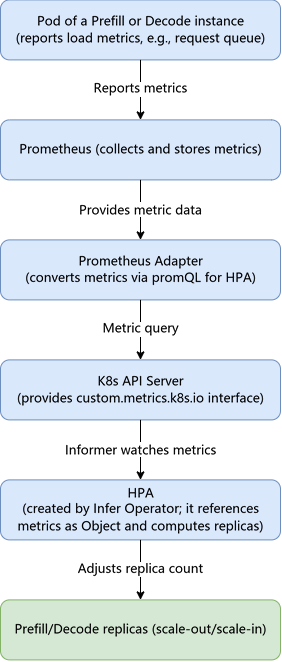
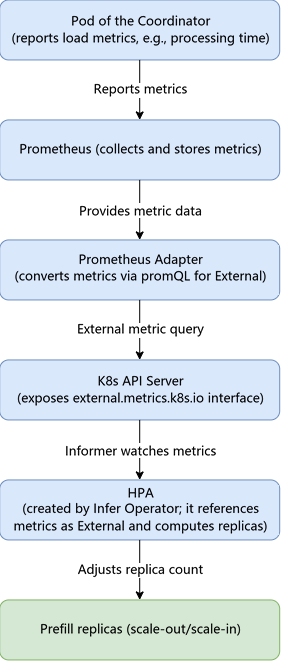

# Configuring Load-Based Elastic Scaling

Infer Operator supports configuring elastic scaling policies for inference instances, enabling automatic adjustment of the number of inference instances based on their load.

> [!NOTE]
> Currently, the elastic scaling function is supported only in MindIE scenarios. That is, only inference instances [deployed based on MindIE PyMotor](./02_deploying_infer_operator_inference_job_with_mindie_pymotor.md)
> Deployed inference instances support elastic scaling configuration.

## Prerequisites

- Infer Operator has been [installed and deployed](../../03_installation_guide/02_installation/00_helm_installation.md).
- The inference job must be deployed based on MindIE
  PyMotor. For the deployment method, see [Deploying Infer Operator Inference Jobs Based on MindIE PyMotor](./02_deploying_infer_operator_inference_job_with_mindie_pymotor.md).
- To configure scaling metrics, you need to build an elastic scaling base environment based on Prometheus
Adapter. For details about the deployment method and configuration example, see the [Building the Elastic Scaling Base Environment](#building-the-elastic-scaling-base-environment-based-on-prometheus-adapter)
section.

> [!NOTE]
> If faults occur, automatic or manual elastic scaling is not supported. Before elastic scaling starts, you must ensure that all instances are in the `Running` state.

## Elastic Scaling Principles

Based on the elastic scaling configuration of an inference instance, Infer Operator creates the corresponding scaling controller resources (for example, Horizontal Pod
Autoscaler (HPA)) for that instance. The scaling controller then automatically adjusts the desired replica count of the instance according to its load conditions.

For elastic scaling based on Prometheus Adapter, service instances report load metrics to Prometheus, and Prometheus
Adapter converts the metrics into metrics that HPA can recognize through promQL. HPA calculates the desired replica count based on the metrics and applies it to the replica count of service instances. The HPA metric type varies depending on the metric source: metrics reported by Prefill or Decode instances correspond to the Object metric type, as shown in [Figure 1](#fig1)
; metrics reported by the Coordinator correspond to the External metric type, as shown in [Figure 2](#fig2).

<a id="fig1"></a>

**Figure 1** Elastic scaling principle for metrics reported by Prefill or Decode instances (metric type: Object)



Figure 1 is described as follows:

1. In the Pod of a Prefill or Decode instance, load metrics (for example, request queue length) are reported to Prometheus through NPU Exporter or other metric collection components.
2. Prometheus collects and stores the metrics reported by service instances.
3. Prometheus Adapter converts the metrics queried from Prometheus into metrics that HPA can recognize through the configured promQL rules, and registers them with the `custom.metrics.k8s.io` interface of the K8s API Server.
4. HPA references the metrics reported by Prefill or Decode instances (Pods) as the Object type, monitors metric changes through the Informer, and periodically calculates the desired replica count.
5. HPA writes the desired replica count to the replicas field of the workload of the Prefill or Decode instance, implementing scale-out and scale-in of Prefill or Decode instances.

<a id="fig2"></a>

**Figure 2** Elastic scaling principle for metrics reported by the Coordinator (metric type: External)



Figure 2 is described as follows:

1. The Pod of the Coordinator reports load metrics (for example, request processing time) to Prometheus through NPU-Exporter or other metric collection components.
2. After the metrics are collected and stored by Prometheus, converted by the promQL rules of Prometheus Adapter, and registered with the K8s API Server,
HPA references the metrics as the External type, monitors metric changes through the Informer, calculates the desired replica count, and finally applies it to the replica count of Prefill instances, implementing scale-out and scale-in of Prefill instances.

Compared with Figure 1, the metrics in Figure 2 come from the Coordinator instance rather than Prefill or Decode instances, and the metric type is External (the metric type reported by Prefill or Decode instances in Figure 1 is Object). The Coordinator reporting scenario applies to scenarios where the load observed by the Coordinator (for example, the request volume in a PD-disaggregated scenario) is used as the basis for decision-making to adjust the number of Prefill instances. The subsequent links of the two (Prometheus →
Prometheus Adapter → K8s API Server → HPA Informer → replica count adjustment) are exactly the same.

## Building the Elastic Scaling Base Environment (Based on Prometheus Adapter)

The elastic scaling base environment based on Prometheus Adapter consists of the following components.

| Component                                                               | Description                                                                                                                                                                                                                                                                      |
|-------------------------------------------------------------------------|----------------------------------------------------------------------------------------------------------------------------------------------------------------------------------------------------------------------------------------------------------------------------------|
| Service instance (Prefill instance, Decode instance, Coordinator, etc.) | A service Pod in an inference job. It reports load metrics (for example, request queue length and request processing time) to Prometheus through NPU Exporter or other metric collection components.                                                                             |
| Prometheus                                                              | Collects and stores the load metrics reported by service instances.                                                                                                                                                                                                              |
| Prometheus Adapter                                                      | Converts the metrics in Prometheus into metrics that HPA can recognize through promQL rules, and registers them with the custom.metrics.k8s.io interface (for the Object metric type) or external.metrics.k8s.io interface (for the External metric type) of the K8s API Server. |
| Infer Operator                                                          | Automatically creates and manages HPA based on the scalingPolicy configuration.                                                                                                                                                                                                  |
| HPA                                                                     | Queries Object/External metrics, calculates the desired replica count, and adjusts the replica count of service instances. HPA is automatically created and managed by Infer Operator based on the scalingPolicy configuration of the job.                                       |

Steps for building the base environment:

1. **Deploy service instances and report metrics**: Service instances must report load metrics in Prometheus format to Prometheus.
2. **Deploy Prometheus**:
   Prometheus is used to collect and store the load metrics reported by service instances. For details about the deployment and configuration method of Prometheus, see [Using with Prometheus](../01_resource_monitoring/00_npu_resource_monitoring/02_working_with_prometheus.md).

   If the metrics reported by MindIE are not successfully collected by Prometheus, you can add Prometheus service discovery annotations to the `mindie-motor-coordinator-obs` service. After the annotations are added, Prometheus automatically scrapes the endpoints of the service (MindIE) through Kubernetes service discovery (`kubernetes_sd_configs`), thereby successfully obtaining the metrics. Example annotations are as follows:

   ```yaml
   metadata:
     annotations:
       prometheus.io/scrape: "true" # Enables Prometheus to scrape the endpoints of the service
       prometheus.io/path: "/metrics" # Specifies the metric scraping path
       prometheus.io/port: "<metrics_port>" # Specifies the metric scraping port, which must be the port through which the mindie-motor-coordinator-obs service exposes metrics
   ```

3. **Deploy Prometheus Adapter**: Complete the deployment according to the installation and deployment guide on the [official website of Prometheus Adapter](https://github.com/kubernetes-sigs/prometheus-adapter)
   (you can use the Helm Chart `prometheus-community/prometheus-adapter` it provides for deployment), and configure promQL rules
   to convert the metric query results in Prometheus into metrics that HPA can recognize, and register them with the `custom.metrics.k8s.io` interface (for the Object metric type)
   or `external.metrics.k8s.io` interface (for the External metric type) of the K8s API Server for HPA to query. Note the following during deployment:
    - Configure `--prometheus-url` as the access address of the actual Prometheus service.
    - Ensure that Prometheus Adapter provides the preceding interfaces externally so that HPA can query metrics.
      For a configuration example of promQL rules, see [Prometheus Adapter Configuration Example](#prometheus-adapter-configuration-example) below.
4. **Verify that the metrics are available**: Query the `custom.metrics.k8s.io` or `external.metrics.k8s.io` interface through kubectl to confirm that the target metrics can be queried. For example, run the
   `kubectl get --raw "/apis/external.metrics.k8s.io/v1beta1/namespaces/<namespace>/<metric-name>"` command to view the External metric query result.

### Prometheus Adapter Configuration Example

The following uses the service metrics `num_requests_waiting` and `generation_tokens_per_second` as examples to provide a configuration example of Prometheus
Adapter. You can customize promQL rules based on actual service metrics and trigger rules. For the deployment method of Prometheus
Adapter, see the [Building the Elastic Scaling Base Environment](#building-the-elastic-scaling-base-environment-based-on-prometheus-adapter) section above.

**1. Creating Prometheus Adapter Configurations (ConfigMap)**

Define promQL rules through `config.yaml` in the ConfigMap to convert the metrics in Prometheus into metrics that HPA can recognize. The metrics defined under `rules`
are registered with the `custom.metrics.k8s.io` interface for HPA to reference as the Object type (corresponding to the scenario where Prefill or Decode instances report metrics); the metrics defined under `externalRules`
are registered with the `external.metrics.k8s.io` interface for HPA to reference as the External type (corresponding to the scenario where the Coordinator reports metrics). An example is as follows.

```yaml
apiVersion: v1 # K8s API version
kind: ConfigMap # Resource type: ConfigMap
metadata: # Metadata
  name: prometheus-adapter # ConfigMap name
  namespace: monitoring # Namespace
data: # Configuration data
  config.yaml: | # Content of the Prometheus Adapter configuration file
    rules: # Rule list. Registers metrics with the custom.metrics.k8s.io interface for HPA to reference as the Object type (corresponding to the scenario where Prefill or Decode instances report metrics)
    # Rule 1: Expose the num_requests_waiting metric directly as a metric with the same name
    - seriesQuery: '{__name__=~"vllm:num_requests_waiting"}' # Matches the metric series in Prometheus. __name__ specifies the metric to query from Prometheus.
      resources: # Mapping configuration between metrics and K8s resources, used to associate metrics with K8s resources
        overrides: # Override rules for the mapping between metric labels and K8s resources
          kubernetes_namespace: {resource: "namespace"} # Map the namespace label in the metric to the K8s namespace resource
          kubernetes_pod_name: {resource: "pod"} # Map the Pod name label in the metric to the K8s pod resource
      name: # Configuration of the externally exposed metric name
        matches: "^(.*)$" # Regular expression used to match the original metric name
        as: "vllm_num_requests_waiting" # Converted metric name
      metricsQuery: 'vllm:num_requests_waiting{<<.LabelMatchers>>}' # promQL statement executed when exposing the metric externally
    externalRules: # Rule list. Registers metrics with the external.metrics.k8s.io interface for HPA to reference as the External type (corresponding to the scenario where the Coordinator reports metrics)
    # Rule 2: Add num_requests_waiting and num_requests_running, and expose the result as the vllm_total_requests metric
    - seriesQuery: '{__name__=~"vllm:(num_requests_waiting|num_requests_running)"}' # Matches the metric series in Prometheus. __name__ specifies the metric to query from Prometheus.
      resources: # Mapping configuration between metrics and K8s resources, used to associate metrics with K8s resources
        overrides: # Override rules for the mapping between metric labels and K8s resources
          kubernetes_namespace: {resource: "namespace"} # Map the namespace label in the metric to the K8s namespace resource
          kubernetes_pod_name: {resource: "pod"} # Map the Pod name label in the metric to the K8s pod resource
      name: # Configuration of the externally exposed metric name
        matches: "^.*$" # Regular expression used to match the original metric name
        as: "vllm_total_requests" # Converted metric name
      metricsQuery: | # promQL statement executed when exposing the metric externally. You can modify it to implement complex trigger rules such as metric addition, multiplication, and time window average
        sum(
          vllm:num_requests_waiting{<<.LabelMatchers>>}
          +
          vllm:num_requests_running{<<.LabelMatchers>>}
        ) by (namespace, pod)
```

`seriesQuery` is used to match the metric series in Prometheus, and `metricsQuery` is the promQL statement executed when exposing the metric externally. By modifying
`metricsQuery`, you can implement complex trigger rules such as metric addition, metric multiplication, and time window average (for example, `avg_over_time`).

**2. Example of HPA referencing metrics**

After Prometheus Adapter converts Prometheus metrics into metrics that HPA can recognize, HPA references the metrics through `type: Object` (metrics reported by Prefill or Decode instances) or `type: External`
(metrics reported by the Coordinator). `metric.name` must be consistent with the metric name exposed by Prometheus Adapter.

In the scenario where Prefill or Decode instances report metrics, HPA references the metrics as `type: Object`. Example:

```yaml
metrics: # HPA scaling metric configuration list
  - type: Object # Metric type: object metric (metric reported by Prefill or Decode instances)
    object:
      describedObject: # Object to which the metric belongs
        kind: Pod # Object type. In this example, it is the Pod of a Prefill or Decode instance.
        name: my-test-prefill-0 # Object name (example value)
      metric:
        name: vllm_num_requests_waiting # Must be consistent with the metric name exposed by Prometheus Adapter
      target: # Target value configuration. HPA determines whether to trigger scaling based on this target value.
        type: Value # Target value type. Currently, Utilization, Value, and AverageValue are supported.
        value: "5" # Target value. Scale-out is triggered when the metric value exceeds this value.
```

In the scenario where the Coordinator reports metrics, HPA references the metrics as `type: External`. Example:

```yaml
metrics:
  - type: External # Metric type: external custom metric (metric reported by the Coordinator)
    external:
      metric:
        name: vllm_total_requests # Must be consistent with the External metric name exposed by Prometheus Adapter
      target: # Target value configuration. HPA determines whether to trigger scaling based on this target value.
        type: AverageValue # Target value type. Currently, Utilization, Value, and AverageValue are supported.
        averageValue: "10" # Target average value. Scale-out is triggered when the average metric value exceeds this value.
```

The correspondence between service instances, metric types, and HPA references is shown in the following table.

| Service Instance | Prometheus Adapter Configuration                                 | Metric Registration Interface | HPA Metric Type | HPA Reference        |
|------------------------------------|------------------------------------------------------------------|-------------------------------|-----------------|----------------------|
| Prefill or Decode instance         | rules (promQL: direct exposure/add/multiply/time window average) | custom.metrics.k8s.io         | Object          | object.metric.name   |
| Coordinator                        | externalRules (promQL)                                           | external.metrics.k8s.io       | External        | external.metric.name |

After the preceding steps are complete, you can configure the HPA metrics in the example as shown in the [Configuring the Elastic Scaling Policy](#configuring-the-elastic-scaling-policy) section. This example uses the `type: External`
type to configure scaling metrics. According to the elastic scaling principle, metrics reported by Prefill or Decode instances correspond to `type: Object`, and metrics reported by the Coordinator correspond to `type: External`
. The metric name must be consistent with the metric exposed by Prometheus Adapter.

## Configuring the Elastic Scaling Policy

The following example shows how to configure an elastic scaling policy for an inference instance. You need to add the configuration in bold. For inference jobs deployed based on MindIE
PyMotor, only the Coordinator instance reports load metrics while Prefill and Decode instances do not report metrics, and HPA scaling metrics can be expressed only in the External type (obtained from the metrics reported by the Coordinator after conversion by Prometheus
Adapter).

<pre codetype="yaml">
apiVersion: mindcluster.huawei.com/v1
kind: InferServiceSet
metadata:
  name: "my-test"
  namespace: default
spec:
  replicas: 1 # Replica count of the inference service
  template:
    roles:
    - name: prefill # Prefill definition
      replicas: 1   # Replica count of prefill
      workload:     # CRD type information of the instance in prefill
        apiVersion: apps/v1
        kind: StatefulSet # Workload type. Currently, StatefulSet and Deployment are supported.
      <strong>scalingPolicy:</strong>
        <strong>type: HPA # Elastic scaling policy type. Currently, only HPA is supported.</strong>
        <strong>spec: # HPA configuration</strong>
          <strong>minReplicas: 1 # Minimum replicas for scale-in</strong>
          <strong>maxReplicas: 4 # Maximum replicas for scale-out</strong>
          <strong>metrics: # List of HPA scaling metric configurations</strong>
          <strong>- type: External # Metric type: external custom metric</strong>
            <strong>external:</strong>
              <strong>metric:</strong>
                <strong>name: vllm_num_requests_waiting # External metric name</strong>
                <strong>selector: # Optional: external metric selector, used to limit the metric scope. For descriptions of related configuration items, see the HPA-related configuration in YAML Parameter Description.</strong>
                  <strong>matchLabels: # Optional: metric matching labels in the Prometheus Adapter format. Dots (.) in label names must be replaced with underscores (_).</strong>
                    <strong>infer_huawei_com_inferservice_name: my-test-0 # Optional: inference service name label, which corresponds to infer.huawei.com/inferservice-name. The example value is my-test-0.</strong>
                    <strong>kubernetes_namespace: default # Optional: namespace label, which limits the namespace to which the metric belongs.</strong>
              <strong>target: # Target value configuration. HPA determines whether to trigger scaling based on this target value.</strong>
                <strong>type: AverageValue # Target value type. Currently, Utilization, Value, and AverageValue are supported.</strong>
                <strong>averageValue: "5" # Target average value. Scale-out is triggered when the average metric value exceeds this value.</strong>
          <strong>... # Other HPA configuration items. Add them as needed and ensure they comply with the HPA configuration specifications.</strong>
      metadata:
        labels:
          infer.huawei.com/gang-schedule: 'false' # Disable gang scheduling. When enabled, a PodGroup is created for each workload instance.
      spec:
        replicas: 1 # Number of pod replicas of the workload in prefill
        podManagementPolicy: Parallel # This configuration is optional. When the workload is a StatefulSet and infer.huawei.com/gang-schedule is true, set this to Parallel.
        selector:
          matchLabels:
            app: test-prefill # User-defined. Must be consistent with the app configuration in labels below.
        template:
          metadata:
            labels:
              app: test-prefill # User-defined. Must be consistent with the app configuration in labels below.
              fault-scheduling: 'grace' # Enable rescheduling
              fault-retry-times: '10'
              ring-controller.atlas: ascend-910b # Product type identifier
            annotations:
              huawei.com/schedule_policy: chip8-node8 # Set based on the hardware form
          spec:
            schedulerName: volcano # Specify Volcano as the scheduler
            nodeSelector:
              example-key: example-value    # Example value. You can configure nodeSelector based on your scheduling intent.
            containers:
            - name: prefill
              image: vllm-ascend:xxx # Custom vllm image name
              ...
              resources:
                requests:
                  huawei.com/Ascend910: 8
                limits:
                  huawei.com/Ascend910: 8
              ... # Necessary mount items and run commands for the supplementary container
    - name: decode  # decode definition
      replicas: 1   # decode replica count
      workload:     # CRD type information of the instance in decode
        apiVersion: apps/v1
        kind: StatefulSet # Workload type. StatefulSet/Deployment is currently supported
      <strong>scalingPolicy:</strong>
        <strong>type: HPA # Elastic scaling policy type. HPA is currently supported</strong>
        <strong>spec: # HPA configuration</strong>
          <strong>minReplicas: 1 # Minimum replicas for scale-in</strong>
          <strong>maxReplicas: 4 # Maximum replicas for scale-out</strong>
          <strong>metrics: # HPA scaling metric configuration list</strong>
          <strong>- type: External # Metric type: external custom metric</strong>
            <strong>external:</strong>
              <strong>metric:</strong>
                <strong>name: vllm_total_requests # External metric name</strong>
                <strong>selector: # Optional: external metric selector, used to limit the metric scope. For descriptions of related configuration items, see the HPA-related configuration in YAML Parameter Description.</strong>
                  <strong>matchLabels: # Optional: metric matching labels in the Prometheus Adapter format. Dots (.) in label names must be replaced with underscores (_).</strong>
                    <strong>infer_huawei_com_inferservice_name: my-test-0 # Optional: inference service name label, which corresponds to infer.huawei.com/inferservice-name. The example value is my-test-0.</strong>
                    <strong>kubernetes_namespace: default # Optional: namespace label, which limits the namespace to which the metric belongs.</strong>
              <strong>target: # Target value configuration. HPA determines whether to trigger scaling based on this target value.</strong>
                <strong>type: AverageValue # Target value type. Currently, Utilization, Value, and AverageValue are supported.</strong>
                <strong>averageValue: "10" # Target average value. Scale-out is triggered when the average metric value exceeds this value.</strong>
          <strong>... # Other HPA configuration items, added as needed and compliant with the HPA configuration specification</strong>
      metadata:
        labels:
          infer.huawei.com/gang-schedule: 'false' # Disable gang scheduling. When enabled, a PodGroup is created for each workload instance
      spec:
        replicas: 1 # Pod replica count of the workload in decode
        podManagementPolicy: Parallel # This configuration is optional. When the workload is a StatefulSet and infer.huawei.com/gang-schedule is true, it must be set to Parallel
        selector:
          matchLabels:
            app: test-decode # User-defined. Must maintain configuration consistency with the app in labels below
        template:
          metadata:
            labels:
              app: test-decode # User-defined. Must maintain configuration consistency with the app in labels below
              fault-scheduling: 'grace' # Enable rescheduling
              fault-retry-times: '10'
              ring-controller.atlas: ascend-910b # Identifies the product type
            annotations:
              huawei.com/schedule_policy: chip8-node8 # Set according to the hardware form
          spec:
            schedulerName: volcano # Specify Volcano as the scheduler
            containers:
            - name: decode
              image: vllm-ascend:xxx # Custom vllm image name
              ...
              resources:
                requests:
                  huawei.com/Ascend910: 8
                limits:
                  huawei.com/Ascend910: 8
              ... # Supplementary container's required mount items and run commands
    - name: router  # router definition
      replicas: 1   # router replica count
      services:     # router services definition. A service defined here is created only once within a role
      - name: vllm-router-service
        spec:
          ports:    # service port definition
          - port: 1026
            protocol: TCP
            targetPort: 1026
          selector:
            app: test-router # User-defined; must maintain configuration consistency with the app in the labels below
          type: ClusterIP
      workload:     # CRD type information of the instance in the router
        apiVersion: apps/v1
        kind: Deployment # Workload type; StatefulSet/Deployment are currently supported
      spec:
        replicas: 1 # Replica count of the workload pods in the router
        selector:
          matchLabels:
            app: test-router # User-defined; must maintain configuration consistency with the app in the labels below
        template:
          metadata:
            labels:
              app: test-router # User-defined; must maintain configuration consistency with the app in the labels below
          spec:
            schedulerName: volcano # Specify Volcano as the scheduler
            containers:
            - name: router
              image: xxx:yyy # Custom image name
              ... # Add the necessary mount items and run commands for the supplementary container
</pre>

> [!NOTE]
>
>- This feature supports Kubernetes 1.23 and later.
