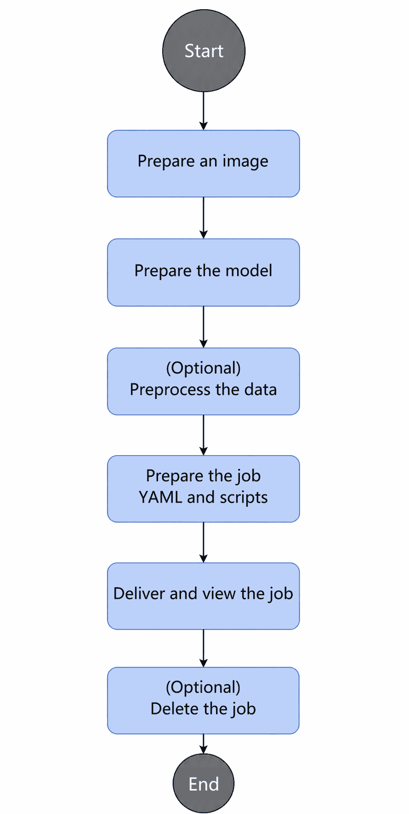

# Deploying a verl Reinforcement Learning Job

## Working Principle

1. Cluster scheduling components periodically report node and chip information.
    - kubelet reports the number of node chips to the node object (Node).
    - Ascend Device Plugin reports chip topology and full-NPU information: it reports chip physical IDs to `device-info-cm`, and reports the total number of allocatable chips, the number of allocated chips, and basic chip information (device ip and super\_device\_ip) to Node for full-NPU scheduling.
    - When a node is faulty, NodeD periodically reports the node health status and hardware fault information to `node-info-cm`. Shared storage faults are reported to the public faults of ClusterD.
2. ClusterD reads `device-info-cm`, `node-info-cm`, and public fault information and consolidates them into `cluster-info-cm`.
3. The user delivers a reinforcement learning job of the verl framework through kubectl or another deep learning platform. Ascend Operator generates master and worker Pods based on the job definition.
4. Ascend Operator creates a PodGroup for the job.
5. volcano-scheduler selects nodes for Pods based on the number of node NPUs, available chips, topology, labels, and affinity, and writes the allocated chip information to the Pod annotation.
6. When kubelet creates a container, it calls Ascend Device Plugin to mount the NPU, and Ascend Docker Runtime helps mount the device into the container.
7. Master and worker containers run the startup script, which initializes the Ray cluster and creates ray head and worker nodes, so that the verl framework can identify available resources based on Ray.
8. After the total number of NPUs in the Ray cluster reaches the resources required by the job, the training script automatically submits the verl job through `ray job submit` to start training.

## Using via Command Line

### Prerequisites

- Ensure that the required MindCluster components have been installed on NPU nodes in the Kubernetes cluster.
- Ensure that the NPUs, drivers, and firmware of the nodes are running properly.
- The verl image, model, and dataset have been prepared.
- The following directories (user-defined) have been created on the host: `/home/models`, `/home/dataset`, `/home/data`, `/home/checkpoints`, and `/home/logs`.

### Process Description

When you use MindCluster cluster scheduling components to deploy a verl reinforcement learning job through the command line, the process is as follows.



### Procedure

1. Prepare an image.

    This example provides an out-of-the-box sample image `verl-sample:v26.2.0-fault-recover-cann9.0.0-torch_npu2.9.0.post2-910b-ubuntu22.04-py3.11-vllm`. You can also build an image as needed, or obtain base images with other version configurations from [ascend/verl·Quay](https://quay.io/repository/ascend/verl?tab=tags&tag=latest). This sample image can be downloaded from AscendHub.

    This sample image is built based on the following official community base image. The image already contains necessary environment dependencies such as verl, Ray, torch, CANN, and vLLM, and integrates `fault_recover` from `verl-ascend-recipe`, providing the capabilities of worker group rebuilding and token-level continuation after a fault occurs.

    ```text
    quay.io/ascend/verl:v0.8.0-cann9.0.0-torch_npu2.9.0.post2-910b-ubuntu22.04-py3.11-vllm
    ```

2. Prepare the model.

    The model weights must be downloaded from Hugging Face or another platform by yourself. This example uses the [Qwen3-32B model](https://www.modelscope.cn/models/Qwen/Qwen3-32B).

    You can customize the storage path, but you need to modify the mount directory in the YAML file accordingly.

3. (Optional) Preprocess the data.

    This example is based on the raw gsm8k dataset (you can download it from [gsm8k·Dataset](https://www.modelscope.cn/datasets/openai-mirror/gsm8k/files/)) and requires preprocessing. If data processing has been completed, you can skip this step, but make sure that the data path is correct.

    Place the dataset in the corresponding directory, run the following command, and pay attention to the default output directory.

    ```shell
    python3 examples/data_preprocess/gsm8k.py --local_dataset_path /data/dataset/gsm8k/
    ```

4. Prepare the job YAML and scripts.

    The files to be prepared or modified are as follows. You can obtain the basic example files from the [example repository](https://gitcode.com/Ascend/mindcluster-deploy/tree/master/samples/train/resumable-training/fault-tolerance/without-ranktable/pytorch/verl/grpo) and then customize them based on the actual scenario.

    **Table 1** File description

    | File | Function |
    | --- | --- |
    | `verl-grpo-910b.yaml` | verl job definition |
    | `start_grpo.sh` | Container startup script, which initializes the Ray cluster and starts the training job |
    | `run_grpo_qwen3_32b_a3b_megatron.sh` | Training startup script, which submits the verl job through `ray job submit` |

    You deliver the job through `verl-grpo-910b.yaml`. The YAML is configured so that after the Pods are started, `start_grpo.sh` is called to initialize the Ray cluster, and when the cluster resources meet the job requirements, `run_grpo_qwen3_32b_a3b_megatron.sh` is called to start the verl job.

    The sample image has integrated the usable `start_grpo.sh` and `run_grpo_qwen3_32b_a3b_megatron.sh` in the `/verl` directory of the container, which are used to start a GRPO reinforcement learning job of the single-node Qwen3-32B model in an A2 scenario. You can customize and modify the scripts as needed.

    **verl-grpo-910b.yaml Example**

    ```yaml
    apiVersion: mindxdl.gitee.com/v1
    kind: AscendJob
    metadata:
      name: mindspeed-rl
      labels:
        framework: pytorch
        fault-scheduling: "force"                 # Must be force
        pod-rescheduling: "on"
        fault-retry-times: "100"
        ring-controller.atlas: ascend-910b
        subHealthyStrategy: "ignore"
      annotations:
        huawei.com/schedule_policy: "chip8-node8"   # Set the scheduling policy based on the hardware form
    spec:
      schedulerName: volcano
      runPolicy:
        schedulingPolicy:
          minAvailable: 2
          queue: default
        ttlSecondsAfterFinished: 30    # Automatically clean up Job resources after the job is complete
      successPolicy: AllWorkers
      replicaSpecs:
        Master:
          replicas: 1                             # Master must be force 1
          restartPolicy: Never                    # Must be Never
          template:
            metadata:
              labels:
                ring-controller.atlas: ascend-910b
              annotations:
                huawei.com/skip-ascend-plugin: enabled
            spec:
              terminationGracePeriodSeconds: 0
              automountServiceAccountToken: false
              hostNetwork: false
              containers:
                - name: ascend                    # Cannot modify
                  # Image name. Modify according to actual situation
                  image: verl-sample:v26.2.0-fault-recover-cann9.0.0-torch_npu2.9.0.post2-910b-ubuntu22.04-py3.11-vllm
                  imagePullPolicy: IfNotPresent
                  securityContext:
                    privileged: true
                  command:
                    - /bin/bash
                    - -c
                  # args. Modify according to actual situation
                  args:
                    - |
                      cd /verl; bash start_grpo.sh;
                  env:
                    - name: PYTHONPATH
                      value: "/vllm"
                  ports:
                    - containerPort: 6666         # Modify according to actual situation
                      name: ray-port
                    - containerPort: 8888         # Modify according to actual situation
                      name: ray-dash-port
                  volumeMounts:
                    - name: ascend-driver
                      mountPath: /usr/local/Ascend/driver
                    - name: dshm
                      mountPath: /dev/shm
                    - name: localtime
                      mountPath: /etc/localtime
                    - name: dataset
                      mountPath: /data/dataset
                    - name: data-processed
                      mountPath: /root/data
                    - name: checkpoints
                      mountPath: /data/ckpt/Qwen3-32B-save/
                    - name: models
                      mountPath: /data/models
                    - name: logs
                      mountPath: /data/logs
              volumes:
                - name: ascend-driver
                  hostPath:
                    path: /usr/local/Ascend/driver
                - name: dshm
                  emptyDir:
                    medium: Memory
                - name: localtime
                  hostPath:
                    path: /etc/localtime
                - name: dataset
                  hostPath:
                    path: /home/dataset
                - name: data-processed
                  hostPath:
                    path: /home/data
                - name: checkpoints
                  hostPath:
                    path: /home/checkpoints
                - name: models
                  hostPath:
                    path: /home/models/Qwen
                - name: logs
                  hostPath:
                    path: /home/logs

        Worker:
          replicas: 1
          restartPolicy: Never
          template:
            metadata:
              labels:
                ring-controller.atlas: ascend-910b
            spec:
              terminationGracePeriodSeconds: 0
              automountServiceAccountToken: false
              hostNetwork: false
              containers:
                - name: ascend                    # Cannot modify
                  # Image name. Modify according to actual situation
                  image: verl-sample:v26.2.0-fault-recover-cann9.0.0-torch_npu2.9.0.post2-910b-ubuntu22.04-py3.11-vllm
                  imagePullPolicy: IfNotPresent
                  command:
                    - /bin/bash
                    - -c
                  args:                           # Modify according to actual situation
                    - |
                      cd /verl; bash start_grpo.sh;
                  env:
                    - name: PYTHONPATH
                      value: "/vllm"
                  resources:
                    limits:
                      huawei.com/Ascend910: 8
                    requests:
                      huawei.com/Ascend910: 8
                  volumeMounts:
                    - name: ascend-driver
                      mountPath: /usr/local/Ascend/driver
                    - name: dshm
                      mountPath: /dev/shm
                    - name: localtime
                      mountPath: /etc/localtime
                    - name: dataset
                      mountPath: /data/dataset
                    - name: data-processed
                      mountPath: /root/data
                    - name: checkpoints
                      mountPath: /data/ckpt/Qwen3-32B-save/
                    - name: models
                      mountPath: /data/models
                    - name: logs
                      mountPath: /data/logs

              volumes:
                - name: ascend-driver
                  hostPath:
                    path: /usr/local/Ascend/driver
                - name: dshm
                  emptyDir:
                    medium: Memory
                - name: localtime
                  hostPath:
                    path: /etc/localtime
                - name: dataset
                  hostPath:
                    path: /home/dataset
                - name: data-processed
                  hostPath:
                    path: /home/data
                - name: checkpoints
                  hostPath:
                    path: /home/checkpoints
                - name: models
                  hostPath:
                    path: /home/models/Qwen
                - name: logs
                  hostPath:
                    path: /home/logs
    ```

    **Mount Relationships**

    The current mount relationships of `verl-grpo-910b.yaml` are as follows. You can modify them based on the actual situation.

    **Table 2** Mount relationships

    | Host Path | Container Path | Description |
    | --- | --- | --- |
    | `/home/models` | `/data/models` | Model |
    | `/home/dataset` | `/data/dataset` | Raw dataset |
    | `/home/data` | `/root/data` | Preprocessed data |
    | `/home/checkpoints` | `/data/ckpt/Qwen3-32B-save/` | Checkpoint path |
    | `/home/logs` | `/data/logs` | Logs |
    | `/usr/local/Ascend/driver` | `/usr/local/Ascend/driver` | NPU driver |

    **Other Key Parameters**

    **Table 3** verl-grpo-910b.yaml parameters

    | Parameter | Example Value | Description |
    | --- | --- | --- |
    | `metadata.name` | `mindspeed-rl` | Job name, which determines the Pod name prefix |
    | `huawei.com/schedule_policy` | `chip8-node8` | Scheduling policy, which is set based on the hardware form |
    | `image` | `verl-sample:v26.2.0-fault-recover-cann9.0.0-torch_npu2.9.0.post2-910b-ubuntu22.04-py3.11-vllm` | Training image |
    | `minAvailable` | `2` | Minimum number of schedulable replicas for gang scheduling |
    | `ttlSecondsAfterFinished` | `30` | Automatically clean up job resources after the job is complete |
    | `Master.replicas` | `1` | Number of master replicas, which must be 1 |
    | `Worker.replicas` | `1` | Number of worker replicas |
    | `Worker.resources` | `huawei.com/Ascend910: 8` | Number of NPUs requested by worker |
    | `Master.resources` | None | Number of NPUs requested by master. Configure this parameter if master participates in training. |
    | `ray-port` | `6666` | Ray Head GCS port |
    | `ray-dash-port` | `8888` | Ray Dashboard port |
    | `hostNetwork` | `false` | Whether to use the host network |

    **Table 4** start_grpo.sh parameters

    | Variable | Example Value | Description |
    | --- | --- | --- |
    | `TP_SOCKET_IFNAME` | `data0.173` | NIC used to obtain the local IP address |
    | `HCCL_SOCKET_IFNAME` | `data0.173` | HCCL communication NIC |
    | `GLOO_SOCKET_IFNAME` | `data0.173` | GLOO communication NIC |
    | `ServerPort` | `6666` | Ray Head port |
    | `DashboardPort` | `8888` | Ray Dashboard port |
    | `HCCL_HOST_SOCKET_PORT_RANGE` | `60000-60050` | Communication port range used by HCCL on the host side |
    | `HCCL_NPU_SOCKET_PORT_RANGE` | `61000-61050` | Communication port range used by HCCL on the NPU side |
    | `path_log_dir` | `/data/logs/$MINDX_TASK_ID/trainlog` | Training log directory |
    | `NPU_PER_NODE` | `8` | Number of NPUs per node, which is automatically calculated by the script based on `LOCAL_WORLD_SIZE` |
    | `NNODES` | `2` | Number of nodes, which is automatically calculated by the script based on `WORLD_SIZE / LOCAL_WORLD_SIZE` |

    The following variables are injected by MindCluster:

    - `REPLICA_TYPE`: Master or worker
    - `MASTER_ADDR`: Address of the master node
    - `WORLD_SIZE`: Total number of chips
    - `LOCAL_WORLD_SIZE`: Number of chips per node
    - `MINDX_TASK_ID`: Task ID

    **Table 5** run_grpo_qwen3_32b_a3b_megatron.sh parameters

    | Parameter | Example Value | Description |
    | --- | --- | --- |
    | `MODEL_PATH` | `/data/models/Qwen3-32B` | Model path |
    | `CKPTS_DIR` | `/data/ckpt/Qwen3-32B-save/` | Checkpoint output directory |
    | `TRAIN_FILE` | `/data/datasets/gsm8k-new/train.parquet` | Training parquet path |
    | `TEST_FILE` | `/data/datasets/gsm8k-new/test.parquet` | Test parquet path |
    | `train_tp` | `8` | Tensor parallelism |
    | `train_pp` | `1` | Pipeline parallelism |
    | `gen_tp` | `16` | vLLM tensor parallelism |
    | `trainer.n_gpus_per_node` | `8` | Number of NPUs per node |
    | `trainer.nnodes` | `2` | Number of nodes |
    | `trainer.save_freq` | `1` | Checkpoint saving frequency |
    | `trainer.total_training_steps` | `6` | Total number of training steps |

    The preceding parameters must be modified by users based on the actual job situation.

5. Deliver and view the job.

    1. Deliver the job.

        ```shell
        kubectl apply -f verl-grpo-910b.yaml
        ```

    2. Check the Pod status.

        ```shell
        kubectl get pod -n <namespace>
        ```

        Confirm that all Pods are in the `Running` state. After the container is started, the training script is automatically executed and the Ray Job is submitted.

        ```ColdFusion
        NAMESPACE   NAME                          READY   STATUS    RESTARTS   AGE
        default     verl-test-master-0            1/1     Running   0          <time>
        default     verl-test-worker-0            1/1     Running   0          <time>
        ```

    3. View container logs.

        ```shell
        kubectl logs mindspeed-rl-master-0 -f
        kubectl logs mindspeed-rl-worker-0 -f
        ```

    4. (Optional) Access the container and manually run the training startup script.

        ```shell
        bash run_grpo_qwen3_32b_a3b_megatron.sh
        ```

    5. (Optional) View the training result.

        ```shell
        ls /home/checkpoints/
        ls /home/logs/
        ```

        Training starts normally when `finished requests num: 0` appears in the training logs.

6. (Optional) Delete the job.

      ```shell
      kubectl delete -f verl-grpo-910b.yaml
      ```
