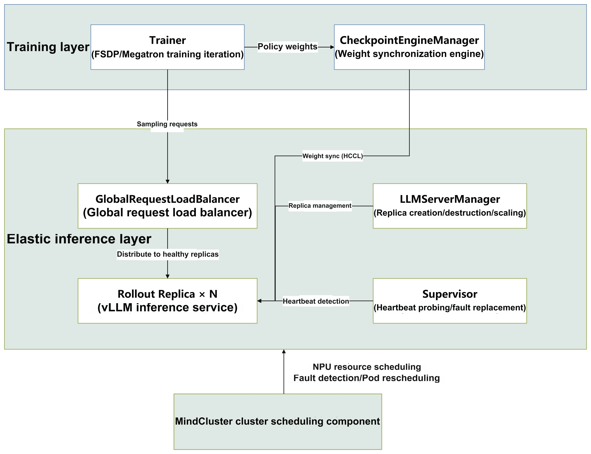

# Configuring verl Elastic Inference Fault Tolerance

## Application Scenarios

Reinforcement learning (RL) training jobs are usually completed alternately and collaboratively by two roles: training (Trainer) and inference sampling (Rollout), and a job cycle can last from several hours to several days. As the cluster scale grows, hardware and software faults occur frequently. Currently, RL jobs have the following pain points:

- **Excessively coarse fault recovery granularity**: After any Pod becomes faulty, job-level rescheduling is usually used to stop and restart all training containers, and the recovery time deteriorates super-linearly with the job scale.
- **Easily lost inference sampling results**: When a fault occurs, all tokens already generated for the prompt being inferred are discarded, and they must be regenerated from scratch after fault recovery, wasting a large amount of inference computing power.
- **Amplified fault domain caused by training-inference coupling**: When training and inference are deployed on the same NPU resources (colocated mode), software jitter on the inference side (such as a vLLM process hang or inference service OOM) also triggers fault handling for the entire job, turning a fault that could have been avoided by retry into job-level rescheduling.

To solve the preceding problems, `verl-ascend-recipe` provides the [elastic inference fault tolerance](https://github.com/verl-project/verl-ascend-recipe/tree/main/rollout_elastic) feature, which separates inference sampling from the training process into an independent elastic inference layer and provides RAS capabilities for inference instance faults: vLLM process faults are self-healed at the service layer within seconds (request retry, replica replacement, and token continuation); inference Pod-level faults and NPU faults trigger Pod rescheduling to rebuild instances. Training is not interrupted throughout the process, and job-level rescheduling is not involved.

>[!NOTE]
>This feature is intended for **separated training and inference deployment** scenarios (inference uses independent NPU resources) and does not apply to synchronized colocated training and inference deployment.

## Key Features

|Feature| Description                                                                       |
|--|--------------------------------------------------------------------------|
|Execution mode| Provides two separated training and inference execution modes: fully-async and one-step-off. Generation overlaps with training to improve training efficiency.        |
|Prompt retry| When a single prompt inference request times out or fails, it automatically switches to another healthy inference replica and retries, without human intervention.                             |
|Token continuation| When an inference process becomes faulty, the tokens already generated are incrementally persisted to storage. After the replica recovers, generation continues from the checkpoint, and only the missing tail tokens are regenerated.                    |
|Elastic scaling| Inference replicas support runtime scale-out, scale-in, and fault replacement, and the training job is not interrupted throughout the process.                                           |
|Pod rescheduling (prerequisite)| When an inference Pod-level fault or NPU fault occurs, the MindCluster fault detection and Pod rescheduling capabilities are used to rebuild the inference instance without job-level rescheduling, complementing service-layer self-healing. |

## Overall Architecture

The elastic inference fault tolerance feature splits an RL job into a training layer and an elastic inference layer, which interact through a weight synchronization link and a sampling request link. The architecture is as follows:



The capabilities of each part are as follows:

1. **Trainer**: Executes RL training iterations based on Fully Sharded Data Parallel (FSDP) or Megatron, consumes the sampling batches returned by the inference layer, and synchronizes the latest policy weights to the inference layer through CheckpointEngineManager.
2. **CheckpointEngineManager (weight synchronization engine)**: Manages weight synchronization transactions from the training side to each inference replica (the HCCL communication domain is used in the Ascend environment) and supports dynamic member addition and removal and retry upon failure.
3. **LLMServerManager (inference replica manager)**: Creates and destroys inference replicas (vLLM Server) and performs elastic scaling.
4. **Rollout Replica**: An independently deployed vLLM inference service that handles prompt generation and can independently fail, be replaced, and be scaled.
5. **GlobalRequestLoadBalancer (global request load balancer)**: Distributes sampling requests to healthy replicas. After a faulty replica is marked, it no longer receives new requests.
6. **Supervisor**: Periodically probes each replica through heartbeats. After consecutive missed heartbeats reach the threshold, the replica is determined to be invalid, and isolation and replacement are triggered.
7. **MindCluster cluster scheduling components**: Responsible for NPU resource scheduling, fault detection and isolation, and Pod rescheduling and rebuilding after NPU faults and inference Pod-level faults (coordinated by components such as Ascend Device Plugin, NodeD, ClusterD, Volcano, and Ascend Operator).

## End-to-End Execution Process

The elastic inference fault tolerance feature works end to end with MindCluster cluster scheduling components. The overall process is as follows:

1. The user delivers an RL training job. Volcano performs gang scheduling and schedules training Pods and inference Pods to healthy NPU nodes.
2. After training Pods are started, the Ray cluster is initialized and the verl job is started. Inference replicas are started as standalone services and are in the `Pending` state, receiving no requests.
3. After the training layer completes the first weight synchronization, inference replicas are promoted and added to the load balancer to start receiving sampling requests.
4. Training and inference are executed in an overlapping manner: the inference layer continuously or ahead-of-time generates sampling batches, and the training layer consumes them asynchronously. Weights are synchronized to inference replicas at the period specified by `trigger_parameter_sync_step`.
5. When an inference instance becomes faulty (vLLM process fault, NPU fault, or inference Pod-level fault), the Supervisor, request layer, or scheduling layer detects the fault and performs instance-level recovery: incomplete prompts are retried on healthy replicas, and faulty replicas are removed from the load balancer and the weight synchronization group. A vLLM process fault automatically starts a replacement replica, while an NPU fault or inference Pod-level fault triggers Pod rescheduling to rebuild the instance. **Training is not interrupted throughout the process, and job-level rescheduling is not involved.**
6. After the recovered inference instance completes weight synchronization, it is promoted and added back to the load balancer to continue providing sampling services.

## Supported Fault Types

This feature provides RAS capabilities (fault detection, service self-healing, and recovery) for **inference instance faults**. In separated training and inference deployment, one inference Pod corresponds to one inference instance. When an inference instance becomes faulty, instance-level recovery is completed through replica replacement or Pod rescheduling. Training is not interrupted, and job-level rescheduling is not involved. The supported fault types are as follows.

|Fault Type|Typical Fault Scenario|Detection Mechanism|Recovery Method|Training Interrupted|
|--|--|--|--|--|
|vLLM process fault|The vLLM service process crashes, hangs, or is OOM-killed, and inference requests time out or return errors.|Supervisor heartbeat probing (`heartbeat_miss_threshold`) and single-call timeout (`server_call_timeout_s`)|Service-layer self-healing (see the fault self-healing mechanism below); training is not interrupted.|No|
|NPU fault|The NPU where the inference replica resides is lost, or a chip hardware fault occurs.|Heartbeat probing loss and Ascend Device Plugin fault detection|The faulty replica is removed; Pod rescheduling rebuilds the inference instance on a healthy NPU, and after weight re-synchronization the instance is promoted.|No|
|Inference Pod-level fault|The inference Pod container crashes, is OOM-killed, or is evicted.|Container status monitoring (Kubernetes)|Pod rescheduling rebuilds the inference instance (1 Pod = 1 instance), and after weight re-synchronization the instance is promoted.|No|

**Fault Self-Healing Mechanism**

When a fault occurs, the service layer performs self-healing level by level at the following four granularities, and the training job is not interrupted throughout the process:

|Self-Healing Granularity|Triggering Scenario|Detection Mechanism|Self-Healing Action|Training Interrupted|
|--|--|--|--|--|
|Inference request level|A single prompt request times out, or the inference service returns an error.|Request timeout (`server_call_timeout_s`) and response errors|Automatically switches to a healthy replica and retries the prompt (prompt retry).|No|
|Inference replica level|The vLLM service process crashes or is OOM-killed, or the replica becomes unresponsive.|Consecutive missed Supervisor heartbeat probes (`heartbeat_miss_threshold`)|The replica is isolated and a replacement replica is automatically started (elastic replacement).|No|
|Batch level|Too many prompt retries are exhausted within a single batch and the batch still fails.|The batch success rate falls below the threshold (`min_ok_ratio`).|When the success rate meets the requirement, only the successful prompts are returned; when it is below the threshold, the batch is discarded, and when all batches fail, the generation job is terminated.|No (only that batch is skipped)|
|Generation interruption|A replica fault during inference interrupts generation.|Request failure or replica determined to be dead|Missing tail tokens are regenerated based on persisted progress (token continuation).|No|

>[!NOTE]
>This feature covers only inference instance faults. Training-side Pod and node/chip-level faults are outside its scope and are handled by the MindCluster resumable training and rescheduling system. For details, see [Fault Handling](../../05_fault_recovery/01_resumable_training/01_solutions_principles/01_fault_handling.md).

**Degradation and Boundary Description**

|Scenario| Behavior                                                                                                                                                                     |
|--|------------------------------------------------------------------------------------------------------------------------------------------------------------------------|
|No idle NPU in the cluster, and the replacement replica cannot be scheduled| The system keeps waiting for an idle NPU to start the replacement replica within `replacement_give_up_timeout_s` (180 seconds by default): <ul><li>If an idle NPU appears during this period: replica replacement is completed automatically, and the job returns to running with N replicas.</li><li>If the wait times out: this replacement is abandoned, training is not interrupted, and the job continues to run with N-1 replicas until it ends. Replicas are not automatically restored during job running. To return to N replicas, deliver the training job again.</li></ul> |
|Token continuation progress verification fails| Automatically degrades to regenerating the prompt from scratch.                                                                                                                                                     |
|The retry budget of a single prompt is exhausted| This is counted into the batch failure rate. When the batch success rate is lower than `min_ok_ratio`, the batch is discarded (training is not interrupted). When all batches fail, the generation job is terminated and training is interrupted.                                                                                                         |
|Synchronized colocated training and inference deployment| This feature does not apply.                                                                                                                                                                 |

## Usage Constraints

The elastic inference fault tolerance feature has the following usage constraints:

- Only one inference instance (vLLM Replica) can be deployed in one K8s Pod. Deploying multiple inference instances in one Pod is not supported.
- Only one faulty inference instance can be faulty and recovered at a time. Multiple inference Pods becoming faulty at the same time are not supported.
- Only vLLM inference instance faults are supported. Faults of instances of other inference frameworks, such as SGLang and TrtLLM, and training-side Pod faults are not supported.

The supported scope is as follows.

|Category|Supported Scope|
|--|--|
|RL algorithm|PPO, GRPO|
|Training framework|Megatron, FSDP|
|Inference engine|vLLM|

## Usage Procedure

Configure and start elastic inference fault tolerance as follows:

### Step 1: Preparing the Environment

1. Install MindCluster cluster scheduling components (Volcano, Ascend Device Plugin, Ascend Docker Runtime, Ascend Operator, and ClusterD). For details, see [Installation and Deployment](../../../05_developer_guide/00_installation_deployment/menu_installation_deployment.md).
2. Prepare images, models, and datasets by referring to steps 1 to 3 in [Deploying a verl Reinforcement Learning Job](../01_colocated_scenario/01_deploying_verl_reinforcement_learning_job.md). In addition, create a shared storage directory (for example, `/home/rollout_progress`) for persisting token continuation progress.
3. Install the specified version of verl (commit ID: `dfc01f85`) in either of the following ways:

    - Method 1: `pip` installation (recommended)

        ```shell
        pip install "verl @ git+https://github.com/verl-project/verl.git@dfc01f85"
        ```

        `pip` automatically clones the repository, checks out the commit, and builds and installs the package. You do not need to manage the code directory manually.

    - Method 2: source code installation using git clone

        ```shell
        git clone https://github.com/verl-project/verl.git
        cd verl
        git checkout dfc01f85
        pip install -e .
        ```

        This method is suitable for scenarios where you need to view or modify the verl source code. After installation, the code directory is retained locally.

4. Obtain the [verl-ascend-recipe code](https://github.com/verl-project/verl-ascend-recipe) and place the `rollout_elastic` directory in the same directory as the native verl code so that the container can import the module.

    ```shell
    git clone https://github.com/verl-project/verl-ascend-recipe.git
    ```

    The mount patch is enabled through environment variables (the native external module mechanism of verl, which does not modify the verl source code; this configuration has been added to the example scripts):

    ```shell
    export PYTHONPATH=<rollout_elastic_parent_directory>:$PYTHONPATH
    export VERL_USE_EXTERNAL_MODULES=rollout_elastic.patch
    ```

5. Plan separated training and inference resources: inference replicas use independent NPUs, and idle NPUs are reserved for replica fault replacement. When no idle resources are available, the job runs in degraded mode with N-1 replicas without interrupting training.
6. Confirm that the RL algorithm, training framework, and inference engine used by the job are within the supported scope described in [Usage Constraints](#usage-constraints).

### Step 2: Running the Job YAML and Scripts

1. Obtain the verl elastic inference fault tolerance example (job YAML, container startup script, and training script), and modify the image, model path, data path, and mount directory based on the actual scenario. For related examples, see [elastic-rollout vcjob deployment script example](https://gitcode.com/Ascend/mindcluster-deploy/tree/master/samples/reinforcement-learning/verl/elastic-rollout).
2. Confirm that the job YAML contains the following labels, which are used to enable fault detection and Pod rescheduling: when an NPU card fault or inference Pod-level fault occurs, the inference instance is rebuilt by rescheduling (job-level rescheduling is not involved). For details, see [Configuring Pod Rescheduling for Reinforcement Learning Jobs](../01_colocated_scenario/02_configuring_rescheduling_reinforcement_learning_job.md).

    ```yaml
    metadata:
      labels:
        fault-scheduling: "force"            # Enable fault rescheduling (as a fallback)
        pod-rescheduling: "on"               # Enable Pod-level rescheduling
        fault-retry-times: "100"             # Number of unconditional retries upon service plane faults
    spec:
      template:
        metadata:
          annotations:
            huawei.com/recover_policy_path: pod   # (Optional) Limit the recovery path to Pod-level rescheduling so that it is not escalated to job-level rescheduling. This takes effect only when the Volcano scheduler is used.
    ```

3. Deliver the job and check the Pod status.

    ```shell
    kubectl apply -f verl-xxx.yaml
    kubectl get pod -n <namespace>
    ```

    After all Pods are in the `Running` state, the container automatically runs the training script. Check the training logs to confirm that the inference replica has completed the first weight synchronization and has been promoted and starts receiving sampling requests.

## Key Training Script Parameters

Elastic inference fault tolerance supports two execution modes: fully-async and one-step-off. For the complete configuration (which already contains the following configuration items), see [elastic-rollout vcjob deployment script example](https://gitcode.com/Ascend/mindcluster-deploy/tree/master/samples/reinforcement-learning/verl/elastic-rollout).

### Startup Commands

- **fully-async**: `python3 -m rollout_elastic.fully_async_main --config-path=config --config-name='fully_async_ppo_trainer'`; for the Megatron training framework, use `fully_async_ppo_megatron_trainer`
- **one-step-off**: `python3 -m verl.experimental.one_step_off_policy.main_ppo --config-path=config --config-name='one_step_off_ppo_trainer'`; for the Megatron training framework, use `one_step_off_ppo_megatron_trainer`

### Common Configurations

```yaml
actor_rollout_ref:
  rollout:
    mode: async                        # Standalone asynchronous inference (separated training and inference)
    calculate_log_probs: True          # Calculate the token-level log probability on the inference side. In separated training and inference scenarios, the training side needs to consume this value to calculate the loss.
    checkpoint_engine:
      backend: hccl                    # Communication backend for weight synchronization. The value is hccl in the Ascend environment and nccl in the NVIDIA environment.
algorithm:
  rollout_correction:
    bypass_mode: True                  # Skip the native rollout consistency correction process. This configuration is necessary for this feature to take over fault tolerance.
async_training:
  fault_tolerance:
    enabled: True                      # Elastic inference fault tolerance switch. The default value is False. When it is disabled, the behavior is the same as that of native verl.
```

### Difference Configurations

**Additional Configuration for fully-async**

```yaml
data:
  train_batch_size: 0                  # All training batches come from continuous generation by the inference layer and are not divided from the dataset by batch
  gen_batch_size: 1                    # Number of prompts generated each time. Currently, only 1 is supported.
async_training:
  staleness_threshold: 0.1             # Maximum allowed staleness of samples. Generation is paused when samples in the queue are too stale.
  trigger_parameter_sync_step: 4       # Number of batches consumed by the training side that triggers one weight synchronization to inference replicas
  require_batches: 1                   # Number of mini-batches consumed during each weight synchronization
  partial_rollout: True                # Whether to continue generation from the breakpoint after generation is interrupted by weight synchronization
```

**Additional Configuration for one-step-off**

```yaml
actor_rollout_ref:
  rollout:
    free_cache_engine: False           # Retain the inference engine cache before synchronizing weights. Otherwise, weight synchronization cannot be performed.
```

### Fault Tolerance Configurations

The following configurations are related to the elastic inference fault tolerance feature. They are common to the fully-async and one-step-off modes, and the values in the YAML are the default values of the parameters.

```yaml
async_training:
  fault_tolerance:
    enabled: False
    heartbeat_interval_s: 5.0
    heartbeat_miss_threshold: 3
    replace_dead_replicas: True
    replacement_give_up_timeout_s: 180.0
    max_request_retries: 3
    request_timeout_s: 600.0
    server_call_timeout_s: 120.0
    min_ok_ratio: 0.5
    weight_sync_member_timeout_s: 60.0
    weight_sync_transfer_timeout_s: 600.0
    max_weight_sync_retries: 2
    progress:
      enabled: False
      persist_root: checkpoints/rollout_progress
      flush_token_interval: 64
      model_version_policy:
        mode: exact
      write_timeout_s: 30.0
      max_pending_writes_per_recovery: 8
      stats_log_interval_s: 60.0
      gc_delay_s: 300.0
      gc_period_s: 60.0
      gc_retry_backoff_s: 30.0
```

**Table 1** `fault_tolerance` parameter description

|Parameter|Default Value| Description                               |
|--|--|----------------------------------|
|`enabled`|`False`| Master switch of elastic inference fault tolerance. When it is disabled, none of the fault tolerance code paths take effect.        |
|`heartbeat_interval_s`|`5.0`| Supervisor heartbeat probing period, in seconds.            |
|`heartbeat_miss_threshold`|`3`| Number of consecutive missed heartbeats that determines a replica is dead.              |
|`replace_dead_replicas`|`True`| Whether to automatically start a replacement replica after a replica is determined to be dead (supported only in standalone mode). |
|`replacement_give_up_timeout_s`|`180.0`| Timeout for giving up waiting for idle NPU resources for a replacement replica, in seconds. After the timeout, this replacement is abandoned, and the job runs in degraded mode with N-1 replicas and does not automatically retry. |
|`max_request_retries`|`3`| Maximum number of retries of a single prompt across replicas.               |
|`request_timeout_s`|`600.0`| Total time budget of the complete retry chain of a single prompt, in seconds.        |
|`server_call_timeout_s`|`120.0`| Timeout of a single call to a single replica, in seconds. A timeout triggers a retry.          |
|`min_ok_ratio`|`0.5`| Minimum batch success rate. When the rate is lower than this value, the training side skips the step.          |
|`weight_sync_member_timeout_s`|`60.0`| Readiness timeout of a single replica when weight synchronization establishes the communication group, in seconds. Replicas that time out are removed. |
|`weight_sync_transfer_timeout_s`|`600.0`| Total timeout of a single complete model weight transfer, in seconds.        |
|`max_weight_sync_retries`|`2`| Maximum number of times that a faulty replica is removed and synchronization is replayed with N-1 replicas after an instantaneous weight synchronization failure on the inference side. |

**Table 2** `fault_tolerance.progress` (token continuation) parameter description

|Parameter|Default Value| Description                                                                           |
|--|--|------------------------------------------------------------------------------|
|`enabled`|`False`| Token continuation switch, which must be enabled together with `fault_tolerance.enabled`.                                    |
|`persist_root`|`checkpoints/rollout_progress`| Root directory for progress persistence. In multi-replica scenarios, it is recommended that this parameter be set to a shared storage path.                                                    |
|`flush_token_interval`|`64`| Number of tokens generated before progress is persisted. A smaller value means less regeneration during recovery but higher persistence overhead.                                        |
|`model_version_policy.mode`|`exact`| Version gating mode for continuation: <ul><li>`exact`: Strictly matches the weight version.</li><li>`relaxed`: No verification.</li><li>`compatible`: Allows continuation when the version is missing.</li></ul> |
|`write_timeout_s`|`30.0`| Timeout of a single progress write, in seconds.                                                              |
|`max_pending_writes_per_recovery`|`8`| Upper limit of pending writes during recovery of a single request. Writes exceeding the limit are discarded without affecting continuation correctness.                                        |
|`stats_log_interval_s`|`60.0`| Interval for printing progress storage statistics logs, in seconds.                                                            |
|`gc_delay_s`|`300.0`| Delay before garbage collection after a progress record is completed, in seconds.                                                           |
|`gc_period_s`|`60.0`| Background garbage collection period, in seconds.                                                                |
|`gc_retry_backoff_s`|`30.0`| Retry backoff time after a garbage collection deletion failure, in seconds.                                                        |
