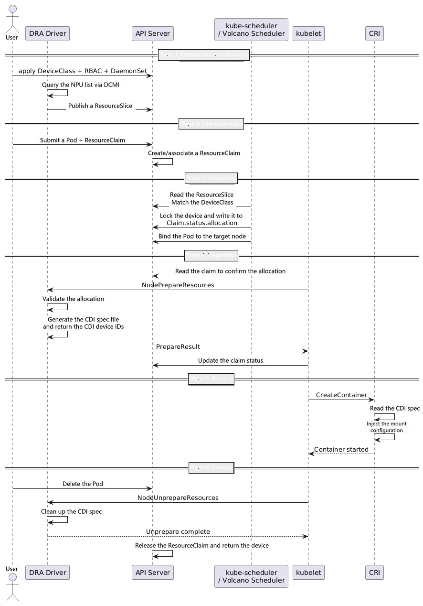

# Before You Start

MindCluster cluster scheduling components support connecting to the Kubernetes Dynamic Resource Allocation (DRA) mechanism through the Ascend Dynamic Resource Allocation (Ascend DRA for short) component, implementing NPU device discovery, reporting, and on-demand allocation.

This chapter describes how to deploy Ascend DRA and demonstrates a complete `Prepare` (device allocation) and `Unprepare` (device release) process, to help users understand the lifecycle management of NPU resources under the DRA mechanism.

## Overview

Ascend DRA runs as a kubelet plugin on each compute node and manages NPU resources based on the Kubernetes DRA mechanism. Compared with the traditional Device Plugin + Extended Resource approach, DRA provides more flexible device allocation capabilities. It supports selecting specific devices on demand and injecting them into containers according to the Container Device Interface (CDI) specification.

The core responsibilities of Ascend DRA include:

- **Device discovery and reporting**: Enumerate all NPU devices on the local node at startup, and report them to the API Server in the ResourceSlice format so that the scheduler can be aware of available resources.
- **Device allocation (Prepare)**: When a Pod references a ResourceClaim and is scheduled to the local node, kubelet calls the DRA plugin to allocate devices for the claim, generates a CDI spec file, and injects the CDI device IDs into the container.
- **Device release (Unprepare)**: When the Pod is deleted, kubelet calls the DRA plugin to release the devices corresponding to the claim and cleans up the CDI spec file.
- **Health check**: Provides a built-in HTTP health probe that works with the Kubernetes livenessProbe mechanism to detect the component's liveness.

## Lifecycle

The complete lifecycle of Ascend DRA consists of the following six phases.

- **Deployment and discovery**: The user delivers the DeviceClass, RBAC, and DaemonSet through the API Server. After DRA starts, it queries the local node's NPU list through DCMI and publishes a ResourceSlice to the API Server.
- **User submission**: The user submits a Pod that references a ResourceClaim, and resourceclaim-controller creates and associates the claim.
- **Scheduling**: kube-scheduler or the Volcano Scheduler reads the ResourceSlice to match the DeviceClass, locks the device and writes it to Claim.status.allocation, and binds the Pod to the target node.
- **Preparation (Prepare)**: After reading the claim and confirming the allocation result, kubelet calls the DRA plugin's NodePrepareResources callback. The plugin validates the allocation, generates a CDI spec file, and returns the CDI device IDs to kubelet.
- **Running**: kubelet calls CRI to create the container. CRI automatically merges the static and dynamic CDI specs and injects the device nodes, mounts, and environment variables.
- **Cleanup (Unprepare)**: After the user deletes the Pod, kubelet calls the DRA plugin's NodeUnprepareResources callback, cleans up the corresponding CDI spec, releases the claim, and returns the device to the resource pool.

## Prerequisites

Before deploying and using Ascend DRA, ensure that the related components have been installed. If they are not installed, see [Installation and Deployment](../../03_installation_guide/02_installation/00_helm_installation.md).

- The Kubernetes cluster version is 1.36.x.
- (Optional) The Volcano scheduler. When Volcano is used to schedule DRA jobs, ascend-volcano-plugin bypasses the NPU-specific scheduling logic for DRA jobs.
- The NPU driver and firmware have been installed on the NPU nodes, and the devices are running properly.

> [!NOTE]
> Ascend DRA and Ascend Device Plugin are two different device access methods. When the DRA method is used, Ascend Device Plugin does not need to be deployed on the node at the same time. If nodes using both access methods exist in the cluster, distinguish them by node labels.

## Supported Product Forms

Ascend DRA supports the following product forms:

- <term>Atlas A2 products</term>
- <term>Atlas A3 products</term>
- <term>Ascend 950PR&950DT products</term>

## Usage

MindCluster cluster scheduling components support using Ascend DRA in the following way:

- [Deploying the DRA Component and Running Prepare/Unprepare Verification](./01_deploying_dra_and_running_task.md): Deploy the DRA component and deliver a job that references a ResourceClaim, to verify the complete device allocation and release process.

> [!NOTE]
> For details about the ResourceSlice format reported by the Ascend DRA component and the health check API, see [Ascend Dynamic Resource Allocation](../../06_api/17_ascend_dynamic_resource_allocation.md).
