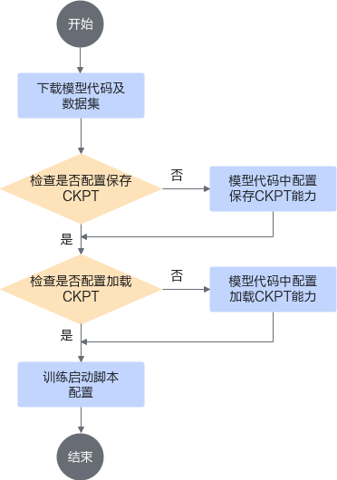
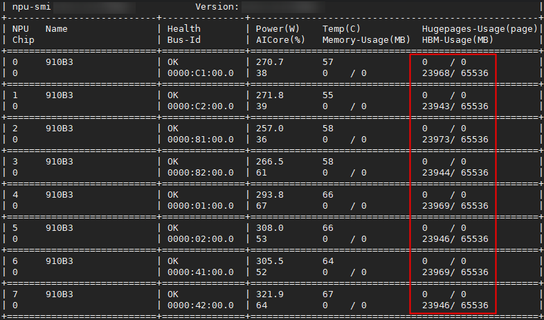
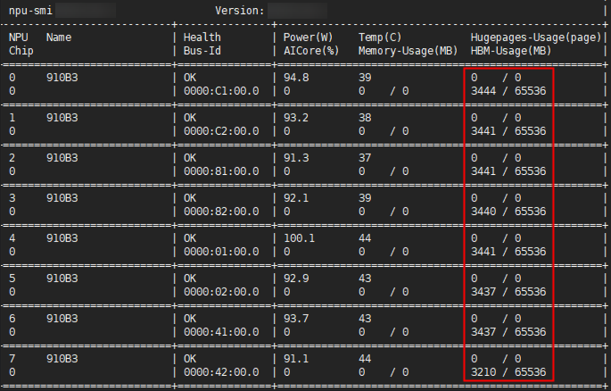

# PyTorch场景示例

## 制作镜像<a name="ZH-CN_TOPIC_0000002511426469"></a>

[MindSpeed-LLM](https://gitcode.com/Ascend/MindSpeed-LLM/tree/26.2.0)作为昇腾大模型训练框架，旨在为昇腾芯片提供端到端的大语言模型训练方案，包含分布式预训练、分布式指令微调、分布式偏好对齐以及对应的开发工具链。[MindSpeed-LLM使用指南](https://gitcode.com/Ascend/MindSpeed-LLM/blob/1.0.0/docs/USER_GUIDE.md)包括了仓库拉取、环境搭建与大模型训练等章节，制作MindSpeed-LLM训练框架镜像可以结合本章节和[MindSpeed-LLM使用指南](https://gitcode.com/Ascend/MindSpeed-LLM/blob/1.0.0/docs/USER_GUIDE.md)。

断点续训可以基于基础训练镜像制作，基础训练镜像的制作可参考[使用Dockerfile构建容器镜像（PyTorch）](../../../../07_references/02_common_operations.md#使用dockerfile构建容器镜像pytorch)章节进行操作。

本章节以DeepSeek-V4-Flash为例，介绍在Atlas A3系列产品、Ascend 950PR&950DT系列产品上使用Python 3.12、PyTorch 2.10.0和torch_npu 2.10.0的断点续训配置。Atlas A3系列产品使用Ubuntu 22.04；Ascend 950PR&950DT系列产品使用openEuler 24.03，两类机型分别制作镜像。

>[!NOTE]
>
>- 以下示例使用支持 DeepSeek-V4-Flash 的 MindSpeed-LLM 及配套 MindSpeed、Megatron-LM。本文示例选用 Python 3.12.16、CANN 9.2.0、PyTorch 2.10.0 和 torch_npu 2.10.0.post7，实际版本按组件兼容性及模型配套要求选择；TaskD、MindIO TFT 使用与集群版本配套的软件包。
>- Atlas 850E风冷超节点、Atlas 850风冷超节点、Atlas 650E服务器、Atlas 650服务器、Atlas 950 SuperPoD液冷超节点等存在UB总线的产品形态下，训练镜像内需要增加UB驱动相关文件。支持如下两种方式：
>   - 从<a href="https://mirrors.huaweicloud.com/ascend/">华为云镜像仓地址</a>的archive目录下载，然后安装到训练镜像中。
>   - 安装Ascend Docker Runtime，默认挂载ub\_driver.list中的UB驱动相关内容。ub\_driver.list中的文件依赖宿主机的glibc版本，目前支持的OS版本和glibc版本如下：
>     - 宿主机：openEuler24.03（glibc2.38）
>     - 容器内：openEuler24.03（glibc2.38）、Ubuntu24.04（glibc2.39）。

**准备软件包<a name="zh-cn_topic_0000002039339945_section18254161612586"></a>**

请按照[表1](#zh-cn_topic_0000002039339945_table1172542119019)所示，获取对应操作系统的软件包，并准备镜像所需的Dockerfile文件与脚本文件。软件包名称中{version}表示版本号、{arch}表示架构、{chip_type}表示芯片类型。

**表 1**  准备软件包

<a name="zh-cn_topic_0000002039339945_table1172542119019"></a>
<table><thead align="left"><tr id="zh-cn_topic_0000002039339945_row157251121508"><th class="cellrowborder" valign="top" width="24.55%" id="mcps1.2.5.1.1"><p id="zh-cn_topic_0000002039339945_p1441653254"><a name="zh-cn_topic_0000002039339945_p1441653254"></a>软件包</p>
</th>
<th class="cellrowborder" valign="top" width="25.45%" id="mcps1.2.5.1.2"><p id="zh-cn_topic_0000002039339945_p2052053751"><a name="zh-cn_topic_0000002039339945_p2052053751"></a>是否必选</p>
</th>
<th class="cellrowborder" valign="top" width="25%" id="mcps1.2.5.1.3"><p id="zh-cn_topic_0000002039339945_p657531455"><a name="zh-cn_topic_0000002039339945_p657531455"></a>说明</p>
</th>
<th class="cellrowborder" valign="top" width="25%" id="mcps1.2.5.1.4"><p id="zh-cn_topic_0000002039339945_p1859531759"><a name="zh-cn_topic_0000002039339945_p1859531759"></a>获取方法</p>
</th>
</tr>
</thead>
<tbody><tr id="zh-cn_topic_0000002039339945_row16726192116014"><td class="cellrowborder" valign="top" width="24.55%" headers="mcps1.2.5.1.1 "><p id="zh-cn_topic_0000002039339945_p1754534515"><a name="zh-cn_topic_0000002039339945_p1754534515"></a>taskd-<em id="i2511021165615"><a name="i2511021165615"></a>{version}</em>-py3-none-linux_{arch}.whl</p>
</td>
<td class="cellrowborder" valign="top" width="25.45%" headers="mcps1.2.5.1.2 "><p id="p4321152352612"><a name="p4321152352612"></a>是</p>
</td>
<td class="cellrowborder" valign="top" width="25%" headers="mcps1.2.5.1.3 "><p id="zh-cn_topic_0000002039339945_p205155310512"><a name="zh-cn_topic_0000002039339945_p205155310512"></a>集群调度组件断点续训whl包。</p>
<div class="note" id="zh-cn_topic_0000002039339945_note494818501423"><a name="zh-cn_topic_0000002039339945_note494818501423"></a><span class="notetitle"> [!NOTE] 说明</span><div class="notebody"><p id="zh-cn_topic_0000002039339945_p159489506423"><a name="zh-cn_topic_0000002039339945_p159489506423"></a>安装<span id="ph1670711477256"><a name="ph1670711477256"></a>TaskD</span>组件前需确保<span id="zh-cn_topic_0000002039339945_ph998914174412"><a name="zh-cn_topic_0000002039339945_ph998914174412"></a>PyTorch</span>框架已正确安装，当前支持的<span id="zh-cn_topic_0000002039339945_ph2908133144419"><a name="zh-cn_topic_0000002039339945_ph2908133144419"></a>PyTorch</span>版本为：2.1.0~2.10.0。TaskD运行依赖PyTorch框架，请选择无已知安全漏洞的PyTorch版本或从官方社区获取已修复安全问题的对应版本。</p>
</div></div>
</td>
<td class="cellrowborder" valign="top" width="25%" headers="mcps1.2.5.1.4 "><p id="zh-cn_topic_0000002039339945_p19595310517"><a name="zh-cn_topic_0000002039339945_p19595310517"></a><a href="https://www.hiascend.com/zh/developer/download/community/result?module=dl%2Bcann" target="_blank" rel="noopener noreferrer">获取链接</a></p>
<div class="note" id="zh-cn_topic_0000002039339945_note1386820525510"><a name="zh-cn_topic_0000002039339945_note1386820525510"></a><span class="notetitle">[!NOTE] 说明</span><div class="notebody"><p id="zh-cn_topic_0000002039339945_p12512532515"><a name="zh-cn_topic_0000002039339945_p12512532515"></a>用户通过获取链接得到的是<span id="ph480901420289"><a name="ph480901420289"></a>TaskD</span>压缩包Ascend-mindxdl-taskd_<em id="i112838253389"><a name="i112838253389"></a>{version}</em>_linux-<em id="i1328312515383"><a name="i1328312515383"></a>{arch}</em>.zip，需要通过解压后，获得相应的whl软件包。</p>
</div></div>
</td>
</tr>
<tr id="zh-cn_topic_0000002039339945_row572619211108"><td class="cellrowborder" valign="top" width="24.55%" headers="mcps1.2.5.1.1 "><p id="zh-cn_topic_0000002039339945_p1863531756"><a name="zh-cn_topic_0000002039339945_p1863531756"></a>mindio_ttp-<em id="zh-cn_topic_0000002039339945_i15340181201416"><a name="zh-cn_topic_0000002039339945_i15340181201416"></a>{version}</em>-py3-none-linux_<em id="zh-cn_topic_0000002039339945_i19614531957"><a name="zh-cn_topic_0000002039339945_i19614531957"></a>{arch}</em>.whl</p>
</td>
<td class="cellrowborder" valign="top" width="25.45%" headers="mcps1.2.5.1.2 "><p id="zh-cn_topic_0000002039339945_p96553958"><a name="zh-cn_topic_0000002039339945_p96553958"></a>是</p>
</td>
<td class="cellrowborder" valign="top" width="25%" headers="mcps1.2.5.1.3 "><p id="zh-cn_topic_0000002039339945_p66253359"><a name="zh-cn_topic_0000002039339945_p66253359"></a><span id="zh-cn_topic_0000002039339945_ph845710020145"><a name="zh-cn_topic_0000002039339945_ph845710020145"></a>MindIO TFT</span>安装包。</p>
</td>
<td class="cellrowborder" valign="top" width="25%" headers="mcps1.2.5.1.4 "><p id="zh-cn_topic_0000002039339945_p1862053354"><a name="zh-cn_topic_0000002039339945_p1862053354"></a><a href="https://www.hiascend.com/zh/developer/download/community/result?module=dl%2Bcann" target="_blank" rel="noopener noreferrer">获取链接</a></p>
</td>
</tr>
<tr id="zh-cn_topic_0000002039339945_row672652117018"><td class="cellrowborder" valign="top" width="24.55%" headers="mcps1.2.5.1.1 "><p id="zh-cn_topic_0000002039339945_p1468532510"><a name="zh-cn_topic_0000002039339945_p1468532510"></a>apex-0.1+ascend-cp3x-cp3x-linux_{arch}.whl</p>
</td>
<td class="cellrowborder" valign="top" width="25.45%" headers="mcps1.2.5.1.2 "><p id="zh-cn_topic_0000002039339945_p1869531256"><a name="zh-cn_topic_0000002039339945_p1869531256"></a>是</p>
<p id="zh-cn_topic_0000002039339945_p156353454"><a name="zh-cn_topic_0000002039339945_p156353454"></a>MindSpeed-LLM依赖</p>
<p id="zh-cn_topic_0000002039339945_p1861353651"><a name="zh-cn_topic_0000002039339945_p1861353651"></a></p>
</td>
<td class="cellrowborder" valign="top" width="25%" headers="mcps1.2.5.1.3 "><p id="zh-cn_topic_0000002039339945_p166105316515"><a name="zh-cn_topic_0000002039339945_p166105316515"></a>混合精度训练是在训练时混合使用单精度（float32）与半精度(float16)数据类型，将两者结合在一起，并使用相同的超参数实现了与float32几乎相同的精度。</p>
<p id="zh-cn_topic_0000002039339945_zh-cn_topic_0000001497364957_p626262173118"><a name="zh-cn_topic_0000002039339945_zh-cn_topic_0000001497364957_p626262173118"></a>软件包中的cp3x表示Python版本号，例如x为12表示Python 3.12，具体Python版本以MindSpeed-LLM版本说明为准。</p>
</td>
<td class="cellrowborder" valign="top" width="25%" headers="mcps1.2.5.1.4 "><p id="zh-cn_topic_0000002039339945_zh-cn_topic_0000001497364957_p39761346403"><a name="zh-cn_topic_0000002039339945_zh-cn_topic_0000001497364957_p39761346403"></a>请参见<span id="zh-cn_topic_0000002039339945_ph156792413596"><a name="zh-cn_topic_0000002039339945_ph156792413596"></a>《Ascend Extension for PyTorch 软件安装指南》中的“<a href="https://gitcode.com/Ascend/apex/blob/master/docs/zh/installing_apex.md">安装APEX模块</a>”章节</span>，根据实际情况编译APEX软件包。</p>
<p id="zh-cn_topic_0000002039339945_p1761531257"><a name="zh-cn_topic_0000002039339945_p1761531257"></a></p>
</td>
</tr>
<tr id="zh-cn_topic_0000002039339945_row197268213011"><td class="cellrowborder" valign="top" width="24.55%" headers="mcps1.2.5.1.1 "><p id="zh-cn_topic_0000002039339945_p1361953254"><a name="zh-cn_topic_0000002039339945_p1361953254"></a>torch_npu-2.10.0.post<em id="zh-cn_topic_0000002039339945_i16204112111321"><a name="zh-cn_topic_0000002039339945_i16204112111321"></a>{version}</em>-cp3x-cp3x-manylinux_2_28_{arch}.whl</p>
</td>
<td class="cellrowborder" valign="top" width="25.45%" headers="mcps1.2.5.1.2 "><p id="zh-cn_topic_0000002039339945_p56185314510"><a name="zh-cn_topic_0000002039339945_p56185314510"></a>是</p>
<p id="zh-cn_topic_0000002039339945_p186653757"><a name="zh-cn_topic_0000002039339945_p186653757"></a>MindSpeed-LLM依赖</p>
</td>
<td class="cellrowborder" valign="top" width="25%" headers="mcps1.2.5.1.3 "><p id="zh-cn_topic_0000002039339945_p15720535517"><a name="zh-cn_topic_0000002039339945_p15720535517"></a>Ascend Extension for PyTorch插件是基于昇腾的深度学习适配框架，使昇腾NPU可以支持PyTorch框架，为PyTorch框架的使用者提供昇腾AI处理器的超强算力。</p>
<p id="zh-cn_topic_0000002039339945_zh-cn_topic_0000001497364957_p849562217019"><a name="zh-cn_topic_0000002039339945_zh-cn_topic_0000001497364957_p849562217019"></a>软件包中的cp3x表示Python版本号，例如x为12表示Python 3.12，具体Python版本以MindSpeed-LLM版本说明为准。</p>
</td>
<td class="cellrowborder" valign="top" width="25%" headers="mcps1.2.5.1.4 "><p id="zh-cn_topic_0000002039339945_p10718533510"><a name="zh-cn_topic_0000002039339945_p10718533510"></a><a href="https://www.hiascend.com/document/detail/zh/Pytorch/720/configandinstg/instg/insg_0004.html" target="_blank" rel="noopener noreferrer">获取链接</a></p>
<div class="note" id="zh-cn_topic_0000002039339945_note1165115165020"><a name="zh-cn_topic_0000002039339945_note1165115165020"></a><span class="notetitle">[!NOTE] 说明</span><div class="notebody"><p id="zh-cn_topic_0000002039339945_p167047813263"><a name="zh-cn_topic_0000002039339945_p167047813263"></a>如果使用MindSpeed-LLM代码仓上的<span id="zh-cn_topic_0000002039339945_ph1987542822613"><a name="zh-cn_topic_0000002039339945_ph1987542822613"></a>PyTorch</span>模型，需要使用<span id="zh-cn_topic_0000002039339945_ph1412723132619"><a name="zh-cn_topic_0000002039339945_ph1412723132619"></a>Ascend Extension for PyTorch</span> 2.6.0及以上版本。</p>
</div></div>
</td>
</tr>
<tr id="zh-cn_topic_0000002039339945_row1412215399516"><td class="cellrowborder" valign="top" width="24.55%" headers="mcps1.2.5.1.1 "><a name="zh-cn_topic_0000002039339945_ul104867135415"></a><ul id="zh-cn_topic_0000002039339945_ul104867135415"><li><span id="zh-cn_topic_0000002039339945_ph0853174512272"><a name="zh-cn_topic_0000002039339945_ph0853174512272"></a>x86_64</span>架构：torch-2.10.0+cpu-cp3x-cp3x-manylinux_2_28_x86_64.whl</li><li><span id="zh-cn_topic_0000002039339945_ph7852164518272"><a name="zh-cn_topic_0000002039339945_ph7852164518272"></a>ARM</span>架构：torch-2.10.0+cpu-cp3x-cp3x-manylinux_2_28_aarch64.whl</li></ul>
</td>
<td class="cellrowborder" valign="top" width="25.45%" headers="mcps1.2.5.1.2 "><p id="zh-cn_topic_0000002039339945_p871953357"><a name="zh-cn_topic_0000002039339945_p871953357"></a>是</p>
<p id="zh-cn_topic_0000002039339945_p17715531453"><a name="zh-cn_topic_0000002039339945_p17715531453"></a>MindSpeed-LLM依赖</p>
</td>
<td class="cellrowborder" valign="top" width="25%" headers="mcps1.2.5.1.3 "><p id="zh-cn_topic_0000002039339945_zh-cn_topic_0000001497364957_p11461347141013"><a name="zh-cn_topic_0000002039339945_zh-cn_topic_0000001497364957_p11461347141013"></a>官方<span id="zh-cn_topic_0000002039339945_ph19355165113512"><a name="zh-cn_topic_0000002039339945_ph19355165113512"></a>PyTorch</span>包。</p><p>软件包中的cp3x表示Python版本号，例如x为12表示Python 3.12，具体Python版本以MindSpeed-LLM版本说明为准。</p>
</td>
<td class="cellrowborder" valign="top" width="25%" headers="mcps1.2.5.1.4 "><p id="zh-cn_topic_0000002039339945_p99745421447"><a name="zh-cn_topic_0000002039339945_p99745421447"></a><a href="https://download.pytorch.org/whl/torch/" target="_blank" rel="noopener noreferrer">获取链接</a></p>
<p id="zh-cn_topic_0000002039339945_p483943610920"><a name="zh-cn_topic_0000002039339945_p483943610920"></a></p>
</td>
</tr>
<tr id="zh-cn_topic_0000002039339945_row151232039750"><td class="cellrowborder" valign="top" width="24.55%" headers="mcps1.2.5.1.1 "><p id="zh-cn_topic_0000002039339945_p4714531658"><a name="zh-cn_topic_0000002039339945_p4714531658"></a>Ascend-cann-{chip_type}-ops_{version}_linux-{arch}.run</p>
</td>
<td class="cellrowborder" valign="top" width="25.45%" headers="mcps1.2.5.1.2 "><p id="zh-cn_topic_0000002039339945_p1774531250"><a name="zh-cn_topic_0000002039339945_p1774531250"></a>是</p><p>CANN 8.5.0之前版本该包名为Ascend-cann-kernels-<em>{chip_type}</em>_<em>{version}</em>_linux-<em>{arch}</em>.run</p>
</td>
<td class="cellrowborder" valign="top" width="25%" headers="mcps1.2.5.1.3 "><p id="zh-cn_topic_0000002039339945_p5720531514"><a name="zh-cn_topic_0000002039339945_p5720531514"></a>CANN算子包。</p>
</td>
<td class="cellrowborder" valign="top" width="25%" headers="mcps1.2.5.1.4 "><p id="zh-cn_topic_0000002039339945_p87153755"><a name="zh-cn_topic_0000002039339945_p87153755"></a><a href="https://www.hiascend.com/zh/developer/download/community/result?module=cann" target="_blank" rel="noopener noreferrer">获取链接</a></p>
<div class="note" id="zh-cn_topic_0000002039339945_note13775154104217"><a name="zh-cn_topic_0000002039339945_note13775154104217"></a><span class="notetitle">[!NOTE] 说明</span><div class="notebody"><p id="zh-cn_topic_0000002039339945_p2075812144313"><a name="zh-cn_topic_0000002039339945_p2075812144313"></a>请获取和服务器型号匹配的软件包。</p>
</div></div>
</td>
</tr>
<tr id="row1173819266428"><td class="cellrowborder" valign="top" width="24.55%" headers="mcps1.2.5.1.1 "><p id="p7738142674217"><a name="p7738142674217"></a>Ascend-cann-toolkit_{version}_linux-{arch}.run</p>
</td>
<td class="cellrowborder" valign="top" width="25.45%" headers="mcps1.2.5.1.2 "><p id="p12738626184214"><a name="p12738626184214"></a>是</p>
</td>
<td class="cellrowborder" valign="top" width="25%" headers="mcps1.2.5.1.3 "><p id="p13738226114218"><a name="p13738226114218"></a>CANN Toolkit开发套件包。</p>
</td>
<td class="cellrowborder" valign="top" width="25%" headers="mcps1.2.5.1.4 "><p id="p19271154916428"><a name="p19271154916428"></a><a href="https://www.hiascend.com/zh/developer/download/community/result?module=cann" target="_blank" rel="noopener noreferrer">获取链接</a></p>
<div class="note" id="note3272104913427"><a name="note3272104913427"></a><span class="notetitle">[!NOTE] 说明</span><div class="notebody"><p id="p2272174920421"><a name="p2272174920421"></a>请获取和服务器型号匹配的软件包。</p>
</div></div>
</td>
</tr>
<tr id="zh-cn_topic_0000002039339945_row121231639952"><td class="cellrowborder" valign="top" width="24.55%" headers="mcps1.2.5.1.1 "><p id="zh-cn_topic_0000002039339945_p1048218391768"><a name="zh-cn_topic_0000002039339945_p1048218391768"></a>MindSpeed</p>
</td>
<td class="cellrowborder" valign="top" width="25.45%" headers="mcps1.2.5.1.2 "><p id="zh-cn_topic_0000002039339945_p3482939367"><a name="zh-cn_topic_0000002039339945_p3482939367"></a>是</p>
</td>
<td class="cellrowborder" valign="top" width="25%" headers="mcps1.2.5.1.3 "><p id="zh-cn_topic_0000002039339945_p048215393610"><a name="zh-cn_topic_0000002039339945_p048215393610"></a>MindSpeed是针对昇腾设备的大模型加速库。</p>
</td>
<td class="cellrowborder" valign="top" width="25%" headers="mcps1.2.5.1.4 "><p id="zh-cn_topic_0000002039339945_p7482193913619"><a name="zh-cn_topic_0000002039339945_p7482193913619"></a>git clone https://gitcode.com/Ascend/MindSpeed.git</p>
<p id="zh-cn_topic_0000002039339945_p9482139663"><a name="zh-cn_topic_0000002039339945_p9482139663"></a>cd MindSpeed</p>
<p id="zh-cn_topic_0000002039339945_p1948213912618"><a name="zh-cn_topic_0000002039339945_p1948213912618"></a>git checkout eb0ad7e73dc8227291e44504041aa7c58136aaa3  # 26.2.0_core_r0.12.1 分支</p>
</td>
</tr>
<tr id="zh-cn_topic_0000002039339945_row144125121466"><td class="cellrowborder" valign="top" width="24.55%" headers="mcps1.2.5.1.1 "><p id="zh-cn_topic_0000002039339945_p848215391768"><a name="zh-cn_topic_0000002039339945_p848215391768"></a>version.info</p>
</td>
<td class="cellrowborder" valign="top" width="25.45%" headers="mcps1.2.5.1.2 "><p id="zh-cn_topic_0000002039339945_p1548319391465"><a name="zh-cn_topic_0000002039339945_p1548319391465"></a>是</p>
<p id="zh-cn_topic_0000002039339945_p16483239968"><a name="zh-cn_topic_0000002039339945_p16483239968"></a>安装CANN的依赖文件</p>
</td>
<td class="cellrowborder" valign="top" width="25%" headers="mcps1.2.5.1.3 "><p id="zh-cn_topic_0000002039339945_p14483939561"><a name="zh-cn_topic_0000002039339945_p14483939561"></a>驱动版本信息文件。</p>
</td>
<td class="cellrowborder" valign="top" width="25%" headers="mcps1.2.5.1.4 "><p id="zh-cn_topic_0000002039339945_p748314394617"><a name="zh-cn_topic_0000002039339945_p748314394617"></a>从host拷贝“/usr/local/Ascend/driver/version.info”文件。</p>
</td>
</tr>
<tr id="zh-cn_topic_0000002039339945_row17301171913614"><td class="cellrowborder" valign="top" width="24.55%" headers="mcps1.2.5.1.1 "><p id="zh-cn_topic_0000002039339945_p148310396616"><a name="zh-cn_topic_0000002039339945_p148310396616"></a>ascend_install.info</p>
</td>
<td class="cellrowborder" valign="top" width="25.45%" headers="mcps1.2.5.1.2 "><p id="zh-cn_topic_0000002039339945_p348313399610"><a name="zh-cn_topic_0000002039339945_p348313399610"></a>是</p>
<p id="zh-cn_topic_0000002039339945_p1348313391961"><a name="zh-cn_topic_0000002039339945_p1348313391961"></a>安装CANN的依赖文件</p>
</td>
<td class="cellrowborder" valign="top" width="25%" headers="mcps1.2.5.1.3 "><p id="zh-cn_topic_0000002039339945_p5483239564"><a name="zh-cn_topic_0000002039339945_p5483239564"></a>驱动安装信息文件。</p>
</td>
<td class="cellrowborder" valign="top" width="25%" headers="mcps1.2.5.1.4 "><p id="zh-cn_topic_0000002039339945_p2483339861"><a name="zh-cn_topic_0000002039339945_p2483339861"></a>从host拷贝“/etc/ascend_install.info”文件。</p>
</td>
</tr>
<tr id="zh-cn_topic_0000002039339945_row93022191368"><td class="cellrowborder" valign="top" width="24.55%" headers="mcps1.2.5.1.1 "><p id="zh-cn_topic_0000002039339945_p15485173911615"><a name="zh-cn_topic_0000002039339945_p15485173911615"></a>Dllogger代码仓</p>
</td>
<td class="cellrowborder" valign="top" width="25.45%" headers="mcps1.2.5.1.2 "><p id="zh-cn_topic_0000002039339945_p248514391563"><a name="zh-cn_topic_0000002039339945_p248514391563"></a>是</p>
</td>
<td class="cellrowborder" valign="top" width="25%" headers="mcps1.2.5.1.3 "><p id="zh-cn_topic_0000002039339945_p164850391565"><a name="zh-cn_topic_0000002039339945_p164850391565"></a>PyTorch日志工具。</p>
</td>
<td class="cellrowborder" valign="top" width="25%" headers="mcps1.2.5.1.4 "><p id="zh-cn_topic_0000002039339945_p1548619391164"><a name="zh-cn_topic_0000002039339945_p1548619391164"></a>git clone https://github.com/NVIDIA/dllogger.git</p>
</td>
</tr>
<tr id="zh-cn_topic_0000002039339945_row33025197610"><td class="cellrowborder" valign="top" width="24.55%" headers="mcps1.2.5.1.1 "><p id="zh-cn_topic_0000002039339945_p0486133919618"><a name="zh-cn_topic_0000002039339945_p0486133919618"></a>Python-3.12.16.tar.xz</p>
</td>
<td class="cellrowborder" valign="top" width="25.45%" headers="mcps1.2.5.1.2 "><p id="zh-cn_topic_0000002039339945_p1148619393610"><a name="zh-cn_topic_0000002039339945_p1148619393610"></a>是</p>
</td>
<td class="cellrowborder" valign="top" width="25%" headers="mcps1.2.5.1.3 "><p id="zh-cn_topic_0000002039339945_p164861439461"><a name="zh-cn_topic_0000002039339945_p164861439461"></a>用于编译 Python 3.12，构建时通过 ensurepip 安装 pip。</p>
</td>
<td class="cellrowborder" valign="top" width="25%" headers="mcps1.2.5.1.4 "><p id="zh-cn_topic_0000002039339945_p34865396611"><a name="zh-cn_topic_0000002039339945_p34865396611"></a>从 Python 官方发行源获取 Python 3.12.16 源码包。</p>
</td>
</tr>
<tr id="zh-cn_topic_0000002039339945_row03021191165"><td class="cellrowborder" valign="top" width="24.55%" headers="mcps1.2.5.1.1 "><p id="zh-cn_topic_0000002039339945_p15486163919616"><a name="zh-cn_topic_0000002039339945_p15486163919616"></a>Dockerfile</p>
</td>
<td class="cellrowborder" valign="top" width="25.45%" headers="mcps1.2.5.1.2 "><p id="zh-cn_topic_0000002039339945_p1448693915619"><a name="zh-cn_topic_0000002039339945_p1448693915619"></a>是</p>
</td>
<td class="cellrowborder" valign="top" width="25%" headers="mcps1.2.5.1.3 "><p id="zh-cn_topic_0000002039339945_p74862391165"><a name="zh-cn_topic_0000002039339945_p74862391165"></a>制作镜像需要。</p>
</td>
<td class="cellrowborder" valign="top" width="25%" headers="mcps1.2.5.1.4 "><p id="zh-cn_topic_0000002039339945_p9571628104613"><a name="zh-cn_topic_0000002039339945_p9571628104613"></a>-</p>
</td>
</tr>
</tbody>
</table>

>[!NOTE]
>镜像构建上下文需包含表1中的软件包、`Python-3.12.16.tar.xz`、MindSpeed和MindSpeed-LLM源码目录。按各自版本说明准备配套源码及requirements.txt。Atlas A3系列产品使用 `CHIP=A3`，Ascend 950PR&950DT系列产品使用 `CHIP=950`；同一镜像中只安装一种芯片的ops包。

**操作步骤<a name="zh-cn_topic_0000002039339945_section20489630477"></a>**

1. 参照[表1](#zh-cn_topic_0000002039339945_table1172542119019)，在宿主机上完成软件包的准备工作。
    镜像构建目录及参数可参考 [mindcluster-deploy PyTorch镜像说明](https://gitcode.com/Ascend/mindcluster-deploy/blob/master/samples/docker/pytorch/OVERVIEW.zh.md)和 [Dockerfile](https://gitcode.com/Ascend/mindcluster-deploy/blob/master/samples/docker/pytorch/Dockerfile)。本文保留手动构建示例，APEX wheel 必须提供并安装。

    将配套的 torch、torch_npu 和 APEX wheel 放到构建上下文的 `whl/` 目录。APEX 可按[安装APEX模块](https://gitcode.com/Ascend/apex/blob/master/docs/zh/installing_apex.md)准备；使用 Ascend/apex 源码构建时，在与目标镜像架构、Python 和 PyTorch 配套的环境中执行：

    ```shell
    git clone https://gitcode.com/Ascend/apex.git
    cd apex
    bash scripts/build.sh --python=3.12
    ```

    将构建产物 `apex/dist/apex-*.whl` 复制到镜像构建目录的 `whl/`。该脚本生成 wheel，镜像中还需执行下文的 pip 安装命令。参考镜像提供的是 APEX 的 Python 部分；如模型使用 `apex_C` 等融合扩展，需按 APEX 安装说明准备包含对应扩展的配套 wheel。

    ```shell
    mkdir -p whl
    ```

    **DeepSeek-V4-Flash 优化器状态适配**

    以下修改适用于本文的 MindSpeed-LLM `bfa35e3c8502995810d64077ed7fd18b8b296012` 基线。两个文件路径均相对于 MindSpeed-LLM 根目录，行号以该基线为准，具体插入位置如下：

    | 文件 | 位置 | 修改内容 |
    |---|---|---|
    | `mindspeed_llm/core/optimizer/distrib_optimizer.py` | `distributed_optimizer_init()`，第131行 `_build_model_and_main_param_groups()` 调用结束后、第133行 `if isinstance(self.optimizer, HybridDeviceOptimizer)` 前 | 按 FP32 参数、FP16 参数的实际排列重建 `model_param_group_index_map` |
    | `mindspeed_llm/core/high_availability/tft_replica_optimizer.py` | `TTPReplicaOptimizer` 类，第565行 `state_dict_memory()` 结束后、第567行 `load_state_dict_memory()` 前 | 增加 `load_state_dict()`，在优化器状态为空时按本地主参数分片初始化状态存储 |

    将以下完整 diff 保存为镜像构建上下文根目录的 `mindspeed_llm_26_2_0_arf_optimizer_state_fix.patch`，保留每行开头的空格、`+` 和 `-`。实际应用由下文 Dockerfile 完成。

    ```diff
    diff --git a/mindspeed_llm/core/optimizer/distrib_optimizer.py b/mindspeed_llm/core/optimizer/distrib_optimizer.py
    --- a/mindspeed_llm/core/optimizer/distrib_optimizer.py
    +++ b/mindspeed_llm/core/optimizer/distrib_optimizer.py
    @@ -130,6 +130,12 @@
             self.gbuf_ranges, self.model_param_gbuf_map, self.opt_group_ranges, config
         )

    +    for group_index, (model_fp32_params, model_float16_params) in enumerate(
    +        zip(self.model_fp32_groups, self.model_float16_groups)
    +    ):
    +        for group_order, model_param in enumerate([*model_fp32_params, *model_float16_params]):
    +            self.model_param_group_index_map[model_param] = (group_index, group_order)
    +
         if isinstance(self.optimizer, HybridDeviceOptimizer):
             self.optimizer = HybridDeviceOptimizer(
                 params=[g["orig_group"] for g in self.opt_group_ranges], **self.optimizer.defaults
    diff --git a/mindspeed_llm/core/high_availability/tft_replica_optimizer.py b/mindspeed_llm/core/high_availability/tft_replica_optimizer.py
    --- a/mindspeed_llm/core/high_availability/tft_replica_optimizer.py
    +++ b/mindspeed_llm/core/high_availability/tft_replica_optimizer.py
    @@ -564,5 +564,10 @@
         def state_dict_memory(self):
             return self.state_dict()

    +    def load_state_dict(self, state_dict):
    +        if len(self.optimizer.state) == 0 and self.init_state_fn is not None:
    +            self.init_state_fn(self.optimizer, self.config)
    +        super().load_state_dict(state_dict)
    +
         def load_state_dict_memory(self, state_dict):
             self.load_state_dict(state_dict)
    ```

    可在镜像构建上下文根目录先检查源码版本和补丁是否匹配：

    ```shell
    git -C MindSpeed-LLM rev-parse HEAD
    git -C MindSpeed-LLM apply --check \
        "$PWD/mindspeed_llm_26_2_0_arf_optimizer_state_fix.patch"
    ```

    构建上下文中的MindSpeed-LLM源码需保留 `.git` 目录，供镜像内校验基线。状态初始化仅在优化器状态为空时分配匹配的存储，恢复时由Checkpoint或对端数据填充。构建时应用上述补丁即可，无需重复手动插入；如所用源码已包含两项修改，应省略补丁应用并同步调整源码版本和构建步骤。

    构建上下文的关键目录如下；CANN、TaskD、MindIO TFT 和 Python 源码包仍按表1及下文 Dockerfile 放置。

    ```text
    build-context/
    ├── Dockerfile
    ├── MindSpeed/
    ├── MindSpeed-LLM/
    ├── mindspeed_llm_26_2_0_arf_optimizer_state_fix.patch
    ├── dllogger/
    └── whl/
        ├── torch-2.10.0+cpu-cp312-cp312-manylinux_2_28_aarch64.whl
        ├── torch_npu-2.10.0.post7-cp312-cp312-manylinux_2_28_aarch64.whl
        └── apex-0.1+ascend-cp312-cp312-linux_aarch64.whl
    ```

2. 编写如下Dockerfile。

    ```dockerfile
    # MindCluster 断点续训 PyTorch 示例镜像
    # 构建使用 --network=host；上下文需提供 version.info、ascend_install.info、
    # whl/、dllogger/ 和 MindSpeed-LLM 优化器状态补丁。

    ARG BASE_IMAGE=ubuntu:22.04
    FROM ${BASE_IMAGE}

    # Atlas A3系列产品使用CHIP=A3，Ascend 950PR&950DT系列产品使用CHIP=950；每个镜像只安装一种芯片的ops包。
    ARG CHIP=A3
    ARG PYTHON_VERSION=3.12
    ARG CANN_VERSION=9.2.0

    # 下载源
    ARG CANN_BASE_URL=https://ascend-repo.obs.cn-east-2.myhuaweicloud.com/CANN/CANN%209.2.0
    ARG PIP_INDEX_URL=https://repo.huaweicloud.com/repository/pypi/simple
    ARG PIP_TRUSTED_HOST=repo.huaweicloud.com
    ARG APT_MIRROR=repo.huaweicloud.com
    ARG TRITON_ASCEND_INDEX_URL=https://mirrors.huaweicloud.com/ascend/repos/pypi

    # PyTorch、torch_npu、torchvision 和 wheel 的 Python ABI 必须配套。
    ARG TORCH_VERSION=2.10.0
    ARG TORCH_NPU_PKG_VERSION=2.10.0.post7
    ARG TASKD_WHEEL_VERSION=26.3.0
    ARG MINDIO_TTP_WHEEL_VERSION=26.2.0
    ARG TRITON_ASCEND_VERSION=3.6.0

    # 固定模型源码版本及配套 Megatron-LM。
    ARG MINDSPEED_COMMIT=eb0ad7e73dc8227291e44504041aa7c58136aaa3
    ARG MINDSPEED_LLM_COMMIT=bfa35e3c8502995810d64077ed7fd18b8b296012
    ARG MINDSPEED_LLM_ARF_PATCH=mindspeed_llm_26_2_0_arf_optimizer_state_fix.patch
    ARG MEGATRON_TAG=core_v0.12.1
    ARG MINDCLUSTER_TAG=v26.2.0

    # 构建前校验软件包文件名与版本。
    COPY check_packages.sh /tmp/check_packages.sh
    RUN bash /tmp/check_packages.sh --filename-only \
          "taskd-${TASKD_WHEEL_VERSION}-py3-none-linux_aarch64.whl:${TASKD_WHEEL_VERSION}" \
          "mindio_ttp-${MINDIO_TTP_WHEEL_VERSION}-py3-none-linux_aarch64.whl:${MINDIO_TTP_WHEEL_VERSION}"

    # 基础系统依赖
    COPY version.info /tmp/ascend-driver/version.info
    COPY ascend_install.info /tmp/ascend-driver/ascend_install.info

    ENV DEBIAN_FRONTEND=noninteractive
    ENV TZ=UTC

    RUN set -eux; \
        for f in /tmp/ascend-driver/version.info /tmp/ascend-driver/ascend_install.info; do \
            if [ ! -s "$f" ]; then \
                echo "ERROR: 缺少驱动信息文件 $f" >&2; \
                echo "请在构建上下文中提供：cp /usr/local/Ascend/driver/version.info ." >&2; \
                echo "                        cp /etc/ascend_install.info ." >&2; \
                exit 1; \
            fi; \
        done; \
        if command -v apt-get >/dev/null 2>&1; then \
            echo "deb http://${APT_MIRROR}/ubuntu-ports/ jammy main restricted universe multiverse" >  /etc/apt/sources.list; \
            echo "deb http://${APT_MIRROR}/ubuntu-ports/ jammy-updates main restricted universe multiverse" >> /etc/apt/sources.list; \
            echo "deb http://${APT_MIRROR}/ubuntu-ports/ jammy-security main restricted universe multiverse" >> /etc/apt/sources.list; \
            apt-get update -qq; \
            apt-get install -y -qq --no-install-recommends \
                ca-certificates curl wget git \
                gcc g++ make cmake patch \
                zlib1g zlib1g-dev libsqlite3-dev libssl-dev libffi-dev \
                unzip pciutils net-tools binutils procps hostname \
                libblas-dev libblas3 libopenblas-dev gfortran \
                liblapack3 liblapack-dev libhdf5-dev libxml2 \
                swig \
                libexpat1-dev libbz2-dev libreadline-dev liblzma-dev libncurses-dev libgdbm-dev libnss3-dev uuid-dev \
                tzdata; \
            ln -sf /usr/share/zoneinfo/UTC /etc/localtime; \
            echo UTC > /etc/timezone; \
        elif command -v dnf >/dev/null 2>&1 || command -v yum >/dev/null 2>&1; then \
            PKG=$(command -v dnf >/dev/null 2>&1 && echo dnf || echo yum); \
            ${PKG} install -y \
                ca-certificates curl wget git tar \
                gcc gcc-c++ gcc-gfortran make cmake patch \
                zlib zlib-devel sqlite-devel openssl openssl-devel libffi-devel \
                unzip pciutils net-tools binutils procps-ng hostname \
                openblas-devel lapack-devel hdf5-devel libxml2-devel \
                expat-devel bzip2-devel readline-devel xz-devel ncurses-devel gdbm-devel uuid-devel \
                nss nss-devel nspr nspr-devel \
                tzdata swig; \
            ${PKG} clean all || true; \
        else \
            echo "ERROR: 既无 apt-get 也无 dnf/yum，不支持的 BASE_IMAGE" >&2; exit 1; \
        fi

    # 源码编译 Python，以匹配 cp312 wheel。
    ARG PY_VERSION=3.12.16
    ARG PY_BASE_URL=https://mirrors.huaweicloud.com/python

    RUN set -eux; \
        cd /tmp; \
        curl -fsSL --retry 3 -o py.tgz "${PY_BASE_URL}/${PY_VERSION}/Python-${PY_VERSION}.tgz"; \
        tar -xzf py.tgz; \
        cd "Python-${PY_VERSION}"; \
        S=$(date +%s); \
        ./configure --prefix=/usr/local --enable-shared --with-ensurepip=install > /tmp/pycfg.log 2>&1 \
            || { echo "ERROR: Python configure 失败"; tail -30 /tmp/pycfg.log; exit 1; }; \
        echo "python configure: $(( $(date +%s) - S ))s"; \
        make -j"$(nproc)" > /tmp/pymake.log 2>&1 \
            || { echo "ERROR: Python make 失败"; tail -30 /tmp/pymake.log; exit 1; }; \
        echo "python make: $(( $(date +%s) - S ))s"; \
        make install > /tmp/pyinst.log 2>&1 \
            || { echo "ERROR: Python make install 失败"; tail -40 /tmp/pyinst.log; exit 1; }; \
        echo "python install: $(( $(date +%s) - S ))s"; \
        if [ -d /etc/ld.so.conf.d ]; then \
            echo "/usr/local/lib" > /etc/ld.so.conf.d/usr-local.conf; \
        else \
            echo "/usr/local/lib" >> /etc/ld.so.conf; \
        fi; \
        ldconfig; \
        rm -rf /tmp/Python-${PY_VERSION} /tmp/py.tgz; \
        /usr/local/bin/python3 -V; \
        /usr/local/bin/python3 -c "import pyexpat, ssl, sqlite3, zlib, bz2, lzma, ctypes; print('stdlib extensions OK')"

    ENV PATH=/usr/local/bin:${PATH}
    # openEuler 默认不搜索 /usr/local/lib，需显式配置共享库路径。
    ENV LD_LIBRARY_PATH=/usr/local/lib:${LD_LIBRARY_PATH}
    RUN set -eux; \
        ln -sf /usr/local/bin/python3 /usr/bin/python3; \
        ln -sf /usr/local/bin/python3 /usr/bin/python; \
        ln -sf /usr/local/bin/pip3 /usr/bin/pip3; \
        ln -sf /usr/local/bin/pip3 /usr/bin/pip; \
        python3 -V; \
        python3 -c "import sys; assert sys.version_info[:3] == (3, 12, 16), sys.version; print('python version OK: 3.12.16')"; \
        mkdir -p /root/.pip; \
        printf '[global]\nindex-url=%s\ntrusted-host=%s\ntimeout=120\n' \
            "${PIP_INDEX_URL}" "${PIP_TRUSTED_HOST}" > /root/.pip/pip.conf; \
        python3 -m pip install --no-cache-dir -U pip setuptools wheel packaging; \
        python3 -m pip --version

    # CANN 安装时临时提供构建机驱动信息，安装后删除；运行时由宿主机挂载。
    RUN set -eux; \
        cd /tmp; \
        mkdir -p /usr/local/Ascend/driver; \
        cp /tmp/ascend-driver/version.info /usr/local/Ascend/driver/version.info; \
        cp /tmp/ascend-driver/ascend_install.info /etc/ascend_install.info; \
        curl -fsSL --retry 3 -o toolkit.run "${CANN_BASE_URL}/Ascend-cann-toolkit_${CANN_VERSION}_linux-aarch64.run"; \
        curl -fsSL --retry 3 -o ops.run     "${CANN_BASE_URL}/Ascend-cann-${CHIP}-ops_${CANN_VERSION}_linux-aarch64.run"; \
        chmod +x toolkit.run ops.run; \
        ./toolkit.run --install-path=/usr/local/Ascend/ --install --quiet; \
        ./ops.run     --install --quiet; \
        rm -f /etc/ascend_install.info; \
        rm -f /tmp/ascend-driver/version.info /tmp/ascend-driver/ascend_install.info; \
        rm -rf /tmp/ascend-driver /usr/local/Ascend/driver; \
        rm -f toolkit.run ops.run; \
        find /usr/local/Ascend -maxdepth 4 -name 'ascend_ops_install.info' -exec cat {} \; ; \
        echo "--- kernel 目录体量（应只有 ascend_93 系为 GB 级）---"; \
        du -sh /usr/local/Ascend/ascend-toolkit/latest/opp/built-in/op_impl/ai_core/tbe/kernel/* 2>/dev/null || true

    ENV ASCEND_HOME_PATH=/usr/local/Ascend/ascend-toolkit/latest
    ENV PATH=${ASCEND_HOME_PATH}/bin:${ASCEND_HOME_PATH}/tools/ccec_compiler/bin:${PATH}

    # ENV 提供运行时环境；需要完整 CANN 环境的 RUN 仍需加载 set_env.sh。
    ENV ASCEND_TOOLKIT_HOME=${ASCEND_HOME_PATH}
    ENV ASCEND_OPP_PATH=${ASCEND_HOME_PATH}/opp
    ENV LD_LIBRARY_PATH=${ASCEND_HOME_PATH}/lib64:${ASCEND_HOME_PATH}/lib64/plugin/opskernel:${ASCEND_HOME_PATH}/lib64/plugin/nnengine:${ASCEND_HOME_PATH}/opp/built-in/op_impl/ai_core/tbe/op_tiling:/usr/local/Ascend/ascend-toolkit/latest/devlib:${LD_LIBRARY_PATH}

    RUN echo "source /usr/local/Ascend/ascend-toolkit/set_env.sh" >> /root/.bashrc; \
        echo "source /usr/local/Ascend/ascend-toolkit/set_env.sh" >> /etc/profile.d/ascend.sh

    # whl/ 需提供 torch、torch_npu、torchvision 的 cp312/aarch64 wheel 及 APEX wheel。
    # 使用 apex_C 等融合扩展时，APEX wheel 必须包含对应扩展。
    ARG APEX_WHL=apex-0.1+ascend-cp312-cp312-linux_aarch64.whl
    COPY whl/ /tmp/whl/

    # 防止后续安装模型依赖时替换 PyTorch / torch_npu 配套版本。
    RUN printf 'torch==%s\ntorch_npu==%s\n' "${TORCH_VERSION}" "${TORCH_NPU_PKG_VERSION}" > /tmp/constraints.txt
    ENV PIP_CONSTRAINT=/tmp/constraints.txt

    RUN set -eux; \
        ls -l /tmp/whl/; \
        python3 -m pip install --no-cache-dir --no-deps \
            "/tmp/whl/torch-${TORCH_VERSION}+cpu-cp312-cp312-manylinux_2_28_aarch64.whl"; \
        python3 -m pip install --no-cache-dir \
            filelock "typing-extensions>=4.10.0" "sympy>=1.13.3" \
            networkx jinja2 fsspec numpy pyyaml; \
        python3 -m pip install --no-cache-dir --no-deps \
            "/tmp/whl/torch_npu-${TORCH_NPU_PKG_VERSION}-cp312-cp312-manylinux_2_28_aarch64.whl"; \
        python3 -m pip install --no-cache-dir --no-deps \
            "/tmp/whl/torchvision-0.25.0+cpu-cp312-cp312-manylinux_2_28_aarch64.whl"; \
        . /usr/local/Ascend/ascend-toolkit/set_env.sh; \
        TORCH_DEVICE_BACKEND_AUTOLOAD=0 \
        python3 -c "import torch, torch_npu; print('torch', torch.__version__); print('torch_npu', torch_npu.__version__)"; \
        python3 -c "import numpy, yaml; print('numpy', numpy.__version__); print('pyyaml', yaml.__version__)"; \
        echo "ASCEND_OPP_PATH=$ASCEND_OPP_PATH"; \
        test -f "/tmp/whl/${APEX_WHL}" || { echo "ERROR: 必须提供配套的 APEX wheel: whl/${APEX_WHL}" >&2; exit 1; }; \
        python3 -m pip install --no-cache-dir "/tmp/whl/${APEX_WHL}"; \
        TORCH_DEVICE_BACKEND_AUTOLOAD=0 python3 -c "import apex; print('apex', apex.__file__)"; \
        rm -rf /tmp/whl

    # Triton-Ascend 与 MindSpeed-LLM 26.2.0 配套，从华为云 Ascend PyPI 源安装。
    RUN set -eux; \
        . /usr/local/Ascend/ascend-toolkit/set_env.sh; \
        python3 -m pip install --no-cache-dir \
            "triton-ascend==${TRITON_ASCEND_VERSION}" \
            --extra-index-url="${TRITON_ASCEND_INDEX_URL}"; \
        python3 -c "import triton; print('triton', triton.__version__)"

    RUN set -eux; \
        python3 -m pip install --no-cache-dir \
            cffi grpcio grpcio-tools absl-py apscheduler; \
        python3 -m pip install --no-cache-dir numpy pillow

    # TaskD 源码构建要求 Go 1.21.13。
    ARG GO_VERSION=1.21.13
    RUN set -eux; \
        cd /tmp; \
        curl -fsSL --retry 3 -o go.tar.gz \
            "https://golang.google.cn/dl/go${GO_VERSION}.linux-arm64.tar.gz"; \
        tar -C /usr/local -xzf go.tar.gz; \
        rm -f go.tar.gz; \
        /usr/local/go/bin/go version; \
        ln -sf /usr/local/go/bin/go /usr/local/bin/go; \
        ln -sf /usr/local/go/bin/gofmt /usr/local/bin/gofmt
    ENV GOROOT=/usr/local/go
    ENV GOPATH=/root/go
    ENV PATH=${GOROOT}/bin:${GOPATH}/bin:${PATH}
    ENV GOPROXY=https://goproxy.cn,https://mirrors.aliyun.com/goproxy/,direct
    ENV GOSUMDB=off

    RUN set -eux; \
        python3 -m pip install --no-cache-dir datasets; \
        TORCH_DEVICE_BACKEND_AUTOLOAD=0 \
        python3 -c "import torch, torchvision; print('torch', torch.__version__); print('torchvision', torchvision.__version__); assert torchvision.__version__.startswith('0.25.0'), torchvision.__version__"

    # 安装模型依赖前校验基线并应用优化器状态补丁。
    # transformers / tokenizers 版本由模型源码的 requirements.txt 决定。
    COPY ${MINDSPEED_LLM_ARF_PATCH} /tmp/mindspeed_llm_arf.patch
    COPY dllogger/ /tmp/dllogger/
    RUN set -eux; \
        clone5() { i=0; until git clone "$1" "$2"; do i=$((i+1)); if [ "$i" -ge 5 ]; then echo "ERROR: clone $1 失败" >&2; return 1; fi; echo "clone $1 第 $i 次失败，重试"; rm -rf "$2"; sleep 5; done; }; \
        . /usr/local/Ascend/ascend-toolkit/set_env.sh; \
        cd /root; \
        clone5 https://gitcode.com/Ascend/MindSpeed.git MindSpeed; \
        cd MindSpeed; \
        git checkout "${MINDSPEED_COMMIT}"; \
        python3 -m pip install --no-cache-dir -r requirements.txt; \
        python3 -m pip install --no-cache-dir -e .; \
        cd /root; \
        clone5 https://gitcode.com/Ascend/MindSpeed-LLM.git MindSpeed-LLM; \
        cd MindSpeed-LLM; \
        git checkout "${MINDSPEED_LLM_COMMIT}"; \
        test "$(git rev-parse HEAD)" = "${MINDSPEED_LLM_COMMIT}"; \
        git apply --check /tmp/mindspeed_llm_arf.patch; \
        git apply /tmp/mindspeed_llm_arf.patch; \
        git diff --check; \
        python3 -m pip install --no-cache-dir -r requirements.txt; \
        python3 -m pip install --no-cache-dir /tmp/dllogger; \
        rm -rf /tmp/dllogger /tmp/mindspeed_llm_arf.patch; \
        cd /root

    RUN set -eux; \
        cd /root; \
        ( git clone --depth 1 --branch "${MEGATRON_TAG}" https://github.com/NVIDIA/Megatron-LM.git \
          || git clone --depth 1 --branch "${MEGATRON_TAG}" https://gitee.com/mirrors/Megatron-LM.git \
          || git clone --depth 1 --branch "${MEGATRON_TAG}" https://gitcode.com/gh_mirrors/me/Megatron-LM.git ); \
        test -d Megatron-LM; \
        cp -r /root/Megatron-LM/megatron /root/MindSpeed-LLM/; \
        rm -rf /root/Megatron-LM

    ENV PYTHONPATH=/root/MindSpeed:/root/MindSpeed-LLM

    # 模型依赖安装后检查导入。
    RUN python3 -c "import transformers, tokenizers; print('transformers', transformers.__version__); print('tokenizers', tokenizers.__version__)"

    # 构建 TaskD / MindIO TTP：显式设置 TaskD 版本，修正 C++17 和 ZIP 时间戳。
    # CMake 必须使用 /usr/local 下的 Python 3.12，避免混入系统 Python ABI。
    RUN set -eux; \
        cd /tmp; \
        i=0; \
        until git clone --depth 1 --branch "${MINDCLUSTER_TAG}" https://gitcode.com/Ascend/mind-cluster.git mc; do \
            i=$((i+1)); rm -rf mc; \
            if [ "$i" -ge 5 ]; then echo "ERROR: mind-cluster 克隆失败" >&2; exit 1; fi; \
            echo "mind-cluster clone 第 $i 次失败，重试"; sleep 5; \
        done; \
        cd mc/component/taskd; \
        printf 'mindxdlversion=%s\n' "${TASKD_WHEEL_VERSION}" > service_config.ini; \
        cd build && bash build.sh; \
        cd /tmp/mc/component/mindio/tft; \
        test -f build/build.sh || { echo "ERROR: mindio build.sh 不存在"; exit 1; }; \
        sed -i 's|-std=c++11|-std=c++17|g' cmake_modules/ttp_common.cmake; \
        sed -i "s|os.environ\['SOURCE_DATE_EPOCH'\] = '0'|os.environ['SOURCE_DATE_EPOCH'] = '315532800'|" src/python/setup.py; \
        grep -n 'std=c++17' cmake_modules/ttp_common.cmake; \
        grep -n 'SOURCE_DATE_EPOCH' src/python/setup.py; \
        echo '--- PYTHON DIAG ---'; \
        echo "PATH=$PATH"; \
        (which -a python3 || true); \
        (python3 -V || true); \
        /usr/local/bin/python3 -V; \
        (/usr/bin/python3 -V || true); \
        echo '--- END DIAG ---'; \
        cd build; \
        bash build.sh -f -DPython3_EXECUTABLE=/usr/local/bin/python3 -DPython3_ROOT_DIR=/usr/local -DPython3_FIND_STRATEGY=LOCATION > /tmp/mindio_build.log 2>&1 || { \
            echo "ERROR: mindio_ttp 构建失败"; \
            grep -nE 'error:|ValueError|CMake Error|Could NOT find' /tmp/mindio_build.log | head -20; \
            tail -25 /tmp/mindio_build.log; \
            exit 1; \
        }; \
        PYINC=$(find /tmp/mc/component/mindio/tft -name flags.make -exec grep -hoE '\-I[^ ]*python3\.[0-9]+' {} \; | sort -u); \
        echo "PYINC=[$PYINC]"; \
        if ! echo "$PYINC" | grep -q 'python3\.12'; then echo "ERROR: CMake 未使用 python3.12 头文件（实际：$PYINC）"; exit 1; fi; \
        if echo "$PYINC" | grep -Eq 'python3\.(10|11)'; then echo "ERROR: 编译混入 python3.10/3.11 头文件，扩展与运行期 3.12.16 ABI 不匹配"; exit 1; fi; \
        echo "OK: CMake 编译使用 python3.12 头文件"; \
        TTP_SO=$(find /tmp/mc -name '_ttp_c2python_api.so' | head -1); \
        test -n "$TTP_SO" || { echo "ERROR: 未生成 _ttp_c2python_api.so"; exit 1; }; \
        echo "OK: 已生成 $TTP_SO"; \
        mkdir -p /tmp/wheels; \
        find /tmp/mc -name "taskd-*.whl" -exec cp {} /tmp/wheels/ \; ; \
        find /tmp/mc -name "mindio_ttp-*.whl" -exec cp {} /tmp/wheels/ \; ; \
        ls -l /tmp/wheels/; \
        test -f "/tmp/wheels/taskd-${TASKD_WHEEL_VERSION}-py3-none-linux_aarch64.whl" \
          || { echo "ERROR: taskd whl 未生成"; exit 1; }; \
        test -f "/tmp/wheels/mindio_ttp-${MINDIO_TTP_WHEEL_VERSION}-py3-none-linux_aarch64.whl" \
          || { echo "ERROR: mindio_ttp whl 未生成（检查上面的 CMake 输出，常见原因：缺 SWIG）"; exit 1; }

    # 安装前校验 wheel 文件名及 METADATA 版本。
    RUN set -eux; \
        cd /tmp/wheels; \
        bash /tmp/check_packages.sh \
            "taskd-${TASKD_WHEEL_VERSION}-py3-none-linux_aarch64.whl:${TASKD_WHEEL_VERSION}" \
            "mindio_ttp-${MINDIO_TTP_WHEEL_VERSION}-py3-none-linux_aarch64.whl:${MINDIO_TTP_WHEEL_VERSION}"; \
        python3 -m pip install --no-cache-dir \
            "taskd-${TASKD_WHEEL_VERSION}-py3-none-linux_aarch64.whl" \
            "mindio_ttp-${MINDIO_TTP_WHEEL_VERSION}-py3-none-linux_aarch64.whl"; \
        rm -rf /tmp/wheels /tmp/mc /tmp/check_packages.sh

    # TaskD 进程级恢复需要适配 torch/distributed/run.py。
    RUN set -eux; \
        DIST_RUN=$(TORCH_DEVICE_BACKEND_AUTOLOAD=0 python3 -c "import torch,os;print(os.path.join(os.path.dirname(torch.__file__),'distributed','run.py'))"); \
        test -f "$DIST_RUN"; \
        if ! grep -q '^import taskd.python.adaptor.patch' "$DIST_RUN"; then \
            sed -i '/^import os/i import taskd.python.adaptor.patch' "$DIST_RUN"; \
        fi; \
        grep -n '^import taskd.python.adaptor.patch' "$DIST_RUN"

    # 运行环境
    ENV HCCL_WHITELIST_DISABLE=1

    RUN set -eux; \
        (getent group HwHiAiUser >/dev/null || groupadd -g 1000 HwHiAiUser); \
        (getent passwd HwHiAiUser >/dev/null || useradd -d /home/HwHiAiUser -u 1000 -g 1000 -m -s /bin/bash HwHiAiUser)

    RUN set -eux; \
        if [ ! -d /lib64 ]; then mkdir -p /lib64; ln -sf /lib/ld-linux-aarch64.so.1 /lib64/ld-linux-aarch64.so.1; fi

    # 镜像构建信息
    ARG BUILD_DATE=unknown
    LABEL org.opencontainers.image.title="torch-npu-sample-dl" \
          org.opencontainers.image.description="MindCluster resumable-training PyTorch sample image" \
          org.opencontainers.image.version="v26.3.0" \
          org.opencontainers.image.created="${BUILD_DATE}" \
          org.opencontainers.image.licenses="Apache-2.0" \
          com.mindcluster.cann.version="${CANN_VERSION}" \
          com.mindcluster.chip="${CHIP}" \
          com.mindcluster.torch="${TORCH_VERSION}+cpu" \
          com.mindcluster.torch_npu="${TORCH_NPU_PKG_VERSION}" \
          com.mindcluster.mindspeed="${MINDSPEED_COMMIT}" \
          com.mindcluster.mindspeed_llm="${MINDSPEED_LLM_COMMIT}" \
          com.mindcluster.megatron="${MEGATRON_TAG}" \
          com.mindcluster.taskd="${TASKD_WHEEL_VERSION}" \
          com.mindcluster.mindio_ttp="${MINDIO_TTP_WHEEL_VERSION}"

    RUN set -eux; \
        . /usr/local/Ascend/ascend-toolkit/set_env.sh; \
        echo "=== 组件版本自检 ==="; \
        python3 -V; \
        echo "ASCEND_OPP_PATH=$ASCEND_OPP_PATH"; \
        TORCH_DEVICE_BACKEND_AUTOLOAD=0 python3 -c "import torch; print('torch', torch.__version__)"; \
        TORCH_DEVICE_BACKEND_AUTOLOAD=0 python3 -c "import torch_npu; print('torch_npu', torch_npu.__version__)"; \
        cat /usr/local/Ascend/ascend-toolkit/latest/opp/version.info | head -2; \
        find /usr/local/Ascend -maxdepth 4 -name 'ascend_ops_install.info' -exec sh -c 'grep -E "package_name|^version" $1' _ {} \; ; \
        python3 -m pip show taskd mindio_ttp 2>/dev/null | grep -E '^(Name|Version)' || echo "WARNING: taskd/mindio_ttp 未安装成功"; \
        TORCH_DEVICE_BACKEND_AUTOLOAD=0 python3 -c "import apex; print('apex OK')"; \
        python3 -c "import triton; print('triton', triton.__version__)"; \
        python3 -m pip check; \
        echo "=== 确认驱动凭证未被烤进镜像（必须为空）==="; \
        test ! -f /etc/ascend_install.info && echo "OK: /etc/ascend_install.info 不存在"; \
        test ! -d /usr/local/Ascend/driver && echo "OK: driver 目录不存在"

    WORKDIR /root
    CMD ["bash"]

    ```

    >[!NOTE]
    >将 `{version}` 替换为配套软件包的版本号。使用其他架构时，同步替换基础镜像和wheel的架构字段；torch、torch_npu、APEX的Python ABI必须与Python 3.12一致。Transformers和tokenizers按模型源码的requirements.txt安装；Triton-Ascend 3.6.0按MindSpeed-LLM安装指导从华为云Ascend PyPI源安装，Dockerfile中已包含该步骤。

    上述构建步骤在安装模型依赖前，将两项适配应用到镜像内的 `/root/MindSpeed-LLM`，并检查源码基线与补丁上下文。TaskD对 `torch/distributed/run.py` 的适配仍按Dockerfile中的独立步骤完成。

    若训练任务使用共享存储源码覆盖镜像中的代码目录，共享存储需使用与镜像一致的源码版本和适配内容。可从构建完成的镜像复制 `/root/MindSpeed` 和 `/root/MindSpeed-LLM`，避免挂载其他源码覆盖镜像内容。

3. 构建对应机型的镜像。在Dockerfile所在目录执行以下命令，注意保留命令结尾的“.”。

    ```shell
    # Atlas A3系列产品
    docker build --network=host --build-arg BASE_IMAGE=ubuntu:22.04 --build-arg CHIP=A3 -t mindspeed-dl:deepseek4-a3 .
    # Ascend 950PR&950DT系列产品
    docker build --network=host --build-arg BASE_IMAGE=openeuler/openeuler:24.03-lts --build-arg CHIP=950 -t mindspeed-dl:deepseek4-a5 .
    ```

4. 将镜像推送到集群可访问的镜像仓库，或导入所有可能承载任务的节点，并在任务YAML中填写对应镜像地址。Ascend 950PR&950DT系列产品还需按本节说明配置UB驱动文件。

    除手动构建镜像外，也可使用以下开箱即用的示例镜像。请选择与机型对应的镜像，示例镜像可通过[AscendHub](https://www.hiascend.com/developer/ascendhub) 获取。

    | 机型 | 镜像名和tag |
    |---|---|
    | Atlas A3系列产品| `torch-npu-sample-dl:v26.3.0-cann9.2.0-torch_npu2.10.0-A3-ubuntu22.04-py3.12-aarch64` |
    | Ascend 950PR&950DT系列产品| `torch-npu-sample-dl:v26.3.0-cann9.2.0-torch_npu2.10.0-950-openeuler24.03-py3.12-aarch64` |

## 脚本适配<a name="ZH-CN_TOPIC_0000002511426481"></a>

### 流程说明<a name="ZH-CN_TOPIC_0000002511346469"></a>

模型脚本需要适配CKPT之后才可以使用断点续训功能，脚本适配大致流程和逻辑如[图1](#fig88341718121515)所示。

**图 1**  脚本适配流程<a name="fig88341718121515"></a>



### 适配示例<a name="ZH-CN_TOPIC_0000002511346445"></a>

本章节将指导用户step by step地完成断点续训的适配步骤。

>[!NOTE]
>
>- 为保证优雅容错与进程级在线恢复功能的正常使用，请将K8s集群master节点与worker节点的时钟保持一致。
>- 断点续训展示的组件代码为开源代码，其中涉及到相关安全说明请参见[安全说明](../../../../07_references/05_appendix.md#安全说明)。
>- 下文中模型示例代码可能与实际版本存在差异，请以实际版本代码为准。
>- 模型的参数配置，根据模型仓的模型配置以实际情况来写。若修改不当，可能会引发不可预知的问题。
>- 若训练过程中出现“Failed to bind the IP port. Reason: The IP address and port have been bound already”报错，可以按照如下进行配置，详情请参见《CANN HCCL集合通信库》中的“[HCCL_HOST_SOCKET_PORT_RANGE](https://www.hiascend.com/document/detail/zh/CANNCommunityEdition/920/commlib/hcclug/docs/zh/user_guide/hccl_env/HCCL_HOST_SOCKET_PORT_RANGE.md)”章节。
>
>   ```shell
>   export HCCL_HOST_SOCKET_PORT_RANGE="60000-60050"
>   export HCCL_NPU_SOCKET_PORT_RANGE="61000-61050"
>   ```
>
>- 若使用TaskD组件且训练容器使用Host网络，则先通过`sysctl net.ipv4.ip_local_reserved_ports`查询当前预留端口配置后，通过`sysctl -w net.ipv4.ip_local_reserved_ports="xxx,9601,9602"`新增预留端口9601、9602（其中xxx指的是前面查出来已配置的端口，若无则省略）。

训练代码与数据集准备，可以参考[MindSpeed-LLM使用指南](https://gitcode.com/Ascend/MindSpeed-LLM/blob/26.2.0/docs/zh/pytorch/training/pretrain/mcore/pretrain.md)。下面以两台同型号的Atlas A3系列产品或Ascend 950PR&950DT系列产品、每台8卡为例，说明具体操作步骤。根据DeepSeek-V4-Flash的训练方式和显存需求配置资源及并行策略。

1. 准备支持DeepSeek-V4-Flash的MindSpeed-LLM源码，以及版本配套的MindSpeed、Megatron-LM。使用与镜像中一致的源码版本；如已在镜像中准备源码，可复制到共享存储后使用。

    ```shell
    mkdir -p /data/atlas_dls/public/code
    cd /data/atlas_dls/public/code
    git clone https://gitcode.com/Ascend/MindSpeed-LLM.git DeepSeek_V4_Flash_for_PyTorch_2.10_code
    cd DeepSeek_V4_Flash_for_PyTorch_2.10_code
    # 根据模型与镜像的配套版本，切换到支持 DeepSeek-V4-Flash 的分支或提交
    git checkout bfa35e3c8502995810d64077ed7fd18b8b296012
    ```

    体验 DeepSeek-V4-Flash 进程级恢复时，该源码还需包含[制作镜像](#zh-cn_topic_0000002039339945_section20489630477)中的两项优化器状态适配。推荐将镜像内已适配的 `/root/MindSpeed-LLM` 复制到共享代码目录；若另行拉取源码，则对相同基线应用同一补丁后再挂载到 `/job/code`。

    上述源码示例配套MindSpeed `eb0ad7e73dc8227291e44504041aa7c58136aaa3`、Megatron-LM `core_v0.12.1`，镜像构建时也使用同一组版本。按该版本的模型说明准备Megatron-LM，并将 `megatron` 目录放到模型代码目录中。将完整模型代码目录挂载到训练容器的 `/job/code`，将数据和权重根目录挂载到 `/job/data`。所有训练节点及备机均需访问相同的代码、数据和Checkpoint。

2. 从DeepSeek官方发布的[DeepSeek-V4-Flash模型文件目录](https://huggingface.co/deepseek-ai/DeepSeek-V4-Flash/tree/main)下载完整权重、配置文件和tokenizer，放到 `/data/atlas_dls/public/dataset/DeepSeek-V4-Flash`。如模型权重需要反量化或格式转换，请按所选MindSpeed-LLM版本的DeepSeek-V4-Flash模型说明完成后，再配置训练脚本的加载路径。

3. 获取训练数据。以下使用[Alpaca数据集](https://huggingface.co/datasets/tatsu-lab/alpaca)作为断点续训示例数据，下载其中的[Parquet文件](https://huggingface.co/datasets/tatsu-lab/alpaca/blob/main/data/train-00000-of-00001-a09b74b3ef9c3b56.parquet)，保存到 `/data/atlas_dls/public/dataset/deepseek4-alpaca/`。该文件包含 `text` 字段，与后续预处理命令中的 `--json-keys text` 对应。也可通过[直接下载地址](https://huggingface.co/datasets/tatsu-lab/alpaca/resolve/main/data/train-00000-of-00001-a09b74b3ef9c3b56.parquet)获取文件：

    ```shell
    mkdir -p /data/atlas_dls/public/dataset/deepseek4-alpaca
    curl -fL \
        https://huggingface.co/datasets/tatsu-lab/alpaca/resolve/main/data/train-00000-of-00001-a09b74b3ef9c3b56.parquet \
        -o /data/atlas_dls/public/dataset/deepseek4-alpaca/train-00000-of-00001-a09b74b3ef9c3b56.parquet
    ```

4. 在训练镜像的容器内处理数据。先将共享代码和数据目录分别挂载为 `/job/code`、`/job/data`，再执行以下命令。Transformers、tokenizers及其他模型依赖使用模型代码requirements.txt中的配套版本。

    ```shell
    source /usr/local/Ascend/ascend-toolkit/set_env.sh
    cd /job/code
    python preprocess_data.py \
        --input /job/data/deepseek4-alpaca/train-00000-of-00001-a09b74b3ef9c3b56.parquet \
        --tokenizer-name-or-path /job/data/DeepSeek-V4-Flash \
        --tokenizer-type PretrainedFromHF \
        --handler-name GeneralPretrainHandler \
        --output-prefix /job/data/deepseek4-alpaca/alpaca \
        --json-keys text \
        --append-eod \
        --workers 4 \
        --log-interval 1000
    ```

    命令生成 `alpaca_text_document.bin` 和 `alpaca_text_document.idx`，训练脚本中的 `DATA_PATH` 填写不带扩展名的文件前缀。

5. 在模型代码目录中创建 `scripts/train_start.sh`。以所选版本 `examples/mcore/deepseek4_flash` 下的模型训练脚本为基础，保留 DeepSeek-V4-Flash 的模型结构、权重转换及训练参数，按步骤7适配启动和恢复逻辑。

    ```text
    DeepSeek_V4_Flash_for_PyTorch_2.10_code/
    ├── scripts/
    │   └── train_start.sh
    └── manager.py
    ```

6. 使用配套 `mindcluster-deploy` 仓库中的DeepSeek-V4-Flash示例YAML：`samples/train/resumable-training/fault-tolerance/without-ranktable/pytorch/DeepSeek-V4-Flash/yamls/pytorch_multinodes_acjob_deepseek4.yaml`。文件名为 `pytorch_multinodes_acjob_deepseek4.yaml`，默认使用Ascend 950PR&950DT系列产品双机16卡和进程级恢复配置。按实际环境替换NFS服务地址，并核对共享代码和数据目录。Atlas A3系列产品镜像、调度策略及其他恢复策略的调整说明请参见该示例目录中的 `README.md`，恢复策略也可参考[准备任务YAML](#ZH-CN_TOPIC_0000002511426415)。优雅容错为已日落的历史功能，新配置使用本章介绍的恢复策略。

7. 配置训练启动脚本train\_start.sh和训练任务YAML，请根据实际情况进行修改。
    1. 修改启动脚本基础参数。

        ```shell
        mkdir -p /job/code/alllogs/$MINDX_TASK_ID/ttplogs
        mkdir -p /job/code/alllogs/$MINDX_TASK_ID/trainlogs
        mkdir -p /job/code/alllogs/$MINDX_TASK_ID/taskd
        # 日志保存路径，可根据实际情况修改
        export ASCEND_PROCESS_LOG_PATH=/job/code/alllogs/$MINDX_TASK_ID/plogs/$XDL_IP       # 设置plog保存路径，其中$MINDX_TASK_ID为Ascend Operator注入的任务UID环境变量，$XDL_IP为任务YAML中写入的环境变量status.hostIP
        export TTP_LOG_PATH=/job/code/alllogs/$MINDX_TASK_ID/ttplogs/ttplog$XDL_IP-$RANK    # 设置TTP日志保存路径，其中$RANK为Ascend Operator为PyTorch框架注入的环境变量
        export TRAIN_LOG_PATH=/job/code/alllogs/$MINDX_TASK_ID/trainlogs/$XDL_IP-$RANK      # 设置训练日志保存路径
        export GLOO_SOCKET_IFNAME=enp189s0f0               # 物理机上可以通信的网口，根据主节点高速网卡实际情况进行配置，如任务YAML中配置hostNetwork为false，则设置为eth0
        export HCCL_SOCKET_IFNAME=enp189s0f0               # 如任务YAML中配置hostNetwork为false，则设置为eth0

        CKPT_SAVE_DIR="/job/code/output/ckpt" # 训练完成后的权重保存路径
        DATA_PATH="/job/data/deepseek4-alpaca/alpaca_text_document" # 数据集路径，填入数据预处理时保存的数据路径
        TOKENIZER_PATH="/job/data/DeepSeek-V4-Flash" # 词表路径，填入下载的开源权重词表路径
        ```

        在模型训练命令中设置 `--save "$CKPT_SAVE_DIR"`、`--save-interval 10` 和 `--train-iters 60`，并加入以下加载逻辑，将 `LOAD_ARGS` 数组传给模型训练入口。`INITIAL_LOAD_DIR` 为已完成转换的初始权重目录；首次启动和恢复启动使用相同的Checkpoint保存目录。若初始权重不含优化器和RNG状态，仅首次加载时追加 `--no-load-optim --no-load-rng`，从训练Checkpoint恢复时加载已保存的完整状态。

        ```shell
        INITIAL_LOAD_DIR="/job/data/DeepSeek-V4-Flash-mcore"
        LOAD_ARGS=(--load "$INITIAL_LOAD_DIR" --no-load-optim --no-load-rng)
        if [ -f "$CKPT_SAVE_DIR/latest_checkpointed_iteration.txt" ]; then
            LOAD_ARGS=(--load "$CKPT_SAVE_DIR")
        fi
        # 在训练入口参数中加入："${LOAD_ARGS[@]}"
        ```

        进程级重调度使用 `--enable-high-availability`；在线恢复在此基础上增加 `--enable-hbmfault-repair`，并设置 `HCCL_ASYNC_ERROR_HANDLING=0`。在线恢复须始终传递 `--load`，保留优化器副本，不配置 `--distributed-optimizer-no-replica`。并行策略还需满足 HA 副本组大小要求：`DP/EP` 为 `REPLICA_NUM`（默认2）的整数倍。模型结构和权重转换参数以所选版本的DeepSeek-V4-Flash说明为准。

    2. 使用TaskD完成Pod级别重调度、进程级别重调度、进程级在线恢复、进程级别原地恢复或弹性训练，还需拉起TaskD Manager。
        1. 创建manager.py文件，放在调用训练脚本时的当前目录下。manager.py文件内容如下所示。

            ```python
            from taskd.api import init_taskd_manager, start_taskd_manager
            import os

            job_id=os.getenv("MINDX_TASK_ID")
            node_nums=2         # 用户填入任务节点总数
            proc_per_node=8     # 用户填入任务每个节点的训练进程数量

            init_taskd_manager({"job_id":job_id, "node_nums": node_nums, "proc_per_node": proc_per_node})
            start_taskd_manager()
            ```

            >[!NOTE]
            >manager.py文件中的参数详细说明请参见[def init\_taskd\_manager\(config:dict\) -\> bool:](../../../../06_api/07_taskd/04_taskd_manager_apis.md#def-init_taskd_managerconfigdict---bool)。

        2. 在训练脚本中增加以下代码，拉起TaskD Manager。

            在以下代码中，TASKD\_SO\_PATH和export LD\_PRELOAD两条语句的作用是将安装TaskD后libtaskd.so的路径配置到环境变量LD\_PRELOAD中。如果这两条语句配置不成功，可通过手动执行pip show taskd命令获取Location的值拼接上/taskd/python/cython\_api/libs/libtaskd.so，然后通过export设置。

            ```shell
            DIST_RUN=$(TORCH_DEVICE_BACKEND_AUTOLOAD=0 python -c 'import os, torch; print(os.path.join(os.path.dirname(torch.__file__), "distributed", "run.py"))')
            grep -q '^import taskd.python.adaptor.patch' "$DIST_RUN" || sed -i '/^import os/i import taskd.python.adaptor.patch' "$DIST_RUN"
            TASKD_SO_PATH="$(pip show taskd | awk '/^Location: / {print $2"/taskd/python/cython_api/libs/libtaskd.so"}')"
            export LD_PRELOAD=$TASKD_SO_PATH:$LD_PRELOAD
            export TASKD_PROCESS_ENABLE="${TASKD_PROCESS_ENABLE:-on}"
            if [[ "${RANK}" == 0 ]]; then
                export MASTER_ADDR=${POD_IP}
                python /job/code/manager.py 2>> /job/code/alllogs/$MINDX_TASK_ID/taskd/error.log &           # manager.py具体执行路径由当前路径决定，error.log日志路径需提前创建
            fi

            cd /job/code
            DISTRIBUTED_ARGS="--nnodes 2 --nproc_per_node 8 --node_rank ${RANK} --master_addr ${MASTER_ADDR} --master_port ${MASTER_PORT}"
            # MODEL_ARGS保留DeepSeek-V4-Flash模型训练脚本的完整参数，包括训练、并行和Checkpoint配置
            torchrun $DISTRIBUTED_ARGS --max_restarts 32767 pretrain_deepseek4.py $MODEL_ARGS "${LOAD_ARGS[@]}"
            ```

            上述拉起命令以预训练入口 `pretrain_deepseek4.py` 为例。`MODEL_ARGS` 使用模型脚本中的完整参数；选择LoRA等微调方式时，保留对应脚本的 `posttrain_gpt.py` 入口及微调参数，仅适配相同的分布式启动、Checkpoint和恢复逻辑。节点数、每节点进程数还需与 `manager.py` 保持一致。

        3. 修改训练任务YAML，新增容器端口，在所有的Pod下增加TaskD通信使用的端口9601（如已有则跳过）。

            ```yaml
            ...
                    spec:
            ...
                      containers:
            ...
                        ports:
                         - containerPort: 9601
                           name: taskd-port
            ...
            ```

## 准备任务YAML<a name="ZH-CN_TOPIC_0000002511426415"></a>

集群调度组件为用户提供YAML示例，用户需要根据使用的功能、模型类型和任务类型等，并根据使用的故障处理模式，选择相应的YAML示例并根据需求进行相应修改后才可使用。

**表 2**  训练任务YAML示例

<a name="table350244433714"></a>
<table><thead align="left"><tr id="row135031644183710"><th class="cellrowborder" valign="top" width="15.393078615723146%" id="mcps1.2.8.1.1"><p id="p8503244173715"><a name="p8503244173715"></a>任务类型</p>
</th>
<th class="cellrowborder" valign="top" width="16.173234646929384%" id="mcps1.2.8.1.2"><p id="p145038448375"><a name="p145038448375"></a>硬件型号</p>
</th>
<th class="cellrowborder" valign="top" width="8.521704340868173%" id="mcps1.2.8.1.3"><p id="p919210345266"><a name="p919210345266"></a>训练框架</p>
</th>
<th class="cellrowborder" valign="top" width="13.672734546909378%" id="mcps1.2.8.1.4"><p id="p5503544193713"><a name="p5503544193713"></a>模型</p>
</th>
<th class="cellrowborder" valign="top" width="15.393078615723146%" id="mcps1.2.8.1.5"><p id="p19672186404"><a name="p19672186404"></a>YAML文件名称</p>
</th>
<th class="cellrowborder" valign="top" width="15.433086617323463%" id="mcps1.2.8.1.6"><p id="p1096741894013"><a name="p1096741894013"></a>获取方式</p>
</th>
<th class="cellrowborder" valign="top" width="15.413082616523303%" id="mcps1.2.8.1.7"><p id="p2967518174012"><a name="p2967518174012"></a>说明</p>
</th>
</tr>
</thead>
<tbody><tr id="row4503174412371"><td class="cellrowborder" valign="top" width="15.393078615723146%" headers="mcps1.2.8.1.1 "><p id="p09365292408"><a name="p09365292408"></a>Ascend Job</p>
</td>
<td class="cellrowborder" valign="top" width="16.173234646929384%" headers="mcps1.2.8.1.2 "><a name="ul129364297402"></a><ul id="ul129364297402"><li><span id="ph157633217501"><a name="ph157633217501"></a>Atlas A3系列产品</span></li><li>Ascend 950PR&950DT系列产品</li></ul>
</td>
<td class="cellrowborder" valign="top" width="8.521704340868173%" headers="mcps1.2.8.1.3 "><p id="p319343422611"><a name="p319343422611"></a><span id="ph310231710274"><a name="ph310231710274"></a>PyTorch</span></p>
</td>
<td class="cellrowborder" valign="top" width="13.672734546909378%" headers="mcps1.2.8.1.4 "><p id="p493616294406"><a name="p493616294406"></a><span id="ph22631282914"><a name="ph22631282914"></a>DeepSeek-V4-Flash</span></p>
</td>
<td class="cellrowborder" valign="top" width="15.393078615723146%" headers="mcps1.2.8.1.5 "><p id="p893610293406"><a name="p893610293406"></a>pytorch_multinodes_acjob_deepseek4.yaml</p>
</td>
<td class="cellrowborder" valign="top" width="15.433086617323463%" headers="mcps1.2.8.1.6 "><p id="p1987716427402"><a name="p1987716427402"></a>配套mindcluster-deploy仓库中的 <code>samples/train/resumable-training/fault-tolerance/without-ranktable/pytorch/DeepSeek-V4-Flash/yamls/pytorch_multinodes_acjob_deepseek4.yaml</code></p>
</td>
<td class="cellrowborder" valign="top" width="15.413082616523303%" headers="mcps1.2.8.1.7 "><p id="p8936152964011"><a name="p8936152964011"></a>示例默认使用2*8卡任务</p>
</td>
</tr>
</tbody>
</table>

以下示例使用同型号的两台A3或950服务器，每个Pod申请8卡。将示例YAML另存为 `pytorch_multinodes_acjob_deepseek4.yaml`，任务名使用 `default-test-pytorch`。Master和Worker分别启动 `bash /job/code/scripts/train_start.sh`，共享代码、数据和Checkpoint目录；镜像按实际机型填写。

按需要选择恢复能力，相关字段分别添加到任务的 `metadata.labels`、`metadata.annotations` 和Master/Worker容器的 `env` 中。下表用于分别体验各项能力。

| 配置项 | Job级别重调度 | Pod级别重调度 | 进程级别重调度 | 进程级在线恢复 |
|---|---|---|---|---|
| `labels.fault-scheduling` | `"grace"` | `"grace"` | `"grace"` | `"grace"` |
| `labels.pod-rescheduling` | 不配置 | `"on"` | 不配置 | 不配置 |
| `annotations.recover-strategy` | 不配置 | 不配置 | `"recover,recover-in-place"` | `"retry"` |
| `TASKD_PROCESS_ENABLE` | 不配置 | `"off"` | `"on"` | `"on"` |
| TaskD Manager、容器端口8000和9601 | 无需 | 配置 | 配置 | 配置 |
| 模型启动参数 | Checkpoint保存和加载 | Checkpoint保存和加载 | `--enable-high-availability` | `--enable-high-availability --enable-hbmfault-repair` |

>[!NOTE]
>Pod级别的 `TASKD_PROCESS_ENABLE=off` 仅关闭进程级恢复，仍需启动TaskD Manager。模型启动参数还需保留原有的训练及Checkpoint配置。

使用TaskD的场景，在Master和Worker的 `spec.replicaSpecs.<角色>.template.spec.containers` 下补充以下字段，并确认各训练Pod能与ClusterD通信。

```yaml
env:
  - name: POD_IP
    valueFrom:
      fieldRef:
        fieldPath: status.podIP
  - name: XDL_IP
    valueFrom:
      fieldRef:
        fieldPath: status.hostIP
  - name: TTP_PORT
    value: "8000"
ports:
  - containerPort: 8000
    name: ttp-port
  - containerPort: 9601
    name: taskd-port
```

任务 YAML 还需包含 `reset-config-<job-name>` ConfigMap，并在 Master、Worker 中挂载。以任务名 `default-test-pytorch`、命名空间 `default` 为例，添加如下资源。

```yaml
apiVersion: v1
kind: ConfigMap
metadata:
  name: reset-config-default-test-pytorch
  namespace: default
  labels:
    reset: "true"
data:
  reset.json: |
    {"status":"initializing"}
```

在各角色的 Pod 模板中，容器下的 `volumeMounts` 与 Pod 下的 `volumes` 分别添加以下内容。

```yaml
# spec.replicaSpecs.<role>.template.spec.containers[*]
volumeMounts:
  - name: reset-config
    mountPath: /user/restore/reset/config
# spec.replicaSpecs.<role>.template.spec
volumes:
  - name: reset-config
    configMap:
      name: reset-config-default-test-pytorch
```

Atlas A3系列产品、Ascend 950PR&950DT系列产品的逻辑超节点大小和调度策略按实际资源拓扑设置。以下是16卡任务的配置示例，添加在任务的 `metadata.annotations` 下；该字段与 `labels` 同级。

| 机型 | `sp-block` | `huawei.com/schedule_policy` |
|---|---|---|
| Atlas A3系列产品 | `"16"` | `"chip2-node16-sp"` |
| Ascend 950PR&950DT系列产品 | `"16"` | `"chip8-node8-ra64-sp"` |

下发前确认共享存储可读写，容器 `/dev/shm` 和文件句柄数量满足训练要求，节点时钟同步。体验跨节点重调度时，另准备满足相同资源、镜像和挂载要求的空闲节点。

## 下发任务<a name="ZH-CN_TOPIC_0000002479226548"></a>

示例YAML中，任务部署在default命名空间下。本章节以Pytorch框架为例，下发训练任务。

1. 登录管理节点，进入YAML文件所在路径。
2. 在管理节点执行以下命令，使用YAML下发训练任务。

    ```shell
    kubectl apply -f XXX.yaml
    ```

    例如：

    ```shell
    kubectl apply -f pytorch_multinodes_acjob_deepseek4.yaml
    ```

    回显如下：

    ```ColdFusion
    configmap/reset-config-default-test-pytorch created
    ascendjob.mindxdl.gitee.com/default-test-pytorch created
    ```

## 查看任务进程<a name="ZH-CN_TOPIC_0000002511426461"></a>

训练任务下发成功后，训练任务就可正常运行。可通过如下内容查看训练任务运行情况。

**查看所有训练任务<a name="section16792164211375"></a>**

查看当前节点上运行的所有训练任务，操作步骤如下。

1. 登录管理节点，进入YAML文件所在路径。
2. 执行以下命令，查看训练任务运行情况。

    ```shell
    kubectl get pods -A -o wide
    ```

    回显示例如下。

    ```ColdFusion
    NAMESPACE        NAME                                       READY   STATUS    RESTARTS   AGE   IP                NODE           NOMINATED NODE   READINESS GATES
    default          default-test-pytorch-master-0              1/1     Running   0          5s    xxx.xxx.xxx.xxx   node1          <none>           <none>
    default          default-test-pytorch-worker-0              1/1     Running   0          5s    xxx.xxx.xxx.xxx   node2          <none>           <none>
    ……
    ```

**查看单个Pod的训练任务<a name="zh-cn_topic_0000001621551937_section1141119143319"></a>**

查看其中一个Pod上运行的训练任务，操作步骤如下。

执行以下命令，查看训练任务运行情况。

```shell
kubectl logs default-test-pytorch-worker-0 -n default -f
```

回显示例如下，出现loss即表示任务正常运行。

```text
iteration        1/      60 | ... | lm loss: ...
iteration        2/      60 | ... | lm loss: ...
```

**查看是否存在CKPT文件<a name="section979416428371"></a>**

故障恢复功能是通过参考CKPT文件实现的，用户需要查看存储节点上是否存在CKPT文件。

用户可以等待训练任务运行时间超过用户设置的保存CKPT文件的时间后，查看设置的保存CKPT文件的路径下是否存在周期性CKPT文件，操作步骤如下。

1. 登录存储节点，执行以下命令，进入CKPT文件路径。

    ```shell
    cd /data/atlas_dls/public/code/DeepSeek_V4_Flash_for_PyTorch_2.10_code/output/ckpt
    ```

2. 执行以下命令，查看当前目录是否存在周期性CKPT文件。

    ```shell
    ll ./
    ```

    回显示例如下，说明存在周期性CKPT文件。

    ```ColdFusion
    total 8
    drwxr-xr-x  18 root root   8192 Jun 22 18:39 iter_0000020
    -rw-r--r--  1 root root    2    Jun 22 18:39 latest_checkpointed_iteration.txt
    ```

3. （可选）如果使用临终遗言，可以在保存CKPT的路径下，执行以下命令，查看当前目录是否存在临终CKPT文件。

    ```shell
    ll ./
    ```

    回显示例如下，说明存在临终CKPT文件。

    ```ColdFusion
    total 8
    drwxr-xr-x  18 root root   8192 Jun 22 15:39 iter_0000009
    -rw-r--r--  1 root root    2    Jun 22 15:39 latest_checkpointed_iteration.txt
    ```

## 查看训练结果<a name="ZH-CN_TOPIC_0000002479386554"></a>

### （可选）构造故障<a name="ZH-CN_TOPIC_0000002511426449"></a>

本章节将指导用户构造简单的故障，包括节点故障、参数面网络故障和业务面故障。

>[!NOTE]
>构造芯片故障存在安全风险。

**构造节点故障<a name="section173881558133914"></a>**

通过重启训练节点，模拟节点下电导致节点状态丢失。该故障在节点重启完成后可自动恢复。

1. 在训练任务正常训练出iteration后，登录正在训练的节点。
2. 执行以下命令，重启该训练节点，模拟节点状态丢失故障。

    ```shell
    reboot
    ```

3. 在Master节点多次执行以下命令，查看Pod状态。

    ```shell
    kubectl get pod -A
    ```

    可以看到Pod状态从Terminating到Pending，最后为Running状态，表示训练任务已经重新拉起。

4. 在Master节点执行以下命令，查看训练日志，记录续训成功时间。

    ```shell
    kubectl logs -n 命名空间名称 Pod名称
    ```

    回显示例如下，表示发生故障时，使用最近保存的第20步的Checkpoint文件恢复，实现训练任务第21个iteration开始继续训练。

    ```ColdFusion
    [2025-06-22 14:47:00] iteration       21/      60 | consumed samples:          336 | elapsed time per iteration (ms): 1932.5 | learning rate: 2.500000E-07 | global batch size:    16 | lm loss: 1.053084E+01 | loss scale: 1.0 | g      rad norm: 56.739 | num zeros: 0 | number of skipped iterations:   0 | number of nan iterations:   0 |
    [2025-06-22 14:47:02] iteration       22/      60 | consumed samples:          352 | elapsed time per iteration (ms): 1981.0 | learning rate: 2.750000E-07 | global batch size:    16 | lm loss: 1.044677E+01 | loss scale: 1.0 | g      rad norm: 57.590 | num zeros: 0 | number of skipped iterations:   0 | number of nan iterations:   0 |
    ......
    ```

**构造参数面网络故障<a name="section22113033919"></a>**

通过断开NPU网络链路模拟参数面网络故障。NPU网络故障不影响单机训练任务。用户在断开链路后需手动恢复，否则该故障会一直存在。

1. 在训练任务正常训练出iteration后，登录正在训练的节点。
2. 执行以下命令，构造NPU网络链路故障。

    ```shell
    hccn_tool -i {device_id} -link -s down
    ```

    >[!NOTE]
    >device\_id为NPU的ID，可以通过<b>npu-smi info</b>命令查看NPU的ID。

3. 执行以下命令，查看NPU链路状态。

    ```shell
    hccn_tool -i {device_id} -net_health -g
    ```

    回显示例如下，表示NPU网络链路故障构造成功。

    ```ColdFusion
    net health status: Fault
    ```

4. 在Master节点多次执行以下命令，查看Pod状态。

    ```shell
    kubectl get pod -A
    ```

    可以看到Pod状态从Terminating到Pending，最后为Running状态，表示训练任务已经重新拉起。

5. 在Master节点执行以下命令，查看训练日志，记录续训成功时间。

    ```shell
    kubectl logs -n 命名空间名称 Pod名称
    ```

    回显示例如下，表示发生故障时，使用最近保存的第20步的Checkpoint文件恢复，实现训练任务第21个iteration开始继续训练。

    ```ColdFusion
    [2025-06-22 14:47:00] iteration       21/      60 | consumed samples:          336 | elapsed time per iteration (ms): 1932.5 | learning rate: 2.500000E-07 | global batch size:    16 | lm loss: 1.053084E+01 | loss scale: 1.0 | g      rad norm: 56.739 | num zeros: 0 | number of skipped iterations:   0 | number of nan iterations:   0 |
    [2025-06-22 14:47:02] iteration       22/      60 | consumed samples:          352 | elapsed time per iteration (ms): 1981.0 | learning rate: 2.750000E-07 | global batch size:    16 | lm loss: 1.044677E+01 | loss scale: 1.0 | g      rad norm: 57.590 | num zeros: 0 | number of skipped iterations:   0 | number of nan iterations:   0 |
    ......
    ```

6. 执行以下命令，恢复NPU网络链路故障。

    ```shell
    hccn_tool -i {device_id} -cfg recovery
    ```

7. 执行以下命令，查看NPU链路状态。

    ```shell
    hccn_tool -i {device_id} -net_health -g
    ```

    回显示例如下，表示NPU网络链路故障已经恢复。

    ```ColdFusion
    net health status: Success
    ```

**构造业务面故障<a name="section9891038124213"></a>**

通过删除训练进程，模拟业务面故障。

1. 在训练任务正常训练出iteration后，登录正在训练的节点。
2. 执行以下命令，使用训练启动脚本，查询训练进程信息。

    ```shell
    ps -ef | grep python| grep 训练启动脚本.py
    ```

3. 执行以下命令，手动删除PID最小的训练进程。

    ```shell
    kill -9 pid
    ```

4. 在Master节点多次执行以下命令，查看Pod状态。

    ```shell
    kubectl get pod -A
    ```

    可以看到Pod状态从Terminating到Pending，最后为Running状态，表示训练任务已经重新拉起。

5. 在Master节点执行以下命令，查看训练日志，记录续训成功时间。

    ```shell
    kubectl logs -n 命名空间名称 Pod名称
    ```

    回显示例如下，表示发生故障时，使用最近保存的第20步的Checkpoint文件恢复，实现训练任务第21个iteration开始继续训练。

    ```ColdFusion
    [2025-06-22 14:47:00] iteration       21/      60 | consumed samples:          336 | elapsed time per iteration (ms): 1932.5 | learning rate: 2.500000E-07 | global batch size:    16 | lm loss: 1.053084E+01 | loss scale: 1.0 | g      rad norm: 56.739 | num zeros: 0 | number of skipped iterations:   0 | number of nan iterations:   0 |
    [2025-06-22 14:47:02] iteration       22/      60 | consumed samples:          352 | elapsed time per iteration (ms): 1981.0 | learning rate: 2.750000E-07 | global batch size:    16 | lm loss: 1.044677E+01 | loss scale: 1.0 | g      rad norm: 57.590 | num zeros: 0 | number of skipped iterations:   0 | number of nan iterations:   0 |
    ......
    ```

### 重调度模式<a name="ZH-CN_TOPIC_0000002479386534"></a>

**重调度情况<a name="section87441013105513"></a>**

>[!NOTE]
>当节点发生故障时，Volcano会将该训练任务调度到其他满足条件的节点上继续运行。

登录管理节点，执行以下命令查看训练任务运行情况。

```shell
kubectl get pods -A -o wide
```

以下以 Job 级别重调度为例。故障前，若训练任务调度到了node1和node2上面，当node1节点上发生故障，此时Volcano组件会将node1和node2上训练任务重调度到node2和node3节点上，重调度后回显示例如下。

```ColdFusion
NAMESPACE        NAME                                       READY   STATUS    RESTARTS   AGE   IP                NODE           NOMINATED NODE   READINESS GATES
default          default-test-pytorch-master-0              1/1     Running   0          5s    xxx.xxx.xxx.xxx   node2          <none>           <none>
default          default-test-pytorch-worker-0              1/1     Running   0          5s    xxx.xxx.xxx.xxx   node3          <none>           <none>
……
```

**查看其中一个Pod运行情况<a name="section28985295314"></a>**

执行以下命令，查看单个Pod的训练任务运行情况。

```shell
kubectl logs default-test-pytorch-worker-0 -n default -f
```

回显如下表示发生故障时，使用最近保存的第20步的Checkpoint文件恢复，实现训练任务第21个iteration开始继续训练。

```text
load-checkpoint ................................: ...
iteration       21/      60 | consumed samples: 336 | ... | global batch size: 16 | lm loss: ...
iteration       22/      60 | consumed samples: 352 | ... | global batch size: 16 | lm loss: ...
```

**查看任务重调度记录<a name="section97707231547"></a>**

执行如下命令查看任务重调度记录。

```shell
kubectl describe cm -n mindx-dl job-reschedule-reason
```

回显示例如下。

```ColdFusion
Name:         job-reschedule-reason
Namespace:    mindx-dl
Labels:       <none>
Annotations:  <none>
Data
====
recent-reschedule-records:
----
{"default/default-test-pytorch-141274b7-ce93-4d31-adde-6c24456a8a3b":{"JobID":"default/default-test-pytorch-141274b7-ce93-4d31-adde-6c24456a8a3b","TotalRescheduleTimes":1,"RescheduleRecords":[{"LogFileFormatTime":"I0908 11:36:10","RescheduleTimeStamp":1759683370,"ReasonOfTask":[{"RescheduleReason":"pod-failed","PodName":"default-test-pytorch-worker-0","NodeName":"node2","NodeRankIndex":"1"}]}]}}
Events:  <none>
```

### 优雅容错模式（本功能已日落）<a name="ZH-CN_TOPIC_0000002511346479"></a>

本章节指导用户查看使用故障处理的优雅容错模式的训练信息。当芯片发生故障时，进程退出后进行优雅容错处理，恢复后重新拉起进程。

**日志说明<a name="section83075820188"></a>**

重新拉起的训练进程的训练日志在“_训练脚本路径_/newlog”中，具体说明如下。

- DeepSeek-V4-Flash（PyTorch）训练日志：“/data/atlas\_dls/public/code/DeepSeek\_V4\_Flash\_for\_PyTorch\_2.10\_code/alllogs”。

**操作步骤<a name="section25042117188"></a>**

1. 登录管理节点，执行以下命令查看芯片情况。

    ```shell
    npu-smi info
    ```

    回显示例如下，此时表示训练进程占用片上内存，正常训练中。

    

2. 故障发生后，执行以下命令查看芯片信息。

    ```shell
    npu-smi info
    ```

    回显示例如下，此时表示训练进程已退出，释放片上内存。

    

3. 故障恢复后，执行以下命令查看芯片信息。

    ```shell
    npu-smi info
    ```

    回显示例如下，此时表示训练进程已重新拉起占用片上内存，正常训练中。

    

## 构造故障并验证故障处理

本文档提供多种故障处理策略的验证方法，用户可根据实际配置的故障处理策略，快速跳转到对应验证章节。

**快速导航**

- [验证Job级别重调度](#验证job级别重调度)
- [验证Pod级别重调度](#验证pod级别重调度)
- [验证进程级别重调度](#验证进程级别重调度)
- [验证进程级别在线恢复](#验证进程级别在线恢复)

进行以下操作前，先确认训练能够正常迭代；体验Job/Pod级别恢复时，等待最近一次Checkpoint保存完成。每次仅构造一个故障，恢复训练后再进行下一次操作。以下任务名和命名空间为示例，请替换为实际值。

记录故障前后的Pod UID、节点和容器重启次数，结合训练日志查看恢复范围和续训位置。

```bash
kubectl get pods -n <namespace> -l job-name=<job-name> \
  -o custom-columns=NAME:.metadata.name,UID:.metadata.uid,NODE:.spec.nodeName,RESTARTS:.status.containerStatuses[0].restartCount
```

### 验证Job级别重调度<a name="验证job级别重调度"></a>

**前提条件**

在基础调度的任务YAML中，添加Job级别重调度的配置，配置说明可参考[配置Job级别重调度](../02_configuration/01_configuring_fault_handling_policies.md#配置job级别重调度)，原理可参考[Job级别重调度](../01_solutions_principles/01_fault_handling.md#job级别重调度)。

**操作步骤**

1. 下发任务。

   ```bash
   kubectl apply -f trjob.yaml
   ```

   >[!NOTE]
   > - 请将`trjob.yaml`替换为实际的任务YAML文件。
   > - 任务Pod的名称、命名空间会根据任务YAML中的配置而变化，以下出现的`taskmgr-npu-020-default-test-`和`trjob`都是示例值，实际值会根据任务YAML中的配置而变化。

2. 查看任务状态和UID。

   1. 查看任务状态。

      ```bash
      kubectl get pod -A -o wide
      ```

      回显示例如下，STATUS字段为Running表示任务正常运行。

      <pre codetype="ColdFusion">
      NAMESPACE        NAME                                            READY   STATUS    RESTARTS   AGE     IP                NODE                    NOMINATED NODE   READINESS GATES
      ...              ...                                             ...     ...       ...        ...     ...               ...                     ...              ...
      trjob            taskmgr-npu-020-default-test-0                  1/1     <strong>Running</strong>    0          2s     xx.xx.xx.xx      node1                 &lt;none&gt;           &lt;none&gt;
      trjob            taskmgr-npu-020-default-test-1                  1/1     <strong>Running</strong>    0          3s     xx.xx.xx.xx      node2   &lt;none&gt;           &lt;none&gt;
      </pre>

   2. 查看2个Pod的UID：

      ```bash
      kubectl get pod taskmgr-npu-020-default-test-0  -n trjob -o jsonpath='{.metadata.uid}'
      kubectl get pod taskmgr-npu-020-default-test-1  -n trjob -o jsonpath='{.metadata.uid}'
      ```

      回显示例如下：

      ```bash
      7286faf8-f029-450a-b302-5e6e94d4346c
      997add9e-6115-456c-9e8e-e05e4b70bb12
      ```

3. 在 Master Pod 中查询训练拉起器，确认目标 PID 后终止该拉起器，体验整个任务的恢复过程。

   ```bash
   kubectl exec -n trjob taskmgr-npu-020-default-test-0 -- pgrep -af 'torchrun|torch.distributed.run'
   kubectl exec -n trjob taskmgr-npu-020-default-test-0 -- kill -9 <launcher-pid>
   ```

   此处操作对象是拉起器，而非单个训练 rank。该方式用于体验训练中断后的 Job 级别恢复；构造参数面网络故障的方法见[构造参数面网络故障](#section22113033919)。

4. 观察重调度过程。

   监控该Job的2个Pod状态变化。

   ```bash
   kubectl get pod -A -o wide -w | grep trjob
   ```

   该Job的2个Pod历史状态如下，观察加粗字段的变化可以发现该Job的2个Pod会经历Terminating→Pending→ContainerCreating→Running阶段，然后正常运行，表示Job重调度成功：

   <pre codetype="ColdFusion">
   trjob            taskmgr-npu-020-default-test-0                  1/1     Running             0          2s      xx.xx.xx.xx       node1                 &lt;none&gt;           &lt;none&gt;
   trjob            taskmgr-npu-020-default-test-1                  1/1     Running             0          3s      xx.xx.xx.xx       node2   &lt;none&gt;           &lt;none&gt;
   // ===================== 注入故障 ======================
   trjob            <strong>taskmgr-npu-020-default-test-0</strong>                 1/1     <strong>Terminating</strong>         0          43s     xx.xx.xx.xx      node1                 &lt;none&gt;           &lt;none&gt;
   trjob            <strong>taskmgr-npu-020-default-test-0</strong>                 1/1     <strong>Terminating</strong>         0          43s     xx.xx.xx.xx      node1                 &lt;none&gt;           &lt;none&gt;
   trjob            <strong>taskmgr-npu-020-default-test-1</strong>                 1/1     <strong>Terminating</strong>         0          43s     xx.xx.xx.xx      node2   &lt;none&gt;           &lt;none&gt;
   trjob            <strong>taskmgr-npu-020-default-test-0</strong>                 0/1     <strong>Pending</strong>             0          0s      &lt;none&gt;            &lt;none&gt;                  &lt;none&gt;           &lt;none&gt;
   trjob            <strong>taskmgr-npu-020-default-test-0</strong>                 0/1     <strong>Pending</strong>             0          1s      &lt;none&gt;            &lt;none&gt;                  &lt;none&gt;           &lt;none&gt;
   trjob            <strong>taskmgr-npu-020-default-test-1</strong>                 0/1     <strong>Terminating</strong>         0          73s     xx.xx.xx.xx      node2   &lt;none&gt;           &lt;none&gt;
   trjob            <strong>taskmgr-npu-020-default-test-1</strong>                 0/1     <strong>Terminating</strong>         0          85s     xx.xx.xx.xx      node2   &lt;none&gt;           &lt;none&gt;
   trjob            <strong>taskmgr-npu-020-default-test-1</strong>                 0/1     <strong>Terminating</strong>         0          85s     xx.xx.xx.xx      node2   &lt;none&gt;           &lt;none&gt;
   trjob            <strong>taskmgr-npu-020-default-test-1</strong>                 0/1     <strong>Pending</strong>             0          0s      &lt;none&gt;            &lt;none&gt;                  &lt;none&gt;           &lt;none&gt;
   trjob            <strong>taskmgr-npu-020-default-test-1</strong>                 0/1     <strong>Pending</strong>             0          1s      &lt;none&gt;                 node2   &lt;none&gt;           &lt;none&gt;
   trjob            <strong>taskmgr-npu-020-default-test-0</strong>                 0/1     <strong>Pending</strong>             0          43s     &lt;none&gt;                 node1                 &lt;none&gt;           &lt;none&gt;
   trjob            <strong>taskmgr-npu-020-default-test-0</strong>                 0/1     <strong>Pending</strong>             0          43s     &lt;none&gt;                 node1                 &lt;none&gt;           &lt;none&gt;
   trjob            <strong>taskmgr-npu-020-default-test-1</strong>                 0/1     <strong>Pending</strong>             0          1s      &lt;none&gt;                 node2   &lt;none&gt;           &lt;none&gt;
   trjob            <strong>taskmgr-npu-020-default-test-0</strong>                 0/1     <strong>ContainerCreating</strong>   0          43s     xx.xx.xx.xx      node1                 &lt;none&gt;           &lt;none&gt;
   trjob            <strong>taskmgr-npu-020-default-test-1</strong>                 0/1     <strong>ContainerCreating</strong>   0          1s      xx.xx.xx.xx      node2   &lt;none&gt;           &lt;none&gt;
   trjob            <strong>taskmgr-npu-020-default-test-1</strong>                 0/1     <strong>ContainerCreating</strong>   0          1s      xx.xx.xx.xx      node2   &lt;none&gt;           &lt;none&gt;
   trjob            <strong>taskmgr-npu-020-default-test-0</strong>                 0/1     <strong>ContainerCreating</strong>   0          43s     xx.xx.xx.xx      node1                 &lt;none&gt;           &lt;none&gt;
   trjob            <strong>taskmgr-npu-020-default-test-0</strong>                 1/1     <strong>Running</strong>             0          43s     xx.xx.xx.xx      node1                 &lt;none&gt;           &lt;none&gt;
   trjob            <strong>taskmgr-npu-020-default-test-1</strong>                 1/1     <strong>Running</strong>             0          2s      xx.xx.xx.xx      node2   &lt;none&gt;           &lt;none&gt;
   </pre>

**恢复结果说明**

1. 查看任务状态和UID。

   1. 查看任务状态。

      ```bash
      kubectl get pod -A -o wide
      ```

      回显示例如下，STATUS字段为Running表示任务正常运行。

      <pre codetype="ColdFusion">
      NAMESPACE        NAME                                            READY   STATUS    RESTARTS   AGE     IP                NODE                    NOMINATED NODE   READINESS GATES
      ...              ...                                             ...     ...       ...        ...     ...               ...                     ...              ...
      trjob            taskmgr-npu-020-default-test-0                  1/1     <strong>Running</strong>   0          2s      xx.xx.xx.xx      node1   &lt;none&gt;           &lt;none&gt;
      trjob            taskmgr-npu-020-default-test-1                  1/1     <strong>Running</strong>   0          33s     xx.xx.xx.xx      node1   &lt;none&gt;           &lt;none&gt;
      </pre>

   2. 查看2个Pod的UID：

      ```bash
      kubectl get pod taskmgr-npu-020-default-test-0  -n trjob -o jsonpath='{.metadata.uid}'
      kubectl get pod taskmgr-npu-020-default-test-1  -n trjob -o jsonpath='{.metadata.uid}'
      ```

      回显示例如下，该Job的2个Pod的UID均发生变化，说明2个Pod都经历了重调度，即触发Job级别重调度：

      ```ColdFusion
      2a24eee8-88f1-4107-bc9d-dabcfb09dea9
      074f9f9c-35f1-4b9e-9298-5b2bcf3759e7
      ```

2. 查看恢复后的训练日志及 `job-reschedule-reason`。整个任务的Pod UID更新，日志显示从最近保存的Checkpoint加载，并继续输出后续iteration。

   ```bash
   kubectl describe cm -n mindx-dl job-reschedule-reason
   kubectl logs -n trjob taskmgr-npu-020-default-test-0 --all-containers=true
   ```

### 验证Pod级别重调度<a name="验证pod级别重调度"></a>

**前提条件**

在基础调度的任务YAML中，添加Pod级别重调度的配置，配置说明可参考[配置Pod级别重调度](../02_configuration/01_configuring_fault_handling_policies.md#配置pod级别重调度)，原理可参考[Pod级别重调度](../01_solutions_principles/01_fault_handling.md#pod级别重调度)。

**操作步骤**

1. 下发任务。

   ```bash
   kubectl apply -f trjob.yaml
   ```

   >[!NOTE]
   > - 请将`trjob.yaml`替换为实际的任务YAML文件。
   > - 任务Pod的名称、命名空间会根据任务YAML中的配置而变化，以下出现的`taskmgr-npu-020-default-test-`和`trjob`都是示例值，实际值会根据任务YAML中的配置而变化。

2. 查看任务状态和UID。

   1. 查看任务状态。

      ```bash
      kubectl get pod -A -o wide
      ```

      回显示例如下，出现Running表示任务正常运行。

      <pre codetype="ColdFusion">
      trjob            taskmgr-npu-020-default-test-0                  1/1     <strong>Running</strong>             0          6s      xx.xx.xx.xx      node1                 &lt;none&gt;           &lt;none&gt;
      trjob            taskmgr-npu-020-default-test-1                  1/1     <strong>Running</strong>             0          6s      xx.xx.xx.xx      node2   &lt;none&gt;           &lt;none&gt;
      </pre>

   2. 查看2个Pod的UID。

      ```bash
      kubectl get pod taskmgr-npu-020-default-test-0  -n trjob -o jsonpath='{.metadata.uid}'
      kubectl get pod taskmgr-npu-020-default-test-1  -n trjob -o jsonpath='{.metadata.uid}'
      ```

      回显示例如下：

      ```ColdFusion
      de1f8848-ed88-4e18-abda-7abc8dbede87
      47291595-85b0-47ff-8393-c922d0e2dfb2
      ```

3. 在承载 Worker Pod 的节点上构造节点故障。先确认该节点不承载 Master Pod，并准备具有空闲资源的备机。

   ```bash
   kubectl get pod -n trjob taskmgr-npu-020-default-test-1 -o wide
   ```

   登录上一步查询到的 Worker 节点后执行：

   ```bash
   reboot
   ```

   节点恢复后，确认其重新处于 Ready 状态。为观察跨节点恢复，可在重启前对该 Worker 节点执行 `kubectl cordon <worker-node>`，待故障 Pod 调度到备机且节点恢复后执行 `kubectl uncordon <worker-node>`。

4. 观察重调度过程。

   监控该Job的2个Pod状态变化。

   ```bash
   kubectl get pod -A -o wide -w | grep trjob
   ```

   该Job的2个Pod历史状态如下，观察加粗字段的变化可以发现故障Pod（taskmgr-npu-020-default-test-1）会经历Terminating→Pending→ContainerCreating→Running阶段，然后正常运行，表示Pod重调度成功：

   <pre codetype="ColdFusion">
   trjob            taskmgr-npu-020-default-test-0                  1/1     Running              0          6s      xx.xx.xx.xx      node1                 &lt;none&gt;           &lt;none&gt;
   trjob            taskmgr-npu-020-default-test-1                  1/1     Running              0          6s      xx.xx.xx.xx      node2   &lt;none&gt;           &lt;none&gt;
   // ===================== 注入故障 ======================
   trjob            <strong>taskmgr-npu-020-default-test-1</strong>                 0/1     <strong>Error</strong>               0          34s     xx.xx.xx.xx      node3   &lt;none&gt;           &lt;none&gt;
   trjob            <strong>taskmgr-npu-020-default-test-1</strong>                 0/1     <strong>Terminating</strong>         0          35s     xx.xx.xx.xx      node3   &lt;none&gt;           &lt;none&gt;
   trjob            <strong>taskmgr-npu-020-default-test-1</strong>                 0/1     <strong>Terminating</strong>         0          35s     xx.xx.xx.xx      node3   &lt;none&gt;           &lt;none&gt;
   trjob            <strong>taskmgr-npu-020-default-test-1</strong>                 0/1     <strong>Pending</strong>             0           0s      &lt;none&gt;            &lt;none&gt;                  &lt;none&gt;           &lt;none&gt;
   trjob            <strong>taskmgr-npu-020-default-test-1</strong>                 0/1     <strong>Pending</strong>             0           1s      &lt;none&gt;                node3   &lt;none&gt;           &lt;none&gt;
   trjob            <strong>taskmgr-npu-020-default-test-1</strong>                 0/1     <strong>Pending</strong>             0           1s      &lt;none&gt;                node3   &lt;none&gt;           &lt;none&gt;
   trjob            <strong>taskmgr-npu-020-default-test-1</strong>                 0/1     <strong>ContainerCreating</strong>   0           1s      xx.xx.xx.xx     node3   &lt;none&gt;           &lt;none&gt;
   trjob            <strong>taskmgr-npu-020-default-test-1</strong>                 0/1     <strong>ContainerCreating</strong>   0           1s      xx.xx.xx.xx     node3   &lt;none&gt;           &lt;none&gt;
   trjob            <strong>taskmgr-npu-020-default-test-1</strong>                 1/1     <strong>Running</strong>             0           2s      xx.xx.xx.xx     node3   &lt;none&gt;           &lt;none&gt;
   </pre>

**恢复结果说明**

1. 查看任务状态和UID。

   1. 查看任务状态。

      ```bash
      kubectl get pod -A -o wide
      ```

      回显示例如下，出现Running表示任务正常运行。

      <pre codetype="ColdFusion">
      trjob            taskmgr-npu-020-default-test-0                  1/1     <strong>Running</strong>   0          66s      xx.xx.xx.xx      node1                 &lt;none&gt;           &lt;none&gt;
      trjob            taskmgr-npu-020-default-test-1                  1/1     <strong>Running</strong>   0          31s      xx.xx.xx.xx      node3   &lt;none&gt;           &lt;none&gt;
      </pre>

   2. 再次查看2个Pod的UID。

      ```bash
      kubectl get pod taskmgr-npu-020-default-test-0  -n trjob -o jsonpath='{.metadata.uid}'
      kubectl get pod taskmgr-npu-020-default-test-1  -n trjob -o jsonpath='{.metadata.uid}'
      ```

      回显示例如下，taskmgr-npu-020-default-test-0 Pod的UID未发生变化，taskmgr-npu-020-default-test-1 Pod的UID发生变化，说明只有发生故障的Pod（taskmgr-npu-020-default-test-1）经历了重调度，即触发Pod级别重调度：

      ```ColdFusion
      de1f8848-ed88-4e18-abda-7abc8dbede87
      6eb3c217-3b63-457a-9010-9d236d281634
      ```

2. 查看恢复后的Pod所在节点及训练日志。故障Worker Pod的UID更新并调度到可用节点，Master Pod的UID和容器重启次数保持不变；训练从最近保存的Checkpoint继续。若故障节点承载Master Pod，恢复范围可能扩大至整个任务，因此本节选择Worker节点进行操作。

### 验证进程级别重调度<a name="验证进程级别重调度"></a>

**前提条件**

在基础调度的任务YAML中，添加进程级别重调度的配置，配置说明可参考[配置进程级别重调度](../02_configuration/01_configuring_fault_handling_policies.md#配置进程级别重调度)，原理可参考[进程级别重调度](../01_solutions_principles/01_fault_handling.md#进程级别重调度)。

**操作步骤**

1. 下发任务。

   ```bash
   kubectl apply -f trjob.yaml
   ```

   >[!NOTE]
   > - 请将`trjob.yaml`替换为实际的任务YAML文件。
   > - 任务Pod的名称、命名空间会根据任务YAML中的配置而变化，以下出现的`process-reschedule-function-`和`trjob`都是示例值，实际值会根据任务YAML中的配置而变化。

2. 查看任务状态。

   ```bash
   kubectl get pod -A -o wide
   ```

   回显示例如下，出现Running表示任务正常运行：
   <pre codetype="ColdFusion">
   trjob            process-reschedule-function-master-0   1/1     Running   0               14s   xx.xx.xx.xx     node1   &lt;none&gt;           &lt;none&gt;
   trjob            process-reschedule-function-worker-0   1/1     Running   0               14s   xx.xx.xx.xx     node2     &lt;none&gt;           &lt;none&gt;
   </pre>

3. 查看训练日志迭代步数，确认训练已正常迭代。

   ```bash
   kubectl logs -n trjob process-reschedule-function-worker-0 | grep -E 'iteration[[:space:]]+[0-9]+[[:space:]]*/' | tail -n 5
   ```

   回显示例如下：

   ```text
   iteration       25/      60 | ...
   ```

4. 在 Worker Pod 内查询训练进程及 local rank，选择一个非 rank0 的训练进程。以下为查询示例；根据所选训练方式，入口可能为 `pretrain_deepseek4.py` 或 `posttrain_gpt.py`。

   ```bash
   kubectl exec -n trjob process-reschedule-function-worker-0 -- \
     pgrep -af 'pretrain_deepseek4.py|posttrain_gpt.py'
   kubectl exec -n trjob process-reschedule-function-worker-0 -- bash -c \
     "tr '\\0' '\\n' < /proc/<training-pid>/environ | grep -E '^(RANK|LOCAL_RANK)='"
   kubectl exec -n trjob process-reschedule-function-worker-0 -- kill -9 <training-pid>
   ```

   确认目标属于本任务后再执行终止操作，不要终止拉起器或 TaskD Manager。

**恢复结果说明**

1. 观察训练日志。

   ```bash
   kubectl logs -n trjob process-reschedule-function-master-0
   ```

   回显示例如下：

   ```ColdFusion
   # 出现以下信息说明开始触发ARF流程
   Mindx calling notify do ARF repair

   # 出现以下信息说明ARF成功
   ... Mindio do repair operation ok ...
   ```

2. 查看ConfigMap job-reschedule-reason中是否有任务信息。

   ```bash
   kubectl describe cm -n mindx-dl job-reschedule-reason |grep process-reschedule-function
   ```

   回显示例如下，其中包含重调度的时间，触发重调度的pod、node、rank，本任务当前重调度次数等信息：

   ```ColdFusion
   {"trjob/process-reschedule-function-ebfbc149-5312-4232-a021-453db0d4ce07":{"JobID":"trjob/process-reschedule-function-ebfbc149-5312-4232-a021-453db0d4ce07","TotalRescheduleTimes":1,"RescheduleRecords":[{"LogFileFormatTime":"I0603 05:16:52","RescheduleTimeStamp":1780435012,"ReasonOfTask":[{"RescheduleReason":"pod-failed","PodName":"process-reschedule-function-worker-0","NodeName":"node2","NodeRankIndex":"1"}]}]}}
   ```

3. 继续查看训练日志，确认修复后持续输出后续 iteration。原地恢复时，Pod UID 与容器重启次数保持不变，故障训练进程重新拉起；迁移恢复时，仅故障 Pod 的 UID 更新。结合故障前后的快照和实际迭代位置，查看所选恢复策略的行为。

### 验证进程级别在线恢复<a name="验证进程级别在线恢复"></a>

本章节以DeepSeek-V4-Flash为例，通过训练代码打桩构造UCE异常，指导用户体验进程级在线恢复。Ascend 950PR&950DT系列产品还可按下文构造HCCL/UB业务面异常，观察通信异常后的step重试。

>[!NOTE]
>
>- 本章节相关修改仅用于指导用户在体验环境下验证进程级在线恢复功能，切勿将此打桩版本上线到生产环境。
>- 配置本章节步骤前，请确保训练能正常拉起并已配置进程级在线恢复。
>- 为保证进程级在线恢复功能的正常使用，请将K8s集群master节点与worker节点的时钟保持一致。
>- 下文中代码可能与实际版本存在差异，请以实际版本代码为准。

#### MindCluster适配<a name="ZH-CN_TOPIC_0000002479386410"></a>

1. <a name="li977718409381"></a>拉取MindCluster代码。

    ```shell
    mkdir -p /data/atlas_dls/public/code
    cd /data/atlas_dls/public/code
    git clone https://gitcode.com/Ascend/mind-cluster.git
    cd ./mind-cluster/component/clusterd
    git checkout release_v26.2.0   # release_v26.2.0是代码仓版本分支，请自行切换到目标分支
    ```

2. 修改ClusterD代码。
   1. 打开“pkg/application/faultmanager/jobprocess/faultrank/job\_fault\_rank\_processor.go”文件。

      ```shell
      vi pkg/application/faultmanager/jobprocess/faultrank/job_fault_rank_processor.go
      ```

   2. 按“i”进入编辑模式，添加如下加粗代码。

      <pre codetype="go">
         package faultrank

         import (
         …
            <strong>"clusterd/pkg/domain/faultdomain/collector"</strong>
         …
         )
         …
         func (processor *jobRankFaultInfoProcessor) findFaultRankForJob(
         …
               if deviceDetail, ok := processor.retryInBusinessPlane(podInfo.jobId, nodeName, deviceName); ok {
                  faultRankList = append(faultRankList, constant.FaultRank{RankId: deviceInfo.RankID, PodUid: podUid,
                     PodRank: podRankStr, FaultCode: faultdomain.GetRetryCodeByFaultType(deviceDetail.FaultType),
                     FaultLevel:  constant.RestartBusiness,
                     DoStepRetry: processor.canDoStepRetry(podInfo.jobId, nodeName, deviceName),
                     DeviceId:    deviceInfo.DeviceID,
               })
               <strong>collector.ReportInfoCollector.ReportRetryInfo(podInfo.jobId, deviceInfo.RankID, constant.JobNotRecover, deviceDetail.FaultType)   // 业务面故障时间设置为无效时间，避免单次故障重复触发进程级在线恢复</strong>
            }
        …
      </pre>

   3. 按“Esc”键，输入:wq!，按“Enter”保存并退出编辑。

3. <a name="li114977117517"></a>编译ClusterD。

   ```shell
   cd ./build/
   chmod +x build.sh && dos2unix build.sh
   sed -i 's|build_version="v[^"]\+"|build_version="xxx"|g' build.sh  # xxx替换为版本号，如v26.2.0
   sed -i 's|export CGO_ENABLED=0|export CGO_ENABLED=1|g' build.sh  # 开启CGO功能
   ./build.sh # 编译ClusterD，需要提前安装好Go sdk，具体版本以ClusterD组件代码的go.mod文件内容为准
   ```

   编译成功后，会在“../output/”目录下生成相关文件，可执行如下命令进行查看：

   ```shell
   ll ../output/
   ```

   回显示例如下：

   ```bash
   -r-x------. 1 root root 45891128 Aug 13 10:52 clusterd
   -r--------. 1 root root     4021 Aug 13 10:52 clusterd-v26.2.0.yaml
   -r--------. 1 root root      946 Aug 13 10:52 Dockerfile
   -r--------. 1 root root      209 Aug 13 10:52 faultDuration.json
   -r--------. 1 root root      207 Aug 13 10:52 fdConfig.yaml
   -r--------. 1 root root      467 Aug 13 10:52 publicFaultConfiguration.json
   -r--------. 1 root root      756 Aug 13 10:52 relationFaultCustomization.json
   ```

4. <a name="li89701053589"></a>进入output目录，制作ClusterD镜像。

   ```shell
   cd ../output/
   docker build --no-cache -t clusterd:{tag} ./  # {tag}与步骤3中build_version="xxx"的取值保持一致
   ```

5. （可选）保存镜像，并将保存后的镜像文件和clusterd-\{tag\}.yaml文件上传到主节点。若[步骤1](#li977718409381)到[步骤4](#li89701053589)在主节点执行，可跳过该步骤。

   ```shell
   docker save -o clusterd.tar clusterd:{tag}  # 保存镜像
   docker load -i clusterd.tar  # 在主节点导入镜像
   ```

6. 在主节点重新拉起ClusterD。

   ```shell
   kubectl delete -f  clusterd-{tag}.yaml  # 删除旧ClusterD容器
   kubectl apply -f  clusterd-{tag}.yaml  # 拉起新容器
   ```

#### 脚本适配<a name="ZH-CN_TOPIC_0000002479226412"></a>

##### PyTorch场景适配示例（基于MindSpeed-LLM）<a name="ZH-CN_TOPIC_0000002511426361"></a>

1. 搭建训练环境，拉起训练，详细请参见[PyTorch场景适配示例（基于MindSpeed-LLM）](#ZH-CN_TOPIC_0000002511346445)。
2. 开启进程级在线恢复，详细请参见[配置进程级在线恢复](../02_configuration/01_configuring_fault_handling_policies.md#配置进程级在线恢复)。
3. 在 `/job/code/mindspeed_llm/training/training.py` 的训练循环内添加以下代码。根据环境变量选择异常类型、迭代位置和全局 rank；同一进程中每个注入点只触发一次，避免回滚后重复注入。

   ```python
   import ast
   import os

   _injected_faults = set()

   def train(forward_step_func, model, optimizer, opt_param_scheduler,
             train_data_iterator, valid_data_iterator,
             process_non_loss_data_func, config):
       # ... retain the original initialization ...
       while iteration < args.train_iters:
           # ... retain the original loop setup ...
           cur_rank = torch.distributed.get_rank()
           for env_name, error_message in (
               ("RAISE_UCE_ERROR_STEP_AND_RANK", "UCE ERROR"),
               ("RAISE_HCCL_ERROR_STEP_AND_RANK",
                "HCCL OP RETRY FAILED, device error type 7c000"),
           ):
               step_rank = ast.literal_eval(os.getenv(env_name, "{}"))
               fault_key = (env_name, iteration, cur_rank)
               if (step_rank.get(iteration) == cur_rank
                       and fault_key not in _injected_faults):
                   _injected_faults.add(fault_key)
                   print(f"inject {env_name}, rank:{cur_rank}, iteration:{iteration}",
                         flush=True)
                   raise RuntimeError(error_message)
           args.curr_iteration = iteration
           # ... retain the original training code ...
   ```

4. 修改 `/job/code/scripts/train_start.sh`，选择一种异常进行体验。以下在第26步、全局 rank9（Worker 的 local rank1）注入 UCE 异常。

   ```shell
   export RAISE_UCE_ERROR_STEP_AND_RANK="{26:9}"
   unset RAISE_HCCL_ERROR_STEP_AND_RANK
   export HCCL_ASYNC_ERROR_HANDLING=0
   sed -i 's/check_memory_result = torch_npu.npu.check_uce_in_memory(device)/check_memory_result = ha_constant.UCE_HIGH_LEVEL/g' /job/code/mindspeed_llm/core/high_availability/tft_stop_clean.py
   ```

   上述接口返回值替换仅用于UCE软件打桩体验。Ascend 950PR&950DT系列产品体验HCCL/UB业务面异常时，先恢复该文件的原始内容，再改用以下变量；两种异常分别运行，不要同时配置。

   ```shell
   unset RAISE_UCE_ERROR_STEP_AND_RANK
   export RAISE_HCCL_ERROR_STEP_AND_RANK="{26:9}"
   export HCCL_ASYNC_ERROR_HANDLING=0
   ```

   HCCL/UB 示例用于观察训练侧通信异常后的恢复行为，不需要操作物理 UB 端口。体验结束后，删除打桩代码、清除注入变量，并恢复修改过的接口返回值。

#### 验证流程

以下示例基于双机16卡，Master 为全局 rank0～7，Worker 为全局 rank8～15。若使用其他规模，请同步调整注入 rank、TaskD Manager 参数及下文 Pod 名称。

**前提条件**

- 已完成本节适配，训练正常迭代；任务设置 `recover-strategy: "retry"`。
- 模型配置 `--enable-high-availability --enable-hbmfault-repair`，保留优化器副本，始终传递 `--load`，设置 `HCCL_ASYNC_ERROR_HANDLING=0`。
- 示例使用 `--train-iters 60`，注入设置为 `{26:9}`。在训练进入正常迭代后构造异常，避免在 HCCL 建链阶段注入。

**操作步骤**

1. 将已配置的在线恢复任务 YAML 保存为 `trjob.yaml`，记录任务名及命名空间后下发。

   ```bash
   kubectl apply -f trjob.yaml
   ```

   下文使用命名空间 `trjob`、Pod `process-online-recovery-master-0` 和 `process-online-recovery-worker-0` 作为示例，请按实际配置替换。

2. 在注入前后分别查看两个 Pod 的 UID、所在节点和容器重启次数。

   ```bash
   kubectl get pod -n trjob process-online-recovery-master-0 process-online-recovery-worker-0 \
     -o custom-columns=NAME:.metadata.name,UID:.metadata.uid,NODE:.spec.nodeName,RESTARTS:.status.containerStatuses[0].restartCount
   ```

3. 在训练日志中观察异常上报和修复过程。如果启动脚本将日志写入共享目录，请查看对应的训练日志和 TTP 日志文件。

   ```bash
   kubectl logs -n trjob process-online-recovery-master-0 --all-containers=true | \
     grep -E 'status error, rank:9|Mindio do repair operation ok|rollback'
   kubectl logs -n trjob process-online-recovery-worker-0 --all-containers=true | \
     grep -E 'inject RAISE_|HCCL OP RETRY FAILED|Mindio do repair operation ok|rollback'
   ```

**恢复结果说明**

1. UCE 场景下，可在日志中观察到 rank9 的 UCE 状态上报、内存副本修复和回滚；HCCL/UB 场景下，可观察到 `HCCL OP RETRY FAILED` 异常识别及 step 重试。修复结果包含以下信息：

   ```text
   Mindio do repair operation ok
   successfully gather and rollback at iteration 26
   ```

2. 两个 Pod 的 UID、所在节点及容器重启次数保持不变，训练从回滚位置继续。第26步注入对应后续第27步，查看命令如下：

   ```bash
   kubectl logs -n trjob process-online-recovery-master-0 --all-containers=true | \
     grep -E 'iteration[[:space:]]+27[[:space:]]*/'
   kubectl logs -n trjob process-online-recovery-worker-0 --all-containers=true | \
     grep -E 'iteration[[:space:]]+27[[:space:]]*/'
   ```

   各 rank 的迭代日志可能只输出在部分 Pod 或被重定向至文件，按启动脚本配置的路径查看。上述匹配限定了完整步数，避免将第270步等内容识别为第27步。

3. 持续查看后续 iteration，直至配置的训练步数完成。在线恢复通过内存回滚继续当前训练，不重新调度 Pod；结合修复日志、Pod 信息和连续迭代输出查看完整恢复过程。

## 删除任务<a name="ZH-CN_TOPIC_0000002479386566"></a>

**操作步骤<a name="section324819211118"></a>**

在下发任务的YAML目录执行以下命令，删除对应的训练任务。

```shell
kubectl delete -f XXX.yaml
```

示例如下：

```shell
kubectl delete -f pytorch_multinodes_acjob_deepseek4.yaml
```

回显示例如下：

```ColdFusion
configmap "reset-config-default-test-pytorch" deleted
ascendjob.mindxdl.gitee.com "default-test-pytorch" deleted
```

## 运行维护<a name="ZH-CN_TOPIC_0000002479386520"></a>

**前提条件<a name="section18751194535314"></a>**

此功能只适用于特定场景下，用户需要使用重调度功能，且Ascend Device Plugin的启动YAML中已设置autoStowing参数（该字段已日落）为false。

**操作方法<a name="section8557331115714"></a>**

- 用户可以使用以下命令，将健康状态由unhealthy恢复为healthy的芯片重新放入资源池。

    ```shell
    kubectl label nodes node_name huawei.com/Ascend910-Recover-
    ```

    执行该命令后会删除“**huawei.com/Ascend910-Recover**”标签，该标签中的芯片会重新放入资源池中供程序调度。

    >[!NOTE]
    >该命令仅作清除Recover标签信息使用，请不要用于添加标签。

- 用户可以使用以下命令，将参数面网络健康状态由unhealthy恢复为healthy的芯片重新放入资源池。

    ```shell
    kubectl label nodes node_name huawei.com/Ascend910-NetworkRecover-
    ```

    执行该命令后会删除“**huawei.com/Ascend910-NetworkRecover**”标签，同时也会清除“**huawei.com/Ascend910-NetworkUnhealthy**”中对应的芯片。

    >[!NOTE]
    >该命令仅作清除NetworkRecover标签信息使用，请不要用于添加标签。
