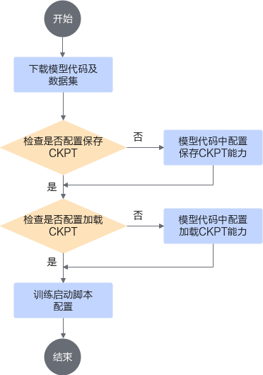
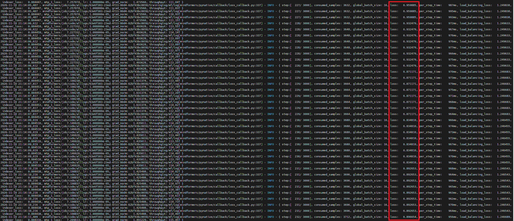

# MindSpore场景示例

>[!NOTE]
>
>- 本章节以在Atlas 950 SuperPoD超节点上训练DeepSeek-V4-Flash模型为例，说明MindSpore **动态图（PyNative）**场景下**Job级重调度**与**Pod级重调度**的使用方法。
>- 示例中的模型、数据集与并行配置仅用于演示操作流程，实际使用时请根据业务替换。
>- 如需使用Atlas A2系列产品/Atlas A3系列产品 及MindSpore **静态图**能力，请使用26.2.0版本的[MindSpore场景示例](https://gitcode.com/Ascend/mind-cluster/blob/v26.2.0/docs/zh/scheduling/04_usage/05_fault_recovery/01_resumable_training/03_examples_and_verification/02_mindspore_examples_and_verification.md)及其配套版本，本章节不再提供该部分内容。

## 制作镜像<a name="ZH-CN_TOPIC_0000002511426469-mindspore"></a>

[MindSpore Transformers套件](https://gitcode.com/mindspore/mindformers)（以下简称MindFormers）的目标是构建一个大模型训练、微调、评估、推理、部署的全流程开发套件，提供业内主流的Transformer类预训练模型和SOTA下游任务应用，涵盖丰富的并行特性。期望帮助用户轻松地实现大模型训练和创新研发。

[MindSpore Transformers文档](https://www.mindspore.cn/mindformers/docs/zh-CN/r2.1.0/installation.html)的快速入门包括了安装与快速启动章节，可以在镜像制作时参考。

本章节基于openEuler 24.03 LTS基础OS制作训练镜像。

### 准备软件包<a name="section_mindspore_a5_packages"></a>

请按照表1所示，获取对应操作系统的软件包，并准备镜像构建所需的Dockerfile文件与脚本文件。软件包名称中{version}表示版本号、{arch}表示架构。

**表1**  准备软件包

<a name="zh-cn_topic_mindspore_a5_pkg_table"></a>
<table><thead align="left"><tr id="zh-cn_topic_mindspore_a5_pkg_row_head">
<th class="cellrowborder" valign="top" width="24.55%" id="mcps1.2.5.1.1"><p id="zh-cn_topic_mindspore_a5_pkg_ph1"><a name="zh-cn_topic_mindspore_a5_pkg_ph1"></a>软件包</p>
</th>
<th class="cellrowborder" valign="top" width="25.45%" id="mcps1.2.5.1.2"><p id="zh-cn_topic_mindspore_a5_pkg_ph2"><a name="zh-cn_topic_mindspore_a5_pkg_ph2"></a>是否必选</p>
</th>
<th class="cellrowborder" valign="top" width="24.55%" id="mcps1.2.5.1.3"><p id="zh-cn_topic_mindspore_a5_pkg_ph3"><a name="zh-cn_topic_mindspore_a5_pkg_ph3"></a>说明</p>
</th>
<th class="cellrowborder" valign="top" width="25.45%" id="mcps1.2.5.1.4"><p id="zh-cn_topic_mindspore_a5_pkg_ph4"><a name="zh-cn_topic_mindspore_a5_pkg_ph4"></a>获取方法</p>
</th>
</tr>
</thead>
<tbody>
<tr id="zh-cn_topic_mindspore_a5_pkg_row1">
<td class="cellrowborder" valign="top" width="24.55%" headers="mcps1.2.5.1.1 "><p id="zh-cn_topic_mindspore_a5_pkg_r1c1"><a name="zh-cn_topic_mindspore_a5_pkg_r1c1"></a>openEuler 24.03 LTS基础镜像</p>
</td>
<td class="cellrowborder" valign="top" width="25.45%" headers="mcps1.2.5.1.2 "><p id="zh-cn_topic_mindspore_a5_pkg_r1c2"><a name="zh-cn_topic_mindspore_a5_pkg_r1c2"></a>是</p>
</td>
<td class="cellrowborder" valign="top" width="24.55%" headers="mcps1.2.5.1.3 "><p id="zh-cn_topic_mindspore_a5_pkg_r1c3"><a name="zh-cn_topic_mindspore_a5_pkg_r1c3"></a>训练镜像的基础OS镜像。</p>
</td>
<td class="cellrowborder" valign="top" width="25.45%" headers="mcps1.2.5.1.4 "><p id="zh-cn_topic_mindspore_a5_pkg_r1c4p1"><a name="zh-cn_topic_mindspore_a5_pkg_r1c4p1"></a>docker pull openeuler/openeuler:24.03-lts</p>
</td>
</tr>
<tr id="zh-cn_topic_mindspore_a5_pkg_row2">
<td class="cellrowborder" valign="top" width="24.55%" headers="mcps1.2.5.1.1 "><p id="zh-cn_topic_mindspore_a5_pkg_r2c1"><a name="zh-cn_topic_mindspore_a5_pkg_r2c1"></a>Python-3.12.4.tgz</p>
</td>
<td class="cellrowborder" valign="top" width="25.45%" headers="mcps1.2.5.1.2 "><p id="zh-cn_topic_mindspore_a5_pkg_r2c2"><a name="zh-cn_topic_mindspore_a5_pkg_r2c2"></a>是</p>
</td>
<td class="cellrowborder" valign="top" width="24.55%" headers="mcps1.2.5.1.3 "><p id="zh-cn_topic_mindspore_a5_pkg_r2c3"><a name="zh-cn_topic_mindspore_a5_pkg_r2c3"></a>Python源码包，用于编译安装Python解释器。</p>
</td>
<td class="cellrowborder" valign="top" width="25.45%" headers="mcps1.2.5.1.4 "><p id="zh-cn_topic_mindspore_a5_pkg_r2c4p1"><a name="zh-cn_topic_mindspore_a5_pkg_r2c4p1"></a>wget https://www.python.org/ftp/python/3.12.4/Python-3.12.4.tgz</p>
</td>
</tr>
<tr id="zh-cn_topic_mindspore_a5_pkg_row3">
<td class="cellrowborder" valign="top" width="24.55%" headers="mcps1.2.5.1.1 "><p id="zh-cn_topic_mindspore_a5_pkg_r3c1"><a name="zh-cn_topic_mindspore_a5_pkg_r3c1"></a>umdk-urma-{version}.{arch}.rpm.tar.gz</p>
</td>
<td class="cellrowborder" valign="top" width="25.45%" headers="mcps1.2.5.1.2 "><p id="zh-cn_topic_mindspore_a5_pkg_r3c2"><a name="zh-cn_topic_mindspore_a5_pkg_r3c2"></a>是</p>
</td>
<td class="cellrowborder" valign="top" width="24.55%" headers="mcps1.2.5.1.3 "><p id="zh-cn_topic_mindspore_a5_pkg_r3c3"><a name="zh-cn_topic_mindspore_a5_pkg_r3c3"></a>UB用户态库。版本需与宿主一致，当前仅支持aarch64架构。</p>
</td>
<td class="cellrowborder" valign="top" width="25.45%" headers="mcps1.2.5.1.4 "><p id="zh-cn_topic_mindspore_a5_pkg_r3c4p1"><a name="zh-cn_topic_mindspore_a5_pkg_r3c4p1"></a>从<a href="https://mirrors.huaweicloud.com/ascend/" target="_blank" rel="noopener noreferrer">华为云镜像仓</a>的archive目录下载。</p>
</td>
</tr>
<tr id="zh-cn_topic_mindspore_a5_pkg_row4">
<td class="cellrowborder" valign="top" width="24.55%" headers="mcps1.2.5.1.1 "><p id="zh-cn_topic_mindspore_a5_pkg_r4c1"><a name="zh-cn_topic_mindspore_a5_pkg_r4c1"></a>Ascend-cann-toolkit_{version}_linux-{arch}.run</p>
</td>
<td class="cellrowborder" valign="top" width="25.45%" headers="mcps1.2.5.1.2 "><p id="zh-cn_topic_mindspore_a5_pkg_r4c2"><a name="zh-cn_topic_mindspore_a5_pkg_r4c2"></a>是</p>
</td>
<td class="cellrowborder" valign="top" width="24.55%" headers="mcps1.2.5.1.3 "><p id="zh-cn_topic_mindspore_a5_pkg_r4c3"><a name="zh-cn_topic_mindspore_a5_pkg_r4c3"></a>CANN Toolkit开发套件包。</p>
</td>
<td class="cellrowborder" valign="top" width="25.45%" headers="mcps1.2.5.1.4 "><p id="zh-cn_topic_mindspore_a5_pkg_r4c4p1"><a name="zh-cn_topic_mindspore_a5_pkg_r4c4p1"></a><a href="https://www.hiascend.com/zh/developer/download/community/result?module=cann" target="_blank" rel="noopener noreferrer">获取链接</a>，请获取和服务器型号匹配的软件包。</p>
</td>
</tr>
<tr id="zh-cn_topic_mindspore_a5_pkg_row5">
<td class="cellrowborder" valign="top" width="24.55%" headers="mcps1.2.5.1.1 "><p id="zh-cn_topic_mindspore_a5_pkg_r5c1"><a name="zh-cn_topic_mindspore_a5_pkg_r5c1"></a>Ascend-cann-950-ops_{version}_linux-{arch}.run</p>
</td>
<td class="cellrowborder" valign="top" width="25.45%" headers="mcps1.2.5.1.2 "><p id="zh-cn_topic_mindspore_a5_pkg_r5c2"><a name="zh-cn_topic_mindspore_a5_pkg_r5c2"></a>是</p>
</td>
<td class="cellrowborder" valign="top" width="24.55%" headers="mcps1.2.5.1.3 "><p id="zh-cn_topic_mindspore_a5_pkg_r5c3"><a name="zh-cn_topic_mindspore_a5_pkg_r5c3"></a>CANN算子包。</p>
</td>
<td class="cellrowborder" valign="top" width="25.45%" headers="mcps1.2.5.1.4 "><p id="zh-cn_topic_mindspore_a5_pkg_r5c4p1"><a name="zh-cn_topic_mindspore_a5_pkg_r5c4p1"></a><a href="https://www.hiascend.com/zh/developer/download/community/result?module=cann" target="_blank" rel="noopener noreferrer">获取链接</a>，请获取和服务器型号匹配的软件包。</p>
</td>
</tr>
<tr id="zh-cn_topic_mindspore_a5_pkg_row6">
<td class="cellrowborder" valign="top" width="24.55%" headers="mcps1.2.5.1.1 "><p id="zh-cn_topic_mindspore_a5_pkg_r6c1"><a name="zh-cn_topic_mindspore_a5_pkg_r6c1"></a>version.info</p>
</td>
<td class="cellrowborder" valign="top" width="25.45%" headers="mcps1.2.5.1.2 "><p id="zh-cn_topic_mindspore_a5_pkg_r6c2"><a name="zh-cn_topic_mindspore_a5_pkg_r6c2"></a>是</p>
</td>
<td class="cellrowborder" valign="top" width="24.55%" headers="mcps1.2.5.1.3 "><p id="zh-cn_topic_mindspore_a5_pkg_r6c3"><a name="zh-cn_topic_mindspore_a5_pkg_r6c3"></a>驱动版本信息文件。</p>
</td>
<td class="cellrowborder" valign="top" width="25.45%" headers="mcps1.2.5.1.4 "><p id="zh-cn_topic_mindspore_a5_pkg_r6c4p1"><a name="zh-cn_topic_mindspore_a5_pkg_r6c4p1"></a>从host拷贝“/usr/local/Ascend/driver/version.info”文件。</p>
</td>
</tr>
<tr id="zh-cn_topic_mindspore_a5_pkg_row7">
<td class="cellrowborder" valign="top" width="24.55%" headers="mcps1.2.5.1.1 "><p id="zh-cn_topic_mindspore_a5_pkg_r7c1"><a name="zh-cn_topic_mindspore_a5_pkg_r7c1"></a>ascend_install.info</p>
</td>
<td class="cellrowborder" valign="top" width="25.45%" headers="mcps1.2.5.1.2 "><p id="zh-cn_topic_mindspore_a5_pkg_r7c2"><a name="zh-cn_topic_mindspore_a5_pkg_r7c2"></a>是</p>
</td>
<td class="cellrowborder" valign="top" width="24.55%" headers="mcps1.2.5.1.3 "><p id="zh-cn_topic_mindspore_a5_pkg_r7c3"><a name="zh-cn_topic_mindspore_a5_pkg_r7c3"></a>驱动安装信息文件。</p>
</td>
<td class="cellrowborder" valign="top" width="25.45%" headers="mcps1.2.5.1.4 "><p id="zh-cn_topic_mindspore_a5_pkg_r7c4p1"><a name="zh-cn_topic_mindspore_a5_pkg_r7c4p1"></a>从host拷贝“/etc/ascend_install.info”文件。</p>
</td>
</tr>
<tr id="zh-cn_topic_mindspore_a5_pkg_row8">
<td class="cellrowborder" valign="top" width="24.55%" headers="mcps1.2.5.1.1 "><p id="zh-cn_topic_mindspore_a5_pkg_r8c1"><a name="zh-cn_topic_mindspore_a5_pkg_r8c1"></a>MindFormers代码仓</p>
</td>
<td class="cellrowborder" valign="top" width="25.45%" headers="mcps1.2.5.1.2 "><p id="zh-cn_topic_mindspore_a5_pkg_r8c2"><a name="zh-cn_topic_mindspore_a5_pkg_r8c2"></a>是</p>
</td>
<td class="cellrowborder" valign="top" width="24.55%" headers="mcps1.2.5.1.3 "><p id="zh-cn_topic_mindspore_a5_pkg_r8c3"><a name="zh-cn_topic_mindspore_a5_pkg_r8c3"></a>构建一个大模型训练、微调、评估、推理、部署的全流程开发套件，提供业内主流的Transformer类预训练模型和SOTA下游任务应用，涵盖丰富的并行特性。</p>
</td>
<td class="cellrowborder" valign="top" width="25.45%" headers="mcps1.2.5.1.4 "><p id="zh-cn_topic_mindspore_a5_pkg_r8c4p1"><a name="zh-cn_topic_mindspore_a5_pkg_r8c4p1"></a>git clone -b r2.1.0 https://atomgit.com/mindspore/mindformers.git</p>
<p id="zh-cn_topic_mindspore_a5_pkg_r8c4p2"><a name="zh-cn_topic_mindspore_a5_pkg_r8c4p2"></a>commit 63ee1d5bed3d46289f0cf50cfce7e7e778cd89c9</p>
<p id="zh-cn_topic_mindspore_a5_pkg_r8c4p3"><a name="zh-cn_topic_mindspore_a5_pkg_r8c4p3"></a>镜像内源码编译安装。</p>
</td>
</tr>
<tr id="zh-cn_topic_mindspore_a5_pkg_row9">
<td class="cellrowborder" valign="top" width="24.55%" headers="mcps1.2.5.1.1 "><p id="zh-cn_topic_mindspore_a5_pkg_r9c1"><a name="zh-cn_topic_mindspore_a5_pkg_r9c1"></a>HyperParallel代码仓</p>
</td>
<td class="cellrowborder" valign="top" width="25.45%" headers="mcps1.2.5.1.2 "><p id="zh-cn_topic_mindspore_a5_pkg_r9c2"><a name="zh-cn_topic_mindspore_a5_pkg_r9c2"></a>是</p>
</td>
<td class="cellrowborder" valign="top" width="24.55%" headers="mcps1.2.5.1.3 "><p id="zh-cn_topic_mindspore_a5_pkg_r9c3"><a name="zh-cn_topic_mindspore_a5_pkg_r9c3"></a>昇腾超节点亲和的分布式并行加速库。</p>
</td>
<td class="cellrowborder" valign="top" width="25.45%" headers="mcps1.2.5.1.4 "><p id="zh-cn_topic_mindspore_a5_pkg_r9c4p1"><a name="zh-cn_topic_mindspore_a5_pkg_r9c4p1"></a>git clone -b r1.0.0 https://atomgit.com/mindspore/hyper-parallel.git</p>
<p id="zh-cn_topic_mindspore_a5_pkg_r9c4p2"><a name="zh-cn_topic_mindspore_a5_pkg_r9c4p2"></a>commit c95c7514053abdd9460b6b55cf4b4021ffbc246d</p>
<p id="zh-cn_topic_mindspore_a5_pkg_r9c4p3"><a name="zh-cn_topic_mindspore_a5_pkg_r9c4p3"></a>镜像内源码编译安装。</p>
</td>
</tr>
<tr id="zh-cn_topic_mindspore_a5_pkg_row10">
<td class="cellrowborder" valign="top" width="24.55%" headers="mcps1.2.5.1.1 "><p id="zh-cn_topic_mindspore_a5_pkg_r10c1"><a name="zh-cn_topic_mindspore_a5_pkg_r10c1"></a>mindspore-{version}-cp{py}-cp{py}-linux_{arch}.whl</p>
</td>
<td class="cellrowborder" valign="top" width="25.45%" headers="mcps1.2.5.1.2 "><p id="zh-cn_topic_mindspore_a5_pkg_r10c2"><a name="zh-cn_topic_mindspore_a5_pkg_r10c2"></a>是</p>
</td>
<td class="cellrowborder" valign="top" width="24.55%" headers="mcps1.2.5.1.3 "><p id="zh-cn_topic_mindspore_a5_pkg_r10c3"><a name="zh-cn_topic_mindspore_a5_pkg_r10c3"></a>MindSpore训练框架。</p>
</td>
<td class="cellrowborder" valign="top" width="25.45%" headers="mcps1.2.5.1.4 "><p id="zh-cn_topic_mindspore_a5_pkg_r10c4p1"><a name="zh-cn_topic_mindspore_a5_pkg_r10c4p1"></a>从<a href="https://www.mindspore.cn/versions" target="_blank" rel="noopener noreferrer">MindSpore下载页</a>获取与CANN 9.2.1、Atlas 950 SuperPoD超节点配套的whl包放到"v26.3.0/pkgs/wheels/"目录下</p>
<p id="zh-cn_topic_mindspore_a5_pkg_r10c4p3"><a name="zh-cn_topic_mindspore_a5_pkg_r10c4p3"></a>示例使用mindspore-2.12.0-cp312-cp312-linux_aarch64.whl。</p>
</td>
</tr>
<tr id="zh-cn_topic_mindspore_a5_pkg_row11">
<td class="cellrowborder" valign="top" width="24.55%" headers="mcps1.2.5.1.1 "><p id="zh-cn_topic_mindspore_a5_pkg_r11c1"><a name="zh-cn_topic_mindspore_a5_pkg_r11c1"></a>taskd-{version}-py3-none-linux_{arch}.whl</p>
</td>
<td class="cellrowborder" valign="top" width="25.45%" headers="mcps1.2.5.1.2 "><p id="zh-cn_topic_mindspore_a5_pkg_r11c2"><a name="zh-cn_topic_mindspore_a5_pkg_r11c2"></a>是</p>
</td>
<td class="cellrowborder" valign="top" width="24.55%" headers="mcps1.2.5.1.3 "><p id="zh-cn_topic_mindspore_a5_pkg_r11c3"><a name="zh-cn_topic_mindspore_a5_pkg_r11c3"></a>集群调度组件断点续训whl包。</p>
</td>
<td class="cellrowborder" valign="top" width="25.45%" headers="mcps1.2.5.1.4 "><p id="zh-cn_topic_mindspore_a5_pkg_r11c4p1"><a name="zh-cn_topic_mindspore_a5_pkg_r11c4p1"></a>从<a href="https://www.hiascend.com/zh/developer/download/community/result?module=dl%2Bcann" target="_blank" rel="noopener noreferrer">获取链接</a>获取Ascend-mindxdl-taskd_{version}_linux-{arch}.zip，解压后获得相应的whl包。</p>
</td>
</tr>
<tr id="zh-cn_topic_mindspore_a5_pkg_row12">
<td class="cellrowborder" valign="top" width="24.55%" headers="mcps1.2.5.1.1 "><p id="zh-cn_topic_mindspore_a5_pkg_r12c1"><a name="zh-cn_topic_mindspore_a5_pkg_r12c1"></a>Dockerfile与脚本文件</p>
</td>
<td class="cellrowborder" valign="top" width="25.45%" headers="mcps1.2.5.1.2 "><p id="zh-cn_topic_mindspore_a5_pkg_r12c2"><a name="zh-cn_topic_mindspore_a5_pkg_r12c2"></a>是</p>
</td>
<td class="cellrowborder" valign="top" width="24.55%" headers="mcps1.2.5.1.3 "><p id="zh-cn_topic_mindspore_a5_pkg_r12c3"><a name="zh-cn_topic_mindspore_a5_pkg_r12c3"></a>制作镜像需要。</p>
</td>
<td class="cellrowborder" valign="top" width="25.45%" headers="mcps1.2.5.1.4 "><p id="zh-cn_topic_mindspore_a5_pkg_r12c4p1"><a name="zh-cn_topic_mindspore_a5_pkg_r12c4p1"></a>参见<a href="#section_mindspore_a5_steps">操作步骤</a>。</p>
</td>
</tr>
</tbody>
</table>

>[!NOTE]
>
>- 本章节以Python 3.12.4、CANN 9.2.1、MindSpore 2.12.0、MindFormers 2.1.0、HyperParallel 1.0.0为例制作，镜像标签为`mindspore-sample-dl:v26.3.0-cann9.2.1-mindspore2.12.0-950-py3.12-aarch64`，实际使用时需根据实际情况修改相关步骤。
>- MindFormers、HyperParallel的版本需要与MindSpore版本保持配套，请参见[MindFormers](https://www.mindspore.cn/mindformers/docs/zh-CN/r2.1.0/installation.html)查看配套关系。
>- CANN软件包需与服务器型号匹配，UMDK版本需与宿主驱动配套。
>- MindSpore通过whl包安装，MindFormers、HyperParallel通过commit ID固定源码版本，制作镜像时会校验源码仓当前提交的commit ID，若与要求的commit ID不一致，将中断构建。

### 操作步骤<a name="section_mindspore_a5_steps"></a>

1. 按[表1](#section_mindspore_a5_packages)准备软件包，并按下述目录结构放置。

    ```text
    mindspore-sample-dl/
    └── v26.3.0/
        ├── Dockerfile.openeuler
        └── pkgs/
            ├── Python-3.12.4.tgz
            ├── umdk-urma-26.06.0-B016.glibc217.aarch64.rpm.tar.gz
            ├── Ascend-cann-toolkit_9.2.1_linux-aarch64.run
            ├── Ascend-cann-950-ops_9.2.1_linux-aarch64.run
            ├── version.info
            ├── ascend_install.info
            └── wheels/
                ├── mindspore-2.12.0-cp312-cp312-linux_aarch64.whl
                └── taskd-26.3.0-py3-none-linux_aarch64.whl
    ```

2. samples仓中`v26.3.0/Dockerfile.openeuler`的内容如下，与[样例仓中的文件](https://gitcode.com/Ascend/mindcluster-deploy/blob/master/samples/docker/mindspore-sample-dl/v26.3.0/Dockerfile.openeuler)一致。

    ```dockerfile
    # MindSpore 26.3.0 训练镜像（openEuler 24.03 LTS）

    ARG BASE_OS=openeuler/openeuler:24.03-lts
    FROM ${BASE_OS}

    ARG PY_VERSION=3.12.4
    ARG CANN_VERSION=9.2.1
    ARG UMDK_PKG=umdk-urma-26.06.0-B016.glibc217.aarch64.rpm.tar.gz
    ARG TASKD_WHL=taskd-26.3.0-py3-none-linux_aarch64.whl

    ARG MS_VERSION=2.12.0
    ARG MS_WHL=mindspore-2.12.0-cp312-cp312-linux_aarch64.whl
    ARG MF_COMMIT=63ee1d5bed3d46289f0cf50cfce7e7e778cd89c9
    ARG HP_COMMIT=c95c7514053abdd9460b6b55cf4b4021ffbc246d

    ARG NUMPY_VERSION=1.26.4
    ARG SCIPY_VERSION=1.13.1
    ARG PANDAS_VERSION=3.0.6
    ARG PYARROW_VERSION=23.0.1
    ARG DATASETS_VERSION=5.0.1
    WORKDIR /root

    # 1. 系统依赖
    RUN set -eux; \
        yum install -y --setopt=tsflags=nodocs \
          unzip shadow util-linux which procps-ng pciutils net-tools numactl-libs \
          libnl3 ca-certificates tar findutils gzip git curl wget cmake patch \
          gcc gcc-c++ make \
          openssl-devel bzip2-devel libffi-devel zlib-devel readline-devel \
          sqlite-devel xz-devel ncurses-devel gdbm-devel \
          gcc-gfortran openblas lapack hdf5; \
        yum clean all; rm -rf /var/cache/yum

    # 2. UMDK
    COPY v26.3.0/pkgs/${UMDK_PKG} /tmp/
    RUN set -eux; \
        mkdir -p /tmp/p; tar -mzxf /tmp/${UMDK_PKG} -C /tmp/p; \
        find /tmp/p -name '*.rpm' \( -name '*kmod*' -o -name '*debug*' \) -delete; \
        rpm -ivh --replacepkgs /tmp/p/*.rpm && ldconfig; \
        rm -rf /tmp/p /tmp/${UMDK_PKG}

    # 3. Python
    COPY v26.3.0/pkgs/Python-${PY_VERSION}.tgz /tmp/py.tgz
    RUN set -eux; \
        cd /tmp && tar -xzf py.tgz && cd Python-${PY_VERSION}; \
        ./configure --prefix=/usr/local/python3.12 --enable-shared --with-ensurepip=install; \
        make -j"$(nproc)"; make install; \
        echo /usr/local/python3.12/lib > /etc/ld.so.conf.d/py312.conf && ldconfig; \
        ln -sf /usr/local/python3.12/bin/python3.12 /usr/local/bin/python3; \
        ln -sf /usr/local/python3.12/bin/python3.12 /usr/local/bin/python; \
        ln -sf /usr/local/python3.12/bin/pip3.12 /usr/local/bin/pip3; \
        ln -sf /usr/local/python3.12/bin/pip3.12 /usr/local/bin/pip; \
        rm -rf /tmp/Python-* /tmp/py.tgz

    ENV PATH=/usr/local/python3.12/bin:${PATH}

    # 4. pip 源
    RUN python3 -m pip config set global.index-url https://mirrors.huaweicloud.com/repository/pypi/simple

    # 5. CANN
    ARG CANN_TOOLKIT=Ascend-cann-toolkit_${CANN_VERSION}_linux-aarch64.run
    ARG CANN_OPS=Ascend-cann-950-ops_${CANN_VERSION}_linux-aarch64.run
    COPY v26.3.0/pkgs/${CANN_TOOLKIT} v26.3.0/pkgs/${CANN_OPS} \
         v26.3.0/pkgs/version.info v26.3.0/pkgs/ascend_install.info /opt/pkgs/
    RUN set -eux; \
        getent group 1000 >/dev/null || groupadd -g 1000 HwHiAiUser; \
        id -u HwHiAiUser >/dev/null 2>&1 || \
          useradd -u 1000 -g HwHiAiUser -d /home/HwHiAiUser -m -s /bin/bash HwHiAiUser; \
        mkdir -p /usr/local/Ascend/driver/lib64; \
        cp /opt/pkgs/version.info /usr/local/Ascend/driver/; \
        cp /opt/pkgs/ascend_install.info /etc/; \
        chmod +x /opt/pkgs/*.run; \
        /opt/pkgs/${CANN_TOOLKIT} --install-path=/usr/local/Ascend/ --install --quiet; \
        /opt/pkgs/${CANN_OPS} --install --quiet; \
        rm -rf /opt/pkgs /usr/local/Ascend/driver /etc/ascend_install.info

    ENV PATH=/usr/local/Ascend/cann/bin:${PATH}

    RUN set -eux; \
        python3 -m pip uninstall -y topi hccl || true; \
        python3 -m pip install --no-cache-dir sympy decorator; \
        python3 -m pip install --no-cache-dir /usr/local/Ascend/cann/lib64/hccl-*-py3-none-any.whl

    # 6. 框架

    # 6.1 MindSpore
    COPY v26.3.0/pkgs/wheels/${MS_WHL} /opt/wheels/
    RUN set -eux; \
        python3 -m pip install --no-cache-dir "setuptools" "wheel"; \
        python3 -m pip install --no-cache-dir /opt/wheels/${MS_WHL}; \
        python3 -m pip show mindspore | head -2; \
        rm -rf /opt/wheels

    # 6.2 HyperParallel
    RUN set -eux; \
        mkdir -p /tmp/hp-src; cd /tmp/hp-src; \
        git init -q; \
        git remote add origin https://atomgit.com/mindspore/hyper-parallel.git; \
        git fetch --depth 1 origin "${HP_COMMIT}"; \
        git checkout -q FETCH_HEAD; \
        test "$(git rev-parse HEAD)" = "${HP_COMMIT}"; \
        python3 setup.py bdist_wheel -d /tmp/hp; \
        python3 -m pip install --no-cache-dir --no-deps /tmp/hp/*.whl; \
        rm -rf /tmp/hp-src /tmp/hp

    # 6.3 MindFormers
    RUN set -eux; \
        mkdir -p /tmp/mf-src; cd /tmp/mf-src; \
        git init -q; \
        git remote add origin https://atomgit.com/mindspore/mindformers.git; \
        git fetch --depth 1 origin "${MF_COMMIT}"; \
        git checkout -q FETCH_HEAD; \
        test "$(git rev-parse HEAD)" = "${MF_COMMIT}"; \
        python3 setup.py bdist_wheel -d /tmp/mf; \
        M=$(unzip -Z1 /tmp/mf/*.whl | grep 'dist-info/METADATA$' | head -1); \
        unzip -p /tmp/mf/*.whl "$M" | sed -n 's/^Requires-Dist: //p' \
          | grep -v 'extra ==' \
          | grep -vE '^(mindspore|hyper-parallel|pyarrow|datasets)' > /tmp/mf-req.txt; \
        python3 -m pip install --no-cache-dir -r /tmp/mf-req.txt; \
        python3 -m pip install --no-cache-dir --no-deps /tmp/mf/*.whl; \
        rm -rf /tmp/mf-src /tmp/mf /tmp/mf-req.txt

    # 6.4 TaskD
    COPY v26.3.0/pkgs/wheels/${TASKD_WHL} /opt/wheels/
    RUN python3 -m pip install --no-cache-dir /opt/wheels/${TASKD_WHL} "apscheduler<4" && rm -rf /opt/wheels

    # 7. 依赖版本锁定
    RUN set -eux; \
        python3 -m pip install --no-cache-dir \
          "numpy==${NUMPY_VERSION}" "scipy==${SCIPY_VERSION}" "pandas==${PANDAS_VERSION}" \
          "pyarrow==${PYARROW_VERSION}" "datasets==${DATASETS_VERSION}"; \
        python3 -c 'import numpy, scipy, pandas; print("numpy", numpy.__version__, "| scipy", scipy.__version__, "| pandas", pandas.__version__)'; \
        python3 -c 'import pyarrow, datasets; print("pyarrow", pyarrow.__version__, "| datasets", datasets.__version__)'; \
        python3 -c 'import mindspore, mindformers; print("mindspore", mindspore.__version__, "| mindformers", mindformers.__version__)'

    # 8. 环境自检
    RUN printf '%s\n' \
          '#!/bin/bash' \
          'source /usr/local/Ascend/cann/set_env.sh' \
          'python3 -m pip list | grep -Ei "mindspore|mindformers|hyper|taskd|numpy|scipy|pandas|pyarrow|datasets"' \
          > /usr/local/bin/ms950-env && chmod 755 /usr/local/bin/ms950-env

    RUN echo "source /usr/local/Ascend/cann/set_env.sh" >> /root/.bashrc

    ENV HCCL_WHITELIST_DISABLE=1 \
        LANG=C.UTF-8 \
        PYTHONUNBUFFERED=1 \
        PATH=/usr/local/python3.12/bin:/usr/local/Ascend/cann/bin:${PATH}

    LABEL org.opencontainers.image.title="mindspore-sample-dl" \
          org.opencontainers.image.version="26.3.0" \
          ai.ascend.cann.version="${CANN_VERSION}" \
          ai.ascend.mindspore.version="${MS_VERSION}" \
          ai.ascend.mindformers.commit="${MF_COMMIT}" \
          ai.ascend.hyper_parallel.commit="${HP_COMMIT}" \
          ai.ascend.taskd.version="26.3.0" \
          ai.ascend.hardware="Atlas 950 SuperPoD"

    CMD ["/bin/bash"]
    ```

3. 进入`mindspore-sample-dl/`目录，执行以下命令构建镜像。为了使Dockerfile更加安全，用户可以根据业务在其中定义HEALTHCHECK检查。通过在容器内部运行**HEALTHCHECK** _\[OPTIONS\]_ **CMD**命令来检查容器的运行状况。注意不要遗漏命令结尾的“.”。

    ```bash
    docker build --network=host -f v26.3.0/Dockerfile.openeuler \
      -t mindspore-sample-dl:v26.3.0-cann9.2.1-mindspore2.12.0-950-py3.12-aarch64 .
    ```

>[!NOTE]
> 除按上述流程手动构建镜像外，用户也可直接使用开箱即用的示例镜像`mindspore-sample-dl:v26.3.0-cann9.2.1-mindspore2.12.0-950-py3.12-aarch64`。示例镜像可通过[AscendHub](https://www.hiascend.com/developer/ascendhub)获取，用于快速验证。

<a name="section_mindspore_a5_build_image"></a>
<a name="section_mindspore_a5_pull_image"></a>

## 脚本适配<a name="ZH-CN_TOPIC_0000002511426481-mindspore"></a>

### 流程说明<a name="ZH-CN_TOPIC_0000002511346469-mindspore"></a>

模型脚本需要适配CKPT之后才可以使用断点续训功能，脚本适配大致流程和逻辑如[图1](#fig_mindspore_a5_adapt)所示。

**图1**  脚本适配流程

<a name="fig_mindspore_a5_adapt"></a>


### 适配示例<a name="section_mindspore_a5_adapt_example"></a>

本章节将指导用户step by step地完成断点续训的适配步骤。

>[!NOTE]
>
>- 断点续训展示的组件代码为开源代码，其中涉及到相关安全说明请参见[安全说明](../../../../07_references/05_appendix.md#安全说明)。
>- 下文中模型示例代码可能与实际版本存在差异，请以实际版本代码为准。
>- 模型的参数配置，根据模型仓的模型配置以实际情况来写。若修改不当，可能会引发不可预知的问题。
>- 若训练过程中出现“Failed to bind the IP port. Reason: The IP address and port have been bound already”报错，可以按照如下进行配置，详情请参见《CANN HCCL集合通信库》中的“[HCCL_HOST_SOCKET_PORT_RANGE](https://www.hiascend.com/document/detail/zh/CANNCommunityEdition/920/commlib/hcclug/docs/zh/user_guide/hccl_env/HCCL_HOST_SOCKET_PORT_RANGE.md)”章节。
>
>   ```shell
>   export HCCL_HOST_SOCKET_PORT_RANGE="60000-60050"
>   export HCCL_NPU_SOCKET_PORT_RANGE="61000-61050"
>   ```
>
>- 若使用TaskD组件且训练容器使用Host网络，则先通过`sysctl net.ipv4.ip_local_reserved_ports`查询当前预留端口配置后，通过`sysctl -w net.ipv4.ip_local_reserved_ports="xxx,9601,9602"`新增预留端口9601、9602（其中xxx指的是前面查出来已配置的端口，若无则省略）。

训练代码与数据集准备，可以参考[MindFormers文档](https://gitcode.com/mindspore/mindformers/blob/master/configs/deepseek4/README.md)。下面以两台Atlas 950 SuperPoD超节点为例，说明具体操作步骤。

#### 准备代码<a name="section_mindspore_a5_prepare_code"></a>

将MindFormers代码（r2.1.0分支）放到共享存储的代码目录下，两个训练节点均需可见。

```bash
mkdir -p /data/atlas_dls/public/code
cd /data/atlas_dls/public/code

git clone https://gitcode.com/mindspore/mindformers.git
cd mindformers
git checkout r2.1.0
cd ..
mv mindformers DeepSeekV4_for_MS_code
```

本章节使用的模型配置为`configs/deepseek4/pretrain_deepseek4_flash_reduction.yaml`。该配置为缩减版：相比完整配置，它减小了模型规模与训练迭代次数，用于在少量节点上快速跑通断点续训流程，不建议用于正式训练。该配置由MindFormers交付，无需单独准备，配置字段说明请参见[DeepSeek-V4配置说明](https://gitcode.com/mindspore/mindformers/blob/master/configs/deepseek4/README.md)。

#### 准备数据集<a name="section_mindspore_a5_prepare_data"></a>

本章节使用WikiText-103数据集，需转换为Megatron格式后使用。

1. 下载数据集。请自行从[DagsHub](https://dagshub.com/DagsHub/WIkiText-103/src/main/dataset/tokens/wiki.train.tokens)下载`wiki.train.tokens`，并放到服务器目录下，如“/data/atlas_dls/public/code/DeepSeekV4_for_MS_code/dataset”。

2. 转换数据集。
    1. 下载数据集转换脚本。从[数据集转换](https://gitee.com/mindspore/mindformers/issues/ICOKGY)下载转换脚本`gen_wiki_json.py`，放到服务器目录下，如“/data/atlas_dls/public/code/DeepSeekV4_for_MS_code/dataset/gen_wiki_json.py”。

    2. 下载tokenizer文件。从[DeepSeek-V4-Flash](https://huggingface.co/deepseek-ai/DeepSeek-V4-Flash)下载tokenizer文件（DeepSeek-V4-Pro与DeepSeek-V4-Flash的tokenizer相同），放到服务器目录下，如“/data/atlas_dls/public/code/DeepSeekV4_for_MS_code/dataset/DeepSeek-V4-Flash”。

    3. 转换数据集。
        1. 启动容器并挂载所需文件。

            ```shell
            docker run -it -v /data/atlas_dls/public/code/:/data/atlas_dls/public/code/ mindspore-sample-dl:v26.3.0-cann9.2.1-mindspore2.12.0-950-py3.12-aarch64 bash
            ```

        2. 执行转换脚本，将`wiki.train.tokens`转换为jsonl格式。

            ```shell
            cd /data/atlas_dls/public/code/DeepSeekV4_for_MS_code/dataset
            python gen_wiki_json.py --input wiki.train.tokens --output wiki.jsonl
            ```

        3. 将jsonl格式数据转换为bin格式数据。

            >[!NOTE]
            >当前示例使用的MindFormers 2.1.0版本中，`toolkit/data_preprocess/megatron/preprocess_indexed_dataset.py`存在缺陷：`split_sentences`与`process_json_file`两个方法都把`encoder = Encoder(self.args)`写在了`with multiprocessing.Pool(self.workers, initializer=encoder.initializer)`语句之后，转换时会因`encoder`尚未定义而报错。使用2.1.0版本时，需要先在这两个方法中把`encoder = Encoder(self.args)`提前到`with`语句之前，再执行下述转换命令；后续版本将改用MindFormers 2.2.0，该版本已不再需要此修改。

            ```shell
            cd /data/atlas_dls/public/code/DeepSeekV4_for_MS_code
            python toolkit/data_preprocess/megatron/preprocess_indexed_dataset.py \
              --input /data/atlas_dls/public/code/DeepSeekV4_for_MS_code/dataset/wiki.jsonl \
              --output-prefix /data/atlas_dls/public/code/DeepSeekV4_for_MS_code/dataset/wiki103-megatron \
              --tokenizer-type HuggingFaceTokenizer \
              --tokenizer-dir /data/atlas_dls/public/code/DeepSeekV4_for_MS_code/dataset/DeepSeek-V4-Flash
            ```

3. 运行完成后，`/data/atlas_dls/public/code/DeepSeekV4_for_MS_code/dataset`目录下会生成`wiki103-megatron_text_document.bin`和`wiki103-megatron_text_document.idx`文件。填写数据集路径时，需要使用`/data/atlas_dls/public/code/DeepSeekV4_for_MS_code/dataset/wiki103-megatron_text_document`，不需要带后缀名。

#### 规划共享存储目录<a name="section_mindspore_a5_storage"></a>

代码、数据集、CKPT、日志均放在同一个共享目录下，两个训练节点均需可读写。示例目录结构如下。

```text
/data/atlas_dls/public/code/DeepSeekV4_for_MS_code/
├── configs/deepseek4/
│   └── pretrain_deepseek4_flash_reduction.yaml   # 模型配置
├── scripts/
│   ├── msrun_launcher.sh                         # 启动脚本（替换后）
│   └── msrun_launcher.sh.bak                     # 原有启动脚本备份
├── manager.py                                    # TaskD Manager
├── dataset/
│   ├── wiki.train.tokens                         # 原始数据集
│   ├── gen_wiki_json.py                          # 转换为jsonl格式的脚本
│   ├── wiki.jsonl                                # 中间结果
│   ├── DeepSeek-V4-Flash/                        # tokenizer 文件
│   └── wiki103-megatron_text_document.bin/.idx   # Megatron 格式数据集
└── output/
    ├── checkpoint/                               # 周期 CKPT
    └── alllogs/                                  # 训练日志
```

>[!NOTE]
>
>- `/data/atlas_dls/public/code/DeepSeekV4_for_MS_code`需要位于NFS或并行文件系统上，且两个节点可见，否则Pod重建后读不到CKPT。
>- 本文任务YAML使用`nfs`卷挂载上述目录，需按实际环境填写服务器地址与路径；若两个节点在同一路径上均已挂载共享存储，也可改为`hostPath`。
>- 任务YAML同时将上述目录下的`dataset`单独挂载为容器内`/job/data`，因此模型配置中的数据集路径写作`/job/data/wiki103-megatron_text_document`；若环境中未单独挂载数据集，请改用`/job/code/dataset/wiki103-megatron_text_document`。
>- 首次拉起时`checkpoint`目录可以为空，此时相当于从头开始训练。

#### 启动脚本<a name="section_mindspore_a5_launcher"></a>

将[MindCluster-Samples](https://gitcode.com/Ascend/mindcluster-deploy/tree/master/samples/train/resumable-training/fault-tolerance/ranktable/mindspore/DeepSeekV4)中的`msrun_launcher.sh`放到MindFormers代码仓的`scripts/`目录下，替换原有的同名脚本。为避免丢失原脚本，可先将其重命名后备份。

```shell
cd /data/atlas_dls/public/code/DeepSeekV4_for_MS_code/scripts
mv msrun_launcher.sh msrun_launcher.sh.bak
# 再将新的 msrun_launcher.sh 放到该目录
```

若训练任务YAML中“hostNetwork”参数值为“false”，则需要将启动脚本中“GLOO_SOCKET_IFNAME”的值设置为“eth0”。示例如下：

```shell
export GLOO_SOCKET_IFNAME=eth0  #eth0是容器内可以通信的网口
export HCCL_SOCKET_IFNAME=eth0
```

然后根据实际情况修改启动脚本中的其他参数，例如网口`enp194s0f0`、日志路径与执行命令中的模型配置。

同时，任务YAML中容器的启动命令需要把训练命令作为参数传给启动脚本，例如：

```shell
bash /job/code/scripts/msrun_launcher.sh "python run_mindformer.py --config configs/deepseek4/pretrain_deepseek4_flash_reduction.yaml --mode 1"
```

#### TaskD Manager<a name="section_mindspore_a5_manager"></a>

使用TaskD完成Pod级重调度，还需拉起TaskD Manager。

1. 创建`manager.py`文件，放在调用训练脚本时的当前目录下，`manager.py`文件内容如下所示。

    ```python
    from taskd.api import init_taskd_manager, start_taskd_manager
    import os

    job_id = os.getenv("MINDX_TASK_ID")
    node_nums = XX         # 用户填入任务节点总数
    proc_per_node = XX     # 用户填入任务每个节点的训练进程数量

    init_taskd_manager({"job_id": job_id, "node_nums": node_nums, "proc_per_node": proc_per_node})
    start_taskd_manager()
    ```

    >[!NOTE]
    >
    >`manager.py`文件中的参数详细说明请参见[def init_taskd_manager(config:dict) -> bool:](../../../../06_api/07_taskd/04_taskd_manager_apis.md#ZH-CN_TOPIC_0000002479386834)。

2. 在训练脚本中增加以下代码拉起TaskD Manager。前两条语句的作用是将安装TaskD后`libtaskd.so`的路径配置到环境变量`LD_PRELOAD`中。如果这两条语句配置不成功，可通过手动执行`pip show taskd`命令获取`Location`的值拼接上`/taskd/python/cython_api/libs/libtaskd.so`，然后通过`export`设置。

    ```shell
    TASKD_SO_PATH="$(pip show taskd | awk '/^Location: / {print $2"/taskd/python/cython_api/libs/libtaskd.so"}')"
    export LD_PRELOAD=$TASKD_SO_PATH:$LD_PRELOAD
    export TASKD_PROCESS_ENABLE="on"
    if [[ "${MS_SCHED_HOST}" == "${POD_IP}" ]]; then
        python /job/code/manager.py 2>> /job/code/alllogs/$MINDX_TASK_ID/taskd/error.log &   # manager.py具体执行路径由当前路径决定，error.log日志路径需提前创建
    fi
    msrun ...
    ```

3. 修改训练任务YAML，新增容器端口，在所有的Pod下增加TaskD通信使用的端口9601（如已有则跳过）。

    ```yaml
    ...
            spec:
              containers:
                ...
                ports:
                  - containerPort: 9601
                    name: taskd-port
    ...
    ```

#### 模型配置与续训<a name="section_mindspore_a5_ckpt"></a>

1. 打开代码目录下的模型配置文件。

    ```shell
    cd /data/atlas_dls/public/code/DeepSeekV4_for_MS_code
    vi configs/deepseek4/pretrain_deepseek4_flash_reduction.yaml
    ```

2. 按“i”进入编辑模式，修改如下配置。

    1. 修改数据集路径为实际使用的Megatron格式数据集路径，路径不带后缀名。

        ```yaml
        train_dataset: &train_dataset
          dataloader:
            ...
              data_path:
                - '1'
                - "/job/data/wiki103-megatron_text_document"
        ```

    2. 双机16卡训练时，将`global_batch_size`设置为16。

        ```yaml
        training:
          local_batch_size: 1
          global_batch_size: 16
        ```

    3. 如需开启周期CKPT保存与断点续训，打开`enable_save`并设置保存路径。

        ```yaml
        checkpoint:
          enable_save: True
          save_path: "/job/code/output/checkpoint"
          load_path: "/job/code/output/checkpoint"
        ```

        `save_path`为周期CKPT的保存目录，`load_path`为续训时加载CKPT的目录，两者配置为同一目录即可。训练开始时会从`load_path`目录下按`latest_checkpointed_iteration.txt`记录查找最新的CKPT并加载；当目录为空或不存在可用CKPT时，将会从头开始训练。

3. 按“Esc”键，输入:wq!，按“Enter”保存并退出编辑。

>[!NOTE]
>
>- 修改配置文件后，启动脚本或任务YAML中的模型配置路径需与实际文件名保持一致。
>- 上述并行配置适用于2节点共16卡，如果节点数或卡数变化，需同步调整`expert_parallel`、`data_parallel_shard`等并行参数。

## 准备任务YAML<a name="ZH-CN_TOPIC_0000002511426415-mindspore"></a>

集群调度组件为用户提供训练任务YAML示例，用户需要根据使用的功能、模型类型、训练框架和任务类型等，选择相应的YAML示例并根据实际环境修改后才可使用。

**表2**  训练任务YAML示例

<a name="zh-cn_topic_mindspore_a5_yaml_table"></a>
<table><thead align="left"><tr id="zh-cn_topic_mindspore_a5_yaml_row_head">
<th class="cellrowborder" valign="top" width="12%" id="mcps1.2.5.1.1"><p id="zh-cn_topic_mindspore_a5_yaml_ph1"><a name="zh-cn_topic_mindspore_a5_yaml_ph1"></a>任务类型</p>
</th>
<th class="cellrowborder" valign="top" width="24%" id="mcps1.2.5.1.2"><p id="zh-cn_topic_mindspore_a5_yaml_ph2"><a name="zh-cn_topic_mindspore_a5_yaml_ph2"></a>硬件型号</p>
</th>
<th class="cellrowborder" valign="top" width="12%" id="mcps1.2.5.1.3"><p id="zh-cn_topic_mindspore_a5_yaml_ph3"><a name="zh-cn_topic_mindspore_a5_yaml_ph3"></a>训练框架</p>
</th>
<th class="cellrowborder" valign="top" width="16%" id="mcps1.2.5.1.4"><p id="zh-cn_topic_mindspore_a5_yaml_ph4"><a name="zh-cn_topic_mindspore_a5_yaml_ph4"></a>模型</p>
</th>
<th class="cellrowborder" valign="top" width="18%" id="mcps1.2.5.1.5"><p id="zh-cn_topic_mindspore_a5_yaml_ph5"><a name="zh-cn_topic_mindspore_a5_yaml_ph5"></a>YAML文件</p>
</th>
<th class="cellrowborder" valign="top" width="18%" id="mcps1.2.5.1.6"><p id="zh-cn_topic_mindspore_a5_yaml_ph6"><a name="zh-cn_topic_mindspore_a5_yaml_ph6"></a>说明</p>
</th>
</tr>
</thead>
<tbody>
<tr id="zh-cn_topic_mindspore_a5_yaml_row1">
<td class="cellrowborder" valign="top" width="12%" headers="mcps1.2.5.1.1 "><p id="zh-cn_topic_mindspore_a5_yaml_r1c1"><a name="zh-cn_topic_mindspore_a5_yaml_r1c1"></a>Ascend Job</p>
</td>
<td class="cellrowborder" valign="top" width="24%" headers="mcps1.2.5.1.2 "><p id="zh-cn_topic_mindspore_a5_yaml_r1c2"><a name="zh-cn_topic_mindspore_a5_yaml_r1c2"></a>Atlas 950 SuperPoD超节点</p>
</td>
<td class="cellrowborder" valign="top" width="12%" headers="mcps1.2.5.1.3 "><p id="zh-cn_topic_mindspore_a5_yaml_r1c3"><a name="zh-cn_topic_mindspore_a5_yaml_r1c3"></a>MindSpore</p>
</td>
<td class="cellrowborder" valign="top" width="16%" headers="mcps1.2.5.1.4 "><p id="zh-cn_topic_mindspore_a5_yaml_r1c4"><a name="zh-cn_topic_mindspore_a5_yaml_r1c4"></a>DeepSeek-V4-Flash</p>
</td>
<td class="cellrowborder" valign="top" width="18%" headers="mcps1.2.5.1.5 "><p id="zh-cn_topic_mindspore_a5_yaml_r1c5"><a name="zh-cn_topic_mindspore_a5_yaml_r1c5"></a><a href="https://gitcode.com/Ascend/mindcluster-deploy/blob/master/samples/train/resumable-training/fault-tolerance/ranktable/mindspore/DeepSeekV4/yamls/ms_multinodes_acjob_950_superpod.yaml" target="_blank" rel="noopener noreferrer">ms_multinodes_acjob_950_superpod.yaml</a></p>
</td>
<td class="cellrowborder" valign="top" width="18%" headers="mcps1.2.5.1.6 "><p id="zh-cn_topic_mindspore_a5_yaml_r1c6"><a name="zh-cn_topic_mindspore_a5_yaml_r1c6"></a>示例默认使用2节点共16卡任务</p>
</td>
</tr>
</tbody>
</table>

## 下发任务<a name="ZH-CN_TOPIC_0000002479226548-mindspore"></a>

示例YAML中，任务部署在default命名空间下。本章节以MindSpore框架为例，下发训练任务。

1. 登录管理节点，进入YAML文件所在路径。

2. 在管理节点执行以下命令，使用YAML下发训练任务。

    ```shell
    kubectl apply -f XXX.yaml
    ```

    例如：

    ```shell
    kubectl apply -f ms_multinodes_acjob_950_superpod.yaml
    ```

    回显示例如下：

    ```ColdFusion
    configmap/reset-config-default-test-mindspore created
    ascendjob.mindxdl.gitee.com/default-test-mindspore created
    ```

## 查看任务进程<a name="ZH-CN_TOPIC_0000002511426461-mindspore"></a>

训练任务下发成功后，训练任务就可正常运行。可通过如下内容查看训练任务运行情况。

**查看所有训练任务**

查看当前节点上运行的所有训练任务，操作步骤如下。

1. 登录管理节点，进入YAML文件所在路径。

2. 执行以下命令，查看训练任务运行情况。

    ```shell
    kubectl get pod -A -o wide
    ```

    回显示例如下。

    ```ColdFusion
    NAMESPACE   NAME                                 READY   STATUS    RESTARTS   AGE   IP             NODE
    default     default-test-mindspore-scheduler-0   1/1     Running   0          60s   xx.xx.xx.xxx   node1
    default     default-test-mindspore-worker-0      1/1     Running   0          60s   xx.xx.xx.xxx   node2
    ```

**查看单个Pod的训练任务**

查看其中一个Pod上运行的训练任务，操作步骤如下。

执行以下命令，查看训练任务运行情况。

```shell
kubectl logs default-test-mindspore-worker-0 -n default -f
```

回显示例如下，出现loss即表示任务正常运行。



**查看是否存在CKPT文件**

故障恢复功能是通过参考CKPT文件实现的，用户需要查看存储节点上是否存在CKPT文件。

用户可以等待训练任务运行时间超过设置的CKPT保存周期后，查看保存路径下是否存在周期性CKPT文件，操作步骤如下。

1. 登录存储节点，执行以下命令，进入CKPT保存路径。

    ```shell
    cd /data/atlas_dls/public/code/DeepSeekV4_for_MS_code/output/checkpoint
    ```

2. 执行以下命令，查看当前目录是否存在周期性CKPT文件。

    ```shell
    ll ./
    ```

    回显示例如下，说明存在周期性CKPT文件。

    ```ColdFusion
    total 8
    drwxr-xr-x 18 root root 8192 Nov 10 10:39 iter_0000100
    -rw-r--r--  1 root root    2 Nov 10 10:39 latest_checkpointed_iteration.txt
    ```

## 构造故障并验证故障处理<a name="section_mindspore_a5_verify"></a>

本章节提供Job级重调度与Pod级重调度的验证方法，用户可根据任务YAML中实际配置的故障处理策略，快速跳转到对应验证章节。

**快速导航**

- [验证Job级别重调度](#验证job级别重调度-mindspore)
- [验证Pod级别重调度](#验证pod级别重调度-mindspore)

### 验证Job级别重调度<a name="验证job级别重调度-mindspore"></a>

**测试准备**

在基础调度的任务YAML中，添加Job级别重调度的配置，配置说明可参考[配置Job级别重调度](../02_configuration/01_configuring_fault_handling_policies.md#ZH-CN_TOPIC_0000002479226580)，原理可参考[Job级别重调度](../01_solutions_principles/01_fault_handling.md#ZH-CN_TOPIC_0000002479226586)。

**测试操作**

1. 下发任务。

    ```bash
    kubectl apply -f ms_multinodes_acjob_950_superpod.yaml
    ```

    >[!NOTE]
    >
    >- 请将`ms_multinodes_acjob_950_superpod.yaml`替换为实际的任务YAML文件。
    >- 任务Pod的名称、命名空间会根据任务YAML中的配置而变化，以下出现的`default-test-mindspore-`和`default`都是示例值，实际值会根据任务YAML中的配置而变化。

2. 查看任务状态和UID。
    1. 查看任务状态。

        ```bash
        kubectl get pod -A -o wide
        ```

        回显示例如下，STATUS字段为Running表示任务正常运行。

        ```ColdFusion
        NAMESPACE   NAME                                 READY   STATUS    RESTARTS   AGE   IP             NODE
        default     default-test-mindspore-scheduler-0   1/1     Running   0          60s   xx.xx.xx.xxx   node1
        default     default-test-mindspore-worker-0      1/1     Running   0          60s   xx.xx.xx.xxx   node2
        ```

    2. 查看2个Pod的UID。

        ```bash
        kubectl get pod default-test-mindspore-scheduler-0 -n default -o jsonpath='{.metadata.uid}'
        kubectl get pod default-test-mindspore-worker-0 -n default -o jsonpath='{.metadata.uid}'
        ```

        回显示例如下：

        ```ColdFusion
        7286faf8-f029-450a-b302-5e6e94d4346c
        997add9e-6115-456c-9e8e-e05e4b70bb12
        ```

3. 构造故障。
    1. 查询Scheduler Pod（rank 0）上的训练进程。

        ```bash
        kubectl exec -it default-test-mindspore-scheduler-0 -n default -- npu-smi info
        ```

    2. 终止其中一个训练进程，模拟业务面故障。

        ```bash
        kubectl exec -it default-test-mindspore-scheduler-0 -n default -- \
          bash -c "npu-smi info | grep python | awk '{print \$5}' | head -1 | xargs kill -9"
        ```

4. 观察重调度过程。

    监控该Job的2个Pod状态变化。

    ```bash
    kubectl get pod -A -o wide -w | grep default-test-mindspore
    ```

    该Job的2个Pod会经历Terminating→Pending→ContainerCreating→Running阶段，然后正常运行，表示Job重调度成功。

**预期结果**

1. 查看任务状态和UID。
    1. 查看任务状态。

        ```bash
        kubectl get pod -A -o wide
        ```

        回显示例如下，STATUS字段为Running表示任务正常运行。

        ```ColdFusion
        NAMESPACE   NAME                                 READY   STATUS    RESTARTS   AGE   IP             NODE
        default     default-test-mindspore-scheduler-0   1/1     Running   0          66s   xx.xx.xx.xxx   node1
        default     default-test-mindspore-worker-0      1/1     Running   0          31s   xx.xx.xx.xxx   node2
        ```

    2. 再次查看2个Pod的UID。

        ```bash
        kubectl get pod default-test-mindspore-scheduler-0 -n default -o jsonpath='{.metadata.uid}'
        kubectl get pod default-test-mindspore-worker-0 -n default -o jsonpath='{.metadata.uid}'
        ```

        回显示例如下，该Job的2个Pod的UID均发生变化，说明2个Pod都经历了重调度，即触发Job级别重调度：

        ```ColdFusion
        2a24eee8-88f1-4107-bc9d-dabcfb09dea9
        074f9f9c-35f1-4b9e-9298-5b2bcf3759e7
        ```

### 验证Pod级别重调度<a name="验证pod级别重调度-mindspore"></a>

**测试准备**

在基础调度的任务YAML中，添加Pod级别重调度的配置，配置说明可参考[配置Pod级别重调度](../02_configuration/01_configuring_fault_handling_policies.md#ZH-CN_TOPIC_0000002479226508)，原理可参考[Pod级别重调度](../01_solutions_principles/01_fault_handling.md#ZH-CN_TOPIC_0000002511346429)。

>[!NOTE]
>
>- 请务必在Worker Pod（rank 1）上构造故障。rank 0 Pod故障会直接触发Job级重调度，无法观察到Pod级重调度现象。
>- 未开启`pod-rescheduling`时，任意Pod故障都按Job级重调度处理。

**测试操作**

1. 下发任务。

    ```bash
    kubectl apply -f ms_multinodes_acjob_950_superpod.yaml
    ```

    >[!NOTE]
    >
    >- 请将`ms_multinodes_acjob_950_superpod.yaml`替换为实际的任务YAML文件。
    >- 任务Pod的名称、命名空间会根据任务YAML中的配置而变化，以下出现的`default-test-mindspore-`和`default`都是示例值，实际值会根据任务YAML中的配置而变化。

2. 查看任务状态和UID。
    1. 查看任务状态。

        ```bash
        kubectl get pod -A -o wide
        ```

        回显示例如下，STATUS字段为Running表示任务正常运行。

        ```ColdFusion
        NAMESPACE   NAME                                 READY   STATUS    RESTARTS   AGE   IP             NODE
        default     default-test-mindspore-scheduler-0   1/1     Running   0          60s   xx.xx.xx.xxx   node1
        default     default-test-mindspore-worker-0      1/1     Running   0          60s   xx.xx.xx.xxx   node2
        ```

    2. 查看2个Pod的UID。

        ```bash
        kubectl get pod default-test-mindspore-scheduler-0 -n default -o jsonpath='{.metadata.uid}'
        kubectl get pod default-test-mindspore-worker-0 -n default -o jsonpath='{.metadata.uid}'
        ```

        回显示例如下：

        ```ColdFusion
        de1f8848-ed88-4e18-abda-7abc8dbede87
        47291595-85b0-47ff-8393-c922d0e2dfb2
        ```

3. 构造故障。
    1. 查询Worker Pod（rank 1）上的训练进程。

        ```bash
        kubectl exec -it default-test-mindspore-worker-0 -n default -- npu-smi info
        ```

    2. 终止其中一个训练进程，模拟业务面故障。

        ```bash
        kubectl exec -it default-test-mindspore-worker-0 -n default -- \
          bash -c "npu-smi info | grep python | awk '{print \$5}' | head -1 | xargs kill -9"
        ```

4. 观察重调度过程。

    监控该Job的2个Pod状态变化。

    ```bash
    kubectl get pod -A -o wide -w | grep default-test-mindspore
    ```

    故障Pod会经历Error→Terminating→Pending→ContainerCreating→Running阶段，然后正常运行；未故障的Scheduler Pod状态不变，表示Pod重调度成功。

**预期结果**

1. 查看任务状态和UID。
    1. 查看任务状态。

        ```bash
        kubectl get pod -A -o wide
        ```

        回显示例如下，STATUS字段为Running表示任务正常运行。

        ```ColdFusion
        NAMESPACE   NAME                                 READY   STATUS    RESTARTS   AGE   IP             NODE
        default     default-test-mindspore-scheduler-0   1/1     Running   0          66s   xx.xx.xx.xxx   node1
        default     default-test-mindspore-worker-0      1/1     Running   0          31s   xx.xx.xx.xxx   node2
        ```

    2. 再次查看2个Pod的UID。

        ```bash
        kubectl get pod default-test-mindspore-scheduler-0 -n default -o jsonpath='{.metadata.uid}'
        kubectl get pod default-test-mindspore-worker-0 -n default -o jsonpath='{.metadata.uid}'
        ```

        回显示例如下，default-test-mindspore-scheduler-0 Pod的UID未发生变化，default-test-mindspore-worker-0 Pod的UID发生变化，说明只有发生故障的Pod（default-test-mindspore-worker-0）经历了重调度，即触发Pod级别重调度：

        ```ColdFusion
        de1f8848-ed88-4e18-abda-7abc8dbede87
        6eb3c217-3b63-457a-9010-9d236d281634
        ```

## 删除任务<a name="ZH-CN_TOPIC_0000002479386566-mindspore"></a>

**操作步骤<a name="section_mindspore_a5_delete"></a>**

在下发任务的YAML目录执行以下命令，删除对应的训练任务。

```shell
kubectl delete -f ms_multinodes_acjob_950_superpod.yaml
```

回显示例如下：

```ColdFusion
configmap "reset-config-default-test-mindspore" deleted
ascendjob.mindxdl.gitee.com "default-test-mindspore" deleted
```

## 运行维护<a name="ZH-CN_TOPIC_0000002479386520"></a>

**前提条件<a name="section_mindspore_a5_maintain_pre"></a>**

此功能只适用于特定场景下，用户需要使用重调度功能，且Ascend Device Plugin的启动YAML中已设置autoStowing参数（该字段已日落）为false。

**操作方法<a name="section_mindspore_a5_maintain_op"></a>**

- 用户可以使用以下命令，将健康状态由unhealthy恢复为healthy的芯片重新放入资源池。

    ```shell
    kubectl label nodes {node_name} huawei.com/NPU-Recover-
    ```

    执行该命令后会删除“**huawei.com/NPU-Recover**”标签，该标签中的芯片会重新放入资源池中供程序调度。

    >[!NOTE]
    >该命令仅作清除Recover标签信息使用，请不要用于添加标签。

- 用户可以使用以下命令，将参数面网络健康状态由unhealthy恢复为healthy的芯片重新放入资源池。

    ```shell
    kubectl label nodes {node_name} huawei.com/NPU-NetworkRecover-
    ```

    执行该命令后会删除“**huawei.com/NPU-NetworkRecover**”标签，同时也会清除“**huawei.com/NPU-NetworkUnhealthy**”中对应的芯片。

    >[!NOTE]
    >该命令仅作清除NetworkRecover标签信息使用，请不要用于添加标签。
